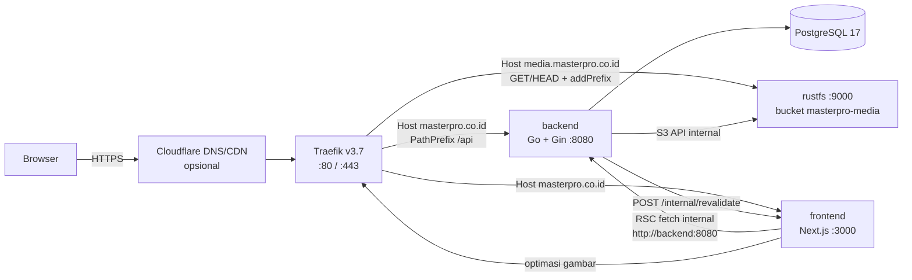
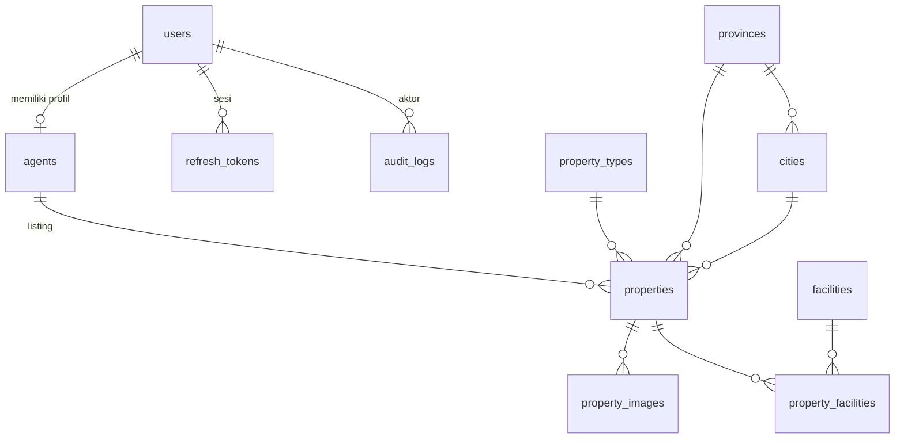
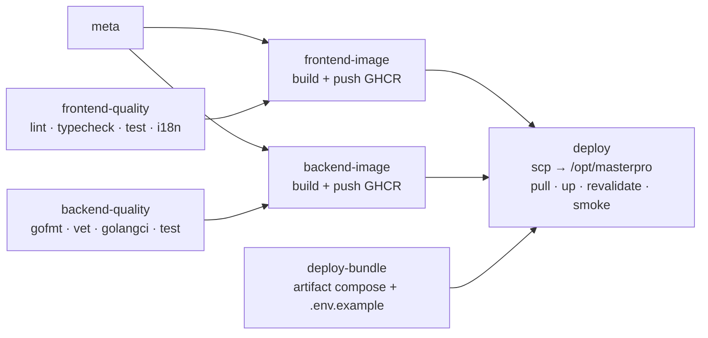

# PRD — MasterPro v1.0

|                           |                                                                                                           |
| ------------------------- | --------------------------------------------------------------------------------------------------------- |
| **Produk**          | MasterPro Real Estate — Website Katalog Properti + Dashboard                                             |
| **Domain**          | `masterpro.co.id` (publik), `masterpro.co.id/dashboard` (dashboard), `media.masterpro.co.id` (aset) |
| **Klien**           | MasterPro Real Estate                                                                                     |
| **Pelaksana**       | Tim Bidtech                                                                                               |
| **Versi dokumen**   | 1.0 (draft untuk review)                                                                                  |
| **Tanggal**         | 28 Oktober 2026                                                                                           |
| **Dokumen terkait** | [`API.md`](./API.md) · [`DESIGN.md`](./DESIGN.md) · [`../AGENTS.md`](../AGENTS.md)                   |

> **Status dokumen.** Bagian bertanda **[KETETAPAN]** bersifat baku. Mengubahnya wajib melalui Pull Request yang **pertama-tama mengubah dokumen ini** (docs-first), di-review minimal 1 orang, dan disetujui PM. Bagian bertanda **[KONFIRMASI KLIEN]** adalah asumsi yang menunggu jawaban MasterPro.

---

## Daftar Isi

1. [Ringkasan Produk](#1-ringkasan-produk)
2. [Tujuan &amp; Metrik Keberhasilan](#2-tujuan--metrik-keberhasilan)
3. [Pengguna &amp; Hak Akses](#3-pengguna--hak-akses)
4. [Ruang Lingkup v1](#4-ruang-lingkup-v1)
5. [Kebutuhan Fungsional — Website Katalog](#5-kebutuhan-fungsional--website-katalog)
6. [Kebutuhan Fungsional — Dashboard](#6-kebutuhan-fungsional--dashboard)
7. [Aturan Bisnis](#7-aturan-bisnis-ketetapan)
8. [Kebutuhan Non-Fungsional](#8-kebutuhan-non-fungsional)
9. [SEO, i18n &amp; Rendering](#9-seo-i18n--rendering-ketetapan)
10. [Arsitektur Sistem](#10-arsitektur-sistem-ketetapan)
11. [Tech Stack &amp; Versi](#11-tech-stack--versi-ketetapan)
12. [Struktur Proyek](#12-struktur-proyek-ketetapan)
13. [Desain Database](#13-desain-database-ketetapan)
14. [Environment Variables](#14-environment-variables-ketetapan)
15. [Containerization &amp; Traefik](#15-containerization--traefik-ketetapan)
16. [CI/CD GitHub Actions](#16-cicd-github-actions-ketetapan)
17. [Operasional](#17-operasional)
18. [Konvensi Kolaborasi](#18-konvensi-kolaborasi-ketetapan)
19. [Risiko &amp; Pertanyaan Terbuka](#19-risiko--pertanyaan-terbuka)
20. [Tahapan Pengerjaan](#20-tahapan-pengerjaan)

---

## 1. Ringkasan Produk

MasterPro adalah perusahaan yang menaungi banyak agen properti untuk **penjualan** properti *primary* (baru) dan *secondary* (bekas) — rumah, unit apartemen, ruko, gedung kos-kosan, lahan/tanah — serta **penyewaan** rumah, ruko, dan unit apartemen.

Versi pertama menghasilkan **dua produk** dalam satu repositori:

| Produk                        | URL                                                    | Pengguna    | Fungsi utama                                                                                |
| ----------------------------- | ------------------------------------------------------ | ----------- | ------------------------------------------------------------------------------------------- |
| **Website Katalog**     | `masterpro.co.id/id/...`, `masterpro.co.id/en/...` | Publik      | Mencari, melihat, dan menghubungi agen untuk properti dijual/disewa; informasi program agen |
| **Dashboard MasterPro** | `masterpro.co.id/dashboard`                          | Admin, Agen | Mengelola akun, agen, dan listing properti; ekspor laporan                                  |

Referensi produk: brighton.co.id, rumah123.com, pinhome.id, 99.co/id.

## 2. Tujuan & Metrik Keberhasilan

| Tujuan                                   | Metrik                                          | Target 3 bulan setelah rilis                  |
| ---------------------------------------- | ----------------------------------------------- | --------------------------------------------- |
| Katalog mudah ditemukan di mesin pencari | Halaman detail terindeks Google                 | ≥ 80% listing aktif                          |
| Website cepat                            | Core Web Vitals (p75, mobile)                   | LCP ≤ 2,5 dtk · INP ≤ 200 ms · CLS ≤ 0,1 |
| Menghasilkan prospek                     | Klik tombol WhatsApp per listing aktif          | Dipantau via `whatsapp_click_count`         |
| Agen mandiri mengelola listing           | Listing dibuat oleh agen (bukan admin)          | ≥ 70%                                        |
| Pelaporan rapi                           | Admin mengekspor laporan Excel tanpa olah ulang | 100% kolom siap pakai                         |

## 3. Pengguna & Hak Akses

### 3.1 Persona

- **Pengunjung (publik)** — calon pembeli/penyewa; mencari properti, membandingkan, menghitung KPR, menghubungi agen via WhatsApp. Juga calon agen yang ingin bergabung.
- **Agen** — mitra MasterPro; mengelola listing miliknya sendiri.
- **Admin** — staf MasterPro; mengelola seluruh akun, agen, dan listing.

### 3.2 Matriks Hak Akses **[KETETAPAN]**

| Aksi                                                   | Publik |       Agen       |           Admin           |
| ------------------------------------------------------ | :----: | :---------------: | :------------------------: |
| Melihat katalog & detail properti berstatus `active` |   ✅   |        ✅        |             ✅             |
| Login / logout / ubah profil & password sendiri        |   —   |        ✅        |             ✅             |
| Melihat daftar & detail akun (admin & agen)            |   —   |        —        |             ✅             |
| Membuat akun admin                                     |   —   |        —        |             ✅             |
| Membuat agen (sekaligus akun agen)                     |   —   |        —        |             ✅             |
| Mengedit akun / profil agen lain                       |   —   |        —        |             ✅             |
| Menonaktifkan / mengaktifkan akun                      |   —   |        —        | ✅ (bukan dirinya sendiri) |
| Mengganti password akun lain                           |   —   |        —        |             ✅             |
| Melihat listing                                        |   —   |   Milik sendiri   |           Semua           |
| Membuat listing                                        |   —   | Atas nama sendiri |  Atas nama agen mana pun  |
| Mengedit listing & mengubah status                     |   —   |   Milik sendiri   |           Semua           |
| Mengganti agen pemilik listing                         |   —   |        —        |             ✅             |
| Menghapus listing                                      |   —   |        —        |             ✅             |
| Ekspor Excel                                           |   —   |        —        |             ✅             |

## 4. Ruang Lingkup v1

### 4.1 Termasuk

- Website katalog bilingual (`/id`, `/en`): Beranda, Properti (katalog + pencarian + filter), Detail Properti, Daftar Agen, halaman 404.
- SEO teknis: metadata, Open Graph, JSON-LD, `robots.txt`, `sitemap.xml`, `llms.txt`, `llms-full.txt`, `/.well-known/security.txt`.
- Dashboard: autentikasi, manajemen pengguna, modul agen, modul properti (CRUD, status, foto), ekspor Excel, akun saya, ringkasan.
- Backend REST API Go, PostgreSQL, object storage RustFS, deployment Docker + Traefik + GitHub Actions.

### 4.2 Tidak termasuk (kandidat v2)

- Registrasi agen mandiri / formulir lamaran online (v1: kontak admin via WhatsApp).
- Lupa password via email (v1: admin yang mereset).
- Alur persetujuan (moderasi) listing oleh admin — **[KONFIRMASI KLIEN]**.
- Konten listing dwibahasa (v1: judul & deskripsi satu bahasa sesuai input agen; UI yang diterjemahkan).
- Halaman profil publik agen, favorit/simpan properti, akun pengunjung, perbandingan properti.
- Perhitungan komisi otomatis per transaksi (struktur komisi hanya ditampilkan sebagai informasi di halaman Daftar Agen).
- Manajemen konten (partner, banner, kontak) lewat dashboard — v1 dikelola sebagai konfigurasi di kode.
- Peta interaktif (v1: tautan "Lihat di Google Maps" bila koordinat diisi).
- Halaman landing SEO berbasis path (mis. `/id/properti/dijual/rumah/kota-batam`).

---

## 5. Kebutuhan Fungsional — Website Katalog

### 5.0 Peta URL **[KETETAPAN]**

| Halaman          | Bahasa Indonesia                                                           | English                   | Folder App Router                           |
| ---------------- | -------------------------------------------------------------------------- | ------------------------- | ------------------------------------------- |
| Beranda          | `/id`                                                                    | `/en`                   | `app/[locale]/page.tsx`                   |
| Katalog properti | `/id/properti`                                                           | `/en/properties`        | `app/[locale]/properties/page.tsx`        |
| Detail properti  | `/id/properti/{slug}`                                                    | `/en/properties/{slug}` | `app/[locale]/properties/[slug]/page.tsx` |
| Daftar Agen      | `/id/daftar-agen`                                                        | `/en/join-as-agent`     | `app/[locale]/join-agent/page.tsx`        |
| Root             | `/` → redirect 307 ke `/id` (atau `/en` sesuai `Accept-Language`) |                           | `proxy.ts` (next-intl)                    |

Pemetaan path lokal memakai konfigurasi `pathnames` next-intl di `src/i18n/routing.ts`.

**Parameter query katalog** (sama di kedua bahasa, tidak diterjemahkan): `listing` (`sale`\|`rent`), `market` (`primary`\|`secondary`), `type` (slug, boleh dipisah koma), `city` (slug), `province` (slug), `q`, `min_price`, `max_price`, `min_land_area`, `max_land_area`, `min_building_area`, `max_building_area`, `bedrooms` (minimum), `bathrooms` (minimum), `certificate`, `furnishing`, `sort`, `page`.

### 5.1 Elemen Global

| ID       | Kebutuhan                                                                                                                                                                                                                                                                                                                                                                                                                                                                                                                                                                               |
| -------- | --------------------------------------------------------------------------------------------------------------------------------------------------------------------------------------------------------------------------------------------------------------------------------------------------------------------------------------------------------------------------------------------------------------------------------------------------------------------------------------------------------------------------------------------------------------------------------------- |
| WEB-G-01 | **Header** sticky 80 px (desain Stitch): logo (ke beranda); menu *Beranda*, *Properti*, *Daftar Agen* (item aktif bergaris bawah biru); kanan: pengalih bahasa pill ID/EN (mempertahankan halaman & query yang sama) dan tombol primary *Masuk* → `/dashboard/login`. Mobile: menu hamburger (sheet).                                                                                                                                                                                                                                                                  |
| WEB-G-02 | **Footer** (desain Stitch): kolom brand (logo putih, tagline, alamat, telepon, email, ikon media sosial); kolom *Tipe Properti* (Rumah Dijual, Apartemen Disewa, Ruko, Gedung Kos, Tanah, Perumahan Baru/Primary — masing-masing tautan katalog berfilter); kolom *Kota Populer*; kolom *Perusahaan* (Beranda, Properti, Daftar Agen, Hubungi Kantor); baris hak cipta. Tautan *Tentang Kami*, *KPR Partner*, *Kebijakan Privasi*, *Syarat & Ketentuan* yang ada di desain **belum** dirender sampai halamannya masuk scope — **[KONFIRMASI KLIEN]**. |
| WEB-G-03 | Data kontak, alamat, & media sosial perusahaan dari `src/config/site.ts` — **[KONFIRMASI KLIEN]** isi final.                                                                                                                                                                                                                                                                                                                                                                                                                                                                   |
| WEB-G-04 | Semua teks UI berasal dari `messages/id.json` & `messages/en.json`. Tidak ada string UI hardcoded di komponen.                                                                                                                                                                                                                                                                                                                                                                                                                                                                      |
| WEB-G-05 | Format angka & mata uang mengikuti locale: `Rp 1,25 M`, `Rp 850 jt` (ringkas di kartu) dan `Rp 1.250.000.000` (lengkap di detail). Untuk `/en`: `IDR 1.25B`, `IDR 850M`.                                                                                                                                                                                                                                                                                                                                                                                                    |
| WEB-G-06 | Halaman 404 bilingual dengan tautan ke katalog dan beranda.                                                                                                                                                                                                                                                                                                                                                                                                                                                                                                                             |

### 5.2 Beranda

| ID       | Section                           | Kebutuhan                                                                                                                                                                                                                                                                                                                                                                                                                                                                                                                                                                      |
| -------- | --------------------------------- | ------------------------------------------------------------------------------------------------------------------------------------------------------------------------------------------------------------------------------------------------------------------------------------------------------------------------------------------------------------------------------------------------------------------------------------------------------------------------------------------------------------------------------------------------------------------------------ |
| WEB-H-01 | **Hero + Pencarian**        | Desain Stitch: foto full-bleed dengan overlay gradien navy; judul "Tanyakan Properti Impianmu ke *Master-nya Properti*" (aksen Playfair italic) + subjudul. Kotak pencarian putih: **Lokasi** (pilihan kota dari `GET /public/locations/cities?has_listings=true`), **Tipe Properti** (kategori), **Rentang Harga** (preset di `src/config/search.ts`), tombol *Cari Properti* → `/[locale]/properti?city=..&type=..&min_price=..&max_price=..`. Tanpa tab Beli/Sewa — hasil mencakup jual & sewa; filter Jual/Sewa tersedia di halaman katalog. |
| WEB-H-02 | **Properti Dijual Terbaru** | Carousel kartu ringkas (`listing=sale`, `sort=newest`, 10 item, 3 terlihat di desktop) dengan tombol panah & *Lihat Semua*. Kartu ringkas: foto 4:3, harga, judul, lokasi, tombol *Detail* dan *Hubungi Agen* (WhatsApp, §7.6).                                                                                                                                                                                                                                                                                                                                     |
| WEB-H-03 | **Properti Disewa Terbaru** | Sama dengan WEB-H-02 untuk `listing=rent`, latar `blue-50`, harga + "/bulan" atau "/tahun".                                                                                                                                                                                                                                                                                                                                                                                                                                                                                |
| WEB-H-04 | **Mitra Kami**              | *Infinite carousel* (marquee) logo partner: BCA, BTN, OCBC, Permata, Panin Bank. Berhenti saat hover, menghormati `prefers-reduced-motion`. Data dari `src/config/partners.ts`, logo SVG di `public/partners/`. **[KONFIRMASI KLIEN]** file logo resmi.                                                                                                                                                                                                                                                                                                          |
| WEB-H-05 | **CTA Properti Populer**    | Banner ajakan dengan tombol *Lihat Properti Populer* → `/[locale]/properti?sort=popular`.                                                                                                                                                                                                                                                                                                                                                                                                                                                                                 |
| WEB-H-06 | Kosong                            | Bila carousel tidak memiliki data, section disembunyikan (bukan ditampilkan kosong).                                                                                                                                                                                                                                                                                                                                                                                                                                                                                           |

### 5.3 Halaman Properti (Katalog & Hasil Pencarian)

| ID       | Kebutuhan                                                                                                                                                                                                                                                                                                  |
| -------- | ---------------------------------------------------------------------------------------------------------------------------------------------------------------------------------------------------------------------------------------------------------------------------------------------------------- |
| WEB-P-01 | Bar pencarian di atas (kata kunci, Beli/Sewa, tipe, lokasi) yang tersinkron dengan query URL.                                                                                                                                                                                                              |
| WEB-P-02 | **Filter**: tipe listing, pasar (primary/secondary), tipe properti (multi), kota/provinsi, rentang harga, rentang LT & LB, minimal KT & KM, sertifikat, furnishing. Desktop: sidebar kiri; mobile: tombol *Filter* membuka bottom sheet. Tombol *Reset filter*. Jumlah filter aktif ditampilkan. |
| WEB-P-03 | **Urutan**: Terbaru (default), Harga terendah, Harga tertinggi, Terpopuler, Luas tanah terbesar.                                                                                                                                                                                                     |
| WEB-P-04 | **Kartu properti**: foto cover (rasio 4:3), badge *Dijual/Disewa* & *Primary/Secondary*, tipe properti, judul, lokasi (kecamatan, kota), harga (+ "/bulan" atau "/tahun" untuk sewa), spesifikasi ringkas ikon (KT, KM, LT, LB sesuai tipe), jumlah foto. Seluruh kartu dapat diklik ke detail.  |
| WEB-P-05 | Jumlah hasil ("128 properti ditemukan"), chip filter aktif yang bisa dihapus satu per satu.                                                                                                                                                                                                                |
| WEB-P-06 | Paginasi bernomor (12 item/halaman) dengan URL `?page=n` (SEO-friendly, bukan infinite scroll).                                                                                                                                                                                                          |
| WEB-P-07 | State kosong dengan saran mengubah filter; state loading berupa skeleton.                                                                                                                                                                                                                                  |

### 5.4 Detail Properti

| ID       | Kebutuhan                                                                                                                                                                                                                                                                      |
| -------- | ------------------------------------------------------------------------------------------------------------------------------------------------------------------------------------------------------------------------------------------------------------------------------ |
| WEB-D-01 | Breadcrumb: Beranda › Properti › {Tipe} › {Judul}.                                                                                                                                                                                                                          |
| WEB-D-02 | **Galeri**: grid 1 foto besar + 4 foto kecil; tombol *Lihat semua foto (n)* membuka lightbox (geser, keyboard, swipe mobile). Mobile: carousel penuh dengan indikator.                                                                                                 |
| WEB-D-03 | Judul, badge (Dijual/Disewa, Primary/Secondary, Tipe), **kode listing**, lokasi, **harga** (+ label "Bisa nego" bila `is_price_negotiable`), tanggal tayang.                                                                                                     |
| WEB-D-04 | **Spesifikasi**: chip ringkas (KT, KM, LT, LB) + tabel lengkap (sertifikat, listrik, jumlah lantai, lantai unit, carport, garasi, furnishing, hadap, tahun dibangun, jumlah kamar kos, sumber air) — hanya field yang terisi.                                           |
| WEB-D-05 | **Deskripsi** (teks dengan baris baru dipertahankan, tombol *Baca selengkapnya* bila panjang) dan **fasilitas** (ikon + label).                                                                                                                                  |
| WEB-D-06 | **Kartu agen**: foto, nama, kode agen, tombol **Hubungi via WhatsApp** dengan pesan template otomatis (§7.6). Desktop: sidebar sticky; mobile: bar bawah sticky berisi harga + tombol WhatsApp. Klik tombol mengirim event `whatsapp_click` (§API).            |
| WEB-D-07 | **Simulasi KPR** (hanya `listing=sale`): input harga (terisi otomatis), DP (%), tenor (tahun), bunga (% p.a.); output plafon pinjaman, cicilan per bulan, total pembayaran, estimasi penghasilan minimum. Rumus di §7.7. Disclaimer "estimasi, bukan penawaran bank". |
| WEB-D-08 | Tautan *Lihat di Google Maps* bila `latitude/longitude` terisi; video (YouTube) tersemat bila `video_url` terisi.                                                                                                                                                        |
| WEB-D-09 | Tombol bagikan: salin tautan, bagikan via WhatsApp.                                                                                                                                                                                                                            |
| WEB-D-10 | **Properti serupa**: carousel 8 item (tipe & kota sama, harga ±30%, fallback tipe sama).                                                                                                                                                                                |
| WEB-D-11 | **CTA** di bawah (mis. "Punya properti untuk dijual? Hubungi kami" / "Bergabung jadi agen").                                                                                                                                                                             |
| WEB-D-12 | Event `view` dikirim sekali per kunjungan halaman (client-side, setelah render) untuk menghitung popularitas.                                                                                                                                                                |
| WEB-D-13 | Listing yang tidak `active` → 404.                                                                                                                                                                                                                                          |

### 5.5 Daftar Agen (Program Kemitraan)

| ID       | Kebutuhan                                                                                                                                                                                                                                                                                                                           |
| -------- | ----------------------------------------------------------------------------------------------------------------------------------------------------------------------------------------------------------------------------------------------------------------------------------------------------------------------------------- |
| WEB-A-01 | Hero: ajakan bergabung sebagai agen MasterPro + tombol *Daftar via WhatsApp* (pesan template ke admin).                                                                                                                                                                                                                           |
| WEB-A-02 | **Keuntungan** bergabung (4–6 poin berikon). **[KONFIRMASI KLIEN]** isi.                                                                                                                                                                                                                                               |
| WEB-A-03 | **Struktur komisi** dalam tabel responsif (data §7.8, dari `src/config/commission.ts`): komisi penjualan & penyewaan per rentang harga, serta persentase pembagian (Agen Selling, Agen Listing, Manager, Master Cool, MasterPro) dengan keterangan tiap peran.                                                             |
| WEB-A-04 | **Alur pendaftaran** sebagai flowchart visual (horizontal di desktop, vertikal di mobile). Draf alur **[KONFIRMASI KLIEN]**: (1) Hubungi admin → (2) Kirim data diri & dokumen → (3) Interview & orientasi → (4) Training produk & sistem → (5) Admin membuatkan akun dashboard → (6) Mulai listing & raih komisi. |
| WEB-A-05 | **Kontak perusahaan**: WhatsApp/telepon admin, email, alamat kantor (dengan tautan Google Maps), media sosial.                                                                                                                                                                                                                |
| WEB-A-06 | FAQ singkat (accordion) — opsional, **[KONFIRMASI KLIEN]** isi.                                                                                                                                                                                                                                                              |

---

## 6. Kebutuhan Fungsional — Dashboard

Dashboard berbahasa Indonesia (tidak dilokalisasi di v1), berada di `/dashboard`, `noindex`, dan seluruhnya dirender di sisi klien setelah autentikasi.

### 6.1 Modul Autentikasi

| ID      | Kebutuhan                                                                                                                                                                                  |
| ------- | ------------------------------------------------------------------------------------------------------------------------------------------------------------------------------------------ |
| AUTH-01 | Login dengan email + password di `/dashboard/login`. Pesan error generik ("Email atau password salah"). Akun `inactive` ditolak dengan pesan "Akun Anda dinonaktifkan, hubungi admin". |
| AUTH-02 | Sesi: access token JWT 15 menit + refresh token 7 hari, keduanya cookie `HttpOnly` (§10.5). Refresh otomatis & transparan.                                                              |
| AUTH-03 | Logout mencabut refresh token sesi saat ini dan menghapus cookie.                                                                                                                          |
| AUTH-04 | Rate limit login: 5 percobaan/menit per IP+email; ke-11 gagal dalam 15 menit mengunci email tsb. 15 menit.                                                                                 |
| AUTH-05 | "Lupa password?" menampilkan instruksi menghubungi admin (v1).                                                                                                                             |
| AUTH-06 | Halaman `/dashboard/*` selain login mengarahkan ke login bila tidak ada sesi; setelah login kembali ke URL semula (`?next=`).                                                          |

### 6.2 Manajemen Pengguna (Admin)

| ID     | Kebutuhan                                                                                                                                        |
| ------ | ------------------------------------------------------------------------------------------------------------------------------------------------ |
| USR-01 | Daftar akun (admin & agen): pencarian nama/email, filter peran & status, paginasi. Kolom: nama, email, peran, status, login terakhir, dibuat.    |
| USR-02 | Tambah akun **admin** (nama, email, telepon, password awal). Akun agen dibuat lewat modul Agen (USR tidak membuat agen).                   |
| USR-03 | Edit akun (nama, email, telepon). Email unik (case-insensitive).                                                                                 |
| USR-04 | Nonaktifkan / aktifkan akun. Tidak bisa menonaktifkan diri sendiri; minimal harus ada 1 admin aktif. Menonaktifkan mencabut semua sesi akun tsb. |
| USR-05 | Ganti password akun lain (tanpa password lama) → semua sesi akun tsb. dicabut.                                                                  |
| USR-06 | Setiap aksi pada USR-02..05 dicatat di `audit_logs`.                                                                                           |

### 6.3 Akun Saya (Semua Peran)

| ID     | Kebutuhan                                                                                                                     |
| ------ | ----------------------------------------------------------------------------------------------------------------------------- |
| ACC-01 | Edit profil: nama, telepon, foto (avatar). Agen juga: nomor WhatsApp, bio, area layanan. Email hanya dapat diubah oleh admin. |
| ACC-02 | Ubah password: password lama, password baru, konfirmasi. Sesi lain dicabut, sesi saat ini tetap.                              |

### 6.4 Modul Agen (Admin)

| ID     | Kebutuhan                                                                                                                                                                                                                   |
| ------ | --------------------------------------------------------------------------------------------------------------------------------------------------------------------------------------------------------------------------- |
| AGT-01 | Daftar agen: foto, kode agen, nama, email, WhatsApp, status akun, jumlah listing per status, tanggal bergabung. Pencarian & filter status.                                                                                  |
| AGT-02 | **Tambah agen** dalam satu formulir & satu transaksi DB: data akun (nama, email, telepon, password awal) + profil agen (WhatsApp, bio, area layanan, tanggal bergabung, foto). Kode agen `AG-0001` dibuat otomatis. |
| AGT-03 | Detail agen: profil + tab **Listing** (tabel listing milik agen, memakai filter `agent_id` pada modul properti).                                                                                                    |
| AGT-04 | Edit profil agen; aktif/nonaktif & reset password memakai aksi USR.                                                                                                                                                         |

### 6.5 Modul Properti

| ID     | Peran       | Kebutuhan                                                                                                                                                                                                                             |
| ------ | ----------- | ------------------------------------------------------------------------------------------------------------------------------------------------------------------------------------------------------------------------------------- |
| PRP-01 | Admin, Agen | Daftar listing (admin: semua; agen: miliknya). Kolom: thumbnail, kode, judul, tipe, Jual/Sewa, harga, kota, agen (admin), status, dilihat, klik WA, diperbarui.                                                                       |
| PRP-02 | Admin, Agen | Pencarian (judul/kode/alamat) dan filter: status, tipe listing, pasar, tipe properti, kota, rentang harga, rentang tanggal dibuat, agen (admin). Filter tersimpan di query URL.                                                       |
| PRP-03 | Admin, Agen | Tambah listing: formulir bertahap (Informasi dasar → Harga → Lokasi → Spesifikasi dinamis per tipe → Fasilitas → Foto). Simpan sebagai **Draf** atau **Tayangkan**. Admin wajib memilih agen; agen otomatis dirinya. |
| PRP-04 | Admin, Agen | Foto: unggah multi (drag & drop, maks 20, maks 10 MB/foto, JPG/PNG/WebP), progress per file, urutkan ulang (drag), pilih cover, hapus.                                                                                                |
| PRP-05 | Admin, Agen | Edit listing (semua field kecuali kode & slug).                                                                                                                                                                                       |
| PRP-06 | Admin, Agen | Ubah status sesuai §7.2 (mis. *Terjual*, *Tersewa*, *Nonaktif*, tayangkan ulang). Konfirmasi dialog.                                                                                                                           |
| PRP-07 | Admin       | Ganti agen pemilik listing.                                                                                                                                                                                                           |
| PRP-08 | Admin       | Hapus listing (soft delete) dengan dialog konfirmasi ketik kode listing.                                                                                                                                                              |
| PRP-09 | Admin       | **Ekspor Excel** sesuai filter aktif (§6.6).                                                                                                                                                                                   |
| PRP-10 | Admin, Agen | Tombol *Lihat di website* untuk listing `active`.                                                                                                                                                                                 |
| PRP-11 | Sistem      | Setiap perubahan listing memicu revalidasi cache halaman publik terkait (§10.4).                                                                                                                                                     |

### 6.6 Spesifikasi Ekspor Excel **[KETETAPAN]**

Dibuat di backend dengan `excelize`, `GET /api/v1/properties/export` (filter sama dengan daftar). Nama file: `masterpro-properti-YYYYMMDD-HHmm.xlsx` (WIB). Batas 10.000 baris per ekspor.

**Sheet 1 — "Daftar Properti"**

- Baris 1: judul "Laporan Data Properti — MasterPro Real Estate" (bold 14pt, merge).
- Baris 2: "Dibuat: {tanggal jam WIB} oleh {nama admin}". Baris 3: "Filter: {ringkasan filter atau 'Semua'}".
- Baris 5: header — latar navy `#0D2B6B`, teks putih bold, rata tengah, wrap.
- Kolom: No · Kode · Judul · Jual/Sewa · Pasar · Tipe Properti · Provinsi · Kota · Kecamatan · Alamat · Harga (Rp) · Periode Sewa · Nego · LT (m²) · LB (m²) · KT · KM · Sertifikat · Furnishing · Status · Agen · Kode Agen · WhatsApp Agen · Dilihat · Klik WA · Tayang · Ditutup · Dibuat · Diperbarui · URL Publik.
- Format: harga `#,##0`; luas `#,##0.00`; tanggal `dd/mm/yyyy hh:mm`; baris zebra abu sangat muda; border tipis; freeze pane di bawah header; autofilter; lebar kolom disesuaikan; kolom Status diwarnai sesuai status.
- Baris akhir: total listing & total nilai harga listing *sale* yang berstatus `active`.

**Sheet 2 — "Ringkasan"**: jumlah listing per status, per tipe properti, per Jual/Sewa, dan per agen (agen × status).

---

## 7. Aturan Bisnis **[KETETAPAN]**

### 7.1 Tipe Properti

| Slug          | Nama ID / EN                | Boleh dijual | Boleh disewa |
| ------------- | --------------------------- | :----------: | :----------: |
| `rumah`     | Rumah / House               |      ✅      |      ✅      |
| `apartemen` | Apartemen / Apartment       |      ✅      |      ✅      |
| `ruko`      | Ruko / Shophouse            |      ✅      |      ✅      |
| `kos`       | Gedung Kos / Boarding House |      ✅      |      —      |
| `tanah`     | Tanah / Land                |      ✅      |      —      |

### 7.2 Status Listing & Transisi

| Status       | Label                    | Tampil publik |
| ------------ | ------------------------ | :-----------: |
| `draft`    | Draf                     |      —      |
| `active`   | Tayang                   |      ✅      |
| `sold`     | Terjual (hanya `sale`) |      —      |
| `rented`   | Tersewa (hanya `rent`) |      —      |
| `inactive` | Nonaktif (disembunyikan) |      —      |

Transisi yang diizinkan (agen pada listing miliknya, admin pada semua):

```
draft    → active | inactive
active   → sold (sale) | rented (rent) | inactive
inactive → active
sold     → active        (hanya admin — relisting)
rented   → active        (agen & admin — unit kembali tersedia)
```

- `active` mensyaratkan: ≥ 1 foto dengan cover, dan semua field wajib per tipe (§7.4) terisi. Saat pertama `active`, `published_at` diisi.
- `sold`/`rented` mengisi `closed_at`; kembali ke `active` mengosongkan `closed_at`.
- **Visibilitas publik** = `status = 'active'` **dan** `deleted_at IS NULL` **dan** akun agen pemilik `active`. Agen dinonaktifkan → listing-nya otomatis tidak tampil sampai dialihkan admin (PRP-07) atau agen diaktifkan lagi.

### 7.3 Identitas Listing

- `code`: `MP-` + 6 digit dari sequence (`MP-000123`), tidak bisa diubah.
- `slug`: `kebab(judul, maks 80 karakter)-{6 karakter acak base36}`, mis. `rumah-minimalis-batam-centre-k3x9q2`. Dibuat sekali saat create, **tidak berubah** walau judul diedit (menjaga tautan & SEO).

### 7.4 Field per Tipe Properti

W = wajib · O = opsional · – = tidak dipakai (disimpan `NULL`, disembunyikan di form)

| Field                                 |              rumah              | apartemen | ruko | kos | tanah |
| ------------------------------------- | :------------------------------: | :-------: | :--: | :-: | :---: |
| `land_area` (LT, m²)               |                W                |    –    |  W  |  W  |   W   |
| `building_area` (LB/luas unit, m²) |                W                |     W     |  W  |  W  |  –  |
| `bedrooms`                          |                W                |     W     |  O  | – |  –  |
| `bathrooms`                         |                W                |     W     |  O  |  O  |  –  |
| `maid_bedrooms`                     |                O                |     O     |  –  | – |  –  |
| `floors` (jumlah lantai)            |                O                |    –    |  W  |  O  |  –  |
| `floor_level` (lantai unit)         |                –                |     O     |  –  | – |  –  |
| `total_rooms` (jumlah kamar kos)    |                –                |    –    |  –  |  W  |  –  |
| `carports`, `garages`             |                O                |     O     |  O  |  O  |  –  |
| `electricity_va`                    |                O                |     O     |  O  |  O  |  –  |
| `water_source`                      |                O                |    –    |  O  |  O  |  –  |
| `furnishing`                        |                O                |     O     |  O  |  O  |  –  |
| `facing`                            |                O                |     O     |  O  |  O  |   O   |
| `year_built`                        |                O                |     O     |  O  |  O  |  –  |
| `certificate`                       | W jika `sale`, O jika `rent` |    ←    |  ←  | ← |  ←  |

Field umum wajib: `listing_type`, `market_type`, `property_type`, `title` (10–160 karakter), `description` (≥ 50 karakter), `price` (> 0), `rent_period` (wajib jika `rent`), `province`, `city`, `agent`. Opsional: `district`, `address`, `latitude`, `longitude`, `video_url` (YouTube), `facilities`, `is_price_negotiable`.

### 7.5 Harga & Satuan

- Harga disimpan `BIGINT` dalam **rupiah utuh** (tanpa desimal). Sewa memiliki `rent_period` = `monthly` | `yearly`.
- Luas dalam m², `NUMERIC(10,2)`.

### 7.6 Template WhatsApp

Nomor disimpan format internasional tanpa `+` (mis. `6281234567890`). URL: `https://wa.me/{nomor}?text={urlencode(pesan)}`. Dibuat di `src/lib/whatsapp.ts`.

- **ID**: `Halo {nama_agen}, saya tertarik dengan properti "{judul}" (Kode: {kode}) seharga {harga_lengkap} di {kota}. Apakah masih tersedia? {url_detail}`
- **EN**: `Hi {agent_name}, I'm interested in the property "{title}" (Code: {code}) priced at {full_price} in {city}. Is it still available? {detail_url}`
- **Daftar agen (ke admin)**: `Halo Admin MasterPro, saya ingin mendaftar sebagai agen properti MasterPro. Nama saya: ...`

### 7.7 Simulasi KPR

Default di `src/config/kpr.ts` — **[KONFIRMASI KLIEN]**: DP 20% (rentang 0–90%), tenor 15 tahun (1–30), bunga 7,5% p.a. (1–20%), rasio cicilan maksimum 30% penghasilan.

```
pokok  P = harga × (1 − DP%)
r      = bunga_tahunan / 12
n      = tenor_tahun × 12
cicilan_bulanan M = P × r / (1 − (1 + r)^−n)        (jika r = 0 → M = P / n)
total_bayar      = M × n
penghasilan_min  = M / 0,30
```

Semua dibulatkan ke rupiah terdekat. Fungsi murni di `src/lib/kpr.ts` dengan unit test.

### 7.8 Struktur Komisi (konten halaman Daftar Agen)

Sumber: materi "Komisi Agen" MasterPro. Disimpan di `src/config/commission.ts`.

| Komisi Penjualan (harga jual) | Komisi |
| ----------------------------- | ------ |
| Di bawah Rp 1 miliar          | 3%     |
| Rp 1 – 3 miliar              | 2,5%   |
| Di atas Rp 3 miliar           | 2%     |

| Komisi Penyewaan (harga sewa) | Komisi |
| ----------------------------- | ------ |
| Di bawah Rp 25 juta           | 10%    |
| > Rp 25 – 50 juta            | 7,5%   |
| Di atas Rp 50 juta            | 5%     |

| Pembagian komisi (jual & sewa) | Porsi | Keterangan                                                       |
| ------------------------------ | ----- | ---------------------------------------------------------------- |
| Agen Selling                   | 40%   | Agen yang melakukan penjualan (mendapatkan pembeli)              |
| Agen Listing                   | 30%   | Agen yang mendapatkan persetujuan penjual untuk menjual properti |
| Manager                        | 5%    | Pendamping agen dalam proses jual/beli                           |
| Master Cool                    | 5%    | Pemilik tempat di mana MasterPro berkantor                       |
| MasterPro                      | 20%   | Perusahaan yang membiayai operasional kantor                     |

**[KONFIRMASI KLIEN]**: (a) batas tepat Rp 1 M dan Rp 3 M masuk tier mana; (b) apakah ada tarif khusus daerah (materi referensi Brighton mencantumkan Bali: jual 5%, sewa 10%) yang juga berlaku di MasterPro.

---

## 8. Kebutuhan Non-Fungsional

| Kategori                 | Kebutuhan                                                                                                                                                                                                                                                                                                                                                  |
| ------------------------ | ---------------------------------------------------------------------------------------------------------------------------------------------------------------------------------------------------------------------------------------------------------------------------------------------------------------------------------------------------------- |
| **Performa**       | Core Web Vitals p75 mobile: LCP ≤ 2,5 dtk, INP ≤ 200 ms, CLS ≤ 0,1. Lighthouse Performance ≥ 90 (mobile) untuk Beranda & Detail. API publik p95 ≤ 300 ms pada 10.000 listing.                                                                                                                                                                         |
| **SEO**            | Lihat §9. Lighthouse SEO = 100 pada halaman publik.                                                                                                                                                                                                                                                                                                       |
| **Aksesibilitas**  | WCAG 2.1 AA: kontras, label form, fokus terlihat, navigasi keyboard (carousel, lightbox, dialog), `alt` foto = judul + urutan.                                                                                                                                                                                                                           |
| **Keamanan**       | bcrypt cost 12; password min 8 karakter berisi huruf & angka; cookie `HttpOnly`/`Secure`/`SameSite=Lax`; header wajib `X-Requested-With` untuk request mutasi; rate limit; validasi upload berdasarkan *magic bytes*; metadata EXIF (termasuk GPS) dibuang; query ter-parameterisasi (GORM); tidak ada secret di repo; log tanpa password/token. |
| **Keandalan**      | Satu VPS, *best effort*. Backup DB harian + object storage harian ke lokasi di luar VPS. RPO 24 jam, RTO 4 jam.                                                                                                                                                                                                                                          |
| **Kompatibilitas** | 2 versi terakhir Chrome, Edge, Firefox, Safari (macOS/iOS), Samsung Internet. Lebar layar 360 px – 1920 px.                                                                                                                                                                                                                                               |
| **Observabilitas** | Log JSON terstruktur (`log/slog`) dengan `request_id`; access log Traefik JSON; rotasi log Docker (10 MB × 3).                                                                                                                                                                                                                                        |
| **Privasi**        | Hanya data agen yang ditampilkan publik: nama, foto, kode agen, nomor WhatsApp. Email & telepon pribadi tidak diekspos API publik.                                                                                                                                                                                                                         |

## 9. SEO, i18n & Rendering **[KETETAPAN]**

### 9.1 i18n

- Library: **next-intl**. Locale: `id` (default), `en`. `localePrefix: 'always'`. Deteksi bahasa hanya saat mengakses `/`.
- Pesan UI: `frontend/messages/{id,en}.json` dengan namespace per halaman (`common`, `home`, `properties`, `propertyDetail`, `joinAgent`, `seo`). Kunci camelCase. Kedua file wajib memiliki kunci identik (dicek di CI oleh unit test).
- Konten listing (judul, deskripsi) tidak diterjemahkan di v1; label referensi (tipe properti, fasilitas) memakai `name_id`/`name_en` dari API.

### 9.2 Rendering & Cache

Next.js 16 App Router, `output: 'standalone'`. Fitur `cacheComponents` **tidak** diaktifkan di v1; strategi memakai ISR berbasis segment `revalidate` + fetch berlabel tag.

| Halaman                                          | Strategi                                                                     | Revalidate | Tag fetch                                |
| ------------------------------------------------ | ---------------------------------------------------------------------------- | ---------- | ---------------------------------------- |
| Beranda                                          | ISR                                                                          | 300 dtk    | `properties:list`, `reference`       |
| Katalog `/properti`                            | Dinamis (membaca `searchParams`), data fetch di-cache                      | 60 dtk     | `properties:list`                      |
| Detail `/properti/{slug}`                      | ISR on-demand (`generateStaticParams` → `[]`, `dynamicParams = true`) | 3600 dtk   | `property:{slug}`, `properties:list` |
| Daftar Agen                                      | Statis (SSG)                                                                 | —         | —                                       |
| `sitemap.xml`, `llms.txt`, `llms-full.txt` | ISR                                                                          | 3600 dtk   | `properties:list`                      |
| Dashboard                                        | Client-side rendering                                                        | —         | —                                       |

**Build tanpa API:** saat `next build` di CI, API tidak tersedia. Lapisan `src/lib/api/server.ts` mengembalikan data kosong bila `process.env.NEXT_PHASE === 'phase-production-build'`. Karena halaman hasil build belum memiliki tag, setelah deploy pipeline memanggil `POST /internal/revalidate` dengan `{"all": true}` (→ `revalidatePath("/", "layout")`) sehingga seluruh halaman diregenerasi dengan data nyata; regenerasi berikutnya mencatat tag sehingga revalidasi per-tag dari backend berlaku.

### 9.3 Metadata

- Setiap halaman memakai `generateMetadata`: `title` (template `%s | MasterPro Real Estate`), `description`, `alternates.canonical`, `alternates.languages` (`id-ID`, `en-US`, `x-default` → versi `/id`), Open Graph (`og:image` = cover listing atau `public/brand/og-default.jpg` 1200×630), Twitter card `summary_large_image`.
- Halaman katalog dengan filter: `canonical` ke URL tanpa query kecuali `listing`, `type`, `city`, `page`; kombinasi filter lain diberi `robots: noindex, follow`.
- Dashboard & `/internal/*`: `noindex, nofollow`.

### 9.4 Data Terstruktur (JSON-LD)

| Halaman     | Schema                                                                                                                              |
| ----------- | ----------------------------------------------------------------------------------------------------------------------------------- |
| Semua       | `Organization` + `RealEstateAgent` (nama, logo, alamat, kontak, sosmed) di layout                                               |
| Beranda     | `WebSite` + `SearchAction` (`/id/properti?q={search_term_string}`)                                                            |
| Katalog     | `ItemList` (URL listing di halaman) + `BreadcrumbList`                                                                          |
| Detail      | `RealEstateListing` (name, url, image[], datePosted, `offers`: price, priceCurrency `IDR`, availability) + `BreadcrumbList` |
| Daftar Agen | `FAQPage` (bila FAQ ada) + `BreadcrumbList`                                                                                     |

### 9.5 File SEO & Keamanan

| File                          | Implementasi                        | Isi                                                                                                                                                                                                                                                                          |
| ----------------------------- | ----------------------------------- | ---------------------------------------------------------------------------------------------------------------------------------------------------------------------------------------------------------------------------------------------------------------------------- |
| `/robots.txt`               | `app/robots.ts`                   | `Allow: /`; `Disallow: /dashboard`, `/api/`, `/internal/`; `Sitemap: https://masterpro.co.id/sitemap.xml`                                                                                                                                                          |
| `/sitemap.xml`              | `app/sitemap.ts`                  | Halaman statis × 2 locale + semua listing aktif (dari `GET /public/sitemap/properties`), `lastModified` = `updated_at`, `alternates.languages`. Pakai `generateSitemaps` bila > 45.000 URL.                                                                       |
| `/llms.txt`                 | `app/llms.txt/route.ts`           | Format llmstxt.org: `# MasterPro Real Estate`, ringkasan perusahaan, bagian *Halaman utama*, *Tipe properti*, *Kota*, tautan ke `llms-full.txt`.                                                                                                                   |
| `/llms-full.txt`            | `app/llms-full.txt/route.ts`      | Markdown: profil perusahaan, cara mencari & menghubungi agen, program agen & komisi, lalu daftar listing aktif (judul, kode, tipe, harga, lokasi, spesifikasi ringkas, URL), maks 2.000 listing terbaru.                                                                     |
| `/.well-known/security.txt` | `public/.well-known/security.txt` | `Contact: mailto:security@masterpro.co.id`, `Expires:` (≤ 1 tahun, diperbarui tiap rilis tahunan), `Preferred-Languages: id, en`, `Canonical: https://masterpro.co.id/.well-known/security.txt`, `Policy:` (opsional). **[KONFIRMASI KLIEN]** alamat email. |

### 9.6 Optimasi Gambar

- Semua gambar memakai `next/image`. `next.config.ts`:

```ts
images: {
  formats: ['image/webp'],
  deviceSizes: [640, 750, 828, 1080, 1200, 1920],
  imageSizes: [96, 128, 256, 384],
  qualities: [60, 75, 85],
  minimumCacheTTL: 2678400, // 31 hari; object key immutable
  remotePatterns: [{ protocol: 'https', hostname: 'media.masterpro.co.id' }, { protocol: 'http', hostname: 'media.localhost' }],
},
```

- Cache optimizer disimpan di volume `frontend_cache` (`/app/.next/cache`).
- Pipeline unggah di backend (§10.6) sudah mengonversi foto ke WebP, sehingga optimizer Next.js hanya me-resize per lebar layar.
- Foto di atas lipatan (hero, foto pertama galeri, 2 kartu pertama) memakai `priority`/`fetchPriority="high"`; lainnya lazy; `sizes` wajib diisi; placeholder warna latar (bukan blur base64) untuk menghemat payload.

---

## 10. Arsitektur Sistem **[KETETAPAN]**

### 10.1 Gambaran Umum



- **Satu domain, routing berdasarkan path**: `masterpro.co.id/api/*` → backend; sisanya → frontend. Cookie sesi otomatis *same-origin*, tanpa CORS di produksi.
- **Media** di subdomain `media.masterpro.co.id`, dilayani langsung oleh RustFS lewat Traefik (hanya GET/HEAD; bucket publik baca-saja untuk objek, tanpa listing).
- Server Components Next.js mengambil data via jaringan Docker internal (`INTERNAL_API_URL=http://backend:8080`), tidak lewat internet.
- Traefik diberi network alias `media.masterpro.co.id` (produksi) / `media.localhost` (lokal) sehingga optimizer gambar Next.js mengambil foto tanpa keluar jaringan.

### 10.2 Frontend

- Next.js 16 App Router + TypeScript strict + Tailwind CSS v4 + shadcn/ui (Radix) + lucide-react.
- Dua root layout: `app/[locale]/layout.tsx` (website) dan `app/dashboard/layout.tsx` (dashboard). Tidak ada `app/layout.tsx`.
- `src/proxy.ts` (pengganti `middleware.ts` di Next.js 16): menjalankan routing next-intl untuk path publik, dan memeriksa keberadaan cookie sesi untuk `/dashboard/*` (validasi sebenarnya tetap di API).
- Dashboard: TanStack Query (data server), React Hook Form + Zod (form), TanStack Table (tabel), dnd-kit (urutan foto), sonner (toast).
- Komunikasi API: `src/lib/api/server.ts` (server, dengan `next: { revalidate, tags }`) dan `src/lib/api/client.ts` (browser, `credentials: 'include'`, header `X-Requested-With`, retry sekali setelah `POST /auth/refresh` bila 401 `TOKEN_EXPIRED`).

### 10.3 Backend

Arsitektur modular berlapis per modul:

```
HTTP (Gin) → handler → service → repository → GORM → PostgreSQL
                         │
                         ├── storage (RustFS via minio-go)
                         ├── imaging (decode/resize/WebP)
                         ├── revalidate (client ke frontend)
                         └── audit (pencatatan aksi)
```

- **handler**: binding & validasi request (DTO + `go-playground/validator`), memanggil service, menulis respons standar. Tidak boleh mengakses GORM.
- **service**: aturan bisnis, otorisasi level data (kepemilikan listing), transaksi DB. Bergantung pada *interface* repository.
- **repository**: query GORM; satu-satunya lapisan yang menyentuh `*gorm.DB`.
- Antar-modul hanya lewat interface service, tidak saling memanggil repository modul lain.
- Migrasi DB: **golang-migrate** dengan file SQL ter-embed; dijalankan otomatis saat start bila `RUN_MIGRATIONS=true` (advisory lock mencegah eksekusi ganda). `AutoMigrate` GORM **dilarang**.

### 10.4 Revalidasi Cache

Setelah create/update/status/delete listing atau perubahan profil agen, service backend memanggil (asinkron, retry 3× dengan backoff):

```
POST http://frontend:3000/internal/revalidate
X-Revalidate-Secret: ${REVALIDATE_SECRET}
{"tags": ["properties:list", "property:<slug>"]}        // atau {"all": true} untuk seluruh situs
```

Route handler `app/internal/revalidate/route.ts` memverifikasi secret (perbandingan *constant-time*) lalu menjalankan `revalidateTag(tag, { expire: 0 })` per tag (sesuaikan bila signature Next.js berubah). Path `/internal/*` diblokir dari publik oleh Traefik (§15.3). Untuk profil agen: tag semua slug listing milik agen tsb.

### 10.5 Autentikasi & Sesi

| Item            | Ketetapan                                                                                                                                                             |
| --------------- | --------------------------------------------------------------------------------------------------------------------------------------------------------------------- |
| Hash password   | bcrypt, cost 12                                                                                                                                                       |
| Access token    | JWT HS256, TTL 15 menit, klaim: `sub` (user id), `role`, `sid` (id refresh token/sesi), `iss=masterpro-api`, `aud=masterpro-dashboard`, `iat`, `exp`    |
| Refresh token   | 32 byte acak (base64url), TTL 7 hari, disimpan sebagai SHA-256 di `refresh_tokens`, **rotasi** setiap refresh; reuse token lama → seluruh *family* dicabut |
| Cookie          | `mp_access` (Path `/`, Max-Age 900) dan `mp_refresh` (Path `/api/v1/auth`, Max-Age 604800); `HttpOnly`, `Secure` (produksi), `SameSite=Lax`             |
| CSRF            | `SameSite=Lax` + request non-GET wajib header `X-Requested-With: XMLHttpRequest` (ditolak 403 bila tidak ada)                                                     |
| Status akun     | Middleware memeriksa `users.status` setiap request terautentikasi (akun nonaktif langsung tertolak walau token belum kedaluwarsa)                                   |
| Pencabutan sesi | Logout, ganti/reset password, nonaktif akun → `revoked_at` diisi                                                                                                   |

### 10.6 Pipeline Unggah Foto

1. `POST /api/v1/properties/{id}/images` (multipart, `files[]`), batas body 60 MB per request, maks 10 MB per file.
2. Validasi tipe dari *magic bytes* (JPEG, PNG, WebP); tolak lainnya (415). Dimensi minimal 600 px sisi terpendek.
3. Decode → auto-orientasi EXIF → resize sisi terpanjang maks 2400 px (Lanczos) → encode **WebP kualitas 82** → metadata dibuang.
4. Simpan ke RustFS: `properties/{property_id}/{uuidv7}.webp`, `Content-Type: image/webp`, `Cache-Control: public, max-age=31536000, immutable`.
5. Simpan baris `property_images` (key, width, height, size). Foto pertama otomatis menjadi cover.
6. Avatar: `avatars/{user_id}/{uuidv7}.webp`, crop persegi 512 px.
7. Hapus foto → hapus objek dari RustFS + baris DB.

Library: `github.com/disintegration/imaging` (resize/orientasi), `golang.org/x/image/webp` (decode), `github.com/gen2brain/webp` (encode WebP tanpa cgo).

### 10.7 Object Storage (RustFS)

- Image `rustfs/rustfs:1.0.4` (rilis stabil 1.0.x; GA 16 Sep 2026). Tag dipin, upgrade lewat PR.
- Satu bucket `masterpro-media`. Saat start, backend memastikan bucket ada dan memasang *bucket policy* `s3:GetObject` anonim untuk `arn:aws:s3:::masterpro-media/*` (tanpa `ListBucket`).
- Container berjalan sebagai UID 10001; service init `rustfs-perms` melakukan `chown` volume data sebelum RustFS start.
- Console RustFS (:9001) **tidak** diekspos publik di produksi; akses via SSH tunnel.

---

## 11. Tech Stack & Versi **[KETETAPAN]**

| Lapisan               | Teknologi                                                                                                                          | Versi (pin minor)                            |
| --------------------- | ---------------------------------------------------------------------------------------------------------------------------------- | -------------------------------------------- |
| Runtime frontend      | Node.js                                                                                                                            | 24 LTS (`node:24-alpine`)                  |
| Package manager       | pnpm (via corepack)                                                                                                                | 10.x, `packageManager` di `package.json` |
| Framework             | Next.js (App Router, standalone, `proxy.ts`)                                                                                     | 16.4.x                                       |
| UI                    | React 19.3, Tailwind CSS 4.3, shadcn/ui (`components.json`), lucide-react 1.x, embla-carousel 8                                  |                                              |
| i18n                  | next-intl                                                                                                                          | 4.14.x                                       |
| Data & form           | Zod 4 (terpasang); TanStack Query 5, TanStack Table 8, React Hook Form 7, dnd-kit, sonner (dipasang saat modul dashboard dibangun) |                                              |
| Test FE               | Vitest 5 (+ Testing Library saat ada test komponen)                                                                                |                                              |
| Lint FE               | ESLint 9 (flat config, `eslint-config-next` 16), Prettier 3 (+ plugin Tailwind), TypeScript 5.9                                  |                                              |
| Bahasa backend        | Go                                                                                                                                 | 1.26.x (`golang:1.26-alpine`)              |
| HTTP                  | Gin                                                                                                                                | 1.12.x                                       |
| ORM                   | GORM + driver `gorm.io/driver/postgres`                                                                                          | 1.31.x / 1.6.x                               |
| Auth                  | `golang.org/x/crypto/bcrypt`, `github.com/golang-jwt/jwt/v5`                                                                   |                                              |
| Migrasi               | `github.com/golang-migrate/migrate/v4` (driver pgx5)                                                                             | 4.20.x                                       |
| Validasi              | `github.com/go-playground/validator/v10`                                                                                         |                                              |
| Storage client        | `github.com/minio/minio-go/v7`                                                                                                   | 7.4.x                                        |
| Excel                 | `github.com/xuri/excelize/v2`                                                                                                    |                                              |
| Lint BE               | golangci-lint v2.15                                                                                                                |                                              |
| Hot reload BE (lokal) | air                                                                                                                                |                                              |
| Database              | PostgreSQL                                                                                                                         | 17 (`postgres:17-alpine`)                  |
| Object storage        | RustFS                                                                                                                             | 1.0.4                                        |
| Reverse proxy         | Traefik                                                                                                                            | v3.7                                         |
| Runtime image BE      | `gcr.io/distroless/static-debian12:nonroot`                                                                                      |                                              |
| CI/CD                 | GitHub Actions, GHCR                                                                                                               |                                              |

> Versi di atas adalah patokan per 28 Okt 2026. Kenaikan **mayor** wajib lewat PR terpisah yang memperbarui tabel ini.

---

## 12. Struktur Proyek **[KETETAPAN]**

Struktur di bawah **baku**. Tidak boleh menambah folder level atas, memindahkan, atau mengganti nama folder tanpa PR docs-first. File baru wajib ditempatkan sesuai aturan §12.4.

### 12.1 Root

```
.
├── .github/
│   └── workflows/
│       └── masterpro.yml          # satu-satunya workflow CI/CD
├── frontend/                       # Next.js (website + dashboard)
├── backend/                        # Go API
├── docs/
│   ├── PRD.md                      # dokumen ini
│   ├── API.md                      # kontrak API
│   ├── DESIGN.md                   # design system & prompt desain
│   └── stitch/                     # ekspor Google Stitch (referensi, read-only): DESIGN.stitch.md, home.html, home.png
├── docker-compose.yml              # lokal (development)
├── docker-compose.prod.yml         # produksi (semua service; memakai Traefik yang sudah ada di VPS)
├── .env.example                    # daftar lengkap env (tanpa nilai rahasia)
├── .gitignore
├── README.md                       # cara menjalankan, struktur singkat, daftar GitHub Secrets
├── CLAUDE.md                       # instruksi Claude Code (mengimpor AGENTS.md)
└── AGENTS.md                       # aturan untuk AI coding agent
```

### 12.2 Frontend

```
frontend/
├── messages/
│   ├── id.json
│   └── en.json
├── public/
│   ├── .well-known/security.txt
│   ├── brand/                      # logo.png, logo-white.png, logo-mark.png (sementara PNG, ganti SVG resmi), og-default.jpg
│   ├── images/                     # foto statis halaman (hero.jpg, cta.jpg)
│   └── partners/                   # bca.svg, btn.svg, ocbc.svg, permata.svg, panin.svg
├── src/
│   ├── app/
│   │   ├── [locale]/
│   │   │   ├── layout.tsx          # root layout website (html lang dinamis)
│   │   │   ├── page.tsx            # Beranda
│   │   │   ├── not-found.tsx
│   │   │   ├── error.tsx
│   │   │   ├── [...rest]/page.tsx  # path tak dikenal → not-found bilingual
│   │   │   ├── properties/
│   │   │   │   ├── page.tsx        # Katalog
│   │   │   │   └── [slug]/page.tsx # Detail
│   │   │   └── join-agent/page.tsx # Daftar Agen
│   │   ├── dashboard/
│   │   │   ├── layout.tsx          # root layout dashboard (lang="id", noindex, providers)
│   │   │   ├── login/page.tsx
│   │   │   └── (protected)/
│   │   │       ├── layout.tsx      # shell: sidebar + topbar + guard
│   │   │       ├── page.tsx        # Ringkasan
│   │   │       ├── properties/
│   │   │       │   ├── page.tsx
│   │   │       │   ├── new/page.tsx
│   │   │       │   └── [id]/page.tsx
│   │   │       ├── agents/         # admin: page.tsx, new/page.tsx, [id]/page.tsx
│   │   │       ├── users/          # admin: page.tsx, new/page.tsx, [id]/page.tsx
│   │   │       └── account/page.tsx
│   │   ├── internal/
│   │   │   ├── revalidate/route.ts
│   │   │   └── health/route.ts
│   │   ├── llms.txt/route.ts
│   │   ├── llms-full.txt/route.ts
│   │   ├── robots.ts
│   │   ├── sitemap.ts
│   │   ├── icon.png
│   │   └── apple-icon.png
│   ├── components/
│   │   ├── ui/                     # primitive shadcn/ui SAJA (hasil generator, boleh di-styling)
│   │   ├── layout/                 # site-header, site-footer, nav-links, locale-switcher, mobile-menu, dashboard-shell
│   │   ├── common/                 # json-ld, price, empty-state, pagination, section-heading, logo
│   │   ├── home/                   # hero-search, property-carousel, partner-marquee, popular-cta
│   │   ├── property/               # property-card, property-filters, search-bar, property-gallery,
│   │   │                           # property-specs, agent-contact-card, kpr-calculator, similar-properties
│   │   ├── join-agent/             # benefit-list, commission-table, registration-flow, contact-section
│   │   └── dashboard/              # login-form, data-table, stat-card, status-badge, property-form, image-uploader,
│   │                               # agent-form, user-form, password-form, confirm-dialog
│   ├── config/                     # site.ts, navigation.ts, partners.ts, search.ts, kpr.ts, commission.ts
│   ├── hooks/                      # use-auth.ts, use-debounce.ts, use-query-state.ts
│   ├── i18n/                       # routing.ts, request.ts, navigation.ts
│   ├── lib/
│   │   ├── api/                    # server.ts, client.ts, endpoints.ts, errors.ts
│   │   ├── fonts.ts                # next/font: Inter, Plus Jakarta Sans, Playfair Display
│   │   ├── format.ts               # mata uang, luas, tanggal
│   │   ├── kpr.ts
│   │   ├── whatsapp.ts
│   │   ├── seo.ts                  # builder metadata & JSON-LD
│   │   └── utils.ts                # cn()
│   ├── providers/                  # query-provider.tsx, auth-provider.tsx
│   ├── schemas/                    # Zod: auth.ts, user.ts, agent.ts, property.ts
│   ├── types/                      # api.ts, property.ts, user.ts, agent.ts, reference.ts, i18n.d.ts
│   ├── styles/globals.css          # token desain (@theme) — lihat DESIGN.md
│   └── proxy.ts
├── .dockerignore
├── .prettierrc
├── components.json                 # konfigurasi shadcn/ui
├── Dockerfile
├── eslint.config.mjs
├── next.config.ts
├── package.json
├── pnpm-lock.yaml
├── postcss.config.mjs
├── tsconfig.json
└── vitest.config.mts
```

### 12.3 Backend

```
backend/
├── cmd/
│   ├── api/main.go                 # entrypoint server (+ subcommand `healthcheck`)
│   └── seed/                       # main.go: admin pertama (SEED_ADMIN_*); demo.go + demo/*.webp: data demo lokal
├── internal/
│   ├── app/app.go                  # wiring dependency & lifecycle (graceful shutdown)
│   ├── config/config.go            # load & validasi env
│   ├── database/
│   │   ├── postgres.go             # koneksi GORM + pool
│   │   └── migrate.go              # golang-migrate dari embed FS
│   ├── http/
│   │   ├── router.go               # registrasi semua route /api/v1
│   │   └── middleware/             # request_id.go, logger.go, recovery.go, cors.go, cache_control.go,
│   │                               # auth.go, rbac.go, csrf.go, rate_limit.go, body_limit.go
│   ├── modules/
│   │   ├── auth/                   # login, refresh, logout, me
│   │   ├── account/                # profil & password sendiri
│   │   ├── user/                   # manajemen akun (admin)
│   │   ├── agent/                  # manajemen agen (admin)
│   │   ├── property/               # CRUD, status, gambar, publik, event
│   │   ├── reference/              # tipe properti, fasilitas, provinsi, kota
│   │   ├── report/                 # ekspor Excel
│   │   └── dashboard/              # ringkasan statistik
│   ├── models/                     # struct GORM (cermin skema §13), enum bertipe
│   ├── storage/s3.go               # klien RustFS (minio-go), ensure bucket & policy
│   ├── imaging/webp.go
│   ├── revalidate/client.go
│   ├── audit/audit.go
│   ├── testutil/                   # helper test integrasi (TEST_DATABASE_URL)
│   └── pkg/
│       ├── apperror/               # tipe error + kode (lihat API.md)
│       ├── response/               # envelope JSON standar
│       ├── pagination/
│       ├── validation/             # validator kustom + terjemahan pesan
│       ├── security/               # bcrypt, jwt, token acak
│       └── slug/
├── migrations/
│   ├── embed.go                    # package migrations: //go:embed *.sql
│   ├── 000001_init_schema.up.sql
│   ├── 000001_init_schema.down.sql
│   ├── 000002_seed_reference.up.sql
│   ├── 000002_seed_reference.down.sql
│   └── data/                       # sumber data referensi (CSV wilayah Kepmendagri 2025)
├── testdata/init-test-db.sql       # membuat DB masterpro_test di Postgres lokal
├── .air.toml
├── .dockerignore
├── .golangci.yml
├── Dockerfile
├── Makefile                        # make dev | lint | test | migrate-new name=...
├── go.mod
└── go.sum
```

**Isi wajib setiap folder modul** (`internal/modules/<nama>/`):

| File              | Tanggung jawab                                                   |
| ----------------- | ---------------------------------------------------------------- |
| `routes.go`     | `func RegisterRoutes(rg *gin.RouterGroup, h *Handler, mw ...)` |
| `handler.go`    | Handler Gin                                                      |
| `service.go`    | Interface `Service` + implementasi                             |
| `repository.go` | Interface `Repository` + implementasi GORM                     |
| `dto.go`        | Struct request/response + tag `json` & `binding`             |
| `*_test.go`     | Unit test service (mock repository) & test repository (Postgres) |

Modul besar boleh memecah file dengan prefix (mis. `property/image_handler.go`, `property/public_handler.go`, `property/query.go`).

### 12.4 Aturan Penamaan & Penempatan

| Hal                 | Aturan                                                                                                                              |
| ------------------- | ----------------------------------------------------------------------------------------------------------------------------------- |
| File TS/TSX         | `kebab-case.tsx`; komponen di-export `PascalCase` dengan named export (kecuali file khusus Next.js: `page`, `layout`, dst.) |
| Komponen            | Spesifik domain → `components/<domain>/`; dipakai ≥ 2 domain → `components/common/`; primitive → `components/ui/`         |
| Akses API FE        | Hanya lewat `src/lib/api/*`; dilarang `fetch` langsung di komponen                                                              |
| Konstanta bisnis FE | Hanya di `src/config/*`                                                                                                           |
| Tipe API FE         | `src/types/*` harus cermin `API.md`                                                                                             |
| Package Go          | huruf kecil satu kata; file `snake_case.go`                                                                                       |
| JSON                | `snake_case` di semua request/response                                                                                            |
| Tabel DB            | `snake_case`, jamak (`properties`); kolom `snake_case`; FK `<tunggal>_id`                                                   |
| Migrasi             | `NNNNNN_deskripsi_singkat.{up,down}.sql`; file yang sudah di-merge ke `main` **tidak boleh diedit** — buat migrasi baru  |
| Env                 | `UPPER_SNAKE_CASE`; variabel baru wajib ditambahkan ke `.env.example` & §14                                                    |

---

## 13. Desain Database **[KETETAPAN]**

### 13.1 ERD



### 13.2 Konvensi

- PK entitas utama `UUID` (v7, dibuat di aplikasi dengan `github.com/google/uuid`), tabel referensi `SMALLINT/INTEGER`.
- Semua timestamp `TIMESTAMPTZ` (UTC). `updated_at` diisi oleh GORM.
- Soft delete hanya untuk `properties` (`deleted_at`). Akun tidak dihapus, hanya dinonaktifkan.
- Enum memakai tipe `ENUM` PostgreSQL; di Go sebagai `type X string` + konstanta.

### 13.3 Migrasi `000001_init_schema.up.sql`

> Salinan untuk dibaca. Sumber kebenaran: `backend/migrations/000001_init_schema.up.sql` (sudah diterapkan & diuji). Perubahan skema berikutnya = migrasi baru, lalu perbarui bagian ini.

```sql
CREATE EXTENSION IF NOT EXISTS pg_trgm;

CREATE TYPE user_role        AS ENUM ('admin', 'agent');
CREATE TYPE user_status      AS ENUM ('active', 'inactive');
CREATE TYPE listing_type     AS ENUM ('sale', 'rent');
CREATE TYPE market_type      AS ENUM ('primary', 'secondary');
CREATE TYPE property_status  AS ENUM ('draft', 'active', 'sold', 'rented', 'inactive');
CREATE TYPE rent_period      AS ENUM ('monthly', 'yearly');
CREATE TYPE certificate_type AS ENUM ('shm', 'hgb', 'strata', 'girik', 'ajb', 'ppjb', 'other');
CREATE TYPE furnishing_type  AS ENUM ('unfurnished', 'semi_furnished', 'fully_furnished');
CREATE TYPE facing_direction AS ENUM ('north', 'south', 'east', 'west', 'northeast', 'northwest', 'southeast', 'southwest');

CREATE SEQUENCE property_code_seq START 1;
CREATE SEQUENCE agent_code_seq START 1;

-- Akun ------------------------------------------------------------
CREATE TABLE users (
  id                  UUID PRIMARY KEY,
  name                VARCHAR(120) NOT NULL,
  email               VARCHAR(160) NOT NULL,
  phone               VARCHAR(20),
  password_hash       VARCHAR(100) NOT NULL,
  role                user_role    NOT NULL,
  status              user_status  NOT NULL DEFAULT 'active',
  avatar_key          VARCHAR(255),
  last_login_at       TIMESTAMPTZ,
  password_changed_at TIMESTAMPTZ  NOT NULL DEFAULT now(),
  created_at          TIMESTAMPTZ  NOT NULL DEFAULT now(),
  updated_at          TIMESTAMPTZ  NOT NULL DEFAULT now()
);
CREATE UNIQUE INDEX uq_users_email_lower ON users (lower(email));
CREATE INDEX idx_users_role_status ON users (role, status);

CREATE TABLE agents (
  id              UUID PRIMARY KEY,
  user_id         UUID NOT NULL UNIQUE REFERENCES users(id) ON DELETE RESTRICT,
  agent_code      VARCHAR(12)  NOT NULL UNIQUE,          -- AG-0001
  whatsapp_number VARCHAR(20)  NOT NULL,                 -- 6281234567890
  bio             TEXT,
  service_area    VARCHAR(160),
  joined_at       DATE,
  created_at      TIMESTAMPTZ NOT NULL DEFAULT now(),
  updated_at      TIMESTAMPTZ NOT NULL DEFAULT now(),
  CONSTRAINT chk_agents_whatsapp CHECK (whatsapp_number ~ '^62[0-9]{8,13}$')
);

CREATE TABLE refresh_tokens (
  id          UUID PRIMARY KEY,
  user_id     UUID NOT NULL REFERENCES users(id) ON DELETE CASCADE,
  family_id   UUID NOT NULL,
  token_hash  CHAR(64) NOT NULL UNIQUE,                  -- SHA-256 hex
  expires_at  TIMESTAMPTZ NOT NULL,
  revoked_at  TIMESTAMPTZ,
  replaced_by UUID REFERENCES refresh_tokens(id),
  user_agent  VARCHAR(255),
  ip_address  INET,
  created_at  TIMESTAMPTZ NOT NULL DEFAULT now()
);
CREATE INDEX idx_refresh_tokens_user ON refresh_tokens (user_id) WHERE revoked_at IS NULL;
CREATE INDEX idx_refresh_tokens_family ON refresh_tokens (family_id);

-- Referensi -------------------------------------------------------
CREATE TABLE property_types (
  id         SMALLINT PRIMARY KEY,
  slug       VARCHAR(30) NOT NULL UNIQUE,
  name_id    VARCHAR(50) NOT NULL,
  name_en    VARCHAR(50) NOT NULL,
  allow_sale BOOLEAN NOT NULL DEFAULT true,
  allow_rent BOOLEAN NOT NULL DEFAULT false,
  sort_order SMALLINT NOT NULL DEFAULT 0
);

CREATE TABLE facilities (
  id         SMALLINT PRIMARY KEY,
  slug       VARCHAR(40) NOT NULL UNIQUE,
  name_id    VARCHAR(60) NOT NULL,
  name_en    VARCHAR(60) NOT NULL,
  icon       VARCHAR(40) NOT NULL,                       -- nama ikon lucide
  sort_order SMALLINT NOT NULL DEFAULT 0
);

CREATE TABLE provinces (
  id   SMALLINT PRIMARY KEY,
  code CHAR(2)      NOT NULL UNIQUE,                     -- kode Kemendagri
  name VARCHAR(80)  NOT NULL,
  slug VARCHAR(80)  NOT NULL UNIQUE
);

CREATE TABLE cities (
  id          INTEGER PRIMARY KEY,
  province_id SMALLINT    NOT NULL REFERENCES provinces(id),
  code        VARCHAR(5)  NOT NULL UNIQUE,               -- mis. 21.71
  name        VARCHAR(100) NOT NULL,                     -- mis. Kota Batam
  slug        VARCHAR(100) NOT NULL UNIQUE,              -- mis. kota-batam
  kind        VARCHAR(10)  NOT NULL CHECK (kind IN ('kota', 'kabupaten'))
);
CREATE INDEX idx_cities_province ON cities (province_id);
CREATE INDEX idx_cities_name_trgm ON cities USING gin (name gin_trgm_ops);

-- Properti --------------------------------------------------------
CREATE TABLE properties (
  id                   UUID PRIMARY KEY,
  code                 VARCHAR(12)  NOT NULL UNIQUE,     -- MP-000123
  slug                 VARCHAR(100) NOT NULL UNIQUE,
  agent_id             UUID NOT NULL REFERENCES agents(id) ON DELETE RESTRICT,
  created_by           UUID NOT NULL REFERENCES users(id),
  updated_by           UUID REFERENCES users(id),

  listing_type         listing_type    NOT NULL,
  market_type          market_type     NOT NULL,
  property_type_id     SMALLINT        NOT NULL REFERENCES property_types(id),
  status               property_status NOT NULL DEFAULT 'draft',

  title                VARCHAR(160) NOT NULL,
  description          TEXT         NOT NULL,
  price                BIGINT       NOT NULL CHECK (price > 0),
  rent_period          rent_period,
  is_price_negotiable  BOOLEAN      NOT NULL DEFAULT false,

  province_id          SMALLINT NOT NULL REFERENCES provinces(id),
  city_id              INTEGER  NOT NULL REFERENCES cities(id),
  district             VARCHAR(100),
  address              VARCHAR(255),
  latitude             NUMERIC(9,6),
  longitude            NUMERIC(9,6),

  land_area            NUMERIC(10,2) CHECK (land_area > 0),
  building_area        NUMERIC(10,2) CHECK (building_area > 0),
  bedrooms             SMALLINT CHECK (bedrooms >= 0),
  bathrooms            SMALLINT CHECK (bathrooms >= 0),
  maid_bedrooms        SMALLINT CHECK (maid_bedrooms >= 0),
  floors               SMALLINT CHECK (floors > 0),
  floor_level          SMALLINT,
  total_rooms          SMALLINT CHECK (total_rooms > 0),
  carports             SMALLINT CHECK (carports >= 0),
  garages              SMALLINT CHECK (garages >= 0),
  electricity_va       INTEGER  CHECK (electricity_va > 0),
  water_source         VARCHAR(40),
  certificate          certificate_type,
  furnishing           furnishing_type,
  facing               facing_direction,
  year_built           SMALLINT CHECK (year_built BETWEEN 1900 AND 2100),
  video_url            VARCHAR(255),

  view_count           INTEGER NOT NULL DEFAULT 0,
  whatsapp_click_count INTEGER NOT NULL DEFAULT 0,
  is_featured          BOOLEAN NOT NULL DEFAULT false,

  published_at         TIMESTAMPTZ,
  closed_at            TIMESTAMPTZ,
  created_at           TIMESTAMPTZ NOT NULL DEFAULT now(),
  updated_at           TIMESTAMPTZ NOT NULL DEFAULT now(),
  deleted_at           TIMESTAMPTZ,

  search_vector tsvector GENERATED ALWAYS AS (
    setweight(to_tsvector('simple', coalesce(title, '')), 'A') ||
    setweight(to_tsvector('simple', coalesce(code, '') || ' ' || coalesce(district, '') || ' ' || coalesce(address, '')), 'B') ||
    setweight(to_tsvector('simple', coalesce(description, '')), 'C')
  ) STORED,

  CONSTRAINT chk_properties_rent_period CHECK (
    (listing_type = 'rent' AND rent_period IS NOT NULL) OR
    (listing_type = 'sale' AND rent_period IS NULL)
  ),
  CONSTRAINT chk_properties_status_listing CHECK (
    NOT (status = 'sold'   AND listing_type <> 'sale') AND
    NOT (status = 'rented' AND listing_type <> 'rent')
  )
);

CREATE INDEX idx_properties_public  ON properties (status, listing_type, published_at DESC) WHERE deleted_at IS NULL;
CREATE INDEX idx_properties_agent   ON properties (agent_id, status) WHERE deleted_at IS NULL;
CREATE INDEX idx_properties_type    ON properties (property_type_id) WHERE deleted_at IS NULL;
CREATE INDEX idx_properties_city    ON properties (city_id) WHERE deleted_at IS NULL;
CREATE INDEX idx_properties_price   ON properties (price) WHERE deleted_at IS NULL;
CREATE INDEX idx_properties_popular ON properties (view_count DESC) WHERE status = 'active' AND deleted_at IS NULL;
CREATE INDEX idx_properties_search  ON properties USING gin (search_vector);
CREATE INDEX idx_properties_title_trgm ON properties USING gin (title gin_trgm_ops);

CREATE TABLE property_images (
  id          UUID PRIMARY KEY,
  property_id UUID NOT NULL REFERENCES properties(id) ON DELETE CASCADE,
  object_key  VARCHAR(255) NOT NULL UNIQUE,
  width       INTEGER  NOT NULL,
  height      INTEGER  NOT NULL,
  size_bytes  INTEGER  NOT NULL,
  sort_order  SMALLINT NOT NULL DEFAULT 0,
  is_cover    BOOLEAN  NOT NULL DEFAULT false,
  created_at  TIMESTAMPTZ NOT NULL DEFAULT now()
);
CREATE INDEX idx_property_images_property ON property_images (property_id, sort_order);
CREATE UNIQUE INDEX uq_property_images_cover ON property_images (property_id) WHERE is_cover;

CREATE TABLE property_facilities (
  property_id UUID     NOT NULL REFERENCES properties(id) ON DELETE CASCADE,
  facility_id SMALLINT NOT NULL REFERENCES facilities(id),
  PRIMARY KEY (property_id, facility_id)
);

-- Audit -----------------------------------------------------------
CREATE TABLE audit_logs (
  id            BIGSERIAL PRIMARY KEY,
  actor_user_id UUID REFERENCES users(id),
  action        VARCHAR(60) NOT NULL,     -- mis. property.status_changed, user.password_reset
  entity_type   VARCHAR(40) NOT NULL,     -- user | agent | property
  entity_id     UUID,
  changes       JSONB,                    -- {"field": {"from": .., "to": ..}}; tanpa data sensitif
  ip_address    INET,
  user_agent    VARCHAR(255),
  created_at    TIMESTAMPTZ NOT NULL DEFAULT now()
);
CREATE INDEX idx_audit_logs_entity ON audit_logs (entity_type, entity_id, created_at DESC);
CREATE INDEX idx_audit_logs_actor  ON audit_logs (actor_user_id, created_at DESC);
```

`000001_init_schema.down.sql` menghapus semua objek di atas dengan urutan terbalik.

### 13.4 Data Referensi `000002_seed_reference.up.sql`

- `property_types`: 5 baris sesuai §7.1.
- `facilities` (awal, dapat ditambah lewat migrasi): `carport`, `garasi`, `taman`, `kolam-renang`, `keamanan-24-jam`, `cctv`, `one-gate-system`, `ac`, `water-heater`, `dapur`, `ruang-kerja`, `gudang`, `balkon`, `lift`, `gym`, `akses-internet`, `parkir-luas`, `dekat-tol`, `dekat-sekolah`, `dekat-pusat-belanja`.
- `provinces` & `cities`: seluruh provinsi dan kabupaten/kota Indonesia dari data wilayah Kemendagri terbaru (file sumber CSV disimpan di repo saat migrasi dibuat; slug = `kebab(name)`).

### 13.5 Query Kunci

- **Katalog publik**: filter visibilitas §7.2 + filter query; pencarian `q` = `search_vector @@ websearch_to_tsquery('simple', :q) OR title ILIKE '%' || :q || '%' OR cities.name ILIKE ...`; urutan `newest` = `published_at DESC`, `popular` = `view_count DESC, published_at DESC`.
- **Ringkasan dashboard**: `COUNT(*) FILTER (WHERE status = ...)` per status, dibatasi `agent_id` untuk agen.
- **Counter**: `UPDATE properties SET view_count = view_count + 1 WHERE slug = ? AND status = 'active'` (dibatasi 1 hitungan per IP per listing per 30 menit, cache in-memory LRU).

---

## 14. Environment Variables **[KETETAPAN]**

Satu file `.env` di root dipakai oleh kedua compose. `.env.example` wajib memuat semua variabel di bawah dengan nilai contoh non-rahasia.

| Variabel                                                             | Dipakai oleh    | Contoh lokal                                  | Produksi                                                        |
| -------------------------------------------------------------------- | --------------- | --------------------------------------------- | --------------------------------------------------------------- |
| `COMPOSE_PROJECT_NAME`                                             | compose         | `masterpro`                                 | `masterpro` (jangan diubah — nama volume bergantung padanya) |
| `DOMAIN`                                                           | compose, FE, BE | `localhost`                                 | `masterpro.co.id`                                             |
| `MEDIA_DOMAIN`                                                     | compose         | `media.localhost`                           | `media.masterpro.co.id`                                       |
| `IMAGE_REGISTRY`                                                   | compose prod    | —                                            | `ghcr.io/<owner-lowercase>`                                   |
| `IMAGE_TAG`                                                        | compose prod    | —                                            | SHA commit (diisi CI)                                           |
| `POSTGRES_DB` / `POSTGRES_USER` / `POSTGRES_PASSWORD`          | postgres, BE    | `masterpro` / `masterpro` / `masterpro` | secret                                                          |
| `APP_ENV`                                                          | BE              | `development`                               | `production`                                                  |
| `APP_PORT`                                                         | BE              | `8080`                                      | `8080`                                                        |
| `LOG_LEVEL`                                                        | BE              | `debug`                                     | `info`                                                        |
| `DB_HOST` / `DB_PORT` / `DB_SSLMODE`                           | BE              | `postgres` / `5432` / `disable`         | `mp-postgres` / `5432` / `disable`                        |
| `RUN_MIGRATIONS`                                                   | BE              | `true`                                      | `true`                                                        |
| `JWT_SECRET`                                                       | BE              | string acak ≥ 64 karakter                    | secret                                                          |
| `JWT_ACCESS_TTL` / `JWT_REFRESH_TTL`                             | BE              | `15m` / `168h`                            | sama                                                            |
| `COOKIE_SECURE`                                                    | BE              | `false`                                     | `true`                                                        |
| `CORS_ALLOWED_ORIGINS`                                             | BE              | `http://localhost`                          | `https://masterpro.co.id`                                     |
| `TRUSTED_PLATFORM`                                                 | BE              | kosong                                        | `cloudflare` bila diproksi Cloudflare                         |
| `S3_ENDPOINT` / `S3_USE_SSL` / `S3_REGION`                     | BE              | `rustfs:9000` / `false` / `us-east-1`   | `mp-rustfs:9000` / `false` / `us-east-1`                  |
| `S3_ACCESS_KEY` / `S3_SECRET_KEY`                                | BE, rustfs      | `masterpro` / `masterpro-secret`          | secret                                                          |
| `S3_BUCKET`                                                        | BE, traefik     | `masterpro-media`                           | `masterpro-media`                                             |
| `MEDIA_PUBLIC_URL`                                                 | BE              | `http://media.localhost`                    | `https://media.masterpro.co.id`                               |
| `FRONTEND_INTERNAL_URL`                                            | BE              | `http://frontend:3000`                      | `http://mp-frontend:3000`                                     |
| `REVALIDATE_SECRET`                                                | BE, FE          | string acak                                   | secret                                                          |
| `SEED_ADMIN_NAME` / `SEED_ADMIN_EMAIL` / `SEED_ADMIN_PASSWORD` | seed            | contoh                                        | diisi manual saat seed, lalu dihapus                            |
| `NEXT_PUBLIC_SITE_URL`                                             | FE (build)      | `http://localhost`                          | `https://masterpro.co.id`                                     |
| `NEXT_PUBLIC_MEDIA_URL`                                            | FE (build)      | `http://media.localhost`                    | `https://media.masterpro.co.id`                               |
| `INTERNAL_API_URL`                                                 | FE (server)     | `http://backend:8080`                       | `http://mp-backend:8080`                                      |

> `NEXT_PUBLIC_*` di-*inline* saat build → di CI diberikan sebagai build-arg dari GitHub Variables.

---

## 15. Containerization & Traefik **[KETETAPAN]**

Sejak repo di-scaffold (28 Okt 2026), **file berikut adalah sumber kebenaran** — dokumen ini hanya merangkum keputusan. Mengubah file-file ini tetap wajib lewat PR yang memperbarui ringkasan di bawah bila ada keputusan yang berubah.

| File                        | Isi                                                                                                                                                                                                                                                                                                                                                                                    |
| --------------------------- | -------------------------------------------------------------------------------------------------------------------------------------------------------------------------------------------------------------------------------------------------------------------------------------------------------------------------------------------------------------------------------------- |
| `frontend/Dockerfile`     | Multi-stage `base → deps → dev / builder → runner`. Runner: `node:24-alpine`, output standalone, user non-root `nextjs` (1001), folder `.next/cache` dimiliki `nextjs` agar volume `frontend_cache` dapat ditulis, `HEALTHCHECK` ke `/internal/health`. `NEXT_PUBLIC_*` sebagai build-arg.                                                                        |
| `backend/Dockerfile`      | `base → dev (air) / builder → runner`. Runner: `gcr.io/distroless/static-debian12:nonroot`, binary `/app/api` & `/app/seed`, `-X main.version=${GIT_SHA}`, `HEALTHCHECK ["/app/api","healthcheck"]`.                                                                                                                                                                     |
| `docker-compose.prod.yml` | Satu file untuk seluruh produksi: `mp-frontend`, `mp-backend`, `mp-postgres`, `mp-rustfs-perms` (chown sekali jalan), `mp-rustfs`. Tanpa Traefik sendiri: bergabung ke network eksternal `traefik-network` milik Traefik di VPS (entrypoint `websecure`, certresolver `letsencrypt`). Awalan `mp-` mencegah bentrok nama dengan project lain di network bersama itu. |
| `docker-compose.yml`      | Development lokal (target `dev`, hot reload, port debug di `127.0.0.1`).                                                                                                                                                                                                                                                                                                           |

### 15.1 Keputusan Traefik (produksi)

- MasterPro **tidak menjalankan Traefik sendiri**; ia memakai Traefik yang sudah ada di VPS tujuan (`Traefik-Proxy`, v3.6, provider Docker `exposedByDefault=false`), lewat label container dan network eksternal `traefik-network` (`traefik.docker.network=traefik-network` di tiap container yang punya router).
- Entrypoint HTTP `http :80` sudah dialihkan ke HTTPS oleh Traefik itu; router MasterPro memakai entrypoint `websecure`. Sertifikat Let's Encrypt via **TLS challenge** (`certresolver=letsencrypt`, `acme.json` dikelola Traefik tersebut). Bila nama entrypoint/resolver/network berubah, sesuaikan label di `docker-compose.prod.yml`.
- Router & prioritas:

| Router              | Rule                                                    | Prioritas | Middleware                                                      |
| ------------------- | ------------------------------------------------------- | --------- | --------------------------------------------------------------- |
| `mp-api`          | `Host(DOMAIN \|\| www.DOMAIN) && PathPrefix(/api)`      | 50        | www-redirect, secure-headers, api-ratelimit (30/dtk, burst 60)  |
| `mp-web-internal` | `Host(...) && PathPrefix(/internal)`                  | 100       | `ipallowlist 127.0.0.1/32` → publik mendapat 403             |
| `mp-web`          | `Host(DOMAIN \|\| www.DOMAIN)`                          | 10        | www-redirect, secure-headers, compress                          |
| `mp-media`        | `Host(MEDIA_DOMAIN) && (Method(GET) \|\| Method(HEAD))` | —        | `addprefix /${S3_BUCKET}`, compress; `passhostheader=false` |

- Secure headers: HSTS 1 tahun + subdomain, `nosniff`, `frameDeny`, `Referrer-Policy: strict-origin-when-cross-origin`, `Permissions-Policy` kamera/mikrofon/lokasi mati.
- Traefik diberi **network alias `${MEDIA_DOMAIN}`** agar optimizer gambar Next.js mengambil media lewat jaringan Docker (karena itu `images.dangerouslyAllowLocalIP = true`, dibatasi `remotePatterns`).
- Jaringan: `masterpro_edge` (Traefik + app) dan `masterpro_internal` (`internal: true`; Postgres hanya di sini). Hanya Traefik yang membuka port publik; console RustFS hanya `127.0.0.1:9101` (akses via SSH tunnel).
- Batas memori: traefik 128 MB, frontend 640 MB, backend 256 MB, postgres 512 MB, rustfs 512 MB. Log Docker dirotasi 10 MB × 3.
- Bila domain diproksi Cloudflare (oranye): SSL/TLS **Full (strict)**, pastikan "Always Use HTTPS" tidak menghalangi HTTP-01 (atau ganti ke `dnsChallenge` Cloudflare + `CF_DNS_API_TOKEN`), aktifkan `forwardedheaders.trustedips` Cloudflare, `ratelimit.sourcecriterion.requestheadername=CF-Connecting-IP`, dan `TRUSTED_PLATFORM=cloudflare`.

### 15.2 Lokal

`cp .env.example .env` → `docker compose up -d --build` → `docker compose exec backend go run ./cmd/seed` (admin) → opsional `docker compose exec backend go run ./cmd/seed demo` (agen + 7 listing demo berfoto).

Akses: website `http://localhost/id`, dashboard `http://localhost/dashboard`, API `http://localhost/api/v1/health`, media `http://media.localhost/...`, console RustFS `http://localhost:9001`, dashboard Traefik `http://localhost:8081`, Postgres `127.0.0.1:5432` (database tambahan `masterpro_test` untuk test integrasi).

---

## 16. CI/CD GitHub Actions **[KETETAPAN]**

### 16.1 Alur



- Jalur **frontend** dan **backend** berjalan **paralel dan independen**. `deploy-bundle` juga paralel sejak awal.
- **Pull request** → quality + build image (tanpa push) sebagai *build test*.
- **Push ke `main`** → quality + build + push ke GHCR (`:<sha>` & `:latest`) + deploy (environment `production`).
- Artifact hanya berisi `docker-compose.prod.yml` dan `.env.example` (**tanpa secret**). File `.env` dibuat di runner dari GitHub Secrets/Variables lalu dikirim langsung via `scp` dengan izin `600`.

### 16.2 GitHub Secrets & Variables

| Nama                                                                                               | Jenis    | Isi                                                                         |
| -------------------------------------------------------------------------------------------------- | -------- | --------------------------------------------------------------------------- |
| `VPS_HOST`, `VPS_PORT`, `VPS_USER`                                                           | Secret   | Alamat & user SSH deploy (disarankan user non-root anggota grup `docker`) |
| `VPS_SSH_KEY`                                                                                    | Secret   | Private key deploy (ed25519)                                                |
| `VPS_KNOWN_HOSTS`                                                                                | Secret   | Output `ssh-keyscan` VPS yang sudah diverifikasi                          |
| `POSTGRES_PASSWORD`, `JWT_SECRET`, `S3_ACCESS_KEY`, `S3_SECRET_KEY`, `REVALIDATE_SECRET` | Secret   | Nilai rahasia aplikasi                                                      |
| `DOMAIN`, `MEDIA_DOMAIN`                                                                       | Variable | `masterpro.co.id`, `media.masterpro.co.id`                              |

Langkah membuat setiap nilai ada di `README.md` → *GitHub Secrets & Variables*.

### 16.3 `.github/workflows/masterpro.yml`

File workflow adalah sumber kebenaran (divalidasi `actionlint`). Ringkasan job:

| Job                                    | Kapan                                     | Isi                                                                                                                                                                                                                                                                    |
| -------------------------------------- | ----------------------------------------- | ---------------------------------------------------------------------------------------------------------------------------------------------------------------------------------------------------------------------------------------------------------------------- |
| `meta`                               | selalu                                    | registry `ghcr.io/<owner-lowercase>`, tag = SHA commit                                                                                                                                                                                                               |
| `frontend-quality`                   | selalu                                    | `pnpm install --frozen-lockfile`, `format:check`, `lint`, `typecheck` (`next typegen && tsc`), `test`                                                                                                                                                      |
| `backend-quality`                    | selalu                                    | service Postgres 17, `gofmt`, `go vet`, golangci-lint v2.15, `go test -race` (+ test integrasi via `TEST_DATABASE_URL`)                                                                                                                                        |
| `frontend-image` / `backend-image` | setelah quality masing-masing             | Buildx + cache GHA; PR: build saja; `main`: push `:<sha>` & `:latest`                                                                                                                                                                                            |
| `deploy-bundle`                      | paralel                                   | validasi `docker compose -f docker-compose.prod.yml config`, upload artifact (compose + `.env.example`)                                                                                                                                                            |
| `deploy`                             | push `main`, environment `production` | `.env` dari Secrets (izin 600, salinan `.env.previous`), `scp` ke `/opt/masterpro`, login GHCR, `pull` + `up -d`, tunggu `healthy`, `image prune`, revalidasi ISR **seluruh situs** (`{"all": true}`), smoke test `/api/v1/health` & `/id` |

> Versi mayor action patokan per Okt 2026; perbarui lewat PR bila ada peringatan deprecation runtime.

---

## 17. Operasional

### 17.1 Deploy Pertama (sekali)

1. VPS tujuan (RAM lapang, lihat §19 R-01) dengan Docker Engine + Compose plugin dan **Traefik yang sudah berjalan** (container `Traefik-Proxy`, network `traefik-network`, entrypoint `websecure`, certresolver `letsencrypt` dengan TLS challenge); firewall hanya membuka 22, 80, 443.
2. Buat user `deploy` (grup `docker`), pasang public key, lalu sebagai root: `install -d -m 750 -o deploy -g deploy /opt/masterpro`. Isi semua Secrets/Variables §16.2.
3. DNS: `A masterpro.co.id`, `A www`, `A media` → IP VPS (harus sudah aktif saat deploy pertama; bila lewat Cloudflare, awan abu-abu dulu sampai sertifikat terbit karena TLS challenge).
4. Merge ke `main` → pipeline deploy.
5. Seed admin: `docker compose -f docker-compose.prod.yml exec -e SEED_ADMIN_NAME=.. -e SEED_ADMIN_EMAIL=.. -e SEED_ADMIN_PASSWORD=.. mp-backend /app/seed`. Admin mengganti password setelah login pertama. (`/app/seed demo` ditolak di produksi.)

### 17.2 Rollback

Di VPS: ubah `IMAGE_TAG` di `/opt/masterpro/.env` ke SHA sebelumnya (atau `cp .env.previous .env`) → `docker compose -f docker-compose.prod.yml up -d --wait`. Migrasi DB harus *backward compatible* satu versi (expand → migrate → contract) agar rollback aman.

### 17.3 Backup

- Cron harian 02:00 WIB di host: `pg_dump -Fc` dari container postgres → `/opt/masterpro/backups/db-YYYYMMDD.dump` (simpan 14 hari).
- Sinkronisasi harian bucket `masterpro-media` (mis. `rclone sync`) dan file dump ke storage di luar VPS.
- Uji restore minimal sebulan sekali.

### 17.4 Pemantauan

Uptime monitor eksternal untuk `/api/v1/health` dan `/id`; alarm disk > 80%; `docker stats` berkala.

---

## 18. Konvensi Kolaborasi **[KETETAPAN]**

| Hal        | Aturan                                                                                                                                                                                  |
| ---------- | --------------------------------------------------------------------------------------------------------------------------------------------------------------------------------------- |
| Branch     | `main` (produksi, terlindungi). Kerja di `feat/<scope>-<deskripsi>`, `fix/...`, `chore/...`, `docs/...`. Scope: `web`, `dashboard`, `api`, `db`, `infra`, `docs`. |
| Commit     | Conventional Commits: `feat(api): tambah endpoint ekspor properti`.                                                                                                                   |
| PR         | Wajib CI hijau + 1 approval. Deskripsi berisi: ringkasan, ID kebutuhan (mis. `PRP-03`), screenshot untuk UI, catatan migrasi. Squash merge.                                           |
| Docs-first | Perubahan kontrak API, skema DB, struktur folder, env, atau versi mayor → ubah `docs/*` dalam PR yang sama, sebelum kode.                                                            |
| Kode FE    | TypeScript `strict`, tanpa `any` (kecuali dengan komentar alasan); Server Component default, `"use client"` hanya bila perlu; tidak ada string UI hardcoded.                      |
| Kode BE    | `gofmt`, golangci-lint bersih; error dibungkus `apperror`; `context.Context` diteruskan sampai repository; tidak ada `panic` di jalur request.                                  |
| Test       | Fungsi murni FE (`kpr`, `format`, `whatsapp`) & service BE wajib ada unit test. Bug fix disertai test regresi.                                                                    |
| Secret     | Tidak pernah di-commit. `.env` ada di `.gitignore`.                                                                                                                                 |

## 19. Risiko & Pertanyaan Terbuka

### 19.1 Risiko

| ID   | Risiko                                                                                                                                       | Mitigasi                                                                                                                                                                                                                                                                                           |
| ---- | -------------------------------------------------------------------------------------------------------------------------------------------- | -------------------------------------------------------------------------------------------------------------------------------------------------------------------------------------------------------------------------------------------------------------------------------------------------- |
| R-01 | **Konflik port 80/443 dengan VPS existing.** VPS `srv1828434` memakai Nginx host di 80/443 dengan RAM ~4 GB yang sudah memakai swap. | **Diputuskan:** MasterPro di-deploy ke VPS lain (RAM lapang) yang sudah memakai Traefik (`Traefik-Proxy`). Compose produksi tidak membawa Traefik sendiri dan bergabung ke `traefik-network`; semua service diberi awalan `mp-` agar tidak bentrok dengan project lain di network itu. |
| R-02 | RustFS baru GA (Sep 2026).                                                                                                                   | Pin versi, backup harian off-server, uji restore. Klien S3 standar (minio-go) memudahkan pindah ke penyedia S3 lain.                                                                                                                                                                               |
| R-03 | Build Next.js tanpa API menghasilkan halaman kosong sementara.                                                                               | Revalidasi `{"all": true}` otomatis pasca-deploy (§16.3); halaman juga beregenerasi sendiri sesuai `revalidate`.                                                                                                                                                                              |
| R-04 | Spam klik/view menggelembungkan popularitas.                                                                                                 | Rate limit per IP + dedup 30 menit.                                                                                                                                                                                                                                                                |
| R-05 | Konten listing satu bahasa di halaman `/en`.                                                                                               | Disepakati v1; label UI tetap EN. v2: field konten EN opsional.                                                                                                                                                                                                                                    |

### 19.2 Pertanyaan untuk MasterPro

1. Apakah listing agen perlu **persetujuan admin** sebelum tayang?
2. Data kontak final: nomor WhatsApp admin, email, alamat kantor, akun media sosial, email `security.txt`.
3. Isi halaman Daftar Agen: keuntungan, alur pendaftaran final, FAQ, syarat dokumen.
4. Batas tier komisi (tepat Rp 1 M / Rp 3 M; Rp 25 jt / Rp 50 jt) & ada/tidaknya tarif khusus daerah.
5. Default simulasi KPR (bunga, DP, tenor) — apakah mengikuti salah satu bank partner?
6. File logo resmi partner bank + izin penggunaan; varian logo MasterPro putih/monokrom (SVG).
7. Apakah listing berstatus *Terjual/Tersewa* ingin tetap ditampilkan publik sebagai portofolio (v1: tidak)?
8. Wilayah operasional utama (untuk default lokasi & konten SEO).

## 20. Tahapan Pengerjaa

# PRD — MasterPro v1.0

|                           |                                                                                                           |
| ------------------------- | --------------------------------------------------------------------------------------------------------- |
| **Produk**          | MasterPro Real Estate — Website Katalog Properti + Dashboard                                             |
| **Domain**          | `masterpro.co.id` (publik), `masterpro.co.id/dashboard` (dashboard), `media.masterpro.co.id` (aset) |
| **Klien**           | MasterPro Real Estate                                                                                     |
| **Pelaksana**       | Tim Bidtech                                                                                               |
| **Versi dokumen**   | 1.0 (draft untuk review)                                                                                  |
| **Tanggal**         | 28 Oktober 2026                                                                                           |
| **Dokumen terkait** | [`API.md`](./API.md) · [`DESIGN.md`](./DESIGN.md) · [`../AGENTS.md`](../AGENTS.md)                   |

> **Status dokumen.** Bagian bertanda **[KETETAPAN]** bersifat baku. Mengubahnya wajib melalui Pull Request yang **pertama-tama mengubah dokumen ini** (docs-first), di-review minimal 1 orang, dan disetujui PM. Bagian bertanda **[KONFIRMASI KLIEN]** adalah asumsi yang menunggu jawaban MasterPro.

---

## Daftar Isi

1. [Ringkasan Produk](#1-ringkasan-produk)
2. [Tujuan &amp; Metrik Keberhasilan](#2-tujuan--metrik-keberhasilan)
3. [Pengguna &amp; Hak Akses](#3-pengguna--hak-akses)
4. [Ruang Lingkup v1](#4-ruang-lingkup-v1)
5. [Kebutuhan Fungsional — Website Katalog](#5-kebutuhan-fungsional--website-katalog)
6. [Kebutuhan Fungsional — Dashboard](#6-kebutuhan-fungsional--dashboard)
7. [Aturan Bisnis](#7-aturan-bisnis-ketetapan)
8. [Kebutuhan Non-Fungsional](#8-kebutuhan-non-fungsional)
9. [SEO, i18n &amp; Rendering](#9-seo-i18n--rendering-ketetapan)
10. [Arsitektur Sistem](#10-arsitektur-sistem-ketetapan)
11. [Tech Stack &amp; Versi](#11-tech-stack--versi-ketetapan)
12. [Struktur Proyek](#12-struktur-proyek-ketetapan)
13. [Desain Database](#13-desain-database-ketetapan)
14. [Environment Variables](#14-environment-variables-ketetapan)
15. [Containerization &amp; Traefik](#15-containerization--traefik-ketetapan)
16. [CI/CD GitHub Actions](#16-cicd-github-actions-ketetapan)
17. [Operasional](#17-operasional)
18. [Konvensi Kolaborasi](#18-konvensi-kolaborasi-ketetapan)
19. [Risiko &amp; Pertanyaan Terbuka](#19-risiko--pertanyaan-terbuka)
20. [Tahapan Pengerjaan](#20-tahapan-pengerjaan)

---

## 1. Ringkasan Produk

MasterPro adalah perusahaan yang menaungi banyak agen properti untuk **penjualan** properti *primary* (baru) dan *secondary* (bekas) — rumah, unit apartemen, ruko, gedung kos-kosan, lahan/tanah — serta **penyewaan** rumah, ruko, dan unit apartemen.

Versi pertama menghasilkan **dua produk** dalam satu repositori:

| Produk                        | URL                                                    | Pengguna    | Fungsi utama                                                                                |
| ----------------------------- | ------------------------------------------------------ | ----------- | ------------------------------------------------------------------------------------------- |
| **Website Katalog**     | `masterpro.co.id/id/...`, `masterpro.co.id/en/...` | Publik      | Mencari, melihat, dan menghubungi agen untuk properti dijual/disewa; informasi program agen |
| **Dashboard MasterPro** | `masterpro.co.id/dashboard`                          | Admin, Agen | Mengelola akun, agen, dan listing properti; ekspor laporan                                  |

Referensi produk: brighton.co.id, rumah123.com, pinhome.id, 99.co/id.

## 2. Tujuan & Metrik Keberhasilan

| Tujuan                                   | Metrik                                          | Target 3 bulan setelah rilis                  |
| ---------------------------------------- | ----------------------------------------------- | --------------------------------------------- |
| Katalog mudah ditemukan di mesin pencari | Halaman detail terindeks Google                 | ≥ 80% listing aktif                          |
| Website cepat                            | Core Web Vitals (p75, mobile)                   | LCP ≤ 2,5 dtk · INP ≤ 200 ms · CLS ≤ 0,1 |
| Menghasilkan prospek                     | Klik tombol WhatsApp per listing aktif          | Dipantau via `whatsapp_click_count`         |
| Agen mandiri mengelola listing           | Listing dibuat oleh agen (bukan admin)          | ≥ 70%                                        |
| Pelaporan rapi                           | Admin mengekspor laporan Excel tanpa olah ulang | 100% kolom siap pakai                         |

## 3. Pengguna & Hak Akses

### 3.1 Persona

- **Pengunjung (publik)** — calon pembeli/penyewa; mencari properti, membandingkan, menghitung KPR, menghubungi agen via WhatsApp. Juga calon agen yang ingin bergabung.
- **Agen** — mitra MasterPro; mengelola listing miliknya sendiri.
- **Admin** — staf MasterPro; mengelola seluruh akun, agen, dan listing.

### 3.2 Matriks Hak Akses **[KETETAPAN]**

| Aksi                                                   | Publik |       Agen       |           Admin           |
| ------------------------------------------------------ | :----: | :---------------: | :------------------------: |
| Melihat katalog & detail properti berstatus `active` |   ✅   |        ✅        |             ✅             |
| Login / logout / ubah profil & password sendiri        |   —   |        ✅        |             ✅             |
| Melihat daftar & detail akun (admin & agen)            |   —   |        —        |             ✅             |
| Membuat akun admin                                     |   —   |        —        |             ✅             |
| Membuat agen (sekaligus akun agen)                     |   —   |        —        |             ✅             |
| Mengedit akun / profil agen lain                       |   —   |        —        |             ✅             |
| Menonaktifkan / mengaktifkan akun                      |   —   |        —        | ✅ (bukan dirinya sendiri) |
| Mengganti password akun lain                           |   —   |        —        |             ✅             |
| Melihat listing                                        |   —   |   Milik sendiri   |           Semua           |
| Membuat listing                                        |   —   | Atas nama sendiri |  Atas nama agen mana pun  |
| Mengedit listing & mengubah status                     |   —   |   Milik sendiri   |           Semua           |
| Mengganti agen pemilik listing                         |   —   |        —        |             ✅             |
| Menghapus listing                                      |   —   |        —        |             ✅             |
| Ekspor Excel                                           |   —   |        —        |             ✅             |

## 4. Ruang Lingkup v1

### 4.1 Termasuk

- Website katalog bilingual (`/id`, `/en`): Beranda, Properti (katalog + pencarian + filter), Detail Properti, Daftar Agen, halaman 404.
- SEO teknis: metadata, Open Graph, JSON-LD, `robots.txt`, `sitemap.xml`, `llms.txt`, `llms-full.txt`, `/.well-known/security.txt`.
- Dashboard: autentikasi, manajemen pengguna, modul agen, modul properti (CRUD, status, foto), ekspor Excel, akun saya, ringkasan.
- Backend REST API Go, PostgreSQL, object storage RustFS, deployment Docker + Traefik + GitHub Actions.

### 4.2 Tidak termasuk (kandidat v2)

- Registrasi agen mandiri / formulir lamaran online (v1: kontak admin via WhatsApp).
- Lupa password via email (v1: admin yang mereset).
- Alur persetujuan (moderasi) listing oleh admin — **[KONFIRMASI KLIEN]**.
- Konten listing dwibahasa (v1: judul & deskripsi satu bahasa sesuai input agen; UI yang diterjemahkan).
- Halaman profil publik agen, favorit/simpan properti, akun pengunjung, perbandingan properti.
- Perhitungan komisi otomatis per transaksi (struktur komisi hanya ditampilkan sebagai informasi di halaman Daftar Agen).
- Manajemen konten (partner, banner, kontak) lewat dashboard — v1 dikelola sebagai konfigurasi di kode.
- Peta interaktif (v1: tautan "Lihat di Google Maps" bila koordinat diisi).
- Halaman landing SEO berbasis path (mis. `/id/properti/dijual/rumah/kota-batam`).

---

## 5. Kebutuhan Fungsional — Website Katalog

### 5.0 Peta URL **[KETETAPAN]**

| Halaman          | Bahasa Indonesia                                                           | English                   | Folder App Router                           |
| ---------------- | -------------------------------------------------------------------------- | ------------------------- | ------------------------------------------- |
| Beranda          | `/id`                                                                    | `/en`                   | `app/[locale]/page.tsx`                   |
| Katalog properti | `/id/properti`                                                           | `/en/properties`        | `app/[locale]/properties/page.tsx`        |
| Detail properti  | `/id/properti/{slug}`                                                    | `/en/properties/{slug}` | `app/[locale]/properties/[slug]/page.tsx` |
| Daftar Agen      | `/id/daftar-agen`                                                        | `/en/join-as-agent`     | `app/[locale]/join-agent/page.tsx`        |
| Root             | `/` → redirect 307 ke `/id` (atau `/en` sesuai `Accept-Language`) |                           | `proxy.ts` (next-intl)                    |

Pemetaan path lokal memakai konfigurasi `pathnames` next-intl di `src/i18n/routing.ts`.

**Parameter query katalog** (sama di kedua bahasa, tidak diterjemahkan): `listing` (`sale`\|`rent`), `market` (`primary`\|`secondary`), `type` (slug, boleh dipisah koma), `city` (slug), `province` (slug), `q`, `min_price`, `max_price`, `min_land_area`, `max_land_area`, `min_building_area`, `max_building_area`, `bedrooms` (minimum), `bathrooms` (minimum), `certificate`, `furnishing`, `sort`, `page`.

### 5.1 Elemen Global

| ID       | Kebutuhan                                                                                                                                                                                                                                                                                                                                                                                                                                                                                                                                                                               |
| -------- | --------------------------------------------------------------------------------------------------------------------------------------------------------------------------------------------------------------------------------------------------------------------------------------------------------------------------------------------------------------------------------------------------------------------------------------------------------------------------------------------------------------------------------------------------------------------------------------- |
| WEB-G-01 | **Header** sticky 80 px (desain Stitch): logo (ke beranda); menu *Beranda*, *Properti*, *Daftar Agen* (item aktif bergaris bawah biru); kanan: pengalih bahasa pill ID/EN (mempertahankan halaman & query yang sama) dan tombol primary *Masuk* → `/dashboard/login`. Mobile: menu hamburger (sheet).                                                                                                                                                                                                                                                                  |
| WEB-G-02 | **Footer** (desain Stitch): kolom brand (logo putih, tagline, alamat, telepon, email, ikon media sosial); kolom *Tipe Properti* (Rumah Dijual, Apartemen Disewa, Ruko, Gedung Kos, Tanah, Perumahan Baru/Primary — masing-masing tautan katalog berfilter); kolom *Kota Populer*; kolom *Perusahaan* (Beranda, Properti, Daftar Agen, Hubungi Kantor); baris hak cipta. Tautan *Tentang Kami*, *KPR Partner*, *Kebijakan Privasi*, *Syarat & Ketentuan* yang ada di desain **belum** dirender sampai halamannya masuk scope — **[KONFIRMASI KLIEN]**. |
| WEB-G-03 | Data kontak, alamat, & media sosial perusahaan dari `src/config/site.ts` — **[KONFIRMASI KLIEN]** isi final.                                                                                                                                                                                                                                                                                                                                                                                                                                                                   |
| WEB-G-04 | Semua teks UI berasal dari `messages/id.json` & `messages/en.json`. Tidak ada string UI hardcoded di komponen.                                                                                                                                                                                                                                                                                                                                                                                                                                                                      |
| WEB-G-05 | Format angka & mata uang mengikuti locale: `Rp 1,25 M`, `Rp 850 jt` (ringkas di kartu) dan `Rp 1.250.000.000` (lengkap di detail). Untuk `/en`: `IDR 1.25B`, `IDR 850M`.                                                                                                                                                                                                                                                                                                                                                                                                    |
| WEB-G-06 | Halaman 404 bilingual dengan tautan ke katalog dan beranda.                                                                                                                                                                                                                                                                                                                                                                                                                                                                                                                             |

### 5.2 Beranda

| ID       | Section                           | Kebutuhan                                                                                                                                                                                                                                                                                                                                                                                                                                                                                                                                                                      |
| -------- | --------------------------------- | ------------------------------------------------------------------------------------------------------------------------------------------------------------------------------------------------------------------------------------------------------------------------------------------------------------------------------------------------------------------------------------------------------------------------------------------------------------------------------------------------------------------------------------------------------------------------------ |
| WEB-H-01 | **Hero + Pencarian**        | Desain Stitch: foto full-bleed dengan overlay gradien navy; judul "Tanyakan Properti Impianmu ke *Master-nya Properti*" (aksen Playfair italic) + subjudul. Kotak pencarian putih: **Lokasi** (pilihan kota dari `GET /public/locations/cities?has_listings=true`), **Tipe Properti** (kategori), **Rentang Harga** (preset di `src/config/search.ts`), tombol *Cari Properti* → `/[locale]/properti?city=..&type=..&min_price=..&max_price=..`. Tanpa tab Beli/Sewa — hasil mencakup jual & sewa; filter Jual/Sewa tersedia di halaman katalog. |
| WEB-H-02 | **Properti Dijual Terbaru** | Carousel kartu ringkas (`listing=sale`, `sort=newest`, 10 item, 3 terlihat di desktop) dengan tombol panah & *Lihat Semua*. Kartu ringkas: foto 4:3, harga, judul, lokasi, tombol *Detail* dan *Hubungi Agen* (WhatsApp, §7.6).                                                                                                                                                                                                                                                                                                                                     |
| WEB-H-03 | **Properti Disewa Terbaru** | Sama dengan WEB-H-02 untuk `listing=rent`, latar `blue-50`, harga + "/bulan" atau "/tahun".                                                                                                                                                                                                                                                                                                                                                                                                                                                                                |
| WEB-H-04 | **Mitra Kami**              | *Infinite carousel* (marquee) logo partner: BCA, BTN, OCBC, Permata, Panin Bank. Berhenti saat hover, menghormati `prefers-reduced-motion`. Data dari `src/config/partners.ts`, logo SVG di `public/partners/`. **[KONFIRMASI KLIEN]** file logo resmi.                                                                                                                                                                                                                                                                                                          |
| WEB-H-05 | **CTA Properti Populer**    | Banner ajakan dengan tombol *Lihat Properti Populer* → `/[locale]/properti?sort=popular`.                                                                                                                                                                                                                                                                                                                                                                                                                                                                                 |
| WEB-H-06 | Kosong                            | Bila carousel tidak memiliki data, section disembunyikan (bukan ditampilkan kosong).                                                                                                                                                                                                                                                                                                                                                                                                                                                                                           |

### 5.3 Halaman Properti (Katalog & Hasil Pencarian)

| ID       | Kebutuhan                                                                                                                                                                                                                                                                                                  |
| -------- | ---------------------------------------------------------------------------------------------------------------------------------------------------------------------------------------------------------------------------------------------------------------------------------------------------------- |
| WEB-P-01 | Bar pencarian di atas (kata kunci, Beli/Sewa, tipe, lokasi) yang tersinkron dengan query URL.                                                                                                                                                                                                              |
| WEB-P-02 | **Filter**: tipe listing, pasar (primary/secondary), tipe properti (multi), kota/provinsi, rentang harga, rentang LT & LB, minimal KT & KM, sertifikat, furnishing. Desktop: sidebar kiri; mobile: tombol *Filter* membuka bottom sheet. Tombol *Reset filter*. Jumlah filter aktif ditampilkan. |
| WEB-P-03 | **Urutan**: Terbaru (default), Harga terendah, Harga tertinggi, Terpopuler, Luas tanah terbesar.                                                                                                                                                                                                     |
| WEB-P-04 | **Kartu properti**: foto cover (rasio 4:3), badge *Dijual/Disewa* & *Primary/Secondary*, tipe properti, judul, lokasi (kecamatan, kota), harga (+ "/bulan" atau "/tahun" untuk sewa), spesifikasi ringkas ikon (KT, KM, LT, LB sesuai tipe), jumlah foto. Seluruh kartu dapat diklik ke detail.  |
| WEB-P-05 | Jumlah hasil ("128 properti ditemukan"), chip filter aktif yang bisa dihapus satu per satu.                                                                                                                                                                                                                |
| WEB-P-06 | Paginasi bernomor (12 item/halaman) dengan URL `?page=n` (SEO-friendly, bukan infinite scroll).                                                                                                                                                                                                          |
| WEB-P-07 | State kosong dengan saran mengubah filter; state loading berupa skeleton.                                                                                                                                                                                                                                  |

### 5.4 Detail Properti

| ID       | Kebutuhan                                                                                                                                                                                                                                                                      |
| -------- | ------------------------------------------------------------------------------------------------------------------------------------------------------------------------------------------------------------------------------------------------------------------------------ |
| WEB-D-01 | Breadcrumb: Beranda › Properti › {Tipe} › {Judul}.                                                                                                                                                                                                                          |
| WEB-D-02 | **Galeri**: grid 1 foto besar + 4 foto kecil; tombol *Lihat semua foto (n)* membuka lightbox (geser, keyboard, swipe mobile). Mobile: carousel penuh dengan indikator.                                                                                                 |
| WEB-D-03 | Judul, badge (Dijual/Disewa, Primary/Secondary, Tipe), **kode listing**, lokasi, **harga** (+ label "Bisa nego" bila `is_price_negotiable`), tanggal tayang.                                                                                                     |
| WEB-D-04 | **Spesifikasi**: chip ringkas (KT, KM, LT, LB) + tabel lengkap (sertifikat, listrik, jumlah lantai, lantai unit, carport, garasi, furnishing, hadap, tahun dibangun, jumlah kamar kos, sumber air) — hanya field yang terisi.                                           |
| WEB-D-05 | **Deskripsi** (teks dengan baris baru dipertahankan, tombol *Baca selengkapnya* bila panjang) dan **fasilitas** (ikon + label).                                                                                                                                  |
| WEB-D-06 | **Kartu agen**: foto, nama, kode agen, tombol **Hubungi via WhatsApp** dengan pesan template otomatis (§7.6). Desktop: sidebar sticky; mobile: bar bawah sticky berisi harga + tombol WhatsApp. Klik tombol mengirim event `whatsapp_click` (§API).            |
| WEB-D-07 | **Simulasi KPR** (hanya `listing=sale`): input harga (terisi otomatis), DP (%), tenor (tahun), bunga (% p.a.); output plafon pinjaman, cicilan per bulan, total pembayaran, estimasi penghasilan minimum. Rumus di §7.7. Disclaimer "estimasi, bukan penawaran bank". |
| WEB-D-08 | Tautan *Lihat di Google Maps* bila `latitude/longitude` terisi; video (YouTube) tersemat bila `video_url` terisi.                                                                                                                                                        |
| WEB-D-09 | Tombol bagikan: salin tautan, bagikan via WhatsApp.                                                                                                                                                                                                                            |
| WEB-D-10 | **Properti serupa**: carousel 8 item (tipe & kota sama, harga ±30%, fallback tipe sama).                                                                                                                                                                                |
| WEB-D-11 | **CTA** di bawah (mis. "Punya properti untuk dijual? Hubungi kami" / "Bergabung jadi agen").                                                                                                                                                                             |
| WEB-D-12 | Event `view` dikirim sekali per kunjungan halaman (client-side, setelah render) untuk menghitung popularitas.                                                                                                                                                                |
| WEB-D-13 | Listing yang tidak `active` → 404.                                                                                                                                                                                                                                          |

### 5.5 Daftar Agen (Program Kemitraan)

| ID       | Kebutuhan                                                                                                                                                                                                                                                                                                                           |
| -------- | ----------------------------------------------------------------------------------------------------------------------------------------------------------------------------------------------------------------------------------------------------------------------------------------------------------------------------------- |
| WEB-A-01 | Hero: ajakan bergabung sebagai agen MasterPro + tombol *Daftar via WhatsApp* (pesan template ke admin).                                                                                                                                                                                                                           |
| WEB-A-02 | **Keuntungan** bergabung (4–6 poin berikon). **[KONFIRMASI KLIEN]** isi.                                                                                                                                                                                                                                               |
| WEB-A-03 | **Struktur komisi** dalam tabel responsif (data §7.8, dari `src/config/commission.ts`): komisi penjualan & penyewaan per rentang harga, serta persentase pembagian (Agen Selling, Agen Listing, Manager, Master Cool, MasterPro) dengan keterangan tiap peran.                                                             |
| WEB-A-04 | **Alur pendaftaran** sebagai flowchart visual (horizontal di desktop, vertikal di mobile). Draf alur **[KONFIRMASI KLIEN]**: (1) Hubungi admin → (2) Kirim data diri & dokumen → (3) Interview & orientasi → (4) Training produk & sistem → (5) Admin membuatkan akun dashboard → (6) Mulai listing & raih komisi. |
| WEB-A-05 | **Kontak perusahaan**: WhatsApp/telepon admin, email, alamat kantor (dengan tautan Google Maps), media sosial.                                                                                                                                                                                                                |
| WEB-A-06 | FAQ singkat (accordion) — opsional, **[KONFIRMASI KLIEN]** isi.                                                                                                                                                                                                                                                              |

---

## 6. Kebutuhan Fungsional — Dashboard

Dashboard berbahasa Indonesia (tidak dilokalisasi di v1), berada di `/dashboard`, `noindex`, dan seluruhnya dirender di sisi klien setelah autentikasi.

### 6.1 Modul Autentikasi

| ID      | Kebutuhan                                                                                                                                                                                  |
| ------- | ------------------------------------------------------------------------------------------------------------------------------------------------------------------------------------------ |
| AUTH-01 | Login dengan email + password di `/dashboard/login`. Pesan error generik ("Email atau password salah"). Akun `inactive` ditolak dengan pesan "Akun Anda dinonaktifkan, hubungi admin". |
| AUTH-02 | Sesi: access token JWT 15 menit + refresh token 7 hari, keduanya cookie `HttpOnly` (§10.5). Refresh otomatis & transparan.                                                              |
| AUTH-03 | Logout mencabut refresh token sesi saat ini dan menghapus cookie.                                                                                                                          |
| AUTH-04 | Rate limit login: 5 percobaan/menit per IP+email; ke-11 gagal dalam 15 menit mengunci email tsb. 15 menit.                                                                                 |
| AUTH-05 | "Lupa password?" menampilkan instruksi menghubungi admin (v1).                                                                                                                             |
| AUTH-06 | Halaman `/dashboard/*` selain login mengarahkan ke login bila tidak ada sesi; setelah login kembali ke URL semula (`?next=`).                                                          |

### 6.2 Manajemen Pengguna (Admin)

| ID     | Kebutuhan                                                                                                                                        |
| ------ | ------------------------------------------------------------------------------------------------------------------------------------------------ |
| USR-01 | Daftar akun (admin & agen): pencarian nama/email, filter peran & status, paginasi. Kolom: nama, email, peran, status, login terakhir, dibuat.    |
| USR-02 | Tambah akun **admin** (nama, email, telepon, password awal). Akun agen dibuat lewat modul Agen (USR tidak membuat agen).                   |
| USR-03 | Edit akun (nama, email, telepon). Email unik (case-insensitive).                                                                                 |
| USR-04 | Nonaktifkan / aktifkan akun. Tidak bisa menonaktifkan diri sendiri; minimal harus ada 1 admin aktif. Menonaktifkan mencabut semua sesi akun tsb. |
| USR-05 | Ganti password akun lain (tanpa password lama) → semua sesi akun tsb. dicabut.                                                                  |
| USR-06 | Setiap aksi pada USR-02..05 dicatat di `audit_logs`.                                                                                           |

### 6.3 Akun Saya (Semua Peran)

| ID     | Kebutuhan                                                                                                                     |
| ------ | ----------------------------------------------------------------------------------------------------------------------------- |
| ACC-01 | Edit profil: nama, telepon, foto (avatar). Agen juga: nomor WhatsApp, bio, area layanan. Email hanya dapat diubah oleh admin. |
| ACC-02 | Ubah password: password lama, password baru, konfirmasi. Sesi lain dicabut, sesi saat ini tetap.                              |

### 6.4 Modul Agen (Admin)

| ID     | Kebutuhan                                                                                                                                                                                                                   |
| ------ | --------------------------------------------------------------------------------------------------------------------------------------------------------------------------------------------------------------------------- |
| AGT-01 | Daftar agen: foto, kode agen, nama, email, WhatsApp, status akun, jumlah listing per status, tanggal bergabung. Pencarian & filter status.                                                                                  |
| AGT-02 | **Tambah agen** dalam satu formulir & satu transaksi DB: data akun (nama, email, telepon, password awal) + profil agen (WhatsApp, bio, area layanan, tanggal bergabung, foto). Kode agen `AG-0001` dibuat otomatis. |
| AGT-03 | Detail agen: profil + tab **Listing** (tabel listing milik agen, memakai filter `agent_id` pada modul properti).                                                                                                    |
| AGT-04 | Edit profil agen; aktif/nonaktif & reset password memakai aksi USR.                                                                                                                                                         |

### 6.5 Modul Properti

| ID     | Peran       | Kebutuhan                                                                                                                                                                                                                             |
| ------ | ----------- | ------------------------------------------------------------------------------------------------------------------------------------------------------------------------------------------------------------------------------------- |
| PRP-01 | Admin, Agen | Daftar listing (admin: semua; agen: miliknya). Kolom: thumbnail, kode, judul, tipe, Jual/Sewa, harga, kota, agen (admin), status, dilihat, klik WA, diperbarui.                                                                       |
| PRP-02 | Admin, Agen | Pencarian (judul/kode/alamat) dan filter: status, tipe listing, pasar, tipe properti, kota, rentang harga, rentang tanggal dibuat, agen (admin). Filter tersimpan di query URL.                                                       |
| PRP-03 | Admin, Agen | Tambah listing: formulir bertahap (Informasi dasar → Harga → Lokasi → Spesifikasi dinamis per tipe → Fasilitas → Foto). Simpan sebagai **Draf** atau **Tayangkan**. Admin wajib memilih agen; agen otomatis dirinya. |
| PRP-04 | Admin, Agen | Foto: unggah multi (drag & drop, maks 20, maks 10 MB/foto, JPG/PNG/WebP), progress per file, urutkan ulang (drag), pilih cover, hapus.                                                                                                |
| PRP-05 | Admin, Agen | Edit listing (semua field kecuali kode & slug).                                                                                                                                                                                       |
| PRP-06 | Admin, Agen | Ubah status sesuai §7.2 (mis. *Terjual*, *Tersewa*, *Nonaktif*, tayangkan ulang). Konfirmasi dialog.                                                                                                                           |
| PRP-07 | Admin       | Ganti agen pemilik listing.                                                                                                                                                                                                           |
| PRP-08 | Admin       | Hapus listing (soft delete) dengan dialog konfirmasi ketik kode listing.                                                                                                                                                              |
| PRP-09 | Admin       | **Ekspor Excel** sesuai filter aktif (§6.6).                                                                                                                                                                                   |
| PRP-10 | Admin, Agen | Tombol *Lihat di website* untuk listing `active`.                                                                                                                                                                                 |
| PRP-11 | Sistem      | Setiap perubahan listing memicu revalidasi cache halaman publik terkait (§10.4).                                                                                                                                                     |

### 6.6 Spesifikasi Ekspor Excel **[KETETAPAN]**

Dibuat di backend dengan `excelize`, `GET /api/v1/properties/export` (filter sama dengan daftar). Nama file: `masterpro-properti-YYYYMMDD-HHmm.xlsx` (WIB). Batas 10.000 baris per ekspor.

**Sheet 1 — "Daftar Properti"**

- Baris 1: judul "Laporan Data Properti — MasterPro Real Estate" (bold 14pt, merge).
- Baris 2: "Dibuat: {tanggal jam WIB} oleh {nama admin}". Baris 3: "Filter: {ringkasan filter atau 'Semua'}".
- Baris 5: header — latar navy `#0D2B6B`, teks putih bold, rata tengah, wrap.
- Kolom: No · Kode · Judul · Jual/Sewa · Pasar · Tipe Properti · Provinsi · Kota · Kecamatan · Alamat · Harga (Rp) · Periode Sewa · Nego · LT (m²) · LB (m²) · KT · KM · Sertifikat · Furnishing · Status · Agen · Kode Agen · WhatsApp Agen · Dilihat · Klik WA · Tayang · Ditutup · Dibuat · Diperbarui · URL Publik.
- Format: harga `#,##0`; luas `#,##0.00`; tanggal `dd/mm/yyyy hh:mm`; baris zebra abu sangat muda; border tipis; freeze pane di bawah header; autofilter; lebar kolom disesuaikan; kolom Status diwarnai sesuai status.
- Baris akhir: total listing & total nilai harga listing *sale* yang berstatus `active`.

**Sheet 2 — "Ringkasan"**: jumlah listing per status, per tipe properti, per Jual/Sewa, dan per agen (agen × status).

---

## 7. Aturan Bisnis **[KETETAPAN]**

### 7.1 Tipe Properti

| Slug          | Nama ID / EN                | Boleh dijual | Boleh disewa |
| ------------- | --------------------------- | :----------: | :----------: |
| `rumah`     | Rumah / House               |      ✅      |      ✅      |
| `apartemen` | Apartemen / Apartment       |      ✅      |      ✅      |
| `ruko`      | Ruko / Shophouse            |      ✅      |      ✅      |
| `kos`       | Gedung Kos / Boarding House |      ✅      |      —      |
| `tanah`     | Tanah / Land                |      ✅      |      —      |

### 7.2 Status Listing & Transisi

| Status       | Label                    | Tampil publik |
| ------------ | ------------------------ | :-----------: |
| `draft`    | Draf                     |      —      |
| `active`   | Tayang                   |      ✅      |
| `sold`     | Terjual (hanya `sale`) |      —      |
| `rented`   | Tersewa (hanya `rent`) |      —      |
| `inactive` | Nonaktif (disembunyikan) |      —      |

Transisi yang diizinkan (agen pada listing miliknya, admin pada semua):

```
draft    → active | inactive
active   → sold (sale) | rented (rent) | inactive
inactive → active
sold     → active        (hanya admin — relisting)
rented   → active        (agen & admin — unit kembali tersedia)
```

- `active` mensyaratkan: ≥ 1 foto dengan cover, dan semua field wajib per tipe (§7.4) terisi. Saat pertama `active`, `published_at` diisi.
- `sold`/`rented` mengisi `closed_at`; kembali ke `active` mengosongkan `closed_at`.
- **Visibilitas publik** = `status = 'active'` **dan** `deleted_at IS NULL` **dan** akun agen pemilik `active`. Agen dinonaktifkan → listing-nya otomatis tidak tampil sampai dialihkan admin (PRP-07) atau agen diaktifkan lagi.

### 7.3 Identitas Listing

- `code`: `MP-` + 6 digit dari sequence (`MP-000123`), tidak bisa diubah.
- `slug`: `kebab(judul, maks 80 karakter)-{6 karakter acak base36}`, mis. `rumah-minimalis-batam-centre-k3x9q2`. Dibuat sekali saat create, **tidak berubah** walau judul diedit (menjaga tautan & SEO).

### 7.4 Field per Tipe Properti

W = wajib · O = opsional · – = tidak dipakai (disimpan `NULL`, disembunyikan di form)

| Field                                 |              rumah              | apartemen | ruko | kos | tanah |
| ------------------------------------- | :------------------------------: | :-------: | :--: | :-: | :---: |
| `land_area` (LT, m²)               |                W                |    –    |  W  |  W  |   W   |
| `building_area` (LB/luas unit, m²) |                W                |     W     |  W  |  W  |  –  |
| `bedrooms`                          |                W                |     W     |  O  | – |  –  |
| `bathrooms`                         |                W                |     W     |  O  |  O  |  –  |
| `maid_bedrooms`                     |                O                |     O     |  –  | – |  –  |
| `floors` (jumlah lantai)            |                O                |    –    |  W  |  O  |  –  |
| `floor_level` (lantai unit)         |                –                |     O     |  –  | – |  –  |
| `total_rooms` (jumlah kamar kos)    |                –                |    –    |  –  |  W  |  –  |
| `carports`, `garages`             |                O                |     O     |  O  |  O  |  –  |
| `electricity_va`                    |                O                |     O     |  O  |  O  |  –  |
| `water_source`                      |                O                |    –    |  O  |  O  |  –  |
| `furnishing`                        |                O                |     O     |  O  |  O  |  –  |
| `facing`                            |                O                |     O     |  O  |  O  |   O   |
| `year_built`                        |                O                |     O     |  O  |  O  |  –  |
| `certificate`                       | W jika `sale`, O jika `rent` |    ←    |  ←  | ← |  ←  |

Field umum wajib: `listing_type`, `market_type`, `property_type`, `title` (10–160 karakter), `description` (≥ 50 karakter), `price` (> 0), `rent_period` (wajib jika `rent`), `province`, `city`, `agent`. Opsional: `district`, `address`, `latitude`, `longitude`, `video_url` (YouTube), `facilities`, `is_price_negotiable`.

### 7.5 Harga & Satuan

- Harga disimpan `BIGINT` dalam **rupiah utuh** (tanpa desimal). Sewa memiliki `rent_period` = `monthly` | `yearly`.
- Luas dalam m², `NUMERIC(10,2)`.

### 7.6 Template WhatsApp

Nomor disimpan format internasional tanpa `+` (mis. `6281234567890`). URL: `https://wa.me/{nomor}?text={urlencode(pesan)}`. Dibuat di `src/lib/whatsapp.ts`.

- **ID**: `Halo {nama_agen}, saya tertarik dengan properti "{judul}" (Kode: {kode}) seharga {harga_lengkap} di {kota}. Apakah masih tersedia? {url_detail}`
- **EN**: `Hi {agent_name}, I'm interested in the property "{title}" (Code: {code}) priced at {full_price} in {city}. Is it still available? {detail_url}`
- **Daftar agen (ke admin)**: `Halo Admin MasterPro, saya ingin mendaftar sebagai agen properti MasterPro. Nama saya: ...`

### 7.7 Simulasi KPR

Default di `src/config/kpr.ts` — **[KONFIRMASI KLIEN]**: DP 20% (rentang 0–90%), tenor 15 tahun (1–30), bunga 7,5% p.a. (1–20%), rasio cicilan maksimum 30% penghasilan.

```
pokok  P = harga × (1 − DP%)
r      = bunga_tahunan / 12
n      = tenor_tahun × 12
cicilan_bulanan M = P × r / (1 − (1 + r)^−n)        (jika r = 0 → M = P / n)
total_bayar      = M × n
penghasilan_min  = M / 0,30
```

Semua dibulatkan ke rupiah terdekat. Fungsi murni di `src/lib/kpr.ts` dengan unit test.

### 7.8 Struktur Komisi (konten halaman Daftar Agen)

Sumber: materi "Komisi Agen" MasterPro. Disimpan di `src/config/commission.ts`.

| Komisi Penjualan (harga jual) | Komisi |
| ----------------------------- | ------ |
| Di bawah Rp 1 miliar          | 3%     |
| Rp 1 – 3 miliar              | 2,5%   |
| Di atas Rp 3 miliar           | 2%     |

| Komisi Penyewaan (harga sewa) | Komisi |
| ----------------------------- | ------ |
| Di bawah Rp 25 juta           | 10%    |
| > Rp 25 – 50 juta            | 7,5%   |
| Di atas Rp 50 juta            | 5%     |

| Pembagian komisi (jual & sewa) | Porsi | Keterangan                                                       |
| ------------------------------ | ----- | ---------------------------------------------------------------- |
| Agen Selling                   | 40%   | Agen yang melakukan penjualan (mendapatkan pembeli)              |
| Agen Listing                   | 30%   | Agen yang mendapatkan persetujuan penjual untuk menjual properti |
| Manager                        | 5%    | Pendamping agen dalam proses jual/beli                           |
| Master Cool                    | 5%    | Pemilik tempat di mana MasterPro berkantor                       |
| MasterPro                      | 20%   | Perusahaan yang membiayai operasional kantor                     |

**[KONFIRMASI KLIEN]**: (a) batas tepat Rp 1 M dan Rp 3 M masuk tier mana; (b) apakah ada tarif khusus daerah (materi referensi Brighton mencantumkan Bali: jual 5%, sewa 10%) yang juga berlaku di MasterPro.

---

## 8. Kebutuhan Non-Fungsional

| Kategori                 | Kebutuhan                                                                                                                                                                                                                                                                                                                                                  |
| ------------------------ | ---------------------------------------------------------------------------------------------------------------------------------------------------------------------------------------------------------------------------------------------------------------------------------------------------------------------------------------------------------- |
| **Performa**       | Core Web Vitals p75 mobile: LCP ≤ 2,5 dtk, INP ≤ 200 ms, CLS ≤ 0,1. Lighthouse Performance ≥ 90 (mobile) untuk Beranda & Detail. API publik p95 ≤ 300 ms pada 10.000 listing.                                                                                                                                                                         |
| **SEO**            | Lihat §9. Lighthouse SEO = 100 pada halaman publik.                                                                                                                                                                                                                                                                                                       |
| **Aksesibilitas**  | WCAG 2.1 AA: kontras, label form, fokus terlihat, navigasi keyboard (carousel, lightbox, dialog), `alt` foto = judul + urutan.                                                                                                                                                                                                                           |
| **Keamanan**       | bcrypt cost 12; password min 8 karakter berisi huruf & angka; cookie `HttpOnly`/`Secure`/`SameSite=Lax`; header wajib `X-Requested-With` untuk request mutasi; rate limit; validasi upload berdasarkan *magic bytes*; metadata EXIF (termasuk GPS) dibuang; query ter-parameterisasi (GORM); tidak ada secret di repo; log tanpa password/token. |
| **Keandalan**      | Satu VPS, *best effort*. Backup DB harian + object storage harian ke lokasi di luar VPS. RPO 24 jam, RTO 4 jam.                                                                                                                                                                                                                                          |
| **Kompatibilitas** | 2 versi terakhir Chrome, Edge, Firefox, Safari (macOS/iOS), Samsung Internet. Lebar layar 360 px – 1920 px.                                                                                                                                                                                                                                               |
| **Observabilitas** | Log JSON terstruktur (`log/slog`) dengan `request_id`; access log Traefik JSON; rotasi log Docker (10 MB × 3).                                                                                                                                                                                                                                        |
| **Privasi**        | Hanya data agen yang ditampilkan publik: nama, foto, kode agen, nomor WhatsApp. Email & telepon pribadi tidak diekspos API publik.                                                                                                                                                                                                                         |

## 9. SEO, i18n & Rendering **[KETETAPAN]**

### 9.1 i18n

- Library: **next-intl**. Locale: `id` (default), `en`. `localePrefix: 'always'`. Deteksi bahasa hanya saat mengakses `/`.
- Pesan UI: `frontend/messages/{id,en}.json` dengan namespace per halaman (`common`, `home`, `properties`, `propertyDetail`, `joinAgent`, `seo`). Kunci camelCase. Kedua file wajib memiliki kunci identik (dicek di CI oleh unit test).
- Konten listing (judul, deskripsi) tidak diterjemahkan di v1; label referensi (tipe properti, fasilitas) memakai `name_id`/`name_en` dari API.

### 9.2 Rendering & Cache

Next.js 16 App Router, `output: 'standalone'`. Fitur `cacheComponents` **tidak** diaktifkan di v1; strategi memakai ISR berbasis segment `revalidate` + fetch berlabel tag.

| Halaman                                          | Strategi                                                                     | Revalidate | Tag fetch                                |
| ------------------------------------------------ | ---------------------------------------------------------------------------- | ---------- | ---------------------------------------- |
| Beranda                                          | ISR                                                                          | 300 dtk    | `properties:list`, `reference`       |
| Katalog `/properti`                            | Dinamis (membaca `searchParams`), data fetch di-cache                      | 60 dtk     | `properties:list`                      |
| Detail `/properti/{slug}`                      | ISR on-demand (`generateStaticParams` → `[]`, `dynamicParams = true`) | 3600 dtk   | `property:{slug}`, `properties:list` |
| Daftar Agen                                      | Statis (SSG)                                                                 | —         | —                                       |
| `sitemap.xml`, `llms.txt`, `llms-full.txt` | ISR                                                                          | 3600 dtk   | `properties:list`                      |
| Dashboard                                        | Client-side rendering                                                        | —         | —                                       |

**Build tanpa API:** saat `next build` di CI, API tidak tersedia. Lapisan `src/lib/api/server.ts` mengembalikan data kosong bila `process.env.NEXT_PHASE === 'phase-production-build'`. Karena halaman hasil build belum memiliki tag, setelah deploy pipeline memanggil `POST /internal/revalidate` dengan `{"all": true}` (→ `revalidatePath("/", "layout")`) sehingga seluruh halaman diregenerasi dengan data nyata; regenerasi berikutnya mencatat tag sehingga revalidasi per-tag dari backend berlaku.

### 9.3 Metadata

- Setiap halaman memakai `generateMetadata`: `title` (template `%s | MasterPro Real Estate`), `description`, `alternates.canonical`, `alternates.languages` (`id-ID`, `en-US`, `x-default` → versi `/id`), Open Graph (`og:image` = cover listing atau `public/brand/og-default.jpg` 1200×630), Twitter card `summary_large_image`.
- Halaman katalog dengan filter: `canonical` ke URL tanpa query kecuali `listing`, `type`, `city`, `page`; kombinasi filter lain diberi `robots: noindex, follow`.
- Dashboard & `/internal/*`: `noindex, nofollow`.

### 9.4 Data Terstruktur (JSON-LD)

| Halaman     | Schema                                                                                                                              |
| ----------- | ----------------------------------------------------------------------------------------------------------------------------------- |
| Semua       | `Organization` + `RealEstateAgent` (nama, logo, alamat, kontak, sosmed) di layout                                               |
| Beranda     | `WebSite` + `SearchAction` (`/id/properti?q={search_term_string}`)                                                            |
| Katalog     | `ItemList` (URL listing di halaman) + `BreadcrumbList`                                                                          |
| Detail      | `RealEstateListing` (name, url, image[], datePosted, `offers`: price, priceCurrency `IDR`, availability) + `BreadcrumbList` |
| Daftar Agen | `FAQPage` (bila FAQ ada) + `BreadcrumbList`                                                                                     |

### 9.5 File SEO & Keamanan

| File                          | Implementasi                        | Isi                                                                                                                                                                                                                                                                          |
| ----------------------------- | ----------------------------------- | ---------------------------------------------------------------------------------------------------------------------------------------------------------------------------------------------------------------------------------------------------------------------------- |
| `/robots.txt`               | `app/robots.ts`                   | `Allow: /`; `Disallow: /dashboard`, `/api/`, `/internal/`; `Sitemap: https://masterpro.co.id/sitemap.xml`                                                                                                                                                          |
| `/sitemap.xml`              | `app/sitemap.ts`                  | Halaman statis × 2 locale + semua listing aktif (dari `GET /public/sitemap/properties`), `lastModified` = `updated_at`, `alternates.languages`. Pakai `generateSitemaps` bila > 45.000 URL.                                                                       |
| `/llms.txt`                 | `app/llms.txt/route.ts`           | Format llmstxt.org: `# MasterPro Real Estate`, ringkasan perusahaan, bagian *Halaman utama*, *Tipe properti*, *Kota*, tautan ke `llms-full.txt`.                                                                                                                   |
| `/llms-full.txt`            | `app/llms-full.txt/route.ts`      | Markdown: profil perusahaan, cara mencari & menghubungi agen, program agen & komisi, lalu daftar listing aktif (judul, kode, tipe, harga, lokasi, spesifikasi ringkas, URL), maks 2.000 listing terbaru.                                                                     |
| `/.well-known/security.txt` | `public/.well-known/security.txt` | `Contact: mailto:security@masterpro.co.id`, `Expires:` (≤ 1 tahun, diperbarui tiap rilis tahunan), `Preferred-Languages: id, en`, `Canonical: https://masterpro.co.id/.well-known/security.txt`, `Policy:` (opsional). **[KONFIRMASI KLIEN]** alamat email. |

### 9.6 Optimasi Gambar

- Semua gambar memakai `next/image`. `next.config.ts`:

```ts
images: {
  formats: ['image/webp'],
  deviceSizes: [640, 750, 828, 1080, 1200, 1920],
  imageSizes: [96, 128, 256, 384],
  qualities: [60, 75, 85],
  minimumCacheTTL: 2678400, // 31 hari; object key immutable
  remotePatterns: [{ protocol: 'https', hostname: 'media.masterpro.co.id' }, { protocol: 'http', hostname: 'media.localhost' }],
},
```

- Cache optimizer disimpan di volume `frontend_cache` (`/app/.next/cache`).
- Pipeline unggah di backend (§10.6) sudah mengonversi foto ke WebP, sehingga optimizer Next.js hanya me-resize per lebar layar.
- Foto di atas lipatan (hero, foto pertama galeri, 2 kartu pertama) memakai `priority`/`fetchPriority="high"`; lainnya lazy; `sizes` wajib diisi; placeholder warna latar (bukan blur base64) untuk menghemat payload.

---

## 10. Arsitektur Sistem **[KETETAPAN]**

### 10.1 Gambaran Umum


- **Satu domain, routing berdasarkan path**: `masterpro.co.id/api/*` → backend; sisanya → frontend. Cookie sesi otomatis *same-origin*, tanpa CORS di produksi.
- **Media** di subdomain `media.masterpro.co.id`, dilayani langsung oleh RustFS lewat Traefik (hanya GET/HEAD; bucket publik baca-saja untuk objek, tanpa listing).
- Server Components Next.js mengambil data via jaringan Docker internal (`INTERNAL_API_URL=http://backend:8080`), tidak lewat internet.
- Traefik diberi network alias `media.masterpro.co.id` (produksi) / `media.localhost` (lokal) sehingga optimizer gambar Next.js mengambil foto tanpa keluar jaringan.

### 10.2 Frontend

- Next.js 16 App Router + TypeScript strict + Tailwind CSS v4 + shadcn/ui (Radix) + lucide-react.
- Dua root layout: `app/[locale]/layout.tsx` (website) dan `app/dashboard/layout.tsx` (dashboard). Tidak ada `app/layout.tsx`.
- `src/proxy.ts` (pengganti `middleware.ts` di Next.js 16): menjalankan routing next-intl untuk path publik, dan memeriksa keberadaan cookie sesi untuk `/dashboard/*` (validasi sebenarnya tetap di API).
- Dashboard: TanStack Query (data server), React Hook Form + Zod (form), TanStack Table (tabel), dnd-kit (urutan foto), sonner (toast).
- Komunikasi API: `src/lib/api/server.ts` (server, dengan `next: { revalidate, tags }`) dan `src/lib/api/client.ts` (browser, `credentials: 'include'`, header `X-Requested-With`, retry sekali setelah `POST /auth/refresh` bila 401 `TOKEN_EXPIRED`).

### 10.3 Backend

Arsitektur modular berlapis per modul:

```
HTTP (Gin) → handler → service → repository → GORM → PostgreSQL
                         │
                         ├── storage (RustFS via minio-go)
                         ├── imaging (decode/resize/WebP)
                         ├── revalidate (client ke frontend)
                         └── audit (pencatatan aksi)
```

- **handler**: binding & validasi request (DTO + `go-playground/validator`), memanggil service, menulis respons standar. Tidak boleh mengakses GORM.
- **service**: aturan bisnis, otorisasi level data (kepemilikan listing), transaksi DB. Bergantung pada *interface* repository.
- **repository**: query GORM; satu-satunya lapisan yang menyentuh `*gorm.DB`.
- Antar-modul hanya lewat interface service, tidak saling memanggil repository modul lain.
- Migrasi DB: **golang-migrate** dengan file SQL ter-embed; dijalankan otomatis saat start bila `RUN_MIGRATIONS=true` (advisory lock mencegah eksekusi ganda). `AutoMigrate` GORM **dilarang**.

### 10.4 Revalidasi Cache

Setelah create/update/status/delete listing atau perubahan profil agen, service backend memanggil (asinkron, retry 3× dengan backoff):

```
POST http://frontend:3000/internal/revalidate
X-Revalidate-Secret: ${REVALIDATE_SECRET}
{"tags": ["properties:list", "property:<slug>"]}        // atau {"all": true} untuk seluruh situs
```

Route handler `app/internal/revalidate/route.ts` memverifikasi secret (perbandingan *constant-time*) lalu menjalankan `revalidateTag(tag, { expire: 0 })` per tag (sesuaikan bila signature Next.js berubah). Path `/internal/*` diblokir dari publik oleh Traefik (§15.3). Untuk profil agen: tag semua slug listing milik agen tsb.

### 10.5 Autentikasi & Sesi

| Item            | Ketetapan                                                                                                                                                             |
| --------------- | --------------------------------------------------------------------------------------------------------------------------------------------------------------------- |
| Hash password   | bcrypt, cost 12                                                                                                                                                       |
| Access token    | JWT HS256, TTL 15 menit, klaim: `sub` (user id), `role`, `sid` (id refresh token/sesi), `iss=masterpro-api`, `aud=masterpro-dashboard`, `iat`, `exp`    |
| Refresh token   | 32 byte acak (base64url), TTL 7 hari, disimpan sebagai SHA-256 di `refresh_tokens`, **rotasi** setiap refresh; reuse token lama → seluruh *family* dicabut |
| Cookie          | `mp_access` (Path `/`, Max-Age 900) dan `mp_refresh` (Path `/api/v1/auth`, Max-Age 604800); `HttpOnly`, `Secure` (produksi), `SameSite=Lax`             |
| CSRF            | `SameSite=Lax` + request non-GET wajib header `X-Requested-With: XMLHttpRequest` (ditolak 403 bila tidak ada)                                                     |
| Status akun     | Middleware memeriksa `users.status` setiap request terautentikasi (akun nonaktif langsung tertolak walau token belum kedaluwarsa)                                   |
| Pencabutan sesi | Logout, ganti/reset password, nonaktif akun → `revoked_at` diisi                                                                                                   |

### 10.6 Pipeline Unggah Foto

1. `POST /api/v1/properties/{id}/images` (multipart, `files[]`), batas body 60 MB per request, maks 10 MB per file.
2. Validasi tipe dari *magic bytes* (JPEG, PNG, WebP); tolak lainnya (415). Dimensi minimal 600 px sisi terpendek.
3. Decode → auto-orientasi EXIF → resize sisi terpanjang maks 2400 px (Lanczos) → encode **WebP kualitas 82** → metadata dibuang.
4. Simpan ke RustFS: `properties/{property_id}/{uuidv7}.webp`, `Content-Type: image/webp`, `Cache-Control: public, max-age=31536000, immutable`.
5. Simpan baris `property_images` (key, width, height, size). Foto pertama otomatis menjadi cover.
6. Avatar: `avatars/{user_id}/{uuidv7}.webp`, crop persegi 512 px.
7. Hapus foto → hapus objek dari RustFS + baris DB.

Library: `github.com/disintegration/imaging` (resize/orientasi), `golang.org/x/image/webp` (decode), `github.com/gen2brain/webp` (encode WebP tanpa cgo).

### 10.7 Object Storage (RustFS)

- Image `rustfs/rustfs:1.0.4` (rilis stabil 1.0.x; GA 16 Sep 2026). Tag dipin, upgrade lewat PR.
- Satu bucket `masterpro-media`. Saat start, backend memastikan bucket ada dan memasang *bucket policy* `s3:GetObject` anonim untuk `arn:aws:s3:::masterpro-media/*` (tanpa `ListBucket`).
- Container berjalan sebagai UID 10001; service init `rustfs-perms` melakukan `chown` volume data sebelum RustFS start.
- Console RustFS (:9001) **tidak** diekspos publik di produksi; akses via SSH tunnel.

---

## 11. Tech Stack & Versi **[KETETAPAN]**

| Lapisan               | Teknologi                                                                                                                          | Versi (pin minor)                            |
| --------------------- | ---------------------------------------------------------------------------------------------------------------------------------- | -------------------------------------------- |
| Runtime frontend      | Node.js                                                                                                                            | 24 LTS (`node:24-alpine`)                  |
| Package manager       | pnpm (via corepack)                                                                                                                | 10.x, `packageManager` di `package.json` |
| Framework             | Next.js (App Router, standalone, `proxy.ts`)                                                                                     | 16.4.x                                       |
| UI                    | React 19.3, Tailwind CSS 4.3, shadcn/ui (`components.json`), lucide-react 1.x, embla-carousel 8                                  |                                              |
| i18n                  | next-intl                                                                                                                          | 4.14.x                                       |
| Data & form           | Zod 4 (terpasang); TanStack Query 5, TanStack Table 8, React Hook Form 7, dnd-kit, sonner (dipasang saat modul dashboard dibangun) |                                              |
| Test FE               | Vitest 5 (+ Testing Library saat ada test komponen)                                                                                |                                              |
| Lint FE               | ESLint 9 (flat config, `eslint-config-next` 16), Prettier 3 (+ plugin Tailwind), TypeScript 5.9                                  |                                              |
| Bahasa backend        | Go                                                                                                                                 | 1.26.x (`golang:1.26-alpine`)              |
| HTTP                  | Gin                                                                                                                                | 1.12.x                                       |
| ORM                   | GORM + driver `gorm.io/driver/postgres`                                                                                          | 1.31.x / 1.6.x                               |
| Auth                  | `golang.org/x/crypto/bcrypt`, `github.com/golang-jwt/jwt/v5`                                                                   |                                              |
| Migrasi               | `github.com/golang-migrate/migrate/v4` (driver pgx5)                                                                             | 4.20.x                                       |
| Validasi              | `github.com/go-playground/validator/v10`                                                                                         |                                              |
| Storage client        | `github.com/minio/minio-go/v7`                                                                                                   | 7.4.x                                        |
| Excel                 | `github.com/xuri/excelize/v2`                                                                                                    |                                              |
| Lint BE               | golangci-lint v2.15                                                                                                                |                                              |
| Hot reload BE (lokal) | air                                                                                                                                |                                              |
| Database              | PostgreSQL                                                                                                                         | 17 (`postgres:17-alpine`)                  |
| Object storage        | RustFS                                                                                                                             | 1.0.4                                        |
| Reverse proxy         | Traefik                                                                                                                            | v3.7                                         |
| Runtime image BE      | `gcr.io/distroless/static-debian12:nonroot`                                                                                      |                                              |
| CI/CD                 | GitHub Actions, GHCR                                                                                                               |                                              |

> Versi di atas adalah patokan per 28 Okt 2026. Kenaikan **mayor** wajib lewat PR terpisah yang memperbarui tabel ini.

---

## 12. Struktur Proyek **[KETETAPAN]**

Struktur di bawah **baku**. Tidak boleh menambah folder level atas, memindahkan, atau mengganti nama folder tanpa PR docs-first. File baru wajib ditempatkan sesuai aturan §12.4.

### 12.1 Root

```
.
├── .github/
│   └── workflows/
│       └── masterpro.yml          # satu-satunya workflow CI/CD
├── frontend/                       # Next.js (website + dashboard)
├── backend/                        # Go API
├── docs/
│   ├── PRD.md                      # dokumen ini
│   ├── API.md                      # kontrak API
│   ├── DESIGN.md                   # design system & prompt desain
│   └── stitch/                     # ekspor Google Stitch (referensi, read-only): DESIGN.stitch.md, home.html, home.png
├── docker-compose.yml              # lokal (development)
├── docker-compose.prod.yml         # produksi (semua service; memakai Traefik yang sudah ada di VPS)
├── .env.example                    # daftar lengkap env (tanpa nilai rahasia)
├── .gitignore
├── README.md                       # cara menjalankan, struktur singkat, daftar GitHub Secrets
├── CLAUDE.md                       # instruksi Claude Code (mengimpor AGENTS.md)
└── AGENTS.md                       # aturan untuk AI coding agent
```

### 12.2 Frontend

```
frontend/
├── messages/
│   ├── id.json
│   └── en.json
├── public/
│   ├── .well-known/security.txt
│   ├── brand/                      # logo.png, logo-white.png, logo-mark.png (sementara PNG, ganti SVG resmi), og-default.jpg
│   ├── images/                     # foto statis halaman (hero.jpg, cta.jpg)
│   └── partners/                   # bca.svg, btn.svg, ocbc.svg, permata.svg, panin.svg
├── src/
│   ├── app/
│   │   ├── [locale]/
│   │   │   ├── layout.tsx          # root layout website (html lang dinamis)
│   │   │   ├── page.tsx            # Beranda
│   │   │   ├── not-found.tsx
│   │   │   ├── error.tsx
│   │   │   ├── [...rest]/page.tsx  # path tak dikenal → not-found bilingual
│   │   │   ├── properties/
│   │   │   │   ├── page.tsx        # Katalog
│   │   │   │   └── [slug]/page.tsx # Detail
│   │   │   └── join-agent/page.tsx # Daftar Agen
│   │   ├── dashboard/
│   │   │   ├── layout.tsx          # root layout dashboard (lang="id", noindex, providers)
│   │   │   ├── login/page.tsx
│   │   │   └── (protected)/
│   │   │       ├── layout.tsx      # shell: sidebar + topbar + guard
│   │   │       ├── page.tsx        # Ringkasan
│   │   │       ├── properties/
│   │   │       │   ├── page.tsx
│   │   │       │   ├── new/page.tsx
│   │   │       │   └── [id]/page.tsx
│   │   │       ├── agents/         # admin: page.tsx, new/page.tsx, [id]/page.tsx
│   │   │       ├── users/          # admin: page.tsx, new/page.tsx, [id]/page.tsx
│   │   │       └── account/page.tsx
│   │   ├── internal/
│   │   │   ├── revalidate/route.ts
│   │   │   └── health/route.ts
│   │   ├── llms.txt/route.ts
│   │   ├── llms-full.txt/route.ts
│   │   ├── robots.ts
│   │   ├── sitemap.ts
│   │   ├── icon.png
│   │   └── apple-icon.png
│   ├── components/
│   │   ├── ui/                     # primitive shadcn/ui SAJA (hasil generator, boleh di-styling)
│   │   ├── layout/                 # site-header, site-footer, nav-links, locale-switcher, mobile-menu, dashboard-shell
│   │   ├── common/                 # json-ld, price, empty-state, pagination, section-heading, logo
│   │   ├── home/                   # hero-search, property-carousel, partner-marquee, popular-cta
│   │   ├── property/               # property-card, property-filters, search-bar, property-gallery,
│   │   │                           # property-specs, agent-contact-card, kpr-calculator, similar-properties
│   │   ├── join-agent/             # benefit-list, commission-table, registration-flow, contact-section
│   │   └── dashboard/              # login-form, data-table, stat-card, status-badge, property-form, image-uploader,
│   │                               # agent-form, user-form, password-form, confirm-dialog
│   ├── config/                     # site.ts, navigation.ts, partners.ts, search.ts, kpr.ts, commission.ts
│   ├── hooks/                      # use-auth.ts, use-debounce.ts, use-query-state.ts
│   ├── i18n/                       # routing.ts, request.ts, navigation.ts
│   ├── lib/
│   │   ├── api/                    # server.ts, client.ts, endpoints.ts, errors.ts
│   │   ├── fonts.ts                # next/font: Inter, Plus Jakarta Sans, Playfair Display
│   │   ├── format.ts               # mata uang, luas, tanggal
│   │   ├── kpr.ts
│   │   ├── whatsapp.ts
│   │   ├── seo.ts                  # builder metadata & JSON-LD
│   │   └── utils.ts                # cn()
│   ├── providers/                  # query-provider.tsx, auth-provider.tsx
│   ├── schemas/                    # Zod: auth.ts, user.ts, agent.ts, property.ts
│   ├── types/                      # api.ts, property.ts, user.ts, agent.ts, reference.ts, i18n.d.ts
│   ├── styles/globals.css          # token desain (@theme) — lihat DESIGN.md
│   └── proxy.ts
├── .dockerignore
├── .prettierrc
├── components.json                 # konfigurasi shadcn/ui
├── Dockerfile
├── eslint.config.mjs
├── next.config.ts
├── package.json
├── pnpm-lock.yaml
├── postcss.config.mjs
├── tsconfig.json
└── vitest.config.mts
```

### 12.3 Backend

```
backend/
├── cmd/
│   ├── api/main.go                 # entrypoint server (+ subcommand `healthcheck`)
│   └── seed/                       # main.go: admin pertama (SEED_ADMIN_*); demo.go + demo/*.webp: data demo lokal
├── internal/
│   ├── app/app.go                  # wiring dependency & lifecycle (graceful shutdown)
│   ├── config/config.go            # load & validasi env
│   ├── database/
│   │   ├── postgres.go             # koneksi GORM + pool
│   │   └── migrate.go              # golang-migrate dari embed FS
│   ├── http/
│   │   ├── router.go               # registrasi semua route /api/v1
│   │   └── middleware/             # request_id.go, logger.go, recovery.go, cors.go, cache_control.go,
│   │                               # auth.go, rbac.go, csrf.go, rate_limit.go, body_limit.go
│   ├── modules/
│   │   ├── auth/                   # login, refresh, logout, me
│   │   ├── account/                # profil & password sendiri
│   │   ├── user/                   # manajemen akun (admin)
│   │   ├── agent/                  # manajemen agen (admin)
│   │   ├── property/               # CRUD, status, gambar, publik, event
│   │   ├── reference/              # tipe properti, fasilitas, provinsi, kota
│   │   ├── report/                 # ekspor Excel
│   │   └── dashboard/              # ringkasan statistik
│   ├── models/                     # struct GORM (cermin skema §13), enum bertipe
│   ├── storage/s3.go               # klien RustFS (minio-go), ensure bucket & policy
│   ├── imaging/webp.go
│   ├── revalidate/client.go
│   ├── audit/audit.go
│   ├── testutil/                   # helper test integrasi (TEST_DATABASE_URL)
│   └── pkg/
│       ├── apperror/               # tipe error + kode (lihat API.md)
│       ├── response/               # envelope JSON standar
│       ├── pagination/
│       ├── validation/             # validator kustom + terjemahan pesan
│       ├── security/               # bcrypt, jwt, token acak
│       └── slug/
├── migrations/
│   ├── embed.go                    # package migrations: //go:embed *.sql
│   ├── 000001_init_schema.up.sql
│   ├── 000001_init_schema.down.sql
│   ├── 000002_seed_reference.up.sql
│   ├── 000002_seed_reference.down.sql
│   └── data/                       # sumber data referensi (CSV wilayah Kepmendagri 2025)
├── testdata/init-test-db.sql       # membuat DB masterpro_test di Postgres lokal
├── .air.toml
├── .dockerignore
├── .golangci.yml
├── Dockerfile
├── Makefile                        # make dev | lint | test | migrate-new name=...
├── go.mod
└── go.sum
```

**Isi wajib setiap folder modul** (`internal/modules/<nama>/`):

| File              | Tanggung jawab                                                   |
| ----------------- | ---------------------------------------------------------------- |
| `routes.go`     | `func RegisterRoutes(rg *gin.RouterGroup, h *Handler, mw ...)` |
| `handler.go`    | Handler Gin                                                      |
| `service.go`    | Interface `Service` + implementasi                             |
| `repository.go` | Interface `Repository` + implementasi GORM                     |
| `dto.go`        | Struct request/response + tag `json` & `binding`             |
| `*_test.go`     | Unit test service (mock repository) & test repository (Postgres) |

Modul besar boleh memecah file dengan prefix (mis. `property/image_handler.go`, `property/public_handler.go`, `property/query.go`).

### 12.4 Aturan Penamaan & Penempatan

| Hal                 | Aturan                                                                                                                              |
| ------------------- | ----------------------------------------------------------------------------------------------------------------------------------- |
| File TS/TSX         | `kebab-case.tsx`; komponen di-export `PascalCase` dengan named export (kecuali file khusus Next.js: `page`, `layout`, dst.) |
| Komponen            | Spesifik domain → `components/<domain>/`; dipakai ≥ 2 domain → `components/common/`; primitive → `components/ui/`         |
| Akses API FE        | Hanya lewat `src/lib/api/*`; dilarang `fetch` langsung di komponen                                                              |
| Konstanta bisnis FE | Hanya di `src/config/*`                                                                                                           |
| Tipe API FE         | `src/types/*` harus cermin `API.md`                                                                                             |
| Package Go          | huruf kecil satu kata; file `snake_case.go`                                                                                       |
| JSON                | `snake_case` di semua request/response                                                                                            |
| Tabel DB            | `snake_case`, jamak (`properties`); kolom `snake_case`; FK `<tunggal>_id`                                                   |
| Migrasi             | `NNNNNN_deskripsi_singkat.{up,down}.sql`; file yang sudah di-merge ke `main` **tidak boleh diedit** — buat migrasi baru  |
| Env                 | `UPPER_SNAKE_CASE`; variabel baru wajib ditambahkan ke `.env.example` & §14                                                    |

---

## 13. Desain Database **[KETETAPAN]**

### 13.1 ERD


### 13.2 Konvensi

- PK entitas utama `UUID` (v7, dibuat di aplikasi dengan `github.com/google/uuid`), tabel referensi `SMALLINT/INTEGER`.
- Semua timestamp `TIMESTAMPTZ` (UTC). `updated_at` diisi oleh GORM.
- Soft delete hanya untuk `properties` (`deleted_at`). Akun tidak dihapus, hanya dinonaktifkan.
- Enum memakai tipe `ENUM` PostgreSQL; di Go sebagai `type X string` + konstanta.

### 13.3 Migrasi `000001_init_schema.up.sql`

> Salinan untuk dibaca. Sumber kebenaran: `backend/migrations/000001_init_schema.up.sql` (sudah diterapkan & diuji). Perubahan skema berikutnya = migrasi baru, lalu perbarui bagian ini.

```sql
CREATE EXTENSION IF NOT EXISTS pg_trgm;

CREATE TYPE user_role        AS ENUM ('admin', 'agent');
CREATE TYPE user_status      AS ENUM ('active', 'inactive');
CREATE TYPE listing_type     AS ENUM ('sale', 'rent');
CREATE TYPE market_type      AS ENUM ('primary', 'secondary');
CREATE TYPE property_status  AS ENUM ('draft', 'active', 'sold', 'rented', 'inactive');
CREATE TYPE rent_period      AS ENUM ('monthly', 'yearly');
CREATE TYPE certificate_type AS ENUM ('shm', 'hgb', 'strata', 'girik', 'ajb', 'ppjb', 'other');
CREATE TYPE furnishing_type  AS ENUM ('unfurnished', 'semi_furnished', 'fully_furnished');
CREATE TYPE facing_direction AS ENUM ('north', 'south', 'east', 'west', 'northeast', 'northwest', 'southeast', 'southwest');

CREATE SEQUENCE property_code_seq START 1;
CREATE SEQUENCE agent_code_seq START 1;

-- Akun ------------------------------------------------------------
CREATE TABLE users (
  id                  UUID PRIMARY KEY,
  name                VARCHAR(120) NOT NULL,
  email               VARCHAR(160) NOT NULL,
  phone               VARCHAR(20),
  password_hash       VARCHAR(100) NOT NULL,
  role                user_role    NOT NULL,
  status              user_status  NOT NULL DEFAULT 'active',
  avatar_key          VARCHAR(255),
  last_login_at       TIMESTAMPTZ,
  password_changed_at TIMESTAMPTZ  NOT NULL DEFAULT now(),
  created_at          TIMESTAMPTZ  NOT NULL DEFAULT now(),
  updated_at          TIMESTAMPTZ  NOT NULL DEFAULT now()
);
CREATE UNIQUE INDEX uq_users_email_lower ON users (lower(email));
CREATE INDEX idx_users_role_status ON users (role, status);

CREATE TABLE agents (
  id              UUID PRIMARY KEY,
  user_id         UUID NOT NULL UNIQUE REFERENCES users(id) ON DELETE RESTRICT,
  agent_code      VARCHAR(12)  NOT NULL UNIQUE,          -- AG-0001
  whatsapp_number VARCHAR(20)  NOT NULL,                 -- 6281234567890
  bio             TEXT,
  service_area    VARCHAR(160),
  joined_at       DATE,
  created_at      TIMESTAMPTZ NOT NULL DEFAULT now(),
  updated_at      TIMESTAMPTZ NOT NULL DEFAULT now(),
  CONSTRAINT chk_agents_whatsapp CHECK (whatsapp_number ~ '^62[0-9]{8,13}$')
);

CREATE TABLE refresh_tokens (
  id          UUID PRIMARY KEY,
  user_id     UUID NOT NULL REFERENCES users(id) ON DELETE CASCADE,
  family_id   UUID NOT NULL,
  token_hash  CHAR(64) NOT NULL UNIQUE,                  -- SHA-256 hex
  expires_at  TIMESTAMPTZ NOT NULL,
  revoked_at  TIMESTAMPTZ,
  replaced_by UUID REFERENCES refresh_tokens(id),
  user_agent  VARCHAR(255),
  ip_address  INET,
  created_at  TIMESTAMPTZ NOT NULL DEFAULT now()
);
CREATE INDEX idx_refresh_tokens_user ON refresh_tokens (user_id) WHERE revoked_at IS NULL;
CREATE INDEX idx_refresh_tokens_family ON refresh_tokens (family_id);

-- Referensi -------------------------------------------------------
CREATE TABLE property_types (
  id         SMALLINT PRIMARY KEY,
  slug       VARCHAR(30) NOT NULL UNIQUE,
  name_id    VARCHAR(50) NOT NULL,
  name_en    VARCHAR(50) NOT NULL,
  allow_sale BOOLEAN NOT NULL DEFAULT true,
  allow_rent BOOLEAN NOT NULL DEFAULT false,
  sort_order SMALLINT NOT NULL DEFAULT 0
);

CREATE TABLE facilities (
  id         SMALLINT PRIMARY KEY,
  slug       VARCHAR(40) NOT NULL UNIQUE,
  name_id    VARCHAR(60) NOT NULL,
  name_en    VARCHAR(60) NOT NULL,
  icon       VARCHAR(40) NOT NULL,                       -- nama ikon lucide
  sort_order SMALLINT NOT NULL DEFAULT 0
);

CREATE TABLE provinces (
  id   SMALLINT PRIMARY KEY,
  code CHAR(2)      NOT NULL UNIQUE,                     -- kode Kemendagri
  name VARCHAR(80)  NOT NULL,
  slug VARCHAR(80)  NOT NULL UNIQUE
);

CREATE TABLE cities (
  id          INTEGER PRIMARY KEY,
  province_id SMALLINT    NOT NULL REFERENCES provinces(id),
  code        VARCHAR(5)  NOT NULL UNIQUE,               -- mis. 21.71
  name        VARCHAR(100) NOT NULL,                     -- mis. Kota Batam
  slug        VARCHAR(100) NOT NULL UNIQUE,              -- mis. kota-batam
  kind        VARCHAR(10)  NOT NULL CHECK (kind IN ('kota', 'kabupaten'))
);
CREATE INDEX idx_cities_province ON cities (province_id);
CREATE INDEX idx_cities_name_trgm ON cities USING gin (name gin_trgm_ops);

-- Properti --------------------------------------------------------
CREATE TABLE properties (
  id                   UUID PRIMARY KEY,
  code                 VARCHAR(12)  NOT NULL UNIQUE,     -- MP-000123
  slug                 VARCHAR(100) NOT NULL UNIQUE,
  agent_id             UUID NOT NULL REFERENCES agents(id) ON DELETE RESTRICT,
  created_by           UUID NOT NULL REFERENCES users(id),
  updated_by           UUID REFERENCES users(id),

  listing_type         listing_type    NOT NULL,
  market_type          market_type     NOT NULL,
  property_type_id     SMALLINT        NOT NULL REFERENCES property_types(id),
  status               property_status NOT NULL DEFAULT 'draft',

  title                VARCHAR(160) NOT NULL,
  description          TEXT         NOT NULL,
  price                BIGINT       NOT NULL CHECK (price > 0),
  rent_period          rent_period,
  is_price_negotiable  BOOLEAN      NOT NULL DEFAULT false,

  province_id          SMALLINT NOT NULL REFERENCES provinces(id),
  city_id              INTEGER  NOT NULL REFERENCES cities(id),
  district             VARCHAR(100),
  address              VARCHAR(255),
  latitude             NUMERIC(9,6),
  longitude            NUMERIC(9,6),

  land_area            NUMERIC(10,2) CHECK (land_area > 0),
  building_area        NUMERIC(10,2) CHECK (building_area > 0),
  bedrooms             SMALLINT CHECK (bedrooms >= 0),
  bathrooms            SMALLINT CHECK (bathrooms >= 0),
  maid_bedrooms        SMALLINT CHECK (maid_bedrooms >= 0),
  floors               SMALLINT CHECK (floors > 0),
  floor_level          SMALLINT,
  total_rooms          SMALLINT CHECK (total_rooms > 0),
  carports             SMALLINT CHECK (carports >= 0),
  garages              SMALLINT CHECK (garages >= 0),
  electricity_va       INTEGER  CHECK (electricity_va > 0),
  water_source         VARCHAR(40),
  certificate          certificate_type,
  furnishing           furnishing_type,
  facing               facing_direction,
  year_built           SMALLINT CHECK (year_built BETWEEN 1900 AND 2100),
  video_url            VARCHAR(255),

  view_count           INTEGER NOT NULL DEFAULT 0,
  whatsapp_click_count INTEGER NOT NULL DEFAULT 0,
  is_featured          BOOLEAN NOT NULL DEFAULT false,

  published_at         TIMESTAMPTZ,
  closed_at            TIMESTAMPTZ,
  created_at           TIMESTAMPTZ NOT NULL DEFAULT now(),
  updated_at           TIMESTAMPTZ NOT NULL DEFAULT now(),
  deleted_at           TIMESTAMPTZ,

  search_vector tsvector GENERATED ALWAYS AS (
    setweight(to_tsvector('simple', coalesce(title, '')), 'A') ||
    setweight(to_tsvector('simple', coalesce(code, '') || ' ' || coalesce(district, '') || ' ' || coalesce(address, '')), 'B') ||
    setweight(to_tsvector('simple', coalesce(description, '')), 'C')
  ) STORED,

  CONSTRAINT chk_properties_rent_period CHECK (
    (listing_type = 'rent' AND rent_period IS NOT NULL) OR
    (listing_type = 'sale' AND rent_period IS NULL)
  ),
  CONSTRAINT chk_properties_status_listing CHECK (
    NOT (status = 'sold'   AND listing_type <> 'sale') AND
    NOT (status = 'rented' AND listing_type <> 'rent')
  )
);

CREATE INDEX idx_properties_public  ON properties (status, listing_type, published_at DESC) WHERE deleted_at IS NULL;
CREATE INDEX idx_properties_agent   ON properties (agent_id, status) WHERE deleted_at IS NULL;
CREATE INDEX idx_properties_type    ON properties (property_type_id) WHERE deleted_at IS NULL;
CREATE INDEX idx_properties_city    ON properties (city_id) WHERE deleted_at IS NULL;
CREATE INDEX idx_properties_price   ON properties (price) WHERE deleted_at IS NULL;
CREATE INDEX idx_properties_popular ON properties (view_count DESC) WHERE status = 'active' AND deleted_at IS NULL;
CREATE INDEX idx_properties_search  ON properties USING gin (search_vector);
CREATE INDEX idx_properties_title_trgm ON properties USING gin (title gin_trgm_ops);

CREATE TABLE property_images (
  id          UUID PRIMARY KEY,
  property_id UUID NOT NULL REFERENCES properties(id) ON DELETE CASCADE,
  object_key  VARCHAR(255) NOT NULL UNIQUE,
  width       INTEGER  NOT NULL,
  height      INTEGER  NOT NULL,
  size_bytes  INTEGER  NOT NULL,
  sort_order  SMALLINT NOT NULL DEFAULT 0,
  is_cover    BOOLEAN  NOT NULL DEFAULT false,
  created_at  TIMESTAMPTZ NOT NULL DEFAULT now()
);
CREATE INDEX idx_property_images_property ON property_images (property_id, sort_order);
CREATE UNIQUE INDEX uq_property_images_cover ON property_images (property_id) WHERE is_cover;

CREATE TABLE property_facilities (
  property_id UUID     NOT NULL REFERENCES properties(id) ON DELETE CASCADE,
  facility_id SMALLINT NOT NULL REFERENCES facilities(id),
  PRIMARY KEY (property_id, facility_id)
);

-- Audit -----------------------------------------------------------
CREATE TABLE audit_logs (
  id            BIGSERIAL PRIMARY KEY,
  actor_user_id UUID REFERENCES users(id),
  action        VARCHAR(60) NOT NULL,     -- mis. property.status_changed, user.password_reset
  entity_type   VARCHAR(40) NOT NULL,     -- user | agent | property
  entity_id     UUID,
  changes       JSONB,                    -- {"field": {"from": .., "to": ..}}; tanpa data sensitif
  ip_address    INET,
  user_agent    VARCHAR(255),
  created_at    TIMESTAMPTZ NOT NULL DEFAULT now()
);
CREATE INDEX idx_audit_logs_entity ON audit_logs (entity_type, entity_id, created_at DESC);
CREATE INDEX idx_audit_logs_actor  ON audit_logs (actor_user_id, created_at DESC);
```

`000001_init_schema.down.sql` menghapus semua objek di atas dengan urutan terbalik.

### 13.4 Data Referensi `000002_seed_reference.up.sql`

- `property_types`: 5 baris sesuai §7.1.
- `facilities` (awal, dapat ditambah lewat migrasi): `carport`, `garasi`, `taman`, `kolam-renang`, `keamanan-24-jam`, `cctv`, `one-gate-system`, `ac`, `water-heater`, `dapur`, `ruang-kerja`, `gudang`, `balkon`, `lift`, `gym`, `akses-internet`, `parkir-luas`, `dekat-tol`, `dekat-sekolah`, `dekat-pusat-belanja`.
- `provinces` & `cities`: seluruh provinsi dan kabupaten/kota Indonesia dari data wilayah Kemendagri terbaru (file sumber CSV disimpan di repo saat migrasi dibuat; slug = `kebab(name)`).

### 13.5 Query Kunci

- **Katalog publik**: filter visibilitas §7.2 + filter query; pencarian `q` = `search_vector @@ websearch_to_tsquery('simple', :q) OR title ILIKE '%' || :q || '%' OR cities.name ILIKE ...`; urutan `newest` = `published_at DESC`, `popular` = `view_count DESC, published_at DESC`.
- **Ringkasan dashboard**: `COUNT(*) FILTER (WHERE status = ...)` per status, dibatasi `agent_id` untuk agen.
- **Counter**: `UPDATE properties SET view_count = view_count + 1 WHERE slug = ? AND status = 'active'` (dibatasi 1 hitungan per IP per listing per 30 menit, cache in-memory LRU).

---

## 14. Environment Variables **[KETETAPAN]**

Satu file `.env` di root dipakai oleh kedua compose. `.env.example` wajib memuat semua variabel di bawah dengan nilai contoh non-rahasia.

| Variabel                                                             | Dipakai oleh    | Contoh lokal                                  | Produksi                                                        |
| -------------------------------------------------------------------- | --------------- | --------------------------------------------- | --------------------------------------------------------------- |
| `COMPOSE_PROJECT_NAME`                                             | compose         | `masterpro`                                 | `masterpro` (jangan diubah — nama volume bergantung padanya) |
| `DOMAIN`                                                           | compose, FE, BE | `localhost`                                 | `masterpro.co.id`                                             |
| `MEDIA_DOMAIN`                                                     | compose         | `media.localhost`                           | `media.masterpro.co.id`                                       |
| `IMAGE_REGISTRY`                                                   | compose prod    | —                                            | `ghcr.io/<owner-lowercase>`                                   |
| `IMAGE_TAG`                                                        | compose prod    | —                                            | SHA commit (diisi CI)                                           |
| `POSTGRES_DB` / `POSTGRES_USER` / `POSTGRES_PASSWORD`          | postgres, BE    | `masterpro` / `masterpro` / `masterpro` | secret                                                          |
| `APP_ENV`                                                          | BE              | `development`                               | `production`                                                  |
| `APP_PORT`                                                         | BE              | `8080`                                      | `8080`                                                        |
| `LOG_LEVEL`                                                        | BE              | `debug`                                     | `info`                                                        |
| `DB_HOST` / `DB_PORT` / `DB_SSLMODE`                           | BE              | `postgres` / `5432` / `disable`         | `mp-postgres` / `5432` / `disable`                        |
| `RUN_MIGRATIONS`                                                   | BE              | `true`                                      | `true`                                                        |
| `JWT_SECRET`                                                       | BE              | string acak ≥ 64 karakter                    | secret                                                          |
| `JWT_ACCESS_TTL` / `JWT_REFRESH_TTL`                             | BE              | `15m` / `168h`                            | sama                                                            |
| `COOKIE_SECURE`                                                    | BE              | `false`                                     | `true`                                                        |
| `CORS_ALLOWED_ORIGINS`                                             | BE              | `http://localhost`                          | `https://masterpro.co.id`                                     |
| `TRUSTED_PLATFORM`                                                 | BE              | kosong                                        | `cloudflare` bila diproksi Cloudflare                         |
| `S3_ENDPOINT` / `S3_USE_SSL` / `S3_REGION`                     | BE              | `rustfs:9000` / `false` / `us-east-1`   | `mp-rustfs:9000` / `false` / `us-east-1`                  |
| `S3_ACCESS_KEY` / `S3_SECRET_KEY`                                | BE, rustfs      | `masterpro` / `masterpro-secret`          | secret                                                          |
| `S3_BUCKET`                                                        | BE, traefik     | `masterpro-media`                           | `masterpro-media`                                             |
| `MEDIA_PUBLIC_URL`                                                 | BE              | `http://media.localhost`                    | `https://media.masterpro.co.id`                               |
| `FRONTEND_INTERNAL_URL`                                            | BE              | `http://frontend:3000`                      | `http://mp-frontend:3000`                                     |
| `REVALIDATE_SECRET`                                                | BE, FE          | string acak                                   | secret                                                          |
| `SEED_ADMIN_NAME` / `SEED_ADMIN_EMAIL` / `SEED_ADMIN_PASSWORD` | seed            | contoh                                        | diisi manual saat seed, lalu dihapus                            |
| `NEXT_PUBLIC_SITE_URL`                                             | FE (build)      | `http://localhost`                          | `https://masterpro.co.id`                                     |
| `NEXT_PUBLIC_MEDIA_URL`                                            | FE (build)      | `http://media.localhost`                    | `https://media.masterpro.co.id`                               |
| `INTERNAL_API_URL`                                                 | FE (server)     | `http://backend:8080`                       | `http://mp-backend:8080`                                      |

> `NEXT_PUBLIC_*` di-*inline* saat build → di CI diberikan sebagai build-arg dari GitHub Variables.

---

## 15. Containerization & Traefik **[KETETAPAN]**

Sejak repo di-scaffold (28 Okt 2026), **file berikut adalah sumber kebenaran** — dokumen ini hanya merangkum keputusan. Mengubah file-file ini tetap wajib lewat PR yang memperbarui ringkasan di bawah bila ada keputusan yang berubah.

| File                        | Isi                                                                                                                                                                                                                                                                                                                                                                                    |
| --------------------------- | -------------------------------------------------------------------------------------------------------------------------------------------------------------------------------------------------------------------------------------------------------------------------------------------------------------------------------------------------------------------------------------- |
| `frontend/Dockerfile`     | Multi-stage `base → deps → dev / builder → runner`. Runner: `node:24-alpine`, output standalone, user non-root `nextjs` (1001), folder `.next/cache` dimiliki `nextjs` agar volume `frontend_cache` dapat ditulis, `HEALTHCHECK` ke `/internal/health`. `NEXT_PUBLIC_*` sebagai build-arg.                                                                        |
| `backend/Dockerfile`      | `base → dev (air) / builder → runner`. Runner: `gcr.io/distroless/static-debian12:nonroot`, binary `/app/api` & `/app/seed`, `-X main.version=${GIT_SHA}`, `HEALTHCHECK ["/app/api","healthcheck"]`.                                                                                                                                                                     |
| `docker-compose.prod.yml` | Satu file untuk seluruh produksi: `mp-frontend`, `mp-backend`, `mp-postgres`, `mp-rustfs-perms` (chown sekali jalan), `mp-rustfs`. Tanpa Traefik sendiri: bergabung ke network eksternal `traefik-network` milik Traefik di VPS (entrypoint `websecure`, certresolver `letsencrypt`). Awalan `mp-` mencegah bentrok nama dengan project lain di network bersama itu. |
| `docker-compose.yml`      | Development lokal (target `dev`, hot reload, port debug di `127.0.0.1`).                                                                                                                                                                                                                                                                                                           |

### 15.1 Keputusan Traefik (produksi)

- MasterPro **tidak menjalankan Traefik sendiri**; ia memakai Traefik yang sudah ada di VPS tujuan (`Traefik-Proxy`, v3.6, provider Docker `exposedByDefault=false`), lewat label container dan network eksternal `traefik-network` (`traefik.docker.network=traefik-network` di tiap container yang punya router).
- Entrypoint HTTP `http :80` sudah dialihkan ke HTTPS oleh Traefik itu; router MasterPro memakai entrypoint `websecure`. Sertifikat Let's Encrypt via **TLS challenge** (`certresolver=letsencrypt`, `acme.json` dikelola Traefik tersebut). Bila nama entrypoint/resolver/network berubah, sesuaikan label di `docker-compose.prod.yml`.
- Router & prioritas:

| Router              | Rule                                                    | Prioritas | Middleware                                                      |
| ------------------- | ------------------------------------------------------- | --------- | --------------------------------------------------------------- |
| `mp-api`          | `Host(DOMAIN \|\| www.DOMAIN) && PathPrefix(/api)`      | 50        | www-redirect, secure-headers, api-ratelimit (30/dtk, burst 60)  |
| `mp-web-internal` | `Host(...) && PathPrefix(/internal)`                  | 100       | `ipallowlist 127.0.0.1/32` → publik mendapat 403             |
| `mp-web`          | `Host(DOMAIN \|\| www.DOMAIN)`                          | 10        | www-redirect, secure-headers, compress                          |
| `mp-media`        | `Host(MEDIA_DOMAIN) && (Method(GET) \|\| Method(HEAD))` | —        | `addprefix /${S3_BUCKET}`, compress; `passhostheader=false` |

- Secure headers: HSTS 1 tahun + subdomain, `nosniff`, `frameDeny`, `Referrer-Policy: strict-origin-when-cross-origin`, `Permissions-Policy` kamera/mikrofon/lokasi mati.
- Traefik diberi **network alias `${MEDIA_DOMAIN}`** agar optimizer gambar Next.js mengambil media lewat jaringan Docker (karena itu `images.dangerouslyAllowLocalIP = true`, dibatasi `remotePatterns`).
- Jaringan: `masterpro_edge` (Traefik + app) dan `masterpro_internal` (`internal: true`; Postgres hanya di sini). Hanya Traefik yang membuka port publik; console RustFS hanya `127.0.0.1:9101` (akses via SSH tunnel).
- Batas memori: traefik 128 MB, frontend 640 MB, backend 256 MB, postgres 512 MB, rustfs 512 MB. Log Docker dirotasi 10 MB × 3.
- Bila domain diproksi Cloudflare (oranye): SSL/TLS **Full (strict)**, pastikan "Always Use HTTPS" tidak menghalangi HTTP-01 (atau ganti ke `dnsChallenge` Cloudflare + `CF_DNS_API_TOKEN`), aktifkan `forwardedheaders.trustedips` Cloudflare, `ratelimit.sourcecriterion.requestheadername=CF-Connecting-IP`, dan `TRUSTED_PLATFORM=cloudflare`.

### 15.2 Lokal

`cp .env.example .env` → `docker compose up -d --build` → `docker compose exec backend go run ./cmd/seed` (admin) → opsional `docker compose exec backend go run ./cmd/seed demo` (agen + 7 listing demo berfoto).

Akses: website `http://localhost/id`, dashboard `http://localhost/dashboard`, API `http://localhost/api/v1/health`, media `http://media.localhost/...`, console RustFS `http://localhost:9001`, dashboard Traefik `http://localhost:8081`, Postgres `127.0.0.1:5432` (database tambahan `masterpro_test` untuk test integrasi).

---

## 16. CI/CD GitHub Actions **[KETETAPAN]**

### 16.1 Alur


- Jalur **frontend** dan **backend** berjalan **paralel dan independen**. `deploy-bundle` juga paralel sejak awal.
- **Pull request** → quality + build image (tanpa push) sebagai *build test*.
- **Push ke `main`** → quality + build + push ke GHCR (`:<sha>` & `:latest`) + deploy (environment `production`).
- Artifact hanya berisi `docker-compose.prod.yml` dan `.env.example` (**tanpa secret**). File `.env` dibuat di runner dari GitHub Secrets/Variables lalu dikirim langsung via `scp` dengan izin `600`.

### 16.2 GitHub Secrets & Variables

| Nama                                                                                               | Jenis    | Isi                                                                         |
| -------------------------------------------------------------------------------------------------- | -------- | --------------------------------------------------------------------------- |
| `VPS_HOST`, `VPS_PORT`, `VPS_USER`                                                           | Secret   | Alamat & user SSH deploy (disarankan user non-root anggota grup `docker`) |
| `VPS_SSH_KEY`                                                                                    | Secret   | Private key deploy (ed25519)                                                |
| `VPS_KNOWN_HOSTS`                                                                                | Secret   | Output `ssh-keyscan` VPS yang sudah diverifikasi                          |
| `POSTGRES_PASSWORD`, `JWT_SECRET`, `S3_ACCESS_KEY`, `S3_SECRET_KEY`, `REVALIDATE_SECRET` | Secret   | Nilai rahasia aplikasi                                                      |
| `DOMAIN`, `MEDIA_DOMAIN`                                                                       | Variable | `masterpro.co.id`, `media.masterpro.co.id`                              |

Langkah membuat setiap nilai ada di `README.md` → *GitHub Secrets & Variables*.

### 16.3 `.github/workflows/masterpro.yml`

File workflow adalah sumber kebenaran (divalidasi `actionlint`). Ringkasan job:

| Job                                    | Kapan                                     | Isi                                                                                                                                                                                                                                                                    |
| -------------------------------------- | ----------------------------------------- | ---------------------------------------------------------------------------------------------------------------------------------------------------------------------------------------------------------------------------------------------------------------------- |
| `meta`                               | selalu                                    | registry `ghcr.io/<owner-lowercase>`, tag = SHA commit                                                                                                                                                                                                               |
| `frontend-quality`                   | selalu                                    | `pnpm install --frozen-lockfile`, `format:check`, `lint`, `typecheck` (`next typegen && tsc`), `test`                                                                                                                                                      |
| `backend-quality`                    | selalu                                    | service Postgres 17, `gofmt`, `go vet`, golangci-lint v2.15, `go test -race` (+ test integrasi via `TEST_DATABASE_URL`)                                                                                                                                        |
| `frontend-image` / `backend-image` | setelah quality masing-masing             | Buildx + cache GHA; PR: build saja; `main`: push `:<sha>` & `:latest`                                                                                                                                                                                            |
| `deploy-bundle`                      | paralel                                   | validasi `docker compose -f docker-compose.prod.yml config`, upload artifact (compose + `.env.example`)                                                                                                                                                            |
| `deploy`                             | push `main`, environment `production` | `.env` dari Secrets (izin 600, salinan `.env.previous`), `scp` ke `/opt/masterpro`, login GHCR, `pull` + `up -d`, tunggu `healthy`, `image prune`, revalidasi ISR **seluruh situs** (`{"all": true}`), smoke test `/api/v1/health` & `/id` |

> Versi mayor action patokan per Okt 2026; perbarui lewat PR bila ada peringatan deprecation runtime.

---

## 17. Operasional

### 17.1 Deploy Pertama (sekali)

1. VPS tujuan (RAM lapang, lihat §19 R-01) dengan Docker Engine + Compose plugin dan **Traefik yang sudah berjalan** (container `Traefik-Proxy`, network `traefik-network`, entrypoint `websecure`, certresolver `letsencrypt` dengan TLS challenge); firewall hanya membuka 22, 80, 443.
2. Buat user `deploy` (grup `docker`), pasang public key, lalu sebagai root: `install -d -m 750 -o deploy -g deploy /opt/masterpro`. Isi semua Secrets/Variables §16.2.
3. DNS: `A masterpro.co.id`, `A www`, `A media` → IP VPS (harus sudah aktif saat deploy pertama; bila lewat Cloudflare, awan abu-abu dulu sampai sertifikat terbit karena TLS challenge).
4. Merge ke `main` → pipeline deploy.
5. Seed admin: `docker compose -f docker-compose.prod.yml exec -e SEED_ADMIN_NAME=.. -e SEED_ADMIN_EMAIL=.. -e SEED_ADMIN_PASSWORD=.. mp-backend /app/seed`. Admin mengganti password setelah login pertama. (`/app/seed demo` ditolak di produksi.)

### 17.2 Rollback

Di VPS: ubah `IMAGE_TAG` di `/opt/masterpro/.env` ke SHA sebelumnya (atau `cp .env.previous .env`) → `docker compose -f docker-compose.prod.yml up -d --wait`. Migrasi DB harus *backward compatible* satu versi (expand → migrate → contract) agar rollback aman.

### 17.3 Backup

- Cron harian 02:00 WIB di host: `pg_dump -Fc` dari container postgres → `/opt/masterpro/backups/db-YYYYMMDD.dump` (simpan 14 hari).
- Sinkronisasi harian bucket `masterpro-media` (mis. `rclone sync`) dan file dump ke storage di luar VPS.
- Uji restore minimal sebulan sekali.

### 17.4 Pemantauan

Uptime monitor eksternal untuk `/api/v1/health` dan `/id`; alarm disk > 80%; `docker stats` berkala.

---

## 18. Konvensi Kolaborasi **[KETETAPAN]**

| Hal        | Aturan                                                                                                                                                                                  |
| ---------- | --------------------------------------------------------------------------------------------------------------------------------------------------------------------------------------- |
| Branch     | `main` (produksi, terlindungi). Kerja di `feat/<scope>-<deskripsi>`, `fix/...`, `chore/...`, `docs/...`. Scope: `web`, `dashboard`, `api`, `db`, `infra`, `docs`. |
| Commit     | Conventional Commits: `feat(api): tambah endpoint ekspor properti`.                                                                                                                   |
| PR         | Wajib CI hijau + 1 approval. Deskripsi berisi: ringkasan, ID kebutuhan (mis. `PRP-03`), screenshot untuk UI, catatan migrasi. Squash merge.                                           |
| Docs-first | Perubahan kontrak API, skema DB, struktur folder, env, atau versi mayor → ubah `docs/*` dalam PR yang sama, sebelum kode.                                                            |
| Kode FE    | TypeScript `strict`, tanpa `any` (kecuali dengan komentar alasan); Server Component default, `"use client"` hanya bila perlu; tidak ada string UI hardcoded.                      |
| Kode BE    | `gofmt`, golangci-lint bersih; error dibungkus `apperror`; `context.Context` diteruskan sampai repository; tidak ada `panic` di jalur request.                                  |
| Test       | Fungsi murni FE (`kpr`, `format`, `whatsapp`) & service BE wajib ada unit test. Bug fix disertai test regresi.                                                                    |
| Secret     | Tidak pernah di-commit. `.env` ada di `.gitignore`.                                                                                                                                 |

## 19. Risiko & Pertanyaan Terbuka

### 19.1 Risiko

| ID   | Risiko                                                                                                                                       | Mitigasi                                                                                                                                                                                                                                                                                           |
| ---- | -------------------------------------------------------------------------------------------------------------------------------------------- | -------------------------------------------------------------------------------------------------------------------------------------------------------------------------------------------------------------------------------------------------------------------------------------------------- |
| R-01 | **Konflik port 80/443 dengan VPS existing.** VPS `srv1828434` memakai Nginx host di 80/443 dengan RAM ~4 GB yang sudah memakai swap. | **Diputuskan:** MasterPro di-deploy ke VPS lain (RAM lapang) yang sudah memakai Traefik (`Traefik-Proxy`). Compose produksi tidak membawa Traefik sendiri dan bergabung ke `traefik-network`; semua service diberi awalan `mp-` agar tidak bentrok dengan project lain di network itu. |
| R-02 | RustFS baru GA (Sep 2026).                                                                                                                   | Pin versi, backup harian off-server, uji restore. Klien S3 standar (minio-go) memudahkan pindah ke penyedia S3 lain.                                                                                                                                                                               |
| R-03 | Build Next.js tanpa API menghasilkan halaman kosong sementara.                                                                               | Revalidasi `{"all": true}` otomatis pasca-deploy (§16.3); halaman juga beregenerasi sendiri sesuai `revalidate`.                                                                                                                                                                              |
| R-04 | Spam klik/view menggelembungkan popularitas.                                                                                                 | Rate limit per IP + dedup 30 menit.                                                                                                                                                                                                                                                                |
| R-05 | Konten listing satu bahasa di halaman `/en`.                                                                                               | Disepakati v1; label UI tetap EN. v2: field konten EN opsional.                                                                                                                                                                                                                                    |

### 19.2 Pertanyaan untuk MasterPro

1. Apakah listing agen perlu **persetujuan admin** sebelum tayang?
2. Data kontak final: nomor WhatsApp admin, email, alamat kantor, akun media sosial, email `security.txt`.
3. Isi halaman Daftar Agen: keuntungan, alur pendaftaran final, FAQ, syarat dokumen.
4. Batas tier komisi (tepat Rp 1 M / Rp 3 M; Rp 25 jt / Rp 50 jt) & ada/tidaknya tarif khusus daerah.
5. Default simulasi KPR (bunga, DP, tenor) — apakah mengikuti salah satu bank partner?
6. File logo resmi partner bank + izin penggunaan; varian logo MasterPro putih/monokrom (SVG).
7. Apakah listing berstatus *Terjual/Tersewa* ingin tetap ditampilkan publik sebagai portofolio (v1: tidak)?
8. Wilayah operasional utama (untuk default lokasi & konten SEO).

## 20. Tahapan Pengerjaan

| Fase             | Keluaran                                                                                           |
| ---------------- | -------------------------------------------------------------------------------------------------- |
| 0. Fondasi       | Repo & struktur, compose lokal, CI quality, migrasi skema, seed referensi, desain Stitch disetujui |
| 1. Backend inti  | Auth, user, agent, reference, property CRUD + gambar, publik API, ekspor Excel                     |
| 2. Dashboard     | Login, shell, properti (list/form/foto/status), agen, pengguna, akun, ringkasan                    |
| 3. Website       | Layout global, Beranda, Katalog, Detail, Daftar Agen, i18n, SEO files                              |
| 4. Infra & rilis | Compose prod + Traefik, pipeline deploy, backup, uji performa & aksesibilitas, UAT klien, go-live  |

# PRD — MasterPro v1.0

|                           |                                                                                                           |
| ------------------------- | --------------------------------------------------------------------------------------------------------- |
| **Produk**          | MasterPro Real Estate — Website Katalog Properti + Dashboard                                             |
| **Domain**          | `masterpro.co.id` (publik), `masterpro.co.id/dashboard` (dashboard), `media.masterpro.co.id` (aset) |
| **Klien**           | MasterPro Real Estate                                                                                     |
| **Pelaksana**       | Tim Bidtech                                                                                               |
| **Versi dokumen**   | 1.0 (draft untuk review)                                                                                  |
| **Tanggal**         | 28 Oktober 2026                                                                                           |
| **Dokumen terkait** | [`API.md`](./API.md) · [`DESIGN.md`](./DESIGN.md) · [`../AGENTS.md`](../AGENTS.md)                   |

> **Status dokumen.** Bagian bertanda **[KETETAPAN]** bersifat baku. Mengubahnya wajib melalui Pull Request yang **pertama-tama mengubah dokumen ini** (docs-first), di-review minimal 1 orang, dan disetujui PM. Bagian bertanda **[KONFIRMASI KLIEN]** adalah asumsi yang menunggu jawaban MasterPro.

---

## Daftar Isi

1. [Ringkasan Produk](#1-ringkasan-produk)
2. [Tujuan &amp; Metrik Keberhasilan](#2-tujuan--metrik-keberhasilan)
3. [Pengguna &amp; Hak Akses](#3-pengguna--hak-akses)
4. [Ruang Lingkup v1](#4-ruang-lingkup-v1)
5. [Kebutuhan Fungsional — Website Katalog](#5-kebutuhan-fungsional--website-katalog)
6. [Kebutuhan Fungsional — Dashboard](#6-kebutuhan-fungsional--dashboard)
7. [Aturan Bisnis](#7-aturan-bisnis-ketetapan)
8. [Kebutuhan Non-Fungsional](#8-kebutuhan-non-fungsional)
9. [SEO, i18n &amp; Rendering](#9-seo-i18n--rendering-ketetapan)
10. [Arsitektur Sistem](#10-arsitektur-sistem-ketetapan)
11. [Tech Stack &amp; Versi](#11-tech-stack--versi-ketetapan)
12. [Struktur Proyek](#12-struktur-proyek-ketetapan)
13. [Desain Database](#13-desain-database-ketetapan)
14. [Environment Variables](#14-environment-variables-ketetapan)
15. [Containerization &amp; Traefik](#15-containerization--traefik-ketetapan)
16. [CI/CD GitHub Actions](#16-cicd-github-actions-ketetapan)
17. [Operasional](#17-operasional)
18. [Konvensi Kolaborasi](#18-konvensi-kolaborasi-ketetapan)
19. [Risiko &amp; Pertanyaan Terbuka](#19-risiko--pertanyaan-terbuka)
20. [Tahapan Pengerjaan](#20-tahapan-pengerjaan)

---

## 1. Ringkasan Produk

MasterPro adalah perusahaan yang menaungi banyak agen properti untuk **penjualan** properti *primary* (baru) dan *secondary* (bekas) — rumah, unit apartemen, ruko, gedung kos-kosan, lahan/tanah — serta **penyewaan** rumah, ruko, dan unit apartemen.

Versi pertama menghasilkan **dua produk** dalam satu repositori:

| Produk                        | URL                                                    | Pengguna    | Fungsi utama                                                                                |
| ----------------------------- | ------------------------------------------------------ | ----------- | ------------------------------------------------------------------------------------------- |
| **Website Katalog**     | `masterpro.co.id/id/...`, `masterpro.co.id/en/...` | Publik      | Mencari, melihat, dan menghubungi agen untuk properti dijual/disewa; informasi program agen |
| **Dashboard MasterPro** | `masterpro.co.id/dashboard`                          | Admin, Agen | Mengelola akun, agen, dan listing properti; ekspor laporan                                  |

Referensi produk: brighton.co.id, rumah123.com, pinhome.id, 99.co/id.

## 2. Tujuan & Metrik Keberhasilan

| Tujuan                                   | Metrik                                          | Target 3 bulan setelah rilis                  |
| ---------------------------------------- | ----------------------------------------------- | --------------------------------------------- |
| Katalog mudah ditemukan di mesin pencari | Halaman detail terindeks Google                 | ≥ 80% listing aktif                          |
| Website cepat                            | Core Web Vitals (p75, mobile)                   | LCP ≤ 2,5 dtk · INP ≤ 200 ms · CLS ≤ 0,1 |
| Menghasilkan prospek                     | Klik tombol WhatsApp per listing aktif          | Dipantau via `whatsapp_click_count`         |
| Agen mandiri mengelola listing           | Listing dibuat oleh agen (bukan admin)          | ≥ 70%                                        |
| Pelaporan rapi                           | Admin mengekspor laporan Excel tanpa olah ulang | 100% kolom siap pakai                         |

## 3. Pengguna & Hak Akses

### 3.1 Persona

- **Pengunjung (publik)** — calon pembeli/penyewa; mencari properti, membandingkan, menghitung KPR, menghubungi agen via WhatsApp. Juga calon agen yang ingin bergabung.
- **Agen** — mitra MasterPro; mengelola listing miliknya sendiri.
- **Admin** — staf MasterPro; mengelola seluruh akun, agen, dan listing.

### 3.2 Matriks Hak Akses **[KETETAPAN]**

| Aksi                                                   | Publik |       Agen       |           Admin           |
| ------------------------------------------------------ | :----: | :---------------: | :------------------------: |
| Melihat katalog & detail properti berstatus `active` |   ✅   |        ✅        |             ✅             |
| Login / logout / ubah profil & password sendiri        |   —   |        ✅        |             ✅             |
| Melihat daftar & detail akun (admin & agen)            |   —   |        —        |             ✅             |
| Membuat akun admin                                     |   —   |        —        |             ✅             |
| Membuat agen (sekaligus akun agen)                     |   —   |        —        |             ✅             |
| Mengedit akun / profil agen lain                       |   —   |        —        |             ✅             |
| Menonaktifkan / mengaktifkan akun                      |   —   |        —        | ✅ (bukan dirinya sendiri) |
| Mengganti password akun lain                           |   —   |        —        |             ✅             |
| Melihat listing                                        |   —   |   Milik sendiri   |           Semua           |
| Membuat listing                                        |   —   | Atas nama sendiri |  Atas nama agen mana pun  |
| Mengedit listing & mengubah status                     |   —   |   Milik sendiri   |           Semua           |
| Mengganti agen pemilik listing                         |   —   |        —        |             ✅             |
| Menghapus listing                                      |   —   |        —        |             ✅             |
| Ekspor Excel                                           |   —   |        —        |             ✅             |

## 4. Ruang Lingkup v1

### 4.1 Termasuk

- Website katalog bilingual (`/id`, `/en`): Beranda, Properti (katalog + pencarian + filter), Detail Properti, Daftar Agen, halaman 404.
- SEO teknis: metadata, Open Graph, JSON-LD, `robots.txt`, `sitemap.xml`, `llms.txt`, `llms-full.txt`, `/.well-known/security.txt`.
- Dashboard: autentikasi, manajemen pengguna, modul agen, modul properti (CRUD, status, foto), ekspor Excel, akun saya, ringkasan.
- Backend REST API Go, PostgreSQL, object storage RustFS, deployment Docker + Traefik + GitHub Actions.

### 4.2 Tidak termasuk (kandidat v2)

- Registrasi agen mandiri / formulir lamaran online (v1: kontak admin via WhatsApp).
- Lupa password via email (v1: admin yang mereset).
- Alur persetujuan (moderasi) listing oleh admin — **[KONFIRMASI KLIEN]**.
- Konten listing dwibahasa (v1: judul & deskripsi satu bahasa sesuai input agen; UI yang diterjemahkan).
- Halaman profil publik agen, favorit/simpan properti, akun pengunjung, perbandingan properti.
- Perhitungan komisi otomatis per transaksi (struktur komisi hanya ditampilkan sebagai informasi di halaman Daftar Agen).
- Manajemen konten (partner, banner, kontak) lewat dashboard — v1 dikelola sebagai konfigurasi di kode.
- Peta interaktif (v1: tautan "Lihat di Google Maps" bila koordinat diisi).
- Halaman landing SEO berbasis path (mis. `/id/properti/dijual/rumah/kota-batam`).

---

## 5. Kebutuhan Fungsional — Website Katalog

### 5.0 Peta URL **[KETETAPAN]**

| Halaman          | Bahasa Indonesia                                                           | English                   | Folder App Router                           |
| ---------------- | -------------------------------------------------------------------------- | ------------------------- | ------------------------------------------- |
| Beranda          | `/id`                                                                    | `/en`                   | `app/[locale]/page.tsx`                   |
| Katalog properti | `/id/properti`                                                           | `/en/properties`        | `app/[locale]/properties/page.tsx`        |
| Detail properti  | `/id/properti/{slug}`                                                    | `/en/properties/{slug}` | `app/[locale]/properties/[slug]/page.tsx` |
| Daftar Agen      | `/id/daftar-agen`                                                        | `/en/join-as-agent`     | `app/[locale]/join-agent/page.tsx`        |
| Root             | `/` → redirect 307 ke `/id` (atau `/en` sesuai `Accept-Language`) |                           | `proxy.ts` (next-intl)                    |

Pemetaan path lokal memakai konfigurasi `pathnames` next-intl di `src/i18n/routing.ts`.

**Parameter query katalog** (sama di kedua bahasa, tidak diterjemahkan): `listing` (`sale`\|`rent`), `market` (`primary`\|`secondary`), `type` (slug, boleh dipisah koma), `city` (slug), `province` (slug), `q`, `min_price`, `max_price`, `min_land_area`, `max_land_area`, `min_building_area`, `max_building_area`, `bedrooms` (minimum), `bathrooms` (minimum), `certificate`, `furnishing`, `sort`, `page`.

### 5.1 Elemen Global

| ID       | Kebutuhan                                                                                                                                                                                                                                                                                                                                                                                                                                                                                                                                                                               |
| -------- | --------------------------------------------------------------------------------------------------------------------------------------------------------------------------------------------------------------------------------------------------------------------------------------------------------------------------------------------------------------------------------------------------------------------------------------------------------------------------------------------------------------------------------------------------------------------------------------- |
| WEB-G-01 | **Header** sticky 80 px (desain Stitch): logo (ke beranda); menu *Beranda*, *Properti*, *Daftar Agen* (item aktif bergaris bawah biru); kanan: pengalih bahasa pill ID/EN (mempertahankan halaman & query yang sama) dan tombol primary *Masuk* → `/dashboard/login`. Mobile: menu hamburger (sheet).                                                                                                                                                                                                                                                                  |
| WEB-G-02 | **Footer** (desain Stitch): kolom brand (logo putih, tagline, alamat, telepon, email, ikon media sosial); kolom *Tipe Properti* (Rumah Dijual, Apartemen Disewa, Ruko, Gedung Kos, Tanah, Perumahan Baru/Primary — masing-masing tautan katalog berfilter); kolom *Kota Populer*; kolom *Perusahaan* (Beranda, Properti, Daftar Agen, Hubungi Kantor); baris hak cipta. Tautan *Tentang Kami*, *KPR Partner*, *Kebijakan Privasi*, *Syarat & Ketentuan* yang ada di desain **belum** dirender sampai halamannya masuk scope — **[KONFIRMASI KLIEN]**. |
| WEB-G-03 | Data kontak, alamat, & media sosial perusahaan dari `src/config/site.ts` — **[KONFIRMASI KLIEN]** isi final.                                                                                                                                                                                                                                                                                                                                                                                                                                                                   |
| WEB-G-04 | Semua teks UI berasal dari `messages/id.json` & `messages/en.json`. Tidak ada string UI hardcoded di komponen.                                                                                                                                                                                                                                                                                                                                                                                                                                                                      |
| WEB-G-05 | Format angka & mata uang mengikuti locale: `Rp 1,25 M`, `Rp 850 jt` (ringkas di kartu) dan `Rp 1.250.000.000` (lengkap di detail). Untuk `/en`: `IDR 1.25B`, `IDR 850M`.                                                                                                                                                                                                                                                                                                                                                                                                    |
| WEB-G-06 | Halaman 404 bilingual dengan tautan ke katalog dan beranda.                                                                                                                                                                                                                                                                                                                                                                                                                                                                                                                             |

### 5.2 Beranda

| ID       | Section                           | Kebutuhan                                                                                                                                                                                                                                                                                                                                                                                                                                                                                                                                                                      |
| -------- | --------------------------------- | ------------------------------------------------------------------------------------------------------------------------------------------------------------------------------------------------------------------------------------------------------------------------------------------------------------------------------------------------------------------------------------------------------------------------------------------------------------------------------------------------------------------------------------------------------------------------------ |
| WEB-H-01 | **Hero + Pencarian**        | Desain Stitch: foto full-bleed dengan overlay gradien navy; judul "Tanyakan Properti Impianmu ke *Master-nya Properti*" (aksen Playfair italic) + subjudul. Kotak pencarian putih: **Lokasi** (pilihan kota dari `GET /public/locations/cities?has_listings=true`), **Tipe Properti** (kategori), **Rentang Harga** (preset di `src/config/search.ts`), tombol *Cari Properti* → `/[locale]/properti?city=..&type=..&min_price=..&max_price=..`. Tanpa tab Beli/Sewa — hasil mencakup jual & sewa; filter Jual/Sewa tersedia di halaman katalog. |
| WEB-H-02 | **Properti Dijual Terbaru** | Carousel kartu ringkas (`listing=sale`, `sort=newest`, 10 item, 3 terlihat di desktop) dengan tombol panah & *Lihat Semua*. Kartu ringkas: foto 4:3, harga, judul, lokasi, tombol *Detail* dan *Hubungi Agen* (WhatsApp, §7.6).                                                                                                                                                                                                                                                                                                                                     |
| WEB-H-03 | **Properti Disewa Terbaru** | Sama dengan WEB-H-02 untuk `listing=rent`, latar `blue-50`, harga + "/bulan" atau "/tahun".                                                                                                                                                                                                                                                                                                                                                                                                                                                                                |
| WEB-H-04 | **Mitra Kami**              | *Infinite carousel* (marquee) logo partner: BCA, BTN, OCBC, Permata, Panin Bank. Berhenti saat hover, menghormati `prefers-reduced-motion`. Data dari `src/config/partners.ts`, logo SVG di `public/partners/`. **[KONFIRMASI KLIEN]** file logo resmi.                                                                                                                                                                                                                                                                                                          |
| WEB-H-05 | **CTA Properti Populer**    | Banner ajakan dengan tombol *Lihat Properti Populer* → `/[locale]/properti?sort=popular`.                                                                                                                                                                                                                                                                                                                                                                                                                                                                                 |
| WEB-H-06 | Kosong                            | Bila carousel tidak memiliki data, section disembunyikan (bukan ditampilkan kosong).                                                                                                                                                                                                                                                                                                                                                                                                                                                                                           |

### 5.3 Halaman Properti (Katalog & Hasil Pencarian)

| ID       | Kebutuhan                                                                                                                                                                                                                                                                                                  |
| -------- | ---------------------------------------------------------------------------------------------------------------------------------------------------------------------------------------------------------------------------------------------------------------------------------------------------------- |
| WEB-P-01 | Bar pencarian di atas (kata kunci, Beli/Sewa, tipe, lokasi) yang tersinkron dengan query URL.                                                                                                                                                                                                              |
| WEB-P-02 | **Filter**: tipe listing, pasar (primary/secondary), tipe properti (multi), kota/provinsi, rentang harga, rentang LT & LB, minimal KT & KM, sertifikat, furnishing. Desktop: sidebar kiri; mobile: tombol *Filter* membuka bottom sheet. Tombol *Reset filter*. Jumlah filter aktif ditampilkan. |
| WEB-P-03 | **Urutan**: Terbaru (default), Harga terendah, Harga tertinggi, Terpopuler, Luas tanah terbesar.                                                                                                                                                                                                     |
| WEB-P-04 | **Kartu properti**: foto cover (rasio 4:3), badge *Dijual/Disewa* & *Primary/Secondary*, tipe properti, judul, lokasi (kecamatan, kota), harga (+ "/bulan" atau "/tahun" untuk sewa), spesifikasi ringkas ikon (KT, KM, LT, LB sesuai tipe), jumlah foto. Seluruh kartu dapat diklik ke detail.  |
| WEB-P-05 | Jumlah hasil ("128 properti ditemukan"), chip filter aktif yang bisa dihapus satu per satu.                                                                                                                                                                                                                |
| WEB-P-06 | Paginasi bernomor (12 item/halaman) dengan URL `?page=n` (SEO-friendly, bukan infinite scroll).                                                                                                                                                                                                          |
| WEB-P-07 | State kosong dengan saran mengubah filter; state loading berupa skeleton.                                                                                                                                                                                                                                  |

### 5.4 Detail Properti

| ID       | Kebutuhan                                                                                                                                                                                                                                                                      |
| -------- | ------------------------------------------------------------------------------------------------------------------------------------------------------------------------------------------------------------------------------------------------------------------------------ |
| WEB-D-01 | Breadcrumb: Beranda › Properti › {Tipe} › {Judul}.                                                                                                                                                                                                                          |
| WEB-D-02 | **Galeri**: grid 1 foto besar + 4 foto kecil; tombol *Lihat semua foto (n)* membuka lightbox (geser, keyboard, swipe mobile). Mobile: carousel penuh dengan indikator.                                                                                                 |
| WEB-D-03 | Judul, badge (Dijual/Disewa, Primary/Secondary, Tipe), **kode listing**, lokasi, **harga** (+ label "Bisa nego" bila `is_price_negotiable`), tanggal tayang.                                                                                                     |
| WEB-D-04 | **Spesifikasi**: chip ringkas (KT, KM, LT, LB) + tabel lengkap (sertifikat, listrik, jumlah lantai, lantai unit, carport, garasi, furnishing, hadap, tahun dibangun, jumlah kamar kos, sumber air) — hanya field yang terisi.                                           |
| WEB-D-05 | **Deskripsi** (teks dengan baris baru dipertahankan, tombol *Baca selengkapnya* bila panjang) dan **fasilitas** (ikon + label).                                                                                                                                  |
| WEB-D-06 | **Kartu agen**: foto, nama, kode agen, tombol **Hubungi via WhatsApp** dengan pesan template otomatis (§7.6). Desktop: sidebar sticky; mobile: bar bawah sticky berisi harga + tombol WhatsApp. Klik tombol mengirim event `whatsapp_click` (§API).            |
| WEB-D-07 | **Simulasi KPR** (hanya `listing=sale`): input harga (terisi otomatis), DP (%), tenor (tahun), bunga (% p.a.); output plafon pinjaman, cicilan per bulan, total pembayaran, estimasi penghasilan minimum. Rumus di §7.7. Disclaimer "estimasi, bukan penawaran bank". |
| WEB-D-08 | Tautan *Lihat di Google Maps* bila `latitude/longitude` terisi; video (YouTube) tersemat bila `video_url` terisi.                                                                                                                                                        |
| WEB-D-09 | Tombol bagikan: salin tautan, bagikan via WhatsApp.                                                                                                                                                                                                                            |
| WEB-D-10 | **Properti serupa**: carousel 8 item (tipe & kota sama, harga ±30%, fallback tipe sama).                                                                                                                                                                                |
| WEB-D-11 | **CTA** di bawah (mis. "Punya properti untuk dijual? Hubungi kami" / "Bergabung jadi agen").                                                                                                                                                                             |
| WEB-D-12 | Event `view` dikirim sekali per kunjungan halaman (client-side, setelah render) untuk menghitung popularitas.                                                                                                                                                                |
| WEB-D-13 | Listing yang tidak `active` → 404.                                                                                                                                                                                                                                          |

### 5.5 Daftar Agen (Program Kemitraan)

| ID       | Kebutuhan                                                                                                                                                                                                                                                                                                                           |
| -------- | ----------------------------------------------------------------------------------------------------------------------------------------------------------------------------------------------------------------------------------------------------------------------------------------------------------------------------------- |
| WEB-A-01 | Hero: ajakan bergabung sebagai agen MasterPro + tombol *Daftar via WhatsApp* (pesan template ke admin).                                                                                                                                                                                                                           |
| WEB-A-02 | **Keuntungan** bergabung (4–6 poin berikon). **[KONFIRMASI KLIEN]** isi.                                                                                                                                                                                                                                               |
| WEB-A-03 | **Struktur komisi** dalam tabel responsif (data §7.8, dari `src/config/commission.ts`): komisi penjualan & penyewaan per rentang harga, serta persentase pembagian (Agen Selling, Agen Listing, Manager, Master Cool, MasterPro) dengan keterangan tiap peran.                                                             |
| WEB-A-04 | **Alur pendaftaran** sebagai flowchart visual (horizontal di desktop, vertikal di mobile). Draf alur **[KONFIRMASI KLIEN]**: (1) Hubungi admin → (2) Kirim data diri & dokumen → (3) Interview & orientasi → (4) Training produk & sistem → (5) Admin membuatkan akun dashboard → (6) Mulai listing & raih komisi. |
| WEB-A-05 | **Kontak perusahaan**: WhatsApp/telepon admin, email, alamat kantor (dengan tautan Google Maps), media sosial.                                                                                                                                                                                                                |
| WEB-A-06 | FAQ singkat (accordion) — opsional, **[KONFIRMASI KLIEN]** isi.                                                                                                                                                                                                                                                              |

---

## 6. Kebutuhan Fungsional — Dashboard

Dashboard berbahasa Indonesia (tidak dilokalisasi di v1), berada di `/dashboard`, `noindex`, dan seluruhnya dirender di sisi klien setelah autentikasi.

### 6.1 Modul Autentikasi

| ID      | Kebutuhan                                                                                                                                                                                  |
| ------- | ------------------------------------------------------------------------------------------------------------------------------------------------------------------------------------------ |
| AUTH-01 | Login dengan email + password di `/dashboard/login`. Pesan error generik ("Email atau password salah"). Akun `inactive` ditolak dengan pesan "Akun Anda dinonaktifkan, hubungi admin". |
| AUTH-02 | Sesi: access token JWT 15 menit + refresh token 7 hari, keduanya cookie `HttpOnly` (§10.5). Refresh otomatis & transparan.                                                              |
| AUTH-03 | Logout mencabut refresh token sesi saat ini dan menghapus cookie.                                                                                                                          |
| AUTH-04 | Rate limit login: 5 percobaan/menit per IP+email; ke-11 gagal dalam 15 menit mengunci email tsb. 15 menit.                                                                                 |
| AUTH-05 | "Lupa password?" menampilkan instruksi menghubungi admin (v1).                                                                                                                             |
| AUTH-06 | Halaman `/dashboard/*` selain login mengarahkan ke login bila tidak ada sesi; setelah login kembali ke URL semula (`?next=`).                                                          |

### 6.2 Manajemen Pengguna (Admin)

| ID     | Kebutuhan                                                                                                                                        |
| ------ | ------------------------------------------------------------------------------------------------------------------------------------------------ |
| USR-01 | Daftar akun (admin & agen): pencarian nama/email, filter peran & status, paginasi. Kolom: nama, email, peran, status, login terakhir, dibuat.    |
| USR-02 | Tambah akun **admin** (nama, email, telepon, password awal). Akun agen dibuat lewat modul Agen (USR tidak membuat agen).                   |
| USR-03 | Edit akun (nama, email, telepon). Email unik (case-insensitive).                                                                                 |
| USR-04 | Nonaktifkan / aktifkan akun. Tidak bisa menonaktifkan diri sendiri; minimal harus ada 1 admin aktif. Menonaktifkan mencabut semua sesi akun tsb. |
| USR-05 | Ganti password akun lain (tanpa password lama) → semua sesi akun tsb. dicabut.                                                                  |
| USR-06 | Setiap aksi pada USR-02..05 dicatat di `audit_logs`.                                                                                           |

### 6.3 Akun Saya (Semua Peran)

| ID     | Kebutuhan                                                                                                                     |
| ------ | ----------------------------------------------------------------------------------------------------------------------------- |
| ACC-01 | Edit profil: nama, telepon, foto (avatar). Agen juga: nomor WhatsApp, bio, area layanan. Email hanya dapat diubah oleh admin. |
| ACC-02 | Ubah password: password lama, password baru, konfirmasi. Sesi lain dicabut, sesi saat ini tetap.                              |

### 6.4 Modul Agen (Admin)

| ID     | Kebutuhan                                                                                                                                                                                                                   |
| ------ | --------------------------------------------------------------------------------------------------------------------------------------------------------------------------------------------------------------------------- |
| AGT-01 | Daftar agen: foto, kode agen, nama, email, WhatsApp, status akun, jumlah listing per status, tanggal bergabung. Pencarian & filter status.                                                                                  |
| AGT-02 | **Tambah agen** dalam satu formulir & satu transaksi DB: data akun (nama, email, telepon, password awal) + profil agen (WhatsApp, bio, area layanan, tanggal bergabung, foto). Kode agen `AG-0001` dibuat otomatis. |
| AGT-03 | Detail agen: profil + tab **Listing** (tabel listing milik agen, memakai filter `agent_id` pada modul properti).                                                                                                    |
| AGT-04 | Edit profil agen; aktif/nonaktif & reset password memakai aksi USR.                                                                                                                                                         |

### 6.5 Modul Properti

| ID     | Peran       | Kebutuhan                                                                                                                                                                                                                             |
| ------ | ----------- | ------------------------------------------------------------------------------------------------------------------------------------------------------------------------------------------------------------------------------------- |
| PRP-01 | Admin, Agen | Daftar listing (admin: semua; agen: miliknya). Kolom: thumbnail, kode, judul, tipe, Jual/Sewa, harga, kota, agen (admin), status, dilihat, klik WA, diperbarui.                                                                       |
| PRP-02 | Admin, Agen | Pencarian (judul/kode/alamat) dan filter: status, tipe listing, pasar, tipe properti, kota, rentang harga, rentang tanggal dibuat, agen (admin). Filter tersimpan di query URL.                                                       |
| PRP-03 | Admin, Agen | Tambah listing: formulir bertahap (Informasi dasar → Harga → Lokasi → Spesifikasi dinamis per tipe → Fasilitas → Foto). Simpan sebagai **Draf** atau **Tayangkan**. Admin wajib memilih agen; agen otomatis dirinya. |
| PRP-04 | Admin, Agen | Foto: unggah multi (drag & drop, maks 20, maks 10 MB/foto, JPG/PNG/WebP), progress per file, urutkan ulang (drag), pilih cover, hapus.                                                                                                |
| PRP-05 | Admin, Agen | Edit listing (semua field kecuali kode & slug).                                                                                                                                                                                       |
| PRP-06 | Admin, Agen | Ubah status sesuai §7.2 (mis. *Terjual*, *Tersewa*, *Nonaktif*, tayangkan ulang). Konfirmasi dialog.                                                                                                                           |
| PRP-07 | Admin       | Ganti agen pemilik listing.                                                                                                                                                                                                           |
| PRP-08 | Admin       | Hapus listing (soft delete) dengan dialog konfirmasi ketik kode listing.                                                                                                                                                              |
| PRP-09 | Admin       | **Ekspor Excel** sesuai filter aktif (§6.6).                                                                                                                                                                                   |
| PRP-10 | Admin, Agen | Tombol *Lihat di website* untuk listing `active`.                                                                                                                                                                                 |
| PRP-11 | Sistem      | Setiap perubahan listing memicu revalidasi cache halaman publik terkait (§10.4).                                                                                                                                                     |

### 6.6 Spesifikasi Ekspor Excel **[KETETAPAN]**

Dibuat di backend dengan `excelize`, `GET /api/v1/properties/export` (filter sama dengan daftar). Nama file: `masterpro-properti-YYYYMMDD-HHmm.xlsx` (WIB). Batas 10.000 baris per ekspor.

**Sheet 1 — "Daftar Properti"**

- Baris 1: judul "Laporan Data Properti — MasterPro Real Estate" (bold 14pt, merge).
- Baris 2: "Dibuat: {tanggal jam WIB} oleh {nama admin}". Baris 3: "Filter: {ringkasan filter atau 'Semua'}".
- Baris 5: header — latar navy `#0D2B6B`, teks putih bold, rata tengah, wrap.
- Kolom: No · Kode · Judul · Jual/Sewa · Pasar · Tipe Properti · Provinsi · Kota · Kecamatan · Alamat · Harga (Rp) · Periode Sewa · Nego · LT (m²) · LB (m²) · KT · KM · Sertifikat · Furnishing · Status · Agen · Kode Agen · WhatsApp Agen · Dilihat · Klik WA · Tayang · Ditutup · Dibuat · Diperbarui · URL Publik.
- Format: harga `#,##0`; luas `#,##0.00`; tanggal `dd/mm/yyyy hh:mm`; baris zebra abu sangat muda; border tipis; freeze pane di bawah header; autofilter; lebar kolom disesuaikan; kolom Status diwarnai sesuai status.
- Baris akhir: total listing & total nilai harga listing *sale* yang berstatus `active`.

**Sheet 2 — "Ringkasan"**: jumlah listing per status, per tipe properti, per Jual/Sewa, dan per agen (agen × status).

---

## 7. Aturan Bisnis **[KETETAPAN]**

### 7.1 Tipe Properti

| Slug          | Nama ID / EN                | Boleh dijual | Boleh disewa |
| ------------- | --------------------------- | :----------: | :----------: |
| `rumah`     | Rumah / House               |      ✅      |      ✅      |
| `apartemen` | Apartemen / Apartment       |      ✅      |      ✅      |
| `ruko`      | Ruko / Shophouse            |      ✅      |      ✅      |
| `kos`       | Gedung Kos / Boarding House |      ✅      |      —      |
| `tanah`     | Tanah / Land                |      ✅      |      —      |

### 7.2 Status Listing & Transisi

| Status       | Label                    | Tampil publik |
| ------------ | ------------------------ | :-----------: |
| `draft`    | Draf                     |      —      |
| `active`   | Tayang                   |      ✅      |
| `sold`     | Terjual (hanya `sale`) |      —      |
| `rented`   | Tersewa (hanya `rent`) |      —      |
| `inactive` | Nonaktif (disembunyikan) |      —      |

Transisi yang diizinkan (agen pada listing miliknya, admin pada semua):

```
draft    → active | inactive
active   → sold (sale) | rented (rent) | inactive
inactive → active
sold     → active        (hanya admin — relisting)
rented   → active        (agen & admin — unit kembali tersedia)
```

- `active` mensyaratkan: ≥ 1 foto dengan cover, dan semua field wajib per tipe (§7.4) terisi. Saat pertama `active`, `published_at` diisi.
- `sold`/`rented` mengisi `closed_at`; kembali ke `active` mengosongkan `closed_at`.
- **Visibilitas publik** = `status = 'active'` **dan** `deleted_at IS NULL` **dan** akun agen pemilik `active`. Agen dinonaktifkan → listing-nya otomatis tidak tampil sampai dialihkan admin (PRP-07) atau agen diaktifkan lagi.

### 7.3 Identitas Listing

- `code`: `MP-` + 6 digit dari sequence (`MP-000123`), tidak bisa diubah.
- `slug`: `kebab(judul, maks 80 karakter)-{6 karakter acak base36}`, mis. `rumah-minimalis-batam-centre-k3x9q2`. Dibuat sekali saat create, **tidak berubah** walau judul diedit (menjaga tautan & SEO).

### 7.4 Field per Tipe Properti

W = wajib · O = opsional · – = tidak dipakai (disimpan `NULL`, disembunyikan di form)

| Field                                 |              rumah              | apartemen | ruko | kos | tanah |
| ------------------------------------- | :------------------------------: | :-------: | :--: | :-: | :---: |
| `land_area` (LT, m²)               |                W                |    –    |  W  |  W  |   W   |
| `building_area` (LB/luas unit, m²) |                W                |     W     |  W  |  W  |  –  |
| `bedrooms`                          |                W                |     W     |  O  | – |  –  |
| `bathrooms`                         |                W                |     W     |  O  |  O  |  –  |
| `maid_bedrooms`                     |                O                |     O     |  –  | – |  –  |
| `floors` (jumlah lantai)            |                O                |    –    |  W  |  O  |  –  |
| `floor_level` (lantai unit)         |                –                |     O     |  –  | – |  –  |
| `total_rooms` (jumlah kamar kos)    |                –                |    –    |  –  |  W  |  –  |
| `carports`, `garages`             |                O                |     O     |  O  |  O  |  –  |
| `electricity_va`                    |                O                |     O     |  O  |  O  |  –  |
| `water_source`                      |                O                |    –    |  O  |  O  |  –  |
| `furnishing`                        |                O                |     O     |  O  |  O  |  –  |
| `facing`                            |                O                |     O     |  O  |  O  |   O   |
| `year_built`                        |                O                |     O     |  O  |  O  |  –  |
| `certificate`                       | W jika `sale`, O jika `rent` |    ←    |  ←  | ← |  ←  |

Field umum wajib: `listing_type`, `market_type`, `property_type`, `title` (10–160 karakter), `description` (≥ 50 karakter), `price` (> 0), `rent_period` (wajib jika `rent`), `province`, `city`, `agent`. Opsional: `district`, `address`, `latitude`, `longitude`, `video_url` (YouTube), `facilities`, `is_price_negotiable`.

### 7.5 Harga & Satuan

- Harga disimpan `BIGINT` dalam **rupiah utuh** (tanpa desimal). Sewa memiliki `rent_period` = `monthly` | `yearly`.
- Luas dalam m², `NUMERIC(10,2)`.

### 7.6 Template WhatsApp

Nomor disimpan format internasional tanpa `+` (mis. `6281234567890`). URL: `https://wa.me/{nomor}?text={urlencode(pesan)}`. Dibuat di `src/lib/whatsapp.ts`.

- **ID**: `Halo {nama_agen}, saya tertarik dengan properti "{judul}" (Kode: {kode}) seharga {harga_lengkap} di {kota}. Apakah masih tersedia? {url_detail}`
- **EN**: `Hi {agent_name}, I'm interested in the property "{title}" (Code: {code}) priced at {full_price} in {city}. Is it still available? {detail_url}`
- **Daftar agen (ke admin)**: `Halo Admin MasterPro, saya ingin mendaftar sebagai agen properti MasterPro. Nama saya: ...`

### 7.7 Simulasi KPR

Default di `src/config/kpr.ts` — **[KONFIRMASI KLIEN]**: DP 20% (rentang 0–90%), tenor 15 tahun (1–30), bunga 7,5% p.a. (1–20%), rasio cicilan maksimum 30% penghasilan.

```
pokok  P = harga × (1 − DP%)
r      = bunga_tahunan / 12
n      = tenor_tahun × 12
cicilan_bulanan M = P × r / (1 − (1 + r)^−n)        (jika r = 0 → M = P / n)
total_bayar      = M × n
penghasilan_min  = M / 0,30
```

Semua dibulatkan ke rupiah terdekat. Fungsi murni di `src/lib/kpr.ts` dengan unit test.

### 7.8 Struktur Komisi (konten halaman Daftar Agen)

Sumber: materi "Komisi Agen" MasterPro. Disimpan di `src/config/commission.ts`.

| Komisi Penjualan (harga jual) | Komisi |
| ----------------------------- | ------ |
| Di bawah Rp 1 miliar          | 3%     |
| Rp 1 – 3 miliar              | 2,5%   |
| Di atas Rp 3 miliar           | 2%     |

| Komisi Penyewaan (harga sewa) | Komisi |
| ----------------------------- | ------ |
| Di bawah Rp 25 juta           | 10%    |
| > Rp 25 – 50 juta            | 7,5%   |
| Di atas Rp 50 juta            | 5%     |

| Pembagian komisi (jual & sewa) | Porsi | Keterangan                                                       |
| ------------------------------ | ----- | ---------------------------------------------------------------- |
| Agen Selling                   | 40%   | Agen yang melakukan penjualan (mendapatkan pembeli)              |
| Agen Listing                   | 30%   | Agen yang mendapatkan persetujuan penjual untuk menjual properti |
| Manager                        | 5%    | Pendamping agen dalam proses jual/beli                           |
| Master Cool                    | 5%    | Pemilik tempat di mana MasterPro berkantor                       |
| MasterPro                      | 20%   | Perusahaan yang membiayai operasional kantor                     |

**[KONFIRMASI KLIEN]**: (a) batas tepat Rp 1 M dan Rp 3 M masuk tier mana; (b) apakah ada tarif khusus daerah (materi referensi Brighton mencantumkan Bali: jual 5%, sewa 10%) yang juga berlaku di MasterPro.

---

## 8. Kebutuhan Non-Fungsional

| Kategori                 | Kebutuhan                                                                                                                                                                                                                                                                                                                                                  |
| ------------------------ | ---------------------------------------------------------------------------------------------------------------------------------------------------------------------------------------------------------------------------------------------------------------------------------------------------------------------------------------------------------- |
| **Performa**       | Core Web Vitals p75 mobile: LCP ≤ 2,5 dtk, INP ≤ 200 ms, CLS ≤ 0,1. Lighthouse Performance ≥ 90 (mobile) untuk Beranda & Detail. API publik p95 ≤ 300 ms pada 10.000 listing.                                                                                                                                                                         |
| **SEO**            | Lihat §9. Lighthouse SEO = 100 pada halaman publik.                                                                                                                                                                                                                                                                                                       |
| **Aksesibilitas**  | WCAG 2.1 AA: kontras, label form, fokus terlihat, navigasi keyboard (carousel, lightbox, dialog), `alt` foto = judul + urutan.                                                                                                                                                                                                                           |
| **Keamanan**       | bcrypt cost 12; password min 8 karakter berisi huruf & angka; cookie `HttpOnly`/`Secure`/`SameSite=Lax`; header wajib `X-Requested-With` untuk request mutasi; rate limit; validasi upload berdasarkan *magic bytes*; metadata EXIF (termasuk GPS) dibuang; query ter-parameterisasi (GORM); tidak ada secret di repo; log tanpa password/token. |
| **Keandalan**      | Satu VPS, *best effort*. Backup DB harian + object storage harian ke lokasi di luar VPS. RPO 24 jam, RTO 4 jam.                                                                                                                                                                                                                                          |
| **Kompatibilitas** | 2 versi terakhir Chrome, Edge, Firefox, Safari (macOS/iOS), Samsung Internet. Lebar layar 360 px – 1920 px.                                                                                                                                                                                                                                               |
| **Observabilitas** | Log JSON terstruktur (`log/slog`) dengan `request_id`; access log Traefik JSON; rotasi log Docker (10 MB × 3).                                                                                                                                                                                                                                        |
| **Privasi**        | Hanya data agen yang ditampilkan publik: nama, foto, kode agen, nomor WhatsApp. Email & telepon pribadi tidak diekspos API publik.                                                                                                                                                                                                                         |

## 9. SEO, i18n & Rendering **[KETETAPAN]**

### 9.1 i18n

- Library: **next-intl**. Locale: `id` (default), `en`. `localePrefix: 'always'`. Deteksi bahasa hanya saat mengakses `/`.
- Pesan UI: `frontend/messages/{id,en}.json` dengan namespace per halaman (`common`, `home`, `properties`, `propertyDetail`, `joinAgent`, `seo`). Kunci camelCase. Kedua file wajib memiliki kunci identik (dicek di CI oleh unit test).
- Konten listing (judul, deskripsi) tidak diterjemahkan di v1; label referensi (tipe properti, fasilitas) memakai `name_id`/`name_en` dari API.

### 9.2 Rendering & Cache

Next.js 16 App Router, `output: 'standalone'`. Fitur `cacheComponents` **tidak** diaktifkan di v1; strategi memakai ISR berbasis segment `revalidate` + fetch berlabel tag.

| Halaman                                          | Strategi                                                                     | Revalidate | Tag fetch                                |
| ------------------------------------------------ | ---------------------------------------------------------------------------- | ---------- | ---------------------------------------- |
| Beranda                                          | ISR                                                                          | 300 dtk    | `properties:list`, `reference`       |
| Katalog `/properti`                            | Dinamis (membaca `searchParams`), data fetch di-cache                      | 60 dtk     | `properties:list`                      |
| Detail `/properti/{slug}`                      | ISR on-demand (`generateStaticParams` → `[]`, `dynamicParams = true`) | 3600 dtk   | `property:{slug}`, `properties:list` |
| Daftar Agen                                      | Statis (SSG)                                                                 | —         | —                                       |
| `sitemap.xml`, `llms.txt`, `llms-full.txt` | ISR                                                                          | 3600 dtk   | `properties:list`                      |
| Dashboard                                        | Client-side rendering                                                        | —         | —                                       |

**Build tanpa API:** saat `next build` di CI, API tidak tersedia. Lapisan `src/lib/api/server.ts` mengembalikan data kosong bila `process.env.NEXT_PHASE === 'phase-production-build'`. Karena halaman hasil build belum memiliki tag, setelah deploy pipeline memanggil `POST /internal/revalidate` dengan `{"all": true}` (→ `revalidatePath("/", "layout")`) sehingga seluruh halaman diregenerasi dengan data nyata; regenerasi berikutnya mencatat tag sehingga revalidasi per-tag dari backend berlaku.

### 9.3 Metadata

- Setiap halaman memakai `generateMetadata`: `title` (template `%s | MasterPro Real Estate`), `description`, `alternates.canonical`, `alternates.languages` (`id-ID`, `en-US`, `x-default` → versi `/id`), Open Graph (`og:image` = cover listing atau `public/brand/og-default.jpg` 1200×630), Twitter card `summary_large_image`.
- Halaman katalog dengan filter: `canonical` ke URL tanpa query kecuali `listing`, `type`, `city`, `page`; kombinasi filter lain diberi `robots: noindex, follow`.
- Dashboard & `/internal/*`: `noindex, nofollow`.

### 9.4 Data Terstruktur (JSON-LD)

| Halaman     | Schema                                                                                                                              |
| ----------- | ----------------------------------------------------------------------------------------------------------------------------------- |
| Semua       | `Organization` + `RealEstateAgent` (nama, logo, alamat, kontak, sosmed) di layout                                               |
| Beranda     | `WebSite` + `SearchAction` (`/id/properti?q={search_term_string}`)                                                            |
| Katalog     | `ItemList` (URL listing di halaman) + `BreadcrumbList`                                                                          |
| Detail      | `RealEstateListing` (name, url, image[], datePosted, `offers`: price, priceCurrency `IDR`, availability) + `BreadcrumbList` |
| Daftar Agen | `FAQPage` (bila FAQ ada) + `BreadcrumbList`                                                                                     |

### 9.5 File SEO & Keamanan

| File                          | Implementasi                        | Isi                                                                                                                                                                                                                                                                          |
| ----------------------------- | ----------------------------------- | ---------------------------------------------------------------------------------------------------------------------------------------------------------------------------------------------------------------------------------------------------------------------------- |
| `/robots.txt`               | `app/robots.ts`                   | `Allow: /`; `Disallow: /dashboard`, `/api/`, `/internal/`; `Sitemap: https://masterpro.co.id/sitemap.xml`                                                                                                                                                          |
| `/sitemap.xml`              | `app/sitemap.ts`                  | Halaman statis × 2 locale + semua listing aktif (dari `GET /public/sitemap/properties`), `lastModified` = `updated_at`, `alternates.languages`. Pakai `generateSitemaps` bila > 45.000 URL.                                                                       |
| `/llms.txt`                 | `app/llms.txt/route.ts`           | Format llmstxt.org: `# MasterPro Real Estate`, ringkasan perusahaan, bagian *Halaman utama*, *Tipe properti*, *Kota*, tautan ke `llms-full.txt`.                                                                                                                   |
| `/llms-full.txt`            | `app/llms-full.txt/route.ts`      | Markdown: profil perusahaan, cara mencari & menghubungi agen, program agen & komisi, lalu daftar listing aktif (judul, kode, tipe, harga, lokasi, spesifikasi ringkas, URL), maks 2.000 listing terbaru.                                                                     |
| `/.well-known/security.txt` | `public/.well-known/security.txt` | `Contact: mailto:security@masterpro.co.id`, `Expires:` (≤ 1 tahun, diperbarui tiap rilis tahunan), `Preferred-Languages: id, en`, `Canonical: https://masterpro.co.id/.well-known/security.txt`, `Policy:` (opsional). **[KONFIRMASI KLIEN]** alamat email. |

### 9.6 Optimasi Gambar

- Semua gambar memakai `next/image`. `next.config.ts`:

```ts
images: {
  formats: ['image/webp'],
  deviceSizes: [640, 750, 828, 1080, 1200, 1920],
  imageSizes: [96, 128, 256, 384],
  qualities: [60, 75, 85],
  minimumCacheTTL: 2678400, // 31 hari; object key immutable
  remotePatterns: [{ protocol: 'https', hostname: 'media.masterpro.co.id' }, { protocol: 'http', hostname: 'media.localhost' }],
},
```

- Cache optimizer disimpan di volume `frontend_cache` (`/app/.next/cache`).
- Pipeline unggah di backend (§10.6) sudah mengonversi foto ke WebP, sehingga optimizer Next.js hanya me-resize per lebar layar.
- Foto di atas lipatan (hero, foto pertama galeri, 2 kartu pertama) memakai `priority`/`fetchPriority="high"`; lainnya lazy; `sizes` wajib diisi; placeholder warna latar (bukan blur base64) untuk menghemat payload.

---

## 10. Arsitektur Sistem **[KETETAPAN]**

### 10.1 Gambaran Umum


- **Satu domain, routing berdasarkan path**: `masterpro.co.id/api/*` → backend; sisanya → frontend. Cookie sesi otomatis *same-origin*, tanpa CORS di produksi.
- **Media** di subdomain `media.masterpro.co.id`, dilayani langsung oleh RustFS lewat Traefik (hanya GET/HEAD; bucket publik baca-saja untuk objek, tanpa listing).
- Server Components Next.js mengambil data via jaringan Docker internal (`INTERNAL_API_URL=http://backend:8080`), tidak lewat internet.
- Traefik diberi network alias `media.masterpro.co.id` (produksi) / `media.localhost` (lokal) sehingga optimizer gambar Next.js mengambil foto tanpa keluar jaringan.

### 10.2 Frontend

- Next.js 16 App Router + TypeScript strict + Tailwind CSS v4 + shadcn/ui (Radix) + lucide-react.
- Dua root layout: `app/[locale]/layout.tsx` (website) dan `app/dashboard/layout.tsx` (dashboard). Tidak ada `app/layout.tsx`.
- `src/proxy.ts` (pengganti `middleware.ts` di Next.js 16): menjalankan routing next-intl untuk path publik, dan memeriksa keberadaan cookie sesi untuk `/dashboard/*` (validasi sebenarnya tetap di API).
- Dashboard: TanStack Query (data server), React Hook Form + Zod (form), TanStack Table (tabel), dnd-kit (urutan foto), sonner (toast).
- Komunikasi API: `src/lib/api/server.ts` (server, dengan `next: { revalidate, tags }`) dan `src/lib/api/client.ts` (browser, `credentials: 'include'`, header `X-Requested-With`, retry sekali setelah `POST /auth/refresh` bila 401 `TOKEN_EXPIRED`).

### 10.3 Backend

Arsitektur modular berlapis per modul:

```
HTTP (Gin) → handler → service → repository → GORM → PostgreSQL
                         │
                         ├── storage (RustFS via minio-go)
                         ├── imaging (decode/resize/WebP)
                         ├── revalidate (client ke frontend)
                         └── audit (pencatatan aksi)
```

- **handler**: binding & validasi request (DTO + `go-playground/validator`), memanggil service, menulis respons standar. Tidak boleh mengakses GORM.
- **service**: aturan bisnis, otorisasi level data (kepemilikan listing), transaksi DB. Bergantung pada *interface* repository.
- **repository**: query GORM; satu-satunya lapisan yang menyentuh `*gorm.DB`.
- Antar-modul hanya lewat interface service, tidak saling memanggil repository modul lain.
- Migrasi DB: **golang-migrate** dengan file SQL ter-embed; dijalankan otomatis saat start bila `RUN_MIGRATIONS=true` (advisory lock mencegah eksekusi ganda). `AutoMigrate` GORM **dilarang**.

### 10.4 Revalidasi Cache

Setelah create/update/status/delete listing atau perubahan profil agen, service backend memanggil (asinkron, retry 3× dengan backoff):

```
POST http://frontend:3000/internal/revalidate
X-Revalidate-Secret: ${REVALIDATE_SECRET}
{"tags": ["properties:list", "property:<slug>"]}        // atau {"all": true} untuk seluruh situs
```

Route handler `app/internal/revalidate/route.ts` memverifikasi secret (perbandingan *constant-time*) lalu menjalankan `revalidateTag(tag, { expire: 0 })` per tag (sesuaikan bila signature Next.js berubah). Path `/internal/*` diblokir dari publik oleh Traefik (§15.3). Untuk profil agen: tag semua slug listing milik agen tsb.

### 10.5 Autentikasi & Sesi

| Item            | Ketetapan                                                                                                                                                             |
| --------------- | --------------------------------------------------------------------------------------------------------------------------------------------------------------------- |
| Hash password   | bcrypt, cost 12                                                                                                                                                       |
| Access token    | JWT HS256, TTL 15 menit, klaim: `sub` (user id), `role`, `sid` (id refresh token/sesi), `iss=masterpro-api`, `aud=masterpro-dashboard`, `iat`, `exp`    |
| Refresh token   | 32 byte acak (base64url), TTL 7 hari, disimpan sebagai SHA-256 di `refresh_tokens`, **rotasi** setiap refresh; reuse token lama → seluruh *family* dicabut |
| Cookie          | `mp_access` (Path `/`, Max-Age 900) dan `mp_refresh` (Path `/api/v1/auth`, Max-Age 604800); `HttpOnly`, `Secure` (produksi), `SameSite=Lax`             |
| CSRF            | `SameSite=Lax` + request non-GET wajib header `X-Requested-With: XMLHttpRequest` (ditolak 403 bila tidak ada)                                                     |
| Status akun     | Middleware memeriksa `users.status` setiap request terautentikasi (akun nonaktif langsung tertolak walau token belum kedaluwarsa)                                   |
| Pencabutan sesi | Logout, ganti/reset password, nonaktif akun → `revoked_at` diisi                                                                                                   |

### 10.6 Pipeline Unggah Foto

1. `POST /api/v1/properties/{id}/images` (multipart, `files[]`), batas body 60 MB per request, maks 10 MB per file.
2. Validasi tipe dari *magic bytes* (JPEG, PNG, WebP); tolak lainnya (415). Dimensi minimal 600 px sisi terpendek.
3. Decode → auto-orientasi EXIF → resize sisi terpanjang maks 2400 px (Lanczos) → encode **WebP kualitas 82** → metadata dibuang.
4. Simpan ke RustFS: `properties/{property_id}/{uuidv7}.webp`, `Content-Type: image/webp`, `Cache-Control: public, max-age=31536000, immutable`.
5. Simpan baris `property_images` (key, width, height, size). Foto pertama otomatis menjadi cover.
6. Avatar: `avatars/{user_id}/{uuidv7}.webp`, crop persegi 512 px.
7. Hapus foto → hapus objek dari RustFS + baris DB.

Library: `github.com/disintegration/imaging` (resize/orientasi), `golang.org/x/image/webp` (decode), `github.com/gen2brain/webp` (encode WebP tanpa cgo).

### 10.7 Object Storage (RustFS)

- Image `rustfs/rustfs:1.0.4` (rilis stabil 1.0.x; GA 16 Sep 2026). Tag dipin, upgrade lewat PR.
- Satu bucket `masterpro-media`. Saat start, backend memastikan bucket ada dan memasang *bucket policy* `s3:GetObject` anonim untuk `arn:aws:s3:::masterpro-media/*` (tanpa `ListBucket`).
- Container berjalan sebagai UID 10001; service init `rustfs-perms` melakukan `chown` volume data sebelum RustFS start.
- Console RustFS (:9001) **tidak** diekspos publik di produksi; akses via SSH tunnel.

---

## 11. Tech Stack & Versi **[KETETAPAN]**

| Lapisan               | Teknologi                                                                                                                          | Versi (pin minor)                            |
| --------------------- | ---------------------------------------------------------------------------------------------------------------------------------- | -------------------------------------------- |
| Runtime frontend      | Node.js                                                                                                                            | 24 LTS (`node:24-alpine`)                  |
| Package manager       | pnpm (via corepack)                                                                                                                | 10.x, `packageManager` di `package.json` |
| Framework             | Next.js (App Router, standalone, `proxy.ts`)                                                                                     | 16.4.x                                       |
| UI                    | React 19.3, Tailwind CSS 4.3, shadcn/ui (`components.json`), lucide-react 1.x, embla-carousel 8                                  |                                              |
| i18n                  | next-intl                                                                                                                          | 4.14.x                                       |
| Data & form           | Zod 4 (terpasang); TanStack Query 5, TanStack Table 8, React Hook Form 7, dnd-kit, sonner (dipasang saat modul dashboard dibangun) |                                              |
| Test FE               | Vitest 5 (+ Testing Library saat ada test komponen)                                                                                |                                              |
| Lint FE               | ESLint 9 (flat config, `eslint-config-next` 16), Prettier 3 (+ plugin Tailwind), TypeScript 5.9                                  |                                              |
| Bahasa backend        | Go                                                                                                                                 | 1.26.x (`golang:1.26-alpine`)              |
| HTTP                  | Gin                                                                                                                                | 1.12.x                                       |
| ORM                   | GORM + driver `gorm.io/driver/postgres`                                                                                          | 1.31.x / 1.6.x                               |
| Auth                  | `golang.org/x/crypto/bcrypt`, `github.com/golang-jwt/jwt/v5`                                                                   |                                              |
| Migrasi               | `github.com/golang-migrate/migrate/v4` (driver pgx5)                                                                             | 4.20.x                                       |
| Validasi              | `github.com/go-playground/validator/v10`                                                                                         |                                              |
| Storage client        | `github.com/minio/minio-go/v7`                                                                                                   | 7.4.x                                        |
| Excel                 | `github.com/xuri/excelize/v2`                                                                                                    |                                              |
| Lint BE               | golangci-lint v2.15                                                                                                                |                                              |
| Hot reload BE (lokal) | air                                                                                                                                |                                              |
| Database              | PostgreSQL                                                                                                                         | 17 (`postgres:17-alpine`)                  |
| Object storage        | RustFS                                                                                                                             | 1.0.4                                        |
| Reverse proxy         | Traefik                                                                                                                            | v3.7                                         |
| Runtime image BE      | `gcr.io/distroless/static-debian12:nonroot`                                                                                      |                                              |
| CI/CD                 | GitHub Actions, GHCR                                                                                                               |                                              |

> Versi di atas adalah patokan per 28 Okt 2026. Kenaikan **mayor** wajib lewat PR terpisah yang memperbarui tabel ini.

---

## 12. Struktur Proyek **[KETETAPAN]**

Struktur di bawah **baku**. Tidak boleh menambah folder level atas, memindahkan, atau mengganti nama folder tanpa PR docs-first. File baru wajib ditempatkan sesuai aturan §12.4.

### 12.1 Root

```
.
├── .github/
│   └── workflows/
│       └── masterpro.yml          # satu-satunya workflow CI/CD
├── frontend/                       # Next.js (website + dashboard)
├── backend/                        # Go API
├── docs/
│   ├── PRD.md                      # dokumen ini
│   ├── API.md                      # kontrak API
│   ├── DESIGN.md                   # design system & prompt desain
│   └── stitch/                     # ekspor Google Stitch (referensi, read-only): DESIGN.stitch.md, home.html, home.png
├── docker-compose.yml              # lokal (development)
├── docker-compose.prod.yml         # produksi (semua service; memakai Traefik yang sudah ada di VPS)
├── .env.example                    # daftar lengkap env (tanpa nilai rahasia)
├── .gitignore
├── README.md                       # cara menjalankan, struktur singkat, daftar GitHub Secrets
├── CLAUDE.md                       # instruksi Claude Code (mengimpor AGENTS.md)
└── AGENTS.md                       # aturan untuk AI coding agent
```

### 12.2 Frontend

```
frontend/
├── messages/
│   ├── id.json
│   └── en.json
├── public/
│   ├── .well-known/security.txt
│   ├── brand/                      # logo.png, logo-white.png, logo-mark.png (sementara PNG, ganti SVG resmi), og-default.jpg
│   ├── images/                     # foto statis halaman (hero.jpg, cta.jpg)
│   └── partners/                   # bca.svg, btn.svg, ocbc.svg, permata.svg, panin.svg
├── src/
│   ├── app/
│   │   ├── [locale]/
│   │   │   ├── layout.tsx          # root layout website (html lang dinamis)
│   │   │   ├── page.tsx            # Beranda
│   │   │   ├── not-found.tsx
│   │   │   ├── error.tsx
│   │   │   ├── [...rest]/page.tsx  # path tak dikenal → not-found bilingual
│   │   │   ├── properties/
│   │   │   │   ├── page.tsx        # Katalog
│   │   │   │   └── [slug]/page.tsx # Detail
│   │   │   └── join-agent/page.tsx # Daftar Agen
│   │   ├── dashboard/
│   │   │   ├── layout.tsx          # root layout dashboard (lang="id", noindex, providers)
│   │   │   ├── login/page.tsx
│   │   │   └── (protected)/
│   │   │       ├── layout.tsx      # shell: sidebar + topbar + guard
│   │   │       ├── page.tsx        # Ringkasan
│   │   │       ├── properties/
│   │   │       │   ├── page.tsx
│   │   │       │   ├── new/page.tsx
│   │   │       │   └── [id]/page.tsx
│   │   │       ├── agents/         # admin: page.tsx, new/page.tsx, [id]/page.tsx
│   │   │       ├── users/          # admin: page.tsx, new/page.tsx, [id]/page.tsx
│   │   │       └── account/page.tsx
│   │   ├── internal/
│   │   │   ├── revalidate/route.ts
│   │   │   └── health/route.ts
│   │   ├── llms.txt/route.ts
│   │   ├── llms-full.txt/route.ts
│   │   ├── robots.ts
│   │   ├── sitemap.ts
│   │   ├── icon.png
│   │   └── apple-icon.png
│   ├── components/
│   │   ├── ui/                     # primitive shadcn/ui SAJA (hasil generator, boleh di-styling)
│   │   ├── layout/                 # site-header, site-footer, nav-links, locale-switcher, mobile-menu, dashboard-shell
│   │   ├── common/                 # json-ld, price, empty-state, pagination, section-heading, logo
│   │   ├── home/                   # hero-search, property-carousel, partner-marquee, popular-cta
│   │   ├── property/               # property-card, property-filters, search-bar, property-gallery,
│   │   │                           # property-specs, agent-contact-card, kpr-calculator, similar-properties
│   │   ├── join-agent/             # benefit-list, commission-table, registration-flow, contact-section
│   │   └── dashboard/              # login-form, data-table, stat-card, status-badge, property-form, image-uploader,
│   │                               # agent-form, user-form, password-form, confirm-dialog
│   ├── config/                     # site.ts, navigation.ts, partners.ts, search.ts, kpr.ts, commission.ts
│   ├── hooks/                      # use-auth.ts, use-debounce.ts, use-query-state.ts
│   ├── i18n/                       # routing.ts, request.ts, navigation.ts
│   ├── lib/
│   │   ├── api/                    # server.ts, client.ts, endpoints.ts, errors.ts
│   │   ├── fonts.ts                # next/font: Inter, Plus Jakarta Sans, Playfair Display
│   │   ├── format.ts               # mata uang, luas, tanggal
│   │   ├── kpr.ts
│   │   ├── whatsapp.ts
│   │   ├── seo.ts                  # builder metadata & JSON-LD
│   │   └── utils.ts                # cn()
│   ├── providers/                  # query-provider.tsx, auth-provider.tsx
│   ├── schemas/                    # Zod: auth.ts, user.ts, agent.ts, property.ts
│   ├── types/                      # api.ts, property.ts, user.ts, agent.ts, reference.ts, i18n.d.ts
│   ├── styles/globals.css          # token desain (@theme) — lihat DESIGN.md
│   └── proxy.ts
├── .dockerignore
├── .prettierrc
├── components.json                 # konfigurasi shadcn/ui
├── Dockerfile
├── eslint.config.mjs
├── next.config.ts
├── package.json
├── pnpm-lock.yaml
├── postcss.config.mjs
├── tsconfig.json
└── vitest.config.mts
```

### 12.3 Backend

```
backend/
├── cmd/
│   ├── api/main.go                 # entrypoint server (+ subcommand `healthcheck`)
│   └── seed/                       # main.go: admin pertama (SEED_ADMIN_*); demo.go + demo/*.webp: data demo lokal
├── internal/
│   ├── app/app.go                  # wiring dependency & lifecycle (graceful shutdown)
│   ├── config/config.go            # load & validasi env
│   ├── database/
│   │   ├── postgres.go             # koneksi GORM + pool
│   │   └── migrate.go              # golang-migrate dari embed FS
│   ├── http/
│   │   ├── router.go               # registrasi semua route /api/v1
│   │   └── middleware/             # request_id.go, logger.go, recovery.go, cors.go, cache_control.go,
│   │                               # auth.go, rbac.go, csrf.go, rate_limit.go, body_limit.go
│   ├── modules/
│   │   ├── auth/                   # login, refresh, logout, me
│   │   ├── account/                # profil & password sendiri
│   │   ├── user/                   # manajemen akun (admin)
│   │   ├── agent/                  # manajemen agen (admin)
│   │   ├── property/               # CRUD, status, gambar, publik, event
│   │   ├── reference/              # tipe properti, fasilitas, provinsi, kota
│   │   ├── report/                 # ekspor Excel
│   │   └── dashboard/              # ringkasan statistik
│   ├── models/                     # struct GORM (cermin skema §13), enum bertipe
│   ├── storage/s3.go               # klien RustFS (minio-go), ensure bucket & policy
│   ├── imaging/webp.go
│   ├── revalidate/client.go
│   ├── audit/audit.go
│   ├── testutil/                   # helper test integrasi (TEST_DATABASE_URL)
│   └── pkg/
│       ├── apperror/               # tipe error + kode (lihat API.md)
│       ├── response/               # envelope JSON standar
│       ├── pagination/
│       ├── validation/             # validator kustom + terjemahan pesan
│       ├── security/               # bcrypt, jwt, token acak
│       └── slug/
├── migrations/
│   ├── embed.go                    # package migrations: //go:embed *.sql
│   ├── 000001_init_schema.up.sql
│   ├── 000001_init_schema.down.sql
│   ├── 000002_seed_reference.up.sql
│   ├── 000002_seed_reference.down.sql
│   └── data/                       # sumber data referensi (CSV wilayah Kepmendagri 2025)
├── testdata/init-test-db.sql       # membuat DB masterpro_test di Postgres lokal
├── .air.toml
├── .dockerignore
├── .golangci.yml
├── Dockerfile
├── Makefile                        # make dev | lint | test | migrate-new name=...
├── go.mod
└── go.sum
```

**Isi wajib setiap folder modul** (`internal/modules/<nama>/`):

| File              | Tanggung jawab                                                   |
| ----------------- | ---------------------------------------------------------------- |
| `routes.go`     | `func RegisterRoutes(rg *gin.RouterGroup, h *Handler, mw ...)` |
| `handler.go`    | Handler Gin                                                      |
| `service.go`    | Interface `Service` + implementasi                             |
| `repository.go` | Interface `Repository` + implementasi GORM                     |
| `dto.go`        | Struct request/response + tag `json` & `binding`             |
| `*_test.go`     | Unit test service (mock repository) & test repository (Postgres) |

Modul besar boleh memecah file dengan prefix (mis. `property/image_handler.go`, `property/public_handler.go`, `property/query.go`).

### 12.4 Aturan Penamaan & Penempatan

| Hal                 | Aturan                                                                                                                              |
| ------------------- | ----------------------------------------------------------------------------------------------------------------------------------- |
| File TS/TSX         | `kebab-case.tsx`; komponen di-export `PascalCase` dengan named export (kecuali file khusus Next.js: `page`, `layout`, dst.) |
| Komponen            | Spesifik domain → `components/<domain>/`; dipakai ≥ 2 domain → `components/common/`; primitive → `components/ui/`         |
| Akses API FE        | Hanya lewat `src/lib/api/*`; dilarang `fetch` langsung di komponen                                                              |
| Konstanta bisnis FE | Hanya di `src/config/*`                                                                                                           |
| Tipe API FE         | `src/types/*` harus cermin `API.md`                                                                                             |
| Package Go          | huruf kecil satu kata; file `snake_case.go`                                                                                       |
| JSON                | `snake_case` di semua request/response                                                                                            |
| Tabel DB            | `snake_case`, jamak (`properties`); kolom `snake_case`; FK `<tunggal>_id`                                                   |
| Migrasi             | `NNNNNN_deskripsi_singkat.{up,down}.sql`; file yang sudah di-merge ke `main` **tidak boleh diedit** — buat migrasi baru  |
| Env                 | `UPPER_SNAKE_CASE`; variabel baru wajib ditambahkan ke `.env.example` & §14                                                    |

---

## 13. Desain Database **[KETETAPAN]**

### 13.1 ERD


### 13.2 Konvensi

- PK entitas utama `UUID` (v7, dibuat di aplikasi dengan `github.com/google/uuid`), tabel referensi `SMALLINT/INTEGER`.
- Semua timestamp `TIMESTAMPTZ` (UTC). `updated_at` diisi oleh GORM.
- Soft delete hanya untuk `properties` (`deleted_at`). Akun tidak dihapus, hanya dinonaktifkan.
- Enum memakai tipe `ENUM` PostgreSQL; di Go sebagai `type X string` + konstanta.

### 13.3 Migrasi `000001_init_schema.up.sql`

> Salinan untuk dibaca. Sumber kebenaran: `backend/migrations/000001_init_schema.up.sql` (sudah diterapkan & diuji). Perubahan skema berikutnya = migrasi baru, lalu perbarui bagian ini.

```sql
CREATE EXTENSION IF NOT EXISTS pg_trgm;

CREATE TYPE user_role        AS ENUM ('admin', 'agent');
CREATE TYPE user_status      AS ENUM ('active', 'inactive');
CREATE TYPE listing_type     AS ENUM ('sale', 'rent');
CREATE TYPE market_type      AS ENUM ('primary', 'secondary');
CREATE TYPE property_status  AS ENUM ('draft', 'active', 'sold', 'rented', 'inactive');
CREATE TYPE rent_period      AS ENUM ('monthly', 'yearly');
CREATE TYPE certificate_type AS ENUM ('shm', 'hgb', 'strata', 'girik', 'ajb', 'ppjb', 'other');
CREATE TYPE furnishing_type  AS ENUM ('unfurnished', 'semi_furnished', 'fully_furnished');
CREATE TYPE facing_direction AS ENUM ('north', 'south', 'east', 'west', 'northeast', 'northwest', 'southeast', 'southwest');

CREATE SEQUENCE property_code_seq START 1;
CREATE SEQUENCE agent_code_seq START 1;

-- Akun ------------------------------------------------------------
CREATE TABLE users (
  id                  UUID PRIMARY KEY,
  name                VARCHAR(120) NOT NULL,
  email               VARCHAR(160) NOT NULL,
  phone               VARCHAR(20),
  password_hash       VARCHAR(100) NOT NULL,
  role                user_role    NOT NULL,
  status              user_status  NOT NULL DEFAULT 'active',
  avatar_key          VARCHAR(255),
  last_login_at       TIMESTAMPTZ,
  password_changed_at TIMESTAMPTZ  NOT NULL DEFAULT now(),
  created_at          TIMESTAMPTZ  NOT NULL DEFAULT now(),
  updated_at          TIMESTAMPTZ  NOT NULL DEFAULT now()
);
CREATE UNIQUE INDEX uq_users_email_lower ON users (lower(email));
CREATE INDEX idx_users_role_status ON users (role, status);

CREATE TABLE agents (
  id              UUID PRIMARY KEY,
  user_id         UUID NOT NULL UNIQUE REFERENCES users(id) ON DELETE RESTRICT,
  agent_code      VARCHAR(12)  NOT NULL UNIQUE,          -- AG-0001
  whatsapp_number VARCHAR(20)  NOT NULL,                 -- 6281234567890
  bio             TEXT,
  service_area    VARCHAR(160),
  joined_at       DATE,
  created_at      TIMESTAMPTZ NOT NULL DEFAULT now(),
  updated_at      TIMESTAMPTZ NOT NULL DEFAULT now(),
  CONSTRAINT chk_agents_whatsapp CHECK (whatsapp_number ~ '^62[0-9]{8,13}$')
);

CREATE TABLE refresh_tokens (
  id          UUID PRIMARY KEY,
  user_id     UUID NOT NULL REFERENCES users(id) ON DELETE CASCADE,
  family_id   UUID NOT NULL,
  token_hash  CHAR(64) NOT NULL UNIQUE,                  -- SHA-256 hex
  expires_at  TIMESTAMPTZ NOT NULL,
  revoked_at  TIMESTAMPTZ,
  replaced_by UUID REFERENCES refresh_tokens(id),
  user_agent  VARCHAR(255),
  ip_address  INET,
  created_at  TIMESTAMPTZ NOT NULL DEFAULT now()
);
CREATE INDEX idx_refresh_tokens_user ON refresh_tokens (user_id) WHERE revoked_at IS NULL;
CREATE INDEX idx_refresh_tokens_family ON refresh_tokens (family_id);

-- Referensi -------------------------------------------------------
CREATE TABLE property_types (
  id         SMALLINT PRIMARY KEY,
  slug       VARCHAR(30) NOT NULL UNIQUE,
  name_id    VARCHAR(50) NOT NULL,
  name_en    VARCHAR(50) NOT NULL,
  allow_sale BOOLEAN NOT NULL DEFAULT true,
  allow_rent BOOLEAN NOT NULL DEFAULT false,
  sort_order SMALLINT NOT NULL DEFAULT 0
);

CREATE TABLE facilities (
  id         SMALLINT PRIMARY KEY,
  slug       VARCHAR(40) NOT NULL UNIQUE,
  name_id    VARCHAR(60) NOT NULL,
  name_en    VARCHAR(60) NOT NULL,
  icon       VARCHAR(40) NOT NULL,                       -- nama ikon lucide
  sort_order SMALLINT NOT NULL DEFAULT 0
);

CREATE TABLE provinces (
  id   SMALLINT PRIMARY KEY,
  code CHAR(2)      NOT NULL UNIQUE,                     -- kode Kemendagri
  name VARCHAR(80)  NOT NULL,
  slug VARCHAR(80)  NOT NULL UNIQUE
);

CREATE TABLE cities (
  id          INTEGER PRIMARY KEY,
  province_id SMALLINT    NOT NULL REFERENCES provinces(id),
  code        VARCHAR(5)  NOT NULL UNIQUE,               -- mis. 21.71
  name        VARCHAR(100) NOT NULL,                     -- mis. Kota Batam
  slug        VARCHAR(100) NOT NULL UNIQUE,              -- mis. kota-batam
  kind        VARCHAR(10)  NOT NULL CHECK (kind IN ('kota', 'kabupaten'))
);
CREATE INDEX idx_cities_province ON cities (province_id);
CREATE INDEX idx_cities_name_trgm ON cities USING gin (name gin_trgm_ops);

-- Properti --------------------------------------------------------
CREATE TABLE properties (
  id                   UUID PRIMARY KEY,
  code                 VARCHAR(12)  NOT NULL UNIQUE,     -- MP-000123
  slug                 VARCHAR(100) NOT NULL UNIQUE,
  agent_id             UUID NOT NULL REFERENCES agents(id) ON DELETE RESTRICT,
  created_by           UUID NOT NULL REFERENCES users(id),
  updated_by           UUID REFERENCES users(id),

  listing_type         listing_type    NOT NULL,
  market_type          market_type     NOT NULL,
  property_type_id     SMALLINT        NOT NULL REFERENCES property_types(id),
  status               property_status NOT NULL DEFAULT 'draft',

  title                VARCHAR(160) NOT NULL,
  description          TEXT         NOT NULL,
  price                BIGINT       NOT NULL CHECK (price > 0),
  rent_period          rent_period,
  is_price_negotiable  BOOLEAN      NOT NULL DEFAULT false,

  province_id          SMALLINT NOT NULL REFERENCES provinces(id),
  city_id              INTEGER  NOT NULL REFERENCES cities(id),
  district             VARCHAR(100),
  address              VARCHAR(255),
  latitude             NUMERIC(9,6),
  longitude            NUMERIC(9,6),

  land_area            NUMERIC(10,2) CHECK (land_area > 0),
  building_area        NUMERIC(10,2) CHECK (building_area > 0),
  bedrooms             SMALLINT CHECK (bedrooms >= 0),
  bathrooms            SMALLINT CHECK (bathrooms >= 0),
  maid_bedrooms        SMALLINT CHECK (maid_bedrooms >= 0),
  floors               SMALLINT CHECK (floors > 0),
  floor_level          SMALLINT,
  total_rooms          SMALLINT CHECK (total_rooms > 0),
  carports             SMALLINT CHECK (carports >= 0),
  garages              SMALLINT CHECK (garages >= 0),
  electricity_va       INTEGER  CHECK (electricity_va > 0),
  water_source         VARCHAR(40),
  certificate          certificate_type,
  furnishing           furnishing_type,
  facing               facing_direction,
  year_built           SMALLINT CHECK (year_built BETWEEN 1900 AND 2100),
  video_url            VARCHAR(255),

  view_count           INTEGER NOT NULL DEFAULT 0,
  whatsapp_click_count INTEGER NOT NULL DEFAULT 0,
  is_featured          BOOLEAN NOT NULL DEFAULT false,

  published_at         TIMESTAMPTZ,
  closed_at            TIMESTAMPTZ,
  created_at           TIMESTAMPTZ NOT NULL DEFAULT now(),
  updated_at           TIMESTAMPTZ NOT NULL DEFAULT now(),
  deleted_at           TIMESTAMPTZ,

  search_vector tsvector GENERATED ALWAYS AS (
    setweight(to_tsvector('simple', coalesce(title, '')), 'A') ||
    setweight(to_tsvector('simple', coalesce(code, '') || ' ' || coalesce(district, '') || ' ' || coalesce(address, '')), 'B') ||
    setweight(to_tsvector('simple', coalesce(description, '')), 'C')
  ) STORED,

  CONSTRAINT chk_properties_rent_period CHECK (
    (listing_type = 'rent' AND rent_period IS NOT NULL) OR
    (listing_type = 'sale' AND rent_period IS NULL)
  ),
  CONSTRAINT chk_properties_status_listing CHECK (
    NOT (status = 'sold'   AND listing_type <> 'sale') AND
    NOT (status = 'rented' AND listing_type <> 'rent')
  )
);

CREATE INDEX idx_properties_public  ON properties (status, listing_type, published_at DESC) WHERE deleted_at IS NULL;
CREATE INDEX idx_properties_agent   ON properties (agent_id, status) WHERE deleted_at IS NULL;
CREATE INDEX idx_properties_type    ON properties (property_type_id) WHERE deleted_at IS NULL;
CREATE INDEX idx_properties_city    ON properties (city_id) WHERE deleted_at IS NULL;
CREATE INDEX idx_properties_price   ON properties (price) WHERE deleted_at IS NULL;
CREATE INDEX idx_properties_popular ON properties (view_count DESC) WHERE status = 'active' AND deleted_at IS NULL;
CREATE INDEX idx_properties_search  ON properties USING gin (search_vector);
CREATE INDEX idx_properties_title_trgm ON properties USING gin (title gin_trgm_ops);

CREATE TABLE property_images (
  id          UUID PRIMARY KEY,
  property_id UUID NOT NULL REFERENCES properties(id) ON DELETE CASCADE,
  object_key  VARCHAR(255) NOT NULL UNIQUE,
  width       INTEGER  NOT NULL,
  height      INTEGER  NOT NULL,
  size_bytes  INTEGER  NOT NULL,
  sort_order  SMALLINT NOT NULL DEFAULT 0,
  is_cover    BOOLEAN  NOT NULL DEFAULT false,
  created_at  TIMESTAMPTZ NOT NULL DEFAULT now()
);
CREATE INDEX idx_property_images_property ON property_images (property_id, sort_order);
CREATE UNIQUE INDEX uq_property_images_cover ON property_images (property_id) WHERE is_cover;

CREATE TABLE property_facilities (
  property_id UUID     NOT NULL REFERENCES properties(id) ON DELETE CASCADE,
  facility_id SMALLINT NOT NULL REFERENCES facilities(id),
  PRIMARY KEY (property_id, facility_id)
);

-- Audit -----------------------------------------------------------
CREATE TABLE audit_logs (
  id            BIGSERIAL PRIMARY KEY,
  actor_user_id UUID REFERENCES users(id),
  action        VARCHAR(60) NOT NULL,     -- mis. property.status_changed, user.password_reset
  entity_type   VARCHAR(40) NOT NULL,     -- user | agent | property
  entity_id     UUID,
  changes       JSONB,                    -- {"field": {"from": .., "to": ..}}; tanpa data sensitif
  ip_address    INET,
  user_agent    VARCHAR(255),
  created_at    TIMESTAMPTZ NOT NULL DEFAULT now()
);
CREATE INDEX idx_audit_logs_entity ON audit_logs (entity_type, entity_id, created_at DESC);
CREATE INDEX idx_audit_logs_actor  ON audit_logs (actor_user_id, created_at DESC);
```

`000001_init_schema.down.sql` menghapus semua objek di atas dengan urutan terbalik.

### 13.4 Data Referensi `000002_seed_reference.up.sql`

- `property_types`: 5 baris sesuai §7.1.
- `facilities` (awal, dapat ditambah lewat migrasi): `carport`, `garasi`, `taman`, `kolam-renang`, `keamanan-24-jam`, `cctv`, `one-gate-system`, `ac`, `water-heater`, `dapur`, `ruang-kerja`, `gudang`, `balkon`, `lift`, `gym`, `akses-internet`, `parkir-luas`, `dekat-tol`, `dekat-sekolah`, `dekat-pusat-belanja`.
- `provinces` & `cities`: seluruh provinsi dan kabupaten/kota Indonesia dari data wilayah Kemendagri terbaru (file sumber CSV disimpan di repo saat migrasi dibuat; slug = `kebab(name)`).

### 13.5 Query Kunci

- **Katalog publik**: filter visibilitas §7.2 + filter query; pencarian `q` = `search_vector @@ websearch_to_tsquery('simple', :q) OR title ILIKE '%' || :q || '%' OR cities.name ILIKE ...`; urutan `newest` = `published_at DESC`, `popular` = `view_count DESC, published_at DESC`.
- **Ringkasan dashboard**: `COUNT(*) FILTER (WHERE status = ...)` per status, dibatasi `agent_id` untuk agen.
- **Counter**: `UPDATE properties SET view_count = view_count + 1 WHERE slug = ? AND status = 'active'` (dibatasi 1 hitungan per IP per listing per 30 menit, cache in-memory LRU).

---

## 14. Environment Variables **[KETETAPAN]**

Satu file `.env` di root dipakai oleh kedua compose. `.env.example` wajib memuat semua variabel di bawah dengan nilai contoh non-rahasia.

| Variabel                                                             | Dipakai oleh    | Contoh lokal                                  | Produksi                                                        |
| -------------------------------------------------------------------- | --------------- | --------------------------------------------- | --------------------------------------------------------------- |
| `COMPOSE_PROJECT_NAME`                                             | compose         | `masterpro`                                 | `masterpro` (jangan diubah — nama volume bergantung padanya) |
| `DOMAIN`                                                           | compose, FE, BE | `localhost`                                 | `masterpro.co.id`                                             |
| `MEDIA_DOMAIN`                                                     | compose         | `media.localhost`                           | `media.masterpro.co.id`                                       |
| `IMAGE_REGISTRY`                                                   | compose prod    | —                                            | `ghcr.io/<owner-lowercase>`                                   |
| `IMAGE_TAG`                                                        | compose prod    | —                                            | SHA commit (diisi CI)                                           |
| `POSTGRES_DB` / `POSTGRES_USER` / `POSTGRES_PASSWORD`          | postgres, BE    | `masterpro` / `masterpro` / `masterpro` | secret                                                          |
| `APP_ENV`                                                          | BE              | `development`                               | `production`                                                  |
| `APP_PORT`                                                         | BE              | `8080`                                      | `8080`                                                        |
| `LOG_LEVEL`                                                        | BE              | `debug`                                     | `info`                                                        |
| `DB_HOST` / `DB_PORT` / `DB_SSLMODE`                           | BE              | `postgres` / `5432` / `disable`         | `mp-postgres` / `5432` / `disable`                        |
| `RUN_MIGRATIONS`                                                   | BE              | `true`                                      | `true`                                                        |
| `JWT_SECRET`                                                       | BE              | string acak ≥ 64 karakter                    | secret                                                          |
| `JWT_ACCESS_TTL` / `JWT_REFRESH_TTL`                             | BE              | `15m` / `168h`                            | sama                                                            |
| `COOKIE_SECURE`                                                    | BE              | `false`                                     | `true`                                                        |
| `CORS_ALLOWED_ORIGINS`                                             | BE              | `http://localhost`                          | `https://masterpro.co.id`                                     |
| `TRUSTED_PLATFORM`                                                 | BE              | kosong                                        | `cloudflare` bila diproksi Cloudflare                         |
| `S3_ENDPOINT` / `S3_USE_SSL` / `S3_REGION`                     | BE              | `rustfs:9000` / `false` / `us-east-1`   | `mp-rustfs:9000` / `false` / `us-east-1`                  |
| `S3_ACCESS_KEY` / `S3_SECRET_KEY`                                | BE, rustfs      | `masterpro` / `masterpro-secret`          | secret                                                          |
| `S3_BUCKET`                                                        | BE, traefik     | `masterpro-media`                           | `masterpro-media`                                             |
| `MEDIA_PUBLIC_URL`                                                 | BE              | `http://media.localhost`                    | `https://media.masterpro.co.id`                               |
| `FRONTEND_INTERNAL_URL`                                            | BE              | `http://frontend:3000`                      | `http://mp-frontend:3000`                                     |
| `REVALIDATE_SECRET`                                                | BE, FE          | string acak                                   | secret                                                          |
| `SEED_ADMIN_NAME` / `SEED_ADMIN_EMAIL` / `SEED_ADMIN_PASSWORD` | seed            | contoh                                        | diisi manual saat seed, lalu dihapus                            |
| `NEXT_PUBLIC_SITE_URL`                                             | FE (build)      | `http://localhost`                          | `https://masterpro.co.id`                                     |
| `NEXT_PUBLIC_MEDIA_URL`                                            | FE (build)      | `http://media.localhost`                    | `https://media.masterpro.co.id`                               |
| `INTERNAL_API_URL`                                                 | FE (server)     | `http://backend:8080`                       | `http://mp-backend:8080`                                      |

> `NEXT_PUBLIC_*` di-*inline* saat build → di CI diberikan sebagai build-arg dari GitHub Variables.

---

## 15. Containerization & Traefik **[KETETAPAN]**

Sejak repo di-scaffold (28 Okt 2026), **file berikut adalah sumber kebenaran** — dokumen ini hanya merangkum keputusan. Mengubah file-file ini tetap wajib lewat PR yang memperbarui ringkasan di bawah bila ada keputusan yang berubah.

| File                        | Isi                                                                                                                                                                                                                                                                                                                                                                                    |
| --------------------------- | -------------------------------------------------------------------------------------------------------------------------------------------------------------------------------------------------------------------------------------------------------------------------------------------------------------------------------------------------------------------------------------- |
| `frontend/Dockerfile`     | Multi-stage `base → deps → dev / builder → runner`. Runner: `node:24-alpine`, output standalone, user non-root `nextjs` (1001), folder `.next/cache` dimiliki `nextjs` agar volume `frontend_cache` dapat ditulis, `HEALTHCHECK` ke `/internal/health`. `NEXT_PUBLIC_*` sebagai build-arg.                                                                        |
| `backend/Dockerfile`      | `base → dev (air) / builder → runner`. Runner: `gcr.io/distroless/static-debian12:nonroot`, binary `/app/api` & `/app/seed`, `-X main.version=${GIT_SHA}`, `HEALTHCHECK ["/app/api","healthcheck"]`.                                                                                                                                                                     |
| `docker-compose.prod.yml` | Satu file untuk seluruh produksi: `mp-frontend`, `mp-backend`, `mp-postgres`, `mp-rustfs-perms` (chown sekali jalan), `mp-rustfs`. Tanpa Traefik sendiri: bergabung ke network eksternal `traefik-network` milik Traefik di VPS (entrypoint `websecure`, certresolver `letsencrypt`). Awalan `mp-` mencegah bentrok nama dengan project lain di network bersama itu. |
| `docker-compose.yml`      | Development lokal (target `dev`, hot reload, port debug di `127.0.0.1`).                                                                                                                                                                                                                                                                                                           |

### 15.1 Keputusan Traefik (produksi)

- MasterPro **tidak menjalankan Traefik sendiri**; ia memakai Traefik yang sudah ada di VPS tujuan (`Traefik-Proxy`, v3.6, provider Docker `exposedByDefault=false`), lewat label container dan network eksternal `traefik-network` (`traefik.docker.network=traefik-network` di tiap container yang punya router).
- Entrypoint HTTP `http :80` sudah dialihkan ke HTTPS oleh Traefik itu; router MasterPro memakai entrypoint `websecure`. Sertifikat Let's Encrypt via **TLS challenge** (`certresolver=letsencrypt`, `acme.json` dikelola Traefik tersebut). Bila nama entrypoint/resolver/network berubah, sesuaikan label di `docker-compose.prod.yml`.
- Router & prioritas:

| Router              | Rule                                                    | Prioritas | Middleware                                                      |
| ------------------- | ------------------------------------------------------- | --------- | --------------------------------------------------------------- |
| `mp-api`          | `Host(DOMAIN \|\| www.DOMAIN) && PathPrefix(/api)`      | 50        | www-redirect, secure-headers, api-ratelimit (30/dtk, burst 60)  |
| `mp-web-internal` | `Host(...) && PathPrefix(/internal)`                  | 100       | `ipallowlist 127.0.0.1/32` → publik mendapat 403             |
| `mp-web`          | `Host(DOMAIN \|\| www.DOMAIN)`                          | 10        | www-redirect, secure-headers, compress                          |
| `mp-media`        | `Host(MEDIA_DOMAIN) && (Method(GET) \|\| Method(HEAD))` | —        | `addprefix /${S3_BUCKET}`, compress; `passhostheader=false` |

- Secure headers: HSTS 1 tahun + subdomain, `nosniff`, `frameDeny`, `Referrer-Policy: strict-origin-when-cross-origin`, `Permissions-Policy` kamera/mikrofon/lokasi mati.
- Traefik diberi **network alias `${MEDIA_DOMAIN}`** agar optimizer gambar Next.js mengambil media lewat jaringan Docker (karena itu `images.dangerouslyAllowLocalIP = true`, dibatasi `remotePatterns`).
- Jaringan: `masterpro_edge` (Traefik + app) dan `masterpro_internal` (`internal: true`; Postgres hanya di sini). Hanya Traefik yang membuka port publik; console RustFS hanya `127.0.0.1:9101` (akses via SSH tunnel).
- Batas memori: traefik 128 MB, frontend 640 MB, backend 256 MB, postgres 512 MB, rustfs 512 MB. Log Docker dirotasi 10 MB × 3.
- Bila domain diproksi Cloudflare (oranye): SSL/TLS **Full (strict)**, pastikan "Always Use HTTPS" tidak menghalangi HTTP-01 (atau ganti ke `dnsChallenge` Cloudflare + `CF_DNS_API_TOKEN`), aktifkan `forwardedheaders.trustedips` Cloudflare, `ratelimit.sourcecriterion.requestheadername=CF-Connecting-IP`, dan `TRUSTED_PLATFORM=cloudflare`.

### 15.2 Lokal

`cp .env.example .env` → `docker compose up -d --build` → `docker compose exec backend go run ./cmd/seed` (admin) → opsional `docker compose exec backend go run ./cmd/seed demo` (agen + 7 listing demo berfoto).

Akses: website `http://localhost/id`, dashboard `http://localhost/dashboard`, API `http://localhost/api/v1/health`, media `http://media.localhost/...`, console RustFS `http://localhost:9001`, dashboard Traefik `http://localhost:8081`, Postgres `127.0.0.1:5432` (database tambahan `masterpro_test` untuk test integrasi).

---

## 16. CI/CD GitHub Actions **[KETETAPAN]**

### 16.1 Alur


- Jalur **frontend** dan **backend** berjalan **paralel dan independen**. `deploy-bundle` juga paralel sejak awal.
- **Pull request** → quality + build image (tanpa push) sebagai *build test*.
- **Push ke `main`** → quality + build + push ke GHCR (`:<sha>` & `:latest`) + deploy (environment `production`).
- Artifact hanya berisi `docker-compose.prod.yml` dan `.env.example` (**tanpa secret**). File `.env` dibuat di runner dari GitHub Secrets/Variables lalu dikirim langsung via `scp` dengan izin `600`.

### 16.2 GitHub Secrets & Variables

| Nama                                                                                               | Jenis    | Isi                                                                         |
| -------------------------------------------------------------------------------------------------- | -------- | --------------------------------------------------------------------------- |
| `VPS_HOST`, `VPS_PORT`, `VPS_USER`                                                           | Secret   | Alamat & user SSH deploy (disarankan user non-root anggota grup `docker`) |
| `VPS_SSH_KEY`                                                                                    | Secret   | Private key deploy (ed25519)                                                |
| `VPS_KNOWN_HOSTS`                                                                                | Secret   | Output `ssh-keyscan` VPS yang sudah diverifikasi                          |
| `POSTGRES_PASSWORD`, `JWT_SECRET`, `S3_ACCESS_KEY`, `S3_SECRET_KEY`, `REVALIDATE_SECRET` | Secret   | Nilai rahasia aplikasi                                                      |
| `DOMAIN`, `MEDIA_DOMAIN`                                                                       | Variable | `masterpro.co.id`, `media.masterpro.co.id`                              |

Langkah membuat setiap nilai ada di `README.md` → *GitHub Secrets & Variables*.

### 16.3 `.github/workflows/masterpro.yml`

File workflow adalah sumber kebenaran (divalidasi `actionlint`). Ringkasan job:

| Job                                    | Kapan                                     | Isi                                                                                                                                                                                                                                                                    |
| -------------------------------------- | ----------------------------------------- | ---------------------------------------------------------------------------------------------------------------------------------------------------------------------------------------------------------------------------------------------------------------------- |
| `meta`                               | selalu                                    | registry `ghcr.io/<owner-lowercase>`, tag = SHA commit                                                                                                                                                                                                               |
| `frontend-quality`                   | selalu                                    | `pnpm install --frozen-lockfile`, `format:check`, `lint`, `typecheck` (`next typegen && tsc`), `test`                                                                                                                                                      |
| `backend-quality`                    | selalu                                    | service Postgres 17, `gofmt`, `go vet`, golangci-lint v2.15, `go test -race` (+ test integrasi via `TEST_DATABASE_URL`)                                                                                                                                        |
| `frontend-image` / `backend-image` | setelah quality masing-masing             | Buildx + cache GHA; PR: build saja; `main`: push `:<sha>` & `:latest`                                                                                                                                                                                            |
| `deploy-bundle`                      | paralel                                   | validasi `docker compose -f docker-compose.prod.yml config`, upload artifact (compose + `.env.example`)                                                                                                                                                            |
| `deploy`                             | push `main`, environment `production` | `.env` dari Secrets (izin 600, salinan `.env.previous`), `scp` ke `/opt/masterpro`, login GHCR, `pull` + `up -d`, tunggu `healthy`, `image prune`, revalidasi ISR **seluruh situs** (`{"all": true}`), smoke test `/api/v1/health` & `/id` |

> Versi mayor action patokan per Okt 2026; perbarui lewat PR bila ada peringatan deprecation runtime.

---

## 17. Operasional

### 17.1 Deploy Pertama (sekali)

1. VPS tujuan (RAM lapang, lihat §19 R-01) dengan Docker Engine + Compose plugin dan **Traefik yang sudah berjalan** (container `Traefik-Proxy`, network `traefik-network`, entrypoint `websecure`, certresolver `letsencrypt` dengan TLS challenge); firewall hanya membuka 22, 80, 443.
2. Buat user `deploy` (grup `docker`), pasang public key, lalu sebagai root: `install -d -m 750 -o deploy -g deploy /opt/masterpro`. Isi semua Secrets/Variables §16.2.
3. DNS: `A masterpro.co.id`, `A www`, `A media` → IP VPS (harus sudah aktif saat deploy pertama; bila lewat Cloudflare, awan abu-abu dulu sampai sertifikat terbit karena TLS challenge).
4. Merge ke `main` → pipeline deploy.
5. Seed admin: `docker compose -f docker-compose.prod.yml exec -e SEED_ADMIN_NAME=.. -e SEED_ADMIN_EMAIL=.. -e SEED_ADMIN_PASSWORD=.. mp-backend /app/seed`. Admin mengganti password setelah login pertama. (`/app/seed demo` ditolak di produksi.)

### 17.2 Rollback

Di VPS: ubah `IMAGE_TAG` di `/opt/masterpro/.env` ke SHA sebelumnya (atau `cp .env.previous .env`) → `docker compose -f docker-compose.prod.yml up -d --wait`. Migrasi DB harus *backward compatible* satu versi (expand → migrate → contract) agar rollback aman.

### 17.3 Backup

- Cron harian 02:00 WIB di host: `pg_dump -Fc` dari container postgres → `/opt/masterpro/backups/db-YYYYMMDD.dump` (simpan 14 hari).
- Sinkronisasi harian bucket `masterpro-media` (mis. `rclone sync`) dan file dump ke storage di luar VPS.
- Uji restore minimal sebulan sekali.

### 17.4 Pemantauan

Uptime monitor eksternal untuk `/api/v1/health` dan `/id`; alarm disk > 80%; `docker stats` berkala.

---

## 18. Konvensi Kolaborasi **[KETETAPAN]**

| Hal        | Aturan                                                                                                                                                                                  |
| ---------- | --------------------------------------------------------------------------------------------------------------------------------------------------------------------------------------- |
| Branch     | `main` (produksi, terlindungi). Kerja di `feat/<scope>-<deskripsi>`, `fix/...`, `chore/...`, `docs/...`. Scope: `web`, `dashboard`, `api`, `db`, `infra`, `docs`. |
| Commit     | Conventional Commits: `feat(api): tambah endpoint ekspor properti`.                                                                                                                   |
| PR         | Wajib CI hijau + 1 approval. Deskripsi berisi: ringkasan, ID kebutuhan (mis. `PRP-03`), screenshot untuk UI, catatan migrasi. Squash merge.                                           |
| Docs-first | Perubahan kontrak API, skema DB, struktur folder, env, atau versi mayor → ubah `docs/*` dalam PR yang sama, sebelum kode.                                                            |
| Kode FE    | TypeScript `strict`, tanpa `any` (kecuali dengan komentar alasan); Server Component default, `"use client"` hanya bila perlu; tidak ada string UI hardcoded.                      |
| Kode BE    | `gofmt`, golangci-lint bersih; error dibungkus `apperror`; `context.Context` diteruskan sampai repository; tidak ada `panic` di jalur request.                                  |
| Test       | Fungsi murni FE (`kpr`, `format`, `whatsapp`) & service BE wajib ada unit test. Bug fix disertai test regresi.                                                                    |
| Secret     | Tidak pernah di-commit. `.env` ada di `.gitignore`.                                                                                                                                 |

## 19. Risiko & Pertanyaan Terbuka

### 19.1 Risiko

| ID   | Risiko                                                                                                                                       | Mitigasi                                                                                                                                                                                                                                                                                           |
| ---- | -------------------------------------------------------------------------------------------------------------------------------------------- | -------------------------------------------------------------------------------------------------------------------------------------------------------------------------------------------------------------------------------------------------------------------------------------------------- |
| R-01 | **Konflik port 80/443 dengan VPS existing.** VPS `srv1828434` memakai Nginx host di 80/443 dengan RAM ~4 GB yang sudah memakai swap. | **Diputuskan:** MasterPro di-deploy ke VPS lain (RAM lapang) yang sudah memakai Traefik (`Traefik-Proxy`). Compose produksi tidak membawa Traefik sendiri dan bergabung ke `traefik-network`; semua service diberi awalan `mp-` agar tidak bentrok dengan project lain di network itu. |
| R-02 | RustFS baru GA (Sep 2026).                                                                                                                   | Pin versi, backup harian off-server, uji restore. Klien S3 standar (minio-go) memudahkan pindah ke penyedia S3 lain.                                                                                                                                                                               |
| R-03 | Build Next.js tanpa API menghasilkan halaman kosong sementara.                                                                               | Revalidasi `{"all": true}` otomatis pasca-deploy (§16.3); halaman juga beregenerasi sendiri sesuai `revalidate`.                                                                                                                                                                              |
| R-04 | Spam klik/view menggelembungkan popularitas.                                                                                                 | Rate limit per IP + dedup 30 menit.                                                                                                                                                                                                                                                                |
| R-05 | Konten listing satu bahasa di halaman `/en`.                                                                                               | Disepakati v1; label UI tetap EN. v2: field konten EN opsional.                                                                                                                                                                                                                                    |

### 19.2 Pertanyaan untuk MasterPro

1. Apakah listing agen perlu **persetujuan admin** sebelum tayang?
2. Data kontak final: nomor WhatsApp admin, email, alamat kantor, akun media sosial, email `security.txt`.
3. Isi halaman Daftar Agen: keuntungan, alur pendaftaran final, FAQ, syarat dokumen.
4. Batas tier komisi (tepat Rp 1 M / Rp 3 M; Rp 25 jt / Rp 50 jt) & ada/tidaknya tarif khusus daerah.
5. Default simulasi KPR (bunga, DP, tenor) — apakah mengikuti salah satu bank partner?
6. File logo resmi partner bank + izin penggunaan; varian logo MasterPro putih/monokrom (SVG).
7. Apakah listing berstatus *Terjual/Tersewa* ingin tetap ditampilkan publik sebagai portofolio (v1: tidak)?
8. Wilayah operasional utama (untuk default lokasi & konten SEO).

## 20. Tahapan Pengerjaa

# PRD — MasterPro v1.0

|                           |                                                                                                           |
| ------------------------- | --------------------------------------------------------------------------------------------------------- |
| **Produk**          | MasterPro Real Estate — Website Katalog Properti + Dashboard                                             |
| **Domain**          | `masterpro.co.id` (publik), `masterpro.co.id/dashboard` (dashboard), `media.masterpro.co.id` (aset) |
| **Klien**           | MasterPro Real Estate                                                                                     |
| **Pelaksana**       | Tim Bidtech                                                                                               |
| **Versi dokumen**   | 1.0 (draft untuk review)                                                                                  |
| **Tanggal**         | 28 Oktober 2026                                                                                           |
| **Dokumen terkait** | [`API.md`](./API.md) · [`DESIGN.md`](./DESIGN.md) · [`../AGENTS.md`](../AGENTS.md)                   |

> **Status dokumen.** Bagian bertanda **[KETETAPAN]** bersifat baku. Mengubahnya wajib melalui Pull Request yang **pertama-tama mengubah dokumen ini** (docs-first), di-review minimal 1 orang, dan disetujui PM. Bagian bertanda **[KONFIRMASI KLIEN]** adalah asumsi yang menunggu jawaban MasterPro.

---

## Daftar Isi

1. [Ringkasan Produk](#1-ringkasan-produk)
2. [Tujuan &amp; Metrik Keberhasilan](#2-tujuan--metrik-keberhasilan)
3. [Pengguna &amp; Hak Akses](#3-pengguna--hak-akses)
4. [Ruang Lingkup v1](#4-ruang-lingkup-v1)
5. [Kebutuhan Fungsional — Website Katalog](#5-kebutuhan-fungsional--website-katalog)
6. [Kebutuhan Fungsional — Dashboard](#6-kebutuhan-fungsional--dashboard)
7. [Aturan Bisnis](#7-aturan-bisnis-ketetapan)
8. [Kebutuhan Non-Fungsional](#8-kebutuhan-non-fungsional)
9. [SEO, i18n &amp; Rendering](#9-seo-i18n--rendering-ketetapan)
10. [Arsitektur Sistem](#10-arsitektur-sistem-ketetapan)
11. [Tech Stack &amp; Versi](#11-tech-stack--versi-ketetapan)
12. [Struktur Proyek](#12-struktur-proyek-ketetapan)
13. [Desain Database](#13-desain-database-ketetapan)
14. [Environment Variables](#14-environment-variables-ketetapan)
15. [Containerization &amp; Traefik](#15-containerization--traefik-ketetapan)
16. [CI/CD GitHub Actions](#16-cicd-github-actions-ketetapan)
17. [Operasional](#17-operasional)
18. [Konvensi Kolaborasi](#18-konvensi-kolaborasi-ketetapan)
19. [Risiko &amp; Pertanyaan Terbuka](#19-risiko--pertanyaan-terbuka)
20. [Tahapan Pengerjaan](#20-tahapan-pengerjaan)

---

## 1. Ringkasan Produk

MasterPro adalah perusahaan yang menaungi banyak agen properti untuk **penjualan** properti *primary* (baru) dan *secondary* (bekas) — rumah, unit apartemen, ruko, gedung kos-kosan, lahan/tanah — serta **penyewaan** rumah, ruko, dan unit apartemen.

Versi pertama menghasilkan **dua produk** dalam satu repositori:

| Produk                        | URL                                                    | Pengguna    | Fungsi utama                                                                                |
| ----------------------------- | ------------------------------------------------------ | ----------- | ------------------------------------------------------------------------------------------- |
| **Website Katalog**     | `masterpro.co.id/id/...`, `masterpro.co.id/en/...` | Publik      | Mencari, melihat, dan menghubungi agen untuk properti dijual/disewa; informasi program agen |
| **Dashboard MasterPro** | `masterpro.co.id/dashboard`                          | Admin, Agen | Mengelola akun, agen, dan listing properti; ekspor laporan                                  |

Referensi produk: brighton.co.id, rumah123.com, pinhome.id, 99.co/id.

## 2. Tujuan & Metrik Keberhasilan

| Tujuan                                   | Metrik                                          | Target 3 bulan setelah rilis                  |
| ---------------------------------------- | ----------------------------------------------- | --------------------------------------------- |
| Katalog mudah ditemukan di mesin pencari | Halaman detail terindeks Google                 | ≥ 80% listing aktif                          |
| Website cepat                            | Core Web Vitals (p75, mobile)                   | LCP ≤ 2,5 dtk · INP ≤ 200 ms · CLS ≤ 0,1 |
| Menghasilkan prospek                     | Klik tombol WhatsApp per listing aktif          | Dipantau via `whatsapp_click_count`         |
| Agen mandiri mengelola listing           | Listing dibuat oleh agen (bukan admin)          | ≥ 70%                                        |
| Pelaporan rapi                           | Admin mengekspor laporan Excel tanpa olah ulang | 100% kolom siap pakai                         |

## 3. Pengguna & Hak Akses

### 3.1 Persona

- **Pengunjung (publik)** — calon pembeli/penyewa; mencari properti, membandingkan, menghitung KPR, menghubungi agen via WhatsApp. Juga calon agen yang ingin bergabung.
- **Agen** — mitra MasterPro; mengelola listing miliknya sendiri.
- **Admin** — staf MasterPro; mengelola seluruh akun, agen, dan listing.

### 3.2 Matriks Hak Akses **[KETETAPAN]**

| Aksi                                                   | Publik |       Agen       |           Admin           |
| ------------------------------------------------------ | :----: | :---------------: | :------------------------: |
| Melihat katalog & detail properti berstatus `active` |   ✅   |        ✅        |             ✅             |
| Login / logout / ubah profil & password sendiri        |   —   |        ✅        |             ✅             |
| Melihat daftar & detail akun (admin & agen)            |   —   |        —        |             ✅             |
| Membuat akun admin                                     |   —   |        —        |             ✅             |
| Membuat agen (sekaligus akun agen)                     |   —   |        —        |             ✅             |
| Mengedit akun / profil agen lain                       |   —   |        —        |             ✅             |
| Menonaktifkan / mengaktifkan akun                      |   —   |        —        | ✅ (bukan dirinya sendiri) |
| Mengganti password akun lain                           |   —   |        —        |             ✅             |
| Melihat listing                                        |   —   |   Milik sendiri   |           Semua           |
| Membuat listing                                        |   —   | Atas nama sendiri |  Atas nama agen mana pun  |
| Mengedit listing & mengubah status                     |   —   |   Milik sendiri   |           Semua           |
| Mengganti agen pemilik listing                         |   —   |        —        |             ✅             |
| Menghapus listing                                      |   —   |        —        |             ✅             |
| Ekspor Excel                                           |   —   |        —        |             ✅             |

## 4. Ruang Lingkup v1

### 4.1 Termasuk

- Website katalog bilingual (`/id`, `/en`): Beranda, Properti (katalog + pencarian + filter), Detail Properti, Daftar Agen, halaman 404.
- SEO teknis: metadata, Open Graph, JSON-LD, `robots.txt`, `sitemap.xml`, `llms.txt`, `llms-full.txt`, `/.well-known/security.txt`.
- Dashboard: autentikasi, manajemen pengguna, modul agen, modul properti (CRUD, status, foto), ekspor Excel, akun saya, ringkasan.
- Backend REST API Go, PostgreSQL, object storage RustFS, deployment Docker + Traefik + GitHub Actions.

### 4.2 Tidak termasuk (kandidat v2)

- Registrasi agen mandiri / formulir lamaran online (v1: kontak admin via WhatsApp).
- Lupa password via email (v1: admin yang mereset).
- Alur persetujuan (moderasi) listing oleh admin — **[KONFIRMASI KLIEN]**.
- Konten listing dwibahasa (v1: judul & deskripsi satu bahasa sesuai input agen; UI yang diterjemahkan).
- Halaman profil publik agen, favorit/simpan properti, akun pengunjung, perbandingan properti.
- Perhitungan komisi otomatis per transaksi (struktur komisi hanya ditampilkan sebagai informasi di halaman Daftar Agen).
- Manajemen konten (partner, banner, kontak) lewat dashboard — v1 dikelola sebagai konfigurasi di kode.
- Peta interaktif (v1: tautan "Lihat di Google Maps" bila koordinat diisi).
- Halaman landing SEO berbasis path (mis. `/id/properti/dijual/rumah/kota-batam`).

---

## 5. Kebutuhan Fungsional — Website Katalog

### 5.0 Peta URL **[KETETAPAN]**

| Halaman          | Bahasa Indonesia                                                           | English                   | Folder App Router                           |
| ---------------- | -------------------------------------------------------------------------- | ------------------------- | ------------------------------------------- |
| Beranda          | `/id`                                                                    | `/en`                   | `app/[locale]/page.tsx`                   |
| Katalog properti | `/id/properti`                                                           | `/en/properties`        | `app/[locale]/properties/page.tsx`        |
| Detail properti  | `/id/properti/{slug}`                                                    | `/en/properties/{slug}` | `app/[locale]/properties/[slug]/page.tsx` |
| Daftar Agen      | `/id/daftar-agen`                                                        | `/en/join-as-agent`     | `app/[locale]/join-agent/page.tsx`        |
| Root             | `/` → redirect 307 ke `/id` (atau `/en` sesuai `Accept-Language`) |                           | `proxy.ts` (next-intl)                    |

Pemetaan path lokal memakai konfigurasi `pathnames` next-intl di `src/i18n/routing.ts`.

**Parameter query katalog** (sama di kedua bahasa, tidak diterjemahkan): `listing` (`sale`\|`rent`), `market` (`primary`\|`secondary`), `type` (slug, boleh dipisah koma), `city` (slug), `province` (slug), `q`, `min_price`, `max_price`, `min_land_area`, `max_land_area`, `min_building_area`, `max_building_area`, `bedrooms` (minimum), `bathrooms` (minimum), `certificate`, `furnishing`, `sort`, `page`.

### 5.1 Elemen Global

| ID       | Kebutuhan                                                                                                                                                                                                                                                                                                                                                                                                                                                                                                                                                                               |
| -------- | --------------------------------------------------------------------------------------------------------------------------------------------------------------------------------------------------------------------------------------------------------------------------------------------------------------------------------------------------------------------------------------------------------------------------------------------------------------------------------------------------------------------------------------------------------------------------------------- |
| WEB-G-01 | **Header** sticky 80 px (desain Stitch): logo (ke beranda); menu *Beranda*, *Properti*, *Daftar Agen* (item aktif bergaris bawah biru); kanan: pengalih bahasa pill ID/EN (mempertahankan halaman & query yang sama) dan tombol primary *Masuk* → `/dashboard/login`. Mobile: menu hamburger (sheet).                                                                                                                                                                                                                                                                  |
| WEB-G-02 | **Footer** (desain Stitch): kolom brand (logo putih, tagline, alamat, telepon, email, ikon media sosial); kolom *Tipe Properti* (Rumah Dijual, Apartemen Disewa, Ruko, Gedung Kos, Tanah, Perumahan Baru/Primary — masing-masing tautan katalog berfilter); kolom *Kota Populer*; kolom *Perusahaan* (Beranda, Properti, Daftar Agen, Hubungi Kantor); baris hak cipta. Tautan *Tentang Kami*, *KPR Partner*, *Kebijakan Privasi*, *Syarat & Ketentuan* yang ada di desain **belum** dirender sampai halamannya masuk scope — **[KONFIRMASI KLIEN]**. |
| WEB-G-03 | Data kontak, alamat, & media sosial perusahaan dari `src/config/site.ts` — **[KONFIRMASI KLIEN]** isi final.                                                                                                                                                                                                                                                                                                                                                                                                                                                                   |
| WEB-G-04 | Semua teks UI berasal dari `messages/id.json` & `messages/en.json`. Tidak ada string UI hardcoded di komponen.                                                                                                                                                                                                                                                                                                                                                                                                                                                                      |
| WEB-G-05 | Format angka & mata uang mengikuti locale: `Rp 1,25 M`, `Rp 850 jt` (ringkas di kartu) dan `Rp 1.250.000.000` (lengkap di detail). Untuk `/en`: `IDR 1.25B`, `IDR 850M`.                                                                                                                                                                                                                                                                                                                                                                                                    |
| WEB-G-06 | Halaman 404 bilingual dengan tautan ke katalog dan beranda.                                                                                                                                                                                                                                                                                                                                                                                                                                                                                                                             |

### 5.2 Beranda

| ID       | Section                           | Kebutuhan                                                                                                                                                                                                                                                                                                                                                                                                                                                                                                                                                                      |
| -------- | --------------------------------- | ------------------------------------------------------------------------------------------------------------------------------------------------------------------------------------------------------------------------------------------------------------------------------------------------------------------------------------------------------------------------------------------------------------------------------------------------------------------------------------------------------------------------------------------------------------------------------ |
| WEB-H-01 | **Hero + Pencarian**        | Desain Stitch: foto full-bleed dengan overlay gradien navy; judul "Tanyakan Properti Impianmu ke *Master-nya Properti*" (aksen Playfair italic) + subjudul. Kotak pencarian putih: **Lokasi** (pilihan kota dari `GET /public/locations/cities?has_listings=true`), **Tipe Properti** (kategori), **Rentang Harga** (preset di `src/config/search.ts`), tombol *Cari Properti* → `/[locale]/properti?city=..&type=..&min_price=..&max_price=..`. Tanpa tab Beli/Sewa — hasil mencakup jual & sewa; filter Jual/Sewa tersedia di halaman katalog. |
| WEB-H-02 | **Properti Dijual Terbaru** | Carousel kartu ringkas (`listing=sale`, `sort=newest`, 10 item, 3 terlihat di desktop) dengan tombol panah & *Lihat Semua*. Kartu ringkas: foto 4:3, harga, judul, lokasi, tombol *Detail* dan *Hubungi Agen* (WhatsApp, §7.6).                                                                                                                                                                                                                                                                                                                                     |
| WEB-H-03 | **Properti Disewa Terbaru** | Sama dengan WEB-H-02 untuk `listing=rent`, latar `blue-50`, harga + "/bulan" atau "/tahun".                                                                                                                                                                                                                                                                                                                                                                                                                                                                                |
| WEB-H-04 | **Mitra Kami**              | *Infinite carousel* (marquee) logo partner: BCA, BTN, OCBC, Permata, Panin Bank. Berhenti saat hover, menghormati `prefers-reduced-motion`. Data dari `src/config/partners.ts`, logo SVG di `public/partners/`. **[KONFIRMASI KLIEN]** file logo resmi.                                                                                                                                                                                                                                                                                                          |
| WEB-H-05 | **CTA Properti Populer**    | Banner ajakan dengan tombol *Lihat Properti Populer* → `/[locale]/properti?sort=popular`.                                                                                                                                                                                                                                                                                                                                                                                                                                                                                 |
| WEB-H-06 | Kosong                            | Bila carousel tidak memiliki data, section disembunyikan (bukan ditampilkan kosong).                                                                                                                                                                                                                                                                                                                                                                                                                                                                                           |

### 5.3 Halaman Properti (Katalog & Hasil Pencarian)

| ID       | Kebutuhan                                                                                                                                                                                                                                                                                                  |
| -------- | ---------------------------------------------------------------------------------------------------------------------------------------------------------------------------------------------------------------------------------------------------------------------------------------------------------- |
| WEB-P-01 | Bar pencarian di atas (kata kunci, Beli/Sewa, tipe, lokasi) yang tersinkron dengan query URL.                                                                                                                                                                                                              |
| WEB-P-02 | **Filter**: tipe listing, pasar (primary/secondary), tipe properti (multi), kota/provinsi, rentang harga, rentang LT & LB, minimal KT & KM, sertifikat, furnishing. Desktop: sidebar kiri; mobile: tombol *Filter* membuka bottom sheet. Tombol *Reset filter*. Jumlah filter aktif ditampilkan. |
| WEB-P-03 | **Urutan**: Terbaru (default), Harga terendah, Harga tertinggi, Terpopuler, Luas tanah terbesar.                                                                                                                                                                                                     |
| WEB-P-04 | **Kartu properti**: foto cover (rasio 4:3), badge *Dijual/Disewa* & *Primary/Secondary*, tipe properti, judul, lokasi (kecamatan, kota), harga (+ "/bulan" atau "/tahun" untuk sewa), spesifikasi ringkas ikon (KT, KM, LT, LB sesuai tipe), jumlah foto. Seluruh kartu dapat diklik ke detail.  |
| WEB-P-05 | Jumlah hasil ("128 properti ditemukan"), chip filter aktif yang bisa dihapus satu per satu.                                                                                                                                                                                                                |
| WEB-P-06 | Paginasi bernomor (12 item/halaman) dengan URL `?page=n` (SEO-friendly, bukan infinite scroll).                                                                                                                                                                                                          |
| WEB-P-07 | State kosong dengan saran mengubah filter; state loading berupa skeleton.                                                                                                                                                                                                                                  |

### 5.4 Detail Properti

| ID       | Kebutuhan                                                                                                                                                                                                                                                                      |
| -------- | ------------------------------------------------------------------------------------------------------------------------------------------------------------------------------------------------------------------------------------------------------------------------------ |
| WEB-D-01 | Breadcrumb: Beranda › Properti › {Tipe} › {Judul}.                                                                                                                                                                                                                          |
| WEB-D-02 | **Galeri**: grid 1 foto besar + 4 foto kecil; tombol *Lihat semua foto (n)* membuka lightbox (geser, keyboard, swipe mobile). Mobile: carousel penuh dengan indikator.                                                                                                 |
| WEB-D-03 | Judul, badge (Dijual/Disewa, Primary/Secondary, Tipe), **kode listing**, lokasi, **harga** (+ label "Bisa nego" bila `is_price_negotiable`), tanggal tayang.                                                                                                     |
| WEB-D-04 | **Spesifikasi**: chip ringkas (KT, KM, LT, LB) + tabel lengkap (sertifikat, listrik, jumlah lantai, lantai unit, carport, garasi, furnishing, hadap, tahun dibangun, jumlah kamar kos, sumber air) — hanya field yang terisi.                                           |
| WEB-D-05 | **Deskripsi** (teks dengan baris baru dipertahankan, tombol *Baca selengkapnya* bila panjang) dan **fasilitas** (ikon + label).                                                                                                                                  |
| WEB-D-06 | **Kartu agen**: foto, nama, kode agen, tombol **Hubungi via WhatsApp** dengan pesan template otomatis (§7.6). Desktop: sidebar sticky; mobile: bar bawah sticky berisi harga + tombol WhatsApp. Klik tombol mengirim event `whatsapp_click` (§API).            |
| WEB-D-07 | **Simulasi KPR** (hanya `listing=sale`): input harga (terisi otomatis), DP (%), tenor (tahun), bunga (% p.a.); output plafon pinjaman, cicilan per bulan, total pembayaran, estimasi penghasilan minimum. Rumus di §7.7. Disclaimer "estimasi, bukan penawaran bank". |
| WEB-D-08 | Tautan *Lihat di Google Maps* bila `latitude/longitude` terisi; video (YouTube) tersemat bila `video_url` terisi.                                                                                                                                                        |
| WEB-D-09 | Tombol bagikan: salin tautan, bagikan via WhatsApp.                                                                                                                                                                                                                            |
| WEB-D-10 | **Properti serupa**: carousel 8 item (tipe & kota sama, harga ±30%, fallback tipe sama).                                                                                                                                                                                |
| WEB-D-11 | **CTA** di bawah (mis. "Punya properti untuk dijual? Hubungi kami" / "Bergabung jadi agen").                                                                                                                                                                             |
| WEB-D-12 | Event `view` dikirim sekali per kunjungan halaman (client-side, setelah render) untuk menghitung popularitas.                                                                                                                                                                |
| WEB-D-13 | Listing yang tidak `active` → 404.                                                                                                                                                                                                                                          |

### 5.5 Daftar Agen (Program Kemitraan)

| ID       | Kebutuhan                                                                                                                                                                                                                                                                                                                           |
| -------- | ----------------------------------------------------------------------------------------------------------------------------------------------------------------------------------------------------------------------------------------------------------------------------------------------------------------------------------- |
| WEB-A-01 | Hero: ajakan bergabung sebagai agen MasterPro + tombol *Daftar via WhatsApp* (pesan template ke admin).                                                                                                                                                                                                                           |
| WEB-A-02 | **Keuntungan** bergabung (4–6 poin berikon). **[KONFIRMASI KLIEN]** isi.                                                                                                                                                                                                                                               |
| WEB-A-03 | **Struktur komisi** dalam tabel responsif (data §7.8, dari `src/config/commission.ts`): komisi penjualan & penyewaan per rentang harga, serta persentase pembagian (Agen Selling, Agen Listing, Manager, Master Cool, MasterPro) dengan keterangan tiap peran.                                                             |
| WEB-A-04 | **Alur pendaftaran** sebagai flowchart visual (horizontal di desktop, vertikal di mobile). Draf alur **[KONFIRMASI KLIEN]**: (1) Hubungi admin → (2) Kirim data diri & dokumen → (3) Interview & orientasi → (4) Training produk & sistem → (5) Admin membuatkan akun dashboard → (6) Mulai listing & raih komisi. |
| WEB-A-05 | **Kontak perusahaan**: WhatsApp/telepon admin, email, alamat kantor (dengan tautan Google Maps), media sosial.                                                                                                                                                                                                                |
| WEB-A-06 | FAQ singkat (accordion) — opsional, **[KONFIRMASI KLIEN]** isi.                                                                                                                                                                                                                                                              |

---

## 6. Kebutuhan Fungsional — Dashboard

Dashboard berbahasa Indonesia (tidak dilokalisasi di v1), berada di `/dashboard`, `noindex`, dan seluruhnya dirender di sisi klien setelah autentikasi.

### 6.1 Modul Autentikasi

| ID      | Kebutuhan                                                                                                                                                                                  |
| ------- | ------------------------------------------------------------------------------------------------------------------------------------------------------------------------------------------ |
| AUTH-01 | Login dengan email + password di `/dashboard/login`. Pesan error generik ("Email atau password salah"). Akun `inactive` ditolak dengan pesan "Akun Anda dinonaktifkan, hubungi admin". |
| AUTH-02 | Sesi: access token JWT 15 menit + refresh token 7 hari, keduanya cookie `HttpOnly` (§10.5). Refresh otomatis & transparan.                                                              |
| AUTH-03 | Logout mencabut refresh token sesi saat ini dan menghapus cookie.                                                                                                                          |
| AUTH-04 | Rate limit login: 5 percobaan/menit per IP+email; ke-11 gagal dalam 15 menit mengunci email tsb. 15 menit.                                                                                 |
| AUTH-05 | "Lupa password?" menampilkan instruksi menghubungi admin (v1).                                                                                                                             |
| AUTH-06 | Halaman `/dashboard/*` selain login mengarahkan ke login bila tidak ada sesi; setelah login kembali ke URL semula (`?next=`).                                                          |

### 6.2 Manajemen Pengguna (Admin)

| ID     | Kebutuhan                                                                                                                                        |
| ------ | ------------------------------------------------------------------------------------------------------------------------------------------------ |
| USR-01 | Daftar akun (admin & agen): pencarian nama/email, filter peran & status, paginasi. Kolom: nama, email, peran, status, login terakhir, dibuat.    |
| USR-02 | Tambah akun **admin** (nama, email, telepon, password awal). Akun agen dibuat lewat modul Agen (USR tidak membuat agen).                   |
| USR-03 | Edit akun (nama, email, telepon). Email unik (case-insensitive).                                                                                 |
| USR-04 | Nonaktifkan / aktifkan akun. Tidak bisa menonaktifkan diri sendiri; minimal harus ada 1 admin aktif. Menonaktifkan mencabut semua sesi akun tsb. |
| USR-05 | Ganti password akun lain (tanpa password lama) → semua sesi akun tsb. dicabut.                                                                  |
| USR-06 | Setiap aksi pada USR-02..05 dicatat di `audit_logs`.                                                                                           |

### 6.3 Akun Saya (Semua Peran)

| ID     | Kebutuhan                                                                                                                     |
| ------ | ----------------------------------------------------------------------------------------------------------------------------- |
| ACC-01 | Edit profil: nama, telepon, foto (avatar). Agen juga: nomor WhatsApp, bio, area layanan. Email hanya dapat diubah oleh admin. |
| ACC-02 | Ubah password: password lama, password baru, konfirmasi. Sesi lain dicabut, sesi saat ini tetap.                              |

### 6.4 Modul Agen (Admin)

| ID     | Kebutuhan                                                                                                                                                                                                                   |
| ------ | --------------------------------------------------------------------------------------------------------------------------------------------------------------------------------------------------------------------------- |
| AGT-01 | Daftar agen: foto, kode agen, nama, email, WhatsApp, status akun, jumlah listing per status, tanggal bergabung. Pencarian & filter status.                                                                                  |
| AGT-02 | **Tambah agen** dalam satu formulir & satu transaksi DB: data akun (nama, email, telepon, password awal) + profil agen (WhatsApp, bio, area layanan, tanggal bergabung, foto). Kode agen `AG-0001` dibuat otomatis. |
| AGT-03 | Detail agen: profil + tab **Listing** (tabel listing milik agen, memakai filter `agent_id` pada modul properti).                                                                                                    |
| AGT-04 | Edit profil agen; aktif/nonaktif & reset password memakai aksi USR.                                                                                                                                                         |

### 6.5 Modul Properti

| ID     | Peran       | Kebutuhan                                                                                                                                                                                                                             |
| ------ | ----------- | ------------------------------------------------------------------------------------------------------------------------------------------------------------------------------------------------------------------------------------- |
| PRP-01 | Admin, Agen | Daftar listing (admin: semua; agen: miliknya). Kolom: thumbnail, kode, judul, tipe, Jual/Sewa, harga, kota, agen (admin), status, dilihat, klik WA, diperbarui.                                                                       |
| PRP-02 | Admin, Agen | Pencarian (judul/kode/alamat) dan filter: status, tipe listing, pasar, tipe properti, kota, rentang harga, rentang tanggal dibuat, agen (admin). Filter tersimpan di query URL.                                                       |
| PRP-03 | Admin, Agen | Tambah listing: formulir bertahap (Informasi dasar → Harga → Lokasi → Spesifikasi dinamis per tipe → Fasilitas → Foto). Simpan sebagai **Draf** atau **Tayangkan**. Admin wajib memilih agen; agen otomatis dirinya. |
| PRP-04 | Admin, Agen | Foto: unggah multi (drag & drop, maks 20, maks 10 MB/foto, JPG/PNG/WebP), progress per file, urutkan ulang (drag), pilih cover, hapus.                                                                                                |
| PRP-05 | Admin, Agen | Edit listing (semua field kecuali kode & slug).                                                                                                                                                                                       |
| PRP-06 | Admin, Agen | Ubah status sesuai §7.2 (mis. *Terjual*, *Tersewa*, *Nonaktif*, tayangkan ulang). Konfirmasi dialog.                                                                                                                           |
| PRP-07 | Admin       | Ganti agen pemilik listing.                                                                                                                                                                                                           |
| PRP-08 | Admin       | Hapus listing (soft delete) dengan dialog konfirmasi ketik kode listing.                                                                                                                                                              |
| PRP-09 | Admin       | **Ekspor Excel** sesuai filter aktif (§6.6).                                                                                                                                                                                   |
| PRP-10 | Admin, Agen | Tombol *Lihat di website* untuk listing `active`.                                                                                                                                                                                 |
| PRP-11 | Sistem      | Setiap perubahan listing memicu revalidasi cache halaman publik terkait (§10.4).                                                                                                                                                     |

### 6.6 Spesifikasi Ekspor Excel **[KETETAPAN]**

Dibuat di backend dengan `excelize`, `GET /api/v1/properties/export` (filter sama dengan daftar). Nama file: `masterpro-properti-YYYYMMDD-HHmm.xlsx` (WIB). Batas 10.000 baris per ekspor.

**Sheet 1 — "Daftar Properti"**

- Baris 1: judul "Laporan Data Properti — MasterPro Real Estate" (bold 14pt, merge).
- Baris 2: "Dibuat: {tanggal jam WIB} oleh {nama admin}". Baris 3: "Filter: {ringkasan filter atau 'Semua'}".
- Baris 5: header — latar navy `#0D2B6B`, teks putih bold, rata tengah, wrap.
- Kolom: No · Kode · Judul · Jual/Sewa · Pasar · Tipe Properti · Provinsi · Kota · Kecamatan · Alamat · Harga (Rp) · Periode Sewa · Nego · LT (m²) · LB (m²) · KT · KM · Sertifikat · Furnishing · Status · Agen · Kode Agen · WhatsApp Agen · Dilihat · Klik WA · Tayang · Ditutup · Dibuat · Diperbarui · URL Publik.
- Format: harga `#,##0`; luas `#,##0.00`; tanggal `dd/mm/yyyy hh:mm`; baris zebra abu sangat muda; border tipis; freeze pane di bawah header; autofilter; lebar kolom disesuaikan; kolom Status diwarnai sesuai status.
- Baris akhir: total listing & total nilai harga listing *sale* yang berstatus `active`.

**Sheet 2 — "Ringkasan"**: jumlah listing per status, per tipe properti, per Jual/Sewa, dan per agen (agen × status).

---

## 7. Aturan Bisnis **[KETETAPAN]**

### 7.1 Tipe Properti

| Slug          | Nama ID / EN                | Boleh dijual | Boleh disewa |
| ------------- | --------------------------- | :----------: | :----------: |
| `rumah`     | Rumah / House               |      ✅      |      ✅      |
| `apartemen` | Apartemen / Apartment       |      ✅      |      ✅      |
| `ruko`      | Ruko / Shophouse            |      ✅      |      ✅      |
| `kos`       | Gedung Kos / Boarding House |      ✅      |      —      |
| `tanah`     | Tanah / Land                |      ✅      |      —      |

### 7.2 Status Listing & Transisi

| Status       | Label                    | Tampil publik |
| ------------ | ------------------------ | :-----------: |
| `draft`    | Draf                     |      —      |
| `active`   | Tayang                   |      ✅      |
| `sold`     | Terjual (hanya `sale`) |      —      |
| `rented`   | Tersewa (hanya `rent`) |      —      |
| `inactive` | Nonaktif (disembunyikan) |      —      |

Transisi yang diizinkan (agen pada listing miliknya, admin pada semua):

```
draft    → active | inactive
active   → sold (sale) | rented (rent) | inactive
inactive → active
sold     → active        (hanya admin — relisting)
rented   → active        (agen & admin — unit kembali tersedia)
```

- `active` mensyaratkan: ≥ 1 foto dengan cover, dan semua field wajib per tipe (§7.4) terisi. Saat pertama `active`, `published_at` diisi.
- `sold`/`rented` mengisi `closed_at`; kembali ke `active` mengosongkan `closed_at`.
- **Visibilitas publik** = `status = 'active'` **dan** `deleted_at IS NULL` **dan** akun agen pemilik `active`. Agen dinonaktifkan → listing-nya otomatis tidak tampil sampai dialihkan admin (PRP-07) atau agen diaktifkan lagi.

### 7.3 Identitas Listing

- `code`: `MP-` + 6 digit dari sequence (`MP-000123`), tidak bisa diubah.
- `slug`: `kebab(judul, maks 80 karakter)-{6 karakter acak base36}`, mis. `rumah-minimalis-batam-centre-k3x9q2`. Dibuat sekali saat create, **tidak berubah** walau judul diedit (menjaga tautan & SEO).

### 7.4 Field per Tipe Properti

W = wajib · O = opsional · – = tidak dipakai (disimpan `NULL`, disembunyikan di form)

| Field                                 |              rumah              | apartemen | ruko | kos | tanah |
| ------------------------------------- | :------------------------------: | :-------: | :--: | :-: | :---: |
| `land_area` (LT, m²)               |                W                |    –    |  W  |  W  |   W   |
| `building_area` (LB/luas unit, m²) |                W                |     W     |  W  |  W  |  –  |
| `bedrooms`                          |                W                |     W     |  O  | – |  –  |
| `bathrooms`                         |                W                |     W     |  O  |  O  |  –  |
| `maid_bedrooms`                     |                O                |     O     |  –  | – |  –  |
| `floors` (jumlah lantai)            |                O                |    –    |  W  |  O  |  –  |
| `floor_level` (lantai unit)         |                –                |     O     |  –  | – |  –  |
| `total_rooms` (jumlah kamar kos)    |                –                |    –    |  –  |  W  |  –  |
| `carports`, `garages`             |                O                |     O     |  O  |  O  |  –  |
| `electricity_va`                    |                O                |     O     |  O  |  O  |  –  |
| `water_source`                      |                O                |    –    |  O  |  O  |  –  |
| `furnishing`                        |                O                |     O     |  O  |  O  |  –  |
| `facing`                            |                O                |     O     |  O  |  O  |   O   |
| `year_built`                        |                O                |     O     |  O  |  O  |  –  |
| `certificate`                       | W jika `sale`, O jika `rent` |    ←    |  ←  | ← |  ←  |

Field umum wajib: `listing_type`, `market_type`, `property_type`, `title` (10–160 karakter), `description` (≥ 50 karakter), `price` (> 0), `rent_period` (wajib jika `rent`), `province`, `city`, `agent`. Opsional: `district`, `address`, `latitude`, `longitude`, `video_url` (YouTube), `facilities`, `is_price_negotiable`.

### 7.5 Harga & Satuan

- Harga disimpan `BIGINT` dalam **rupiah utuh** (tanpa desimal). Sewa memiliki `rent_period` = `monthly` | `yearly`.
- Luas dalam m², `NUMERIC(10,2)`.

### 7.6 Template WhatsApp

Nomor disimpan format internasional tanpa `+` (mis. `6281234567890`). URL: `https://wa.me/{nomor}?text={urlencode(pesan)}`. Dibuat di `src/lib/whatsapp.ts`.

- **ID**: `Halo {nama_agen}, saya tertarik dengan properti "{judul}" (Kode: {kode}) seharga {harga_lengkap} di {kota}. Apakah masih tersedia? {url_detail}`
- **EN**: `Hi {agent_name}, I'm interested in the property "{title}" (Code: {code}) priced at {full_price} in {city}. Is it still available? {detail_url}`
- **Daftar agen (ke admin)**: `Halo Admin MasterPro, saya ingin mendaftar sebagai agen properti MasterPro. Nama saya: ...`

### 7.7 Simulasi KPR

Default di `src/config/kpr.ts` — **[KONFIRMASI KLIEN]**: DP 20% (rentang 0–90%), tenor 15 tahun (1–30), bunga 7,5% p.a. (1–20%), rasio cicilan maksimum 30% penghasilan.

```
pokok  P = harga × (1 − DP%)
r      = bunga_tahunan / 12
n      = tenor_tahun × 12
cicilan_bulanan M = P × r / (1 − (1 + r)^−n)        (jika r = 0 → M = P / n)
total_bayar      = M × n
penghasilan_min  = M / 0,30
```

Semua dibulatkan ke rupiah terdekat. Fungsi murni di `src/lib/kpr.ts` dengan unit test.

### 7.8 Struktur Komisi (konten halaman Daftar Agen)

Sumber: materi "Komisi Agen" MasterPro. Disimpan di `src/config/commission.ts`.

| Komisi Penjualan (harga jual) | Komisi |
| ----------------------------- | ------ |
| Di bawah Rp 1 miliar          | 3%     |
| Rp 1 – 3 miliar              | 2,5%   |
| Di atas Rp 3 miliar           | 2%     |

| Komisi Penyewaan (harga sewa) | Komisi |
| ----------------------------- | ------ |
| Di bawah Rp 25 juta           | 10%    |
| > Rp 25 – 50 juta            | 7,5%   |
| Di atas Rp 50 juta            | 5%     |

| Pembagian komisi (jual & sewa) | Porsi | Keterangan                                                       |
| ------------------------------ | ----- | ---------------------------------------------------------------- |
| Agen Selling                   | 40%   | Agen yang melakukan penjualan (mendapatkan pembeli)              |
| Agen Listing                   | 30%   | Agen yang mendapatkan persetujuan penjual untuk menjual properti |
| Manager                        | 5%    | Pendamping agen dalam proses jual/beli                           |
| Master Cool                    | 5%    | Pemilik tempat di mana MasterPro berkantor                       |
| MasterPro                      | 20%   | Perusahaan yang membiayai operasional kantor                     |

**[KONFIRMASI KLIEN]**: (a) batas tepat Rp 1 M dan Rp 3 M masuk tier mana; (b) apakah ada tarif khusus daerah (materi referensi Brighton mencantumkan Bali: jual 5%, sewa 10%) yang juga berlaku di MasterPro.

---

## 8. Kebutuhan Non-Fungsional

| Kategori                 | Kebutuhan                                                                                                                                                                                                                                                                                                                                                  |
| ------------------------ | ---------------------------------------------------------------------------------------------------------------------------------------------------------------------------------------------------------------------------------------------------------------------------------------------------------------------------------------------------------- |
| **Performa**       | Core Web Vitals p75 mobile: LCP ≤ 2,5 dtk, INP ≤ 200 ms, CLS ≤ 0,1. Lighthouse Performance ≥ 90 (mobile) untuk Beranda & Detail. API publik p95 ≤ 300 ms pada 10.000 listing.                                                                                                                                                                         |
| **SEO**            | Lihat §9. Lighthouse SEO = 100 pada halaman publik.                                                                                                                                                                                                                                                                                                       |
| **Aksesibilitas**  | WCAG 2.1 AA: kontras, label form, fokus terlihat, navigasi keyboard (carousel, lightbox, dialog), `alt` foto = judul + urutan.                                                                                                                                                                                                                           |
| **Keamanan**       | bcrypt cost 12; password min 8 karakter berisi huruf & angka; cookie `HttpOnly`/`Secure`/`SameSite=Lax`; header wajib `X-Requested-With` untuk request mutasi; rate limit; validasi upload berdasarkan *magic bytes*; metadata EXIF (termasuk GPS) dibuang; query ter-parameterisasi (GORM); tidak ada secret di repo; log tanpa password/token. |
| **Keandalan**      | Satu VPS, *best effort*. Backup DB harian + object storage harian ke lokasi di luar VPS. RPO 24 jam, RTO 4 jam.                                                                                                                                                                                                                                          |
| **Kompatibilitas** | 2 versi terakhir Chrome, Edge, Firefox, Safari (macOS/iOS), Samsung Internet. Lebar layar 360 px – 1920 px.                                                                                                                                                                                                                                               |
| **Observabilitas** | Log JSON terstruktur (`log/slog`) dengan `request_id`; access log Traefik JSON; rotasi log Docker (10 MB × 3).                                                                                                                                                                                                                                        |
| **Privasi**        | Hanya data agen yang ditampilkan publik: nama, foto, kode agen, nomor WhatsApp. Email & telepon pribadi tidak diekspos API publik.                                                                                                                                                                                                                         |

## 9. SEO, i18n & Rendering **[KETETAPAN]**

### 9.1 i18n

- Library: **next-intl**. Locale: `id` (default), `en`. `localePrefix: 'always'`. Deteksi bahasa hanya saat mengakses `/`.
- Pesan UI: `frontend/messages/{id,en}.json` dengan namespace per halaman (`common`, `home`, `properties`, `propertyDetail`, `joinAgent`, `seo`). Kunci camelCase. Kedua file wajib memiliki kunci identik (dicek di CI oleh unit test).
- Konten listing (judul, deskripsi) tidak diterjemahkan di v1; label referensi (tipe properti, fasilitas) memakai `name_id`/`name_en` dari API.

### 9.2 Rendering & Cache

Next.js 16 App Router, `output: 'standalone'`. Fitur `cacheComponents` **tidak** diaktifkan di v1; strategi memakai ISR berbasis segment `revalidate` + fetch berlabel tag.

| Halaman                                          | Strategi                                                                     | Revalidate | Tag fetch                                |
| ------------------------------------------------ | ---------------------------------------------------------------------------- | ---------- | ---------------------------------------- |
| Beranda                                          | ISR                                                                          | 300 dtk    | `properties:list`, `reference`       |
| Katalog `/properti`                            | Dinamis (membaca `searchParams`), data fetch di-cache                      | 60 dtk     | `properties:list`                      |
| Detail `/properti/{slug}`                      | ISR on-demand (`generateStaticParams` → `[]`, `dynamicParams = true`) | 3600 dtk   | `property:{slug}`, `properties:list` |
| Daftar Agen                                      | Statis (SSG)                                                                 | —         | —                                       |
| `sitemap.xml`, `llms.txt`, `llms-full.txt` | ISR                                                                          | 3600 dtk   | `properties:list`                      |
| Dashboard                                        | Client-side rendering                                                        | —         | —                                       |

**Build tanpa API:** saat `next build` di CI, API tidak tersedia. Lapisan `src/lib/api/server.ts` mengembalikan data kosong bila `process.env.NEXT_PHASE === 'phase-production-build'`. Karena halaman hasil build belum memiliki tag, setelah deploy pipeline memanggil `POST /internal/revalidate` dengan `{"all": true}` (→ `revalidatePath("/", "layout")`) sehingga seluruh halaman diregenerasi dengan data nyata; regenerasi berikutnya mencatat tag sehingga revalidasi per-tag dari backend berlaku.

### 9.3 Metadata

- Setiap halaman memakai `generateMetadata`: `title` (template `%s | MasterPro Real Estate`), `description`, `alternates.canonical`, `alternates.languages` (`id-ID`, `en-US`, `x-default` → versi `/id`), Open Graph (`og:image` = cover listing atau `public/brand/og-default.jpg` 1200×630), Twitter card `summary_large_image`.
- Halaman katalog dengan filter: `canonical` ke URL tanpa query kecuali `listing`, `type`, `city`, `page`; kombinasi filter lain diberi `robots: noindex, follow`.
- Dashboard & `/internal/*`: `noindex, nofollow`.

### 9.4 Data Terstruktur (JSON-LD)

| Halaman     | Schema                                                                                                                              |
| ----------- | ----------------------------------------------------------------------------------------------------------------------------------- |
| Semua       | `Organization` + `RealEstateAgent` (nama, logo, alamat, kontak, sosmed) di layout                                               |
| Beranda     | `WebSite` + `SearchAction` (`/id/properti?q={search_term_string}`)                                                            |
| Katalog     | `ItemList` (URL listing di halaman) + `BreadcrumbList`                                                                          |
| Detail      | `RealEstateListing` (name, url, image[], datePosted, `offers`: price, priceCurrency `IDR`, availability) + `BreadcrumbList` |
| Daftar Agen | `FAQPage` (bila FAQ ada) + `BreadcrumbList`                                                                                     |

### 9.5 File SEO & Keamanan

| File                          | Implementasi                        | Isi                                                                                                                                                                                                                                                                          |
| ----------------------------- | ----------------------------------- | ---------------------------------------------------------------------------------------------------------------------------------------------------------------------------------------------------------------------------------------------------------------------------- |
| `/robots.txt`               | `app/robots.ts`                   | `Allow: /`; `Disallow: /dashboard`, `/api/`, `/internal/`; `Sitemap: https://masterpro.co.id/sitemap.xml`                                                                                                                                                          |
| `/sitemap.xml`              | `app/sitemap.ts`                  | Halaman statis × 2 locale + semua listing aktif (dari `GET /public/sitemap/properties`), `lastModified` = `updated_at`, `alternates.languages`. Pakai `generateSitemaps` bila > 45.000 URL.                                                                       |
| `/llms.txt`                 | `app/llms.txt/route.ts`           | Format llmstxt.org: `# MasterPro Real Estate`, ringkasan perusahaan, bagian *Halaman utama*, *Tipe properti*, *Kota*, tautan ke `llms-full.txt`.                                                                                                                   |
| `/llms-full.txt`            | `app/llms-full.txt/route.ts`      | Markdown: profil perusahaan, cara mencari & menghubungi agen, program agen & komisi, lalu daftar listing aktif (judul, kode, tipe, harga, lokasi, spesifikasi ringkas, URL), maks 2.000 listing terbaru.                                                                     |
| `/.well-known/security.txt` | `public/.well-known/security.txt` | `Contact: mailto:security@masterpro.co.id`, `Expires:` (≤ 1 tahun, diperbarui tiap rilis tahunan), `Preferred-Languages: id, en`, `Canonical: https://masterpro.co.id/.well-known/security.txt`, `Policy:` (opsional). **[KONFIRMASI KLIEN]** alamat email. |

### 9.6 Optimasi Gambar

- Semua gambar memakai `next/image`. `next.config.ts`:

```ts
images: {
  formats: ['image/webp'],
  deviceSizes: [640, 750, 828, 1080, 1200, 1920],
  imageSizes: [96, 128, 256, 384],
  qualities: [60, 75, 85],
  minimumCacheTTL: 2678400, // 31 hari; object key immutable
  remotePatterns: [{ protocol: 'https', hostname: 'media.masterpro.co.id' }, { protocol: 'http', hostname: 'media.localhost' }],
},
```

- Cache optimizer disimpan di volume `frontend_cache` (`/app/.next/cache`).
- Pipeline unggah di backend (§10.6) sudah mengonversi foto ke WebP, sehingga optimizer Next.js hanya me-resize per lebar layar.
- Foto di atas lipatan (hero, foto pertama galeri, 2 kartu pertama) memakai `priority`/`fetchPriority="high"`; lainnya lazy; `sizes` wajib diisi; placeholder warna latar (bukan blur base64) untuk menghemat payload.

---

## 10. Arsitektur Sistem **[KETETAPAN]**

### 10.1 Gambaran Umum


- **Satu domain, routing berdasarkan path**: `masterpro.co.id/api/*` → backend; sisanya → frontend. Cookie sesi otomatis *same-origin*, tanpa CORS di produksi.
- **Media** di subdomain `media.masterpro.co.id`, dilayani langsung oleh RustFS lewat Traefik (hanya GET/HEAD; bucket publik baca-saja untuk objek, tanpa listing).
- Server Components Next.js mengambil data via jaringan Docker internal (`INTERNAL_API_URL=http://backend:8080`), tidak lewat internet.
- Traefik diberi network alias `media.masterpro.co.id` (produksi) / `media.localhost` (lokal) sehingga optimizer gambar Next.js mengambil foto tanpa keluar jaringan.

### 10.2 Frontend

- Next.js 16 App Router + TypeScript strict + Tailwind CSS v4 + shadcn/ui (Radix) + lucide-react.
- Dua root layout: `app/[locale]/layout.tsx` (website) dan `app/dashboard/layout.tsx` (dashboard). Tidak ada `app/layout.tsx`.
- `src/proxy.ts` (pengganti `middleware.ts` di Next.js 16): menjalankan routing next-intl untuk path publik, dan memeriksa keberadaan cookie sesi untuk `/dashboard/*` (validasi sebenarnya tetap di API).
- Dashboard: TanStack Query (data server), React Hook Form + Zod (form), TanStack Table (tabel), dnd-kit (urutan foto), sonner (toast).
- Komunikasi API: `src/lib/api/server.ts` (server, dengan `next: { revalidate, tags }`) dan `src/lib/api/client.ts` (browser, `credentials: 'include'`, header `X-Requested-With`, retry sekali setelah `POST /auth/refresh` bila 401 `TOKEN_EXPIRED`).

### 10.3 Backend

Arsitektur modular berlapis per modul:

```
HTTP (Gin) → handler → service → repository → GORM → PostgreSQL
                         │
                         ├── storage (RustFS via minio-go)
                         ├── imaging (decode/resize/WebP)
                         ├── revalidate (client ke frontend)
                         └── audit (pencatatan aksi)
```

- **handler**: binding & validasi request (DTO + `go-playground/validator`), memanggil service, menulis respons standar. Tidak boleh mengakses GORM.
- **service**: aturan bisnis, otorisasi level data (kepemilikan listing), transaksi DB. Bergantung pada *interface* repository.
- **repository**: query GORM; satu-satunya lapisan yang menyentuh `*gorm.DB`.
- Antar-modul hanya lewat interface service, tidak saling memanggil repository modul lain.
- Migrasi DB: **golang-migrate** dengan file SQL ter-embed; dijalankan otomatis saat start bila `RUN_MIGRATIONS=true` (advisory lock mencegah eksekusi ganda). `AutoMigrate` GORM **dilarang**.

### 10.4 Revalidasi Cache

Setelah create/update/status/delete listing atau perubahan profil agen, service backend memanggil (asinkron, retry 3× dengan backoff):

```
POST http://frontend:3000/internal/revalidate
X-Revalidate-Secret: ${REVALIDATE_SECRET}
{"tags": ["properties:list", "property:<slug>"]}        // atau {"all": true} untuk seluruh situs
```

Route handler `app/internal/revalidate/route.ts` memverifikasi secret (perbandingan *constant-time*) lalu menjalankan `revalidateTag(tag, { expire: 0 })` per tag (sesuaikan bila signature Next.js berubah). Path `/internal/*` diblokir dari publik oleh Traefik (§15.3). Untuk profil agen: tag semua slug listing milik agen tsb.

### 10.5 Autentikasi & Sesi

| Item            | Ketetapan                                                                                                                                                             |
| --------------- | --------------------------------------------------------------------------------------------------------------------------------------------------------------------- |
| Hash password   | bcrypt, cost 12                                                                                                                                                       |
| Access token    | JWT HS256, TTL 15 menit, klaim: `sub` (user id), `role`, `sid` (id refresh token/sesi), `iss=masterpro-api`, `aud=masterpro-dashboard`, `iat`, `exp`    |
| Refresh token   | 32 byte acak (base64url), TTL 7 hari, disimpan sebagai SHA-256 di `refresh_tokens`, **rotasi** setiap refresh; reuse token lama → seluruh *family* dicabut |
| Cookie          | `mp_access` (Path `/`, Max-Age 900) dan `mp_refresh` (Path `/api/v1/auth`, Max-Age 604800); `HttpOnly`, `Secure` (produksi), `SameSite=Lax`             |
| CSRF            | `SameSite=Lax` + request non-GET wajib header `X-Requested-With: XMLHttpRequest` (ditolak 403 bila tidak ada)                                                     |
| Status akun     | Middleware memeriksa `users.status` setiap request terautentikasi (akun nonaktif langsung tertolak walau token belum kedaluwarsa)                                   |
| Pencabutan sesi | Logout, ganti/reset password, nonaktif akun → `revoked_at` diisi                                                                                                   |

### 10.6 Pipeline Unggah Foto

1. `POST /api/v1/properties/{id}/images` (multipart, `files[]`), batas body 60 MB per request, maks 10 MB per file.
2. Validasi tipe dari *magic bytes* (JPEG, PNG, WebP); tolak lainnya (415). Dimensi minimal 600 px sisi terpendek.
3. Decode → auto-orientasi EXIF → resize sisi terpanjang maks 2400 px (Lanczos) → encode **WebP kualitas 82** → metadata dibuang.
4. Simpan ke RustFS: `properties/{property_id}/{uuidv7}.webp`, `Content-Type: image/webp`, `Cache-Control: public, max-age=31536000, immutable`.
5. Simpan baris `property_images` (key, width, height, size). Foto pertama otomatis menjadi cover.
6. Avatar: `avatars/{user_id}/{uuidv7}.webp`, crop persegi 512 px.
7. Hapus foto → hapus objek dari RustFS + baris DB.

Library: `github.com/disintegration/imaging` (resize/orientasi), `golang.org/x/image/webp` (decode), `github.com/gen2brain/webp` (encode WebP tanpa cgo).

### 10.7 Object Storage (RustFS)

- Image `rustfs/rustfs:1.0.4` (rilis stabil 1.0.x; GA 16 Sep 2026). Tag dipin, upgrade lewat PR.
- Satu bucket `masterpro-media`. Saat start, backend memastikan bucket ada dan memasang *bucket policy* `s3:GetObject` anonim untuk `arn:aws:s3:::masterpro-media/*` (tanpa `ListBucket`).
- Container berjalan sebagai UID 10001; service init `rustfs-perms` melakukan `chown` volume data sebelum RustFS start.
- Console RustFS (:9001) **tidak** diekspos publik di produksi; akses via SSH tunnel.

---

## 11. Tech Stack & Versi **[KETETAPAN]**

| Lapisan               | Teknologi                                                                                                                          | Versi (pin minor)                            |
| --------------------- | ---------------------------------------------------------------------------------------------------------------------------------- | -------------------------------------------- |
| Runtime frontend      | Node.js                                                                                                                            | 24 LTS (`node:24-alpine`)                  |
| Package manager       | pnpm (via corepack)                                                                                                                | 10.x, `packageManager` di `package.json` |
| Framework             | Next.js (App Router, standalone, `proxy.ts`)                                                                                     | 16.4.x                                       |
| UI                    | React 19.3, Tailwind CSS 4.3, shadcn/ui (`components.json`), lucide-react 1.x, embla-carousel 8                                  |                                              |
| i18n                  | next-intl                                                                                                                          | 4.14.x                                       |
| Data & form           | Zod 4 (terpasang); TanStack Query 5, TanStack Table 8, React Hook Form 7, dnd-kit, sonner (dipasang saat modul dashboard dibangun) |                                              |
| Test FE               | Vitest 5 (+ Testing Library saat ada test komponen)                                                                                |                                              |
| Lint FE               | ESLint 9 (flat config, `eslint-config-next` 16), Prettier 3 (+ plugin Tailwind), TypeScript 5.9                                  |                                              |
| Bahasa backend        | Go                                                                                                                                 | 1.26.x (`golang:1.26-alpine`)              |
| HTTP                  | Gin                                                                                                                                | 1.12.x                                       |
| ORM                   | GORM + driver `gorm.io/driver/postgres`                                                                                          | 1.31.x / 1.6.x                               |
| Auth                  | `golang.org/x/crypto/bcrypt`, `github.com/golang-jwt/jwt/v5`                                                                   |                                              |
| Migrasi               | `github.com/golang-migrate/migrate/v4` (driver pgx5)                                                                             | 4.20.x                                       |
| Validasi              | `github.com/go-playground/validator/v10`                                                                                         |                                              |
| Storage client        | `github.com/minio/minio-go/v7`                                                                                                   | 7.4.x                                        |
| Excel                 | `github.com/xuri/excelize/v2`                                                                                                    |                                              |
| Lint BE               | golangci-lint v2.15                                                                                                                |                                              |
| Hot reload BE (lokal) | air                                                                                                                                |                                              |
| Database              | PostgreSQL                                                                                                                         | 17 (`postgres:17-alpine`)                  |
| Object storage        | RustFS                                                                                                                             | 1.0.4                                        |
| Reverse proxy         | Traefik                                                                                                                            | v3.7                                         |
| Runtime image BE      | `gcr.io/distroless/static-debian12:nonroot`                                                                                      |                                              |
| CI/CD                 | GitHub Actions, GHCR                                                                                                               |                                              |

> Versi di atas adalah patokan per 28 Okt 2026. Kenaikan **mayor** wajib lewat PR terpisah yang memperbarui tabel ini.

---

## 12. Struktur Proyek **[KETETAPAN]**

Struktur di bawah **baku**. Tidak boleh menambah folder level atas, memindahkan, atau mengganti nama folder tanpa PR docs-first. File baru wajib ditempatkan sesuai aturan §12.4.

### 12.1 Root

```
.
├── .github/
│   └── workflows/
│       └── masterpro.yml          # satu-satunya workflow CI/CD
├── frontend/                       # Next.js (website + dashboard)
├── backend/                        # Go API
├── docs/
│   ├── PRD.md                      # dokumen ini
│   ├── API.md                      # kontrak API
│   ├── DESIGN.md                   # design system & prompt desain
│   └── stitch/                     # ekspor Google Stitch (referensi, read-only): DESIGN.stitch.md, home.html, home.png
├── docker-compose.yml              # lokal (development)
├── docker-compose.prod.yml         # produksi (Traefik + semua service)
├── .env.example                    # daftar lengkap env (tanpa nilai rahasia)
├── .gitignore
├── README.md                       # cara menjalankan, struktur singkat, daftar GitHub Secrets
├── CLAUDE.md                       # instruksi Claude Code (mengimpor AGENTS.md)
└── AGENTS.md                       # aturan untuk AI coding agent
```

### 12.2 Frontend

```
frontend/
├── messages/
│   ├── id.json
│   └── en.json
├── public/
│   ├── .well-known/security.txt
│   ├── brand/                      # logo.png, logo-white.png, logo-mark.png (sementara PNG, ganti SVG resmi), og-default.jpg
│   ├── images/                     # foto statis halaman (hero.jpg, cta.jpg)
│   └── partners/                   # bca.svg, btn.svg, ocbc.svg, permata.svg, panin.svg
├── src/
│   ├── app/
│   │   ├── [locale]/
│   │   │   ├── layout.tsx          # root layout website (html lang dinamis)
│   │   │   ├── page.tsx            # Beranda
│   │   │   ├── not-found.tsx
│   │   │   ├── error.tsx
│   │   │   ├── [...rest]/page.tsx  # path tak dikenal → not-found bilingual
│   │   │   ├── properties/
│   │   │   │   ├── page.tsx        # Katalog
│   │   │   │   └── [slug]/page.tsx # Detail
│   │   │   └── join-agent/page.tsx # Daftar Agen
│   │   ├── dashboard/
│   │   │   ├── layout.tsx          # root layout dashboard (lang="id", noindex, providers)
│   │   │   ├── login/page.tsx
│   │   │   └── (protected)/
│   │   │       ├── layout.tsx      # shell: sidebar + topbar + guard
│   │   │       ├── page.tsx        # Ringkasan
│   │   │       ├── properties/
│   │   │       │   ├── page.tsx
│   │   │       │   ├── new/page.tsx
│   │   │       │   └── [id]/page.tsx
│   │   │       ├── agents/         # admin: page.tsx, new/page.tsx, [id]/page.tsx
│   │   │       ├── users/          # admin: page.tsx, new/page.tsx, [id]/page.tsx
│   │   │       └── account/page.tsx
│   │   ├── internal/
│   │   │   ├── revalidate/route.ts
│   │   │   └── health/route.ts
│   │   ├── llms.txt/route.ts
│   │   ├── llms-full.txt/route.ts
│   │   ├── robots.ts
│   │   ├── sitemap.ts
│   │   ├── icon.png
│   │   └── apple-icon.png
│   ├── components/
│   │   ├── ui/                     # primitive shadcn/ui SAJA (hasil generator, boleh di-styling)
│   │   ├── layout/                 # site-header, site-footer, nav-links, locale-switcher, mobile-menu, dashboard-shell
│   │   ├── common/                 # json-ld, price, empty-state, pagination, section-heading, logo
│   │   ├── home/                   # hero-search, property-carousel, partner-marquee, popular-cta
│   │   ├── property/               # property-card, property-filters, search-bar, property-gallery,
│   │   │                           # property-specs, agent-contact-card, kpr-calculator, similar-properties
│   │   ├── join-agent/             # benefit-list, commission-table, registration-flow, contact-section
│   │   └── dashboard/              # login-form, data-table, stat-card, status-badge, property-form, image-uploader,
│   │                               # agent-form, user-form, password-form, confirm-dialog
│   ├── config/                     # site.ts, navigation.ts, partners.ts, search.ts, kpr.ts, commission.ts
│   ├── hooks/                      # use-auth.ts, use-debounce.ts, use-query-state.ts
│   ├── i18n/                       # routing.ts, request.ts, navigation.ts
│   ├── lib/
│   │   ├── api/                    # server.ts, client.ts, endpoints.ts, errors.ts
│   │   ├── fonts.ts                # next/font: Inter, Plus Jakarta Sans, Playfair Display
│   │   ├── format.ts               # mata uang, luas, tanggal
│   │   ├── kpr.ts
│   │   ├── whatsapp.ts
│   │   ├── seo.ts                  # builder metadata & JSON-LD
│   │   └── utils.ts                # cn()
│   ├── providers/                  # query-provider.tsx, auth-provider.tsx
│   ├── schemas/                    # Zod: auth.ts, user.ts, agent.ts, property.ts
│   ├── types/                      # api.ts, property.ts, user.ts, agent.ts, reference.ts, i18n.d.ts
│   ├── styles/globals.css          # token desain (@theme) — lihat DESIGN.md
│   └── proxy.ts
├── .dockerignore
├── .prettierrc
├── components.json                 # konfigurasi shadcn/ui
├── Dockerfile
├── eslint.config.mjs
├── next.config.ts
├── package.json
├── pnpm-lock.yaml
├── postcss.config.mjs
├── tsconfig.json
└── vitest.config.mts
```

### 12.3 Backend

```
backend/
├── cmd/
│   ├── api/main.go                 # entrypoint server (+ subcommand `healthcheck`)
│   └── seed/                       # main.go: admin pertama (SEED_ADMIN_*); demo.go + demo/*.webp: data demo lokal
├── internal/
│   ├── app/app.go                  # wiring dependency & lifecycle (graceful shutdown)
│   ├── config/config.go            # load & validasi env
│   ├── database/
│   │   ├── postgres.go             # koneksi GORM + pool
│   │   └── migrate.go              # golang-migrate dari embed FS
│   ├── http/
│   │   ├── router.go               # registrasi semua route /api/v1
│   │   └── middleware/             # request_id.go, logger.go, recovery.go, cors.go, cache_control.go,
│   │                               # auth.go, rbac.go, csrf.go, rate_limit.go, body_limit.go
│   ├── modules/
│   │   ├── auth/                   # login, refresh, logout, me
│   │   ├── account/                # profil & password sendiri
│   │   ├── user/                   # manajemen akun (admin)
│   │   ├── agent/                  # manajemen agen (admin)
│   │   ├── property/               # CRUD, status, gambar, publik, event
│   │   ├── reference/              # tipe properti, fasilitas, provinsi, kota
│   │   ├── report/                 # ekspor Excel
│   │   └── dashboard/              # ringkasan statistik
│   ├── models/                     # struct GORM (cermin skema §13), enum bertipe
│   ├── storage/s3.go               # klien RustFS (minio-go), ensure bucket & policy
│   ├── imaging/webp.go
│   ├── revalidate/client.go
│   ├── audit/audit.go
│   ├── testutil/                   # helper test integrasi (TEST_DATABASE_URL)
│   └── pkg/
│       ├── apperror/               # tipe error + kode (lihat API.md)
│       ├── response/               # envelope JSON standar
│       ├── pagination/
│       ├── validation/             # validator kustom + terjemahan pesan
│       ├── security/               # bcrypt, jwt, token acak
│       └── slug/
├── migrations/
│   ├── embed.go                    # package migrations: //go:embed *.sql
│   ├── 000001_init_schema.up.sql
│   ├── 000001_init_schema.down.sql
│   ├── 000002_seed_reference.up.sql
│   ├── 000002_seed_reference.down.sql
│   └── data/                       # sumber data referensi (CSV wilayah Kepmendagri 2025)
├── testdata/init-test-db.sql       # membuat DB masterpro_test di Postgres lokal
├── .air.toml
├── .dockerignore
├── .golangci.yml
├── Dockerfile
├── Makefile                        # make dev | lint | test | migrate-new name=...
├── go.mod
└── go.sum
```

**Isi wajib setiap folder modul** (`internal/modules/<nama>/`):

| File              | Tanggung jawab                                                   |
| ----------------- | ---------------------------------------------------------------- |
| `routes.go`     | `func RegisterRoutes(rg *gin.RouterGroup, h *Handler, mw ...)` |
| `handler.go`    | Handler Gin                                                      |
| `service.go`    | Interface `Service` + implementasi                             |
| `repository.go` | Interface `Repository` + implementasi GORM                     |
| `dto.go`        | Struct request/response + tag `json` & `binding`             |
| `*_test.go`     | Unit test service (mock repository) & test repository (Postgres) |

Modul besar boleh memecah file dengan prefix (mis. `property/image_handler.go`, `property/public_handler.go`, `property/query.go`).

### 12.4 Aturan Penamaan & Penempatan

| Hal                 | Aturan                                                                                                                              |
| ------------------- | ----------------------------------------------------------------------------------------------------------------------------------- |
| File TS/TSX         | `kebab-case.tsx`; komponen di-export `PascalCase` dengan named export (kecuali file khusus Next.js: `page`, `layout`, dst.) |
| Komponen            | Spesifik domain → `components/<domain>/`; dipakai ≥ 2 domain → `components/common/`; primitive → `components/ui/`         |
| Akses API FE        | Hanya lewat `src/lib/api/*`; dilarang `fetch` langsung di komponen                                                              |
| Konstanta bisnis FE | Hanya di `src/config/*`                                                                                                           |
| Tipe API FE         | `src/types/*` harus cermin `API.md`                                                                                             |
| Package Go          | huruf kecil satu kata; file `snake_case.go`                                                                                       |
| JSON                | `snake_case` di semua request/response                                                                                            |
| Tabel DB            | `snake_case`, jamak (`properties`); kolom `snake_case`; FK `<tunggal>_id`                                                   |
| Migrasi             | `NNNNNN_deskripsi_singkat.{up,down}.sql`; file yang sudah di-merge ke `main` **tidak boleh diedit** — buat migrasi baru  |
| Env                 | `UPPER_SNAKE_CASE`; variabel baru wajib ditambahkan ke `.env.example` & §14                                                    |

---

## 13. Desain Database **[KETETAPAN]**

### 13.1 ERD


### 13.2 Konvensi

- PK entitas utama `UUID` (v7, dibuat di aplikasi dengan `github.com/google/uuid`), tabel referensi `SMALLINT/INTEGER`.
- Semua timestamp `TIMESTAMPTZ` (UTC). `updated_at` diisi oleh GORM.
- Soft delete hanya untuk `properties` (`deleted_at`). Akun tidak dihapus, hanya dinonaktifkan.
- Enum memakai tipe `ENUM` PostgreSQL; di Go sebagai `type X string` + konstanta.

### 13.3 Migrasi `000001_init_schema.up.sql`

> Salinan untuk dibaca. Sumber kebenaran: `backend/migrations/000001_init_schema.up.sql` (sudah diterapkan & diuji). Perubahan skema berikutnya = migrasi baru, lalu perbarui bagian ini.

```sql
CREATE EXTENSION IF NOT EXISTS pg_trgm;

CREATE TYPE user_role        AS ENUM ('admin', 'agent');
CREATE TYPE user_status      AS ENUM ('active', 'inactive');
CREATE TYPE listing_type     AS ENUM ('sale', 'rent');
CREATE TYPE market_type      AS ENUM ('primary', 'secondary');
CREATE TYPE property_status  AS ENUM ('draft', 'active', 'sold', 'rented', 'inactive');
CREATE TYPE rent_period      AS ENUM ('monthly', 'yearly');
CREATE TYPE certificate_type AS ENUM ('shm', 'hgb', 'strata', 'girik', 'ajb', 'ppjb', 'other');
CREATE TYPE furnishing_type  AS ENUM ('unfurnished', 'semi_furnished', 'fully_furnished');
CREATE TYPE facing_direction AS ENUM ('north', 'south', 'east', 'west', 'northeast', 'northwest', 'southeast', 'southwest');

CREATE SEQUENCE property_code_seq START 1;
CREATE SEQUENCE agent_code_seq START 1;

-- Akun ------------------------------------------------------------
CREATE TABLE users (
  id                  UUID PRIMARY KEY,
  name                VARCHAR(120) NOT NULL,
  email               VARCHAR(160) NOT NULL,
  phone               VARCHAR(20),
  password_hash       VARCHAR(100) NOT NULL,
  role                user_role    NOT NULL,
  status              user_status  NOT NULL DEFAULT 'active',
  avatar_key          VARCHAR(255),
  last_login_at       TIMESTAMPTZ,
  password_changed_at TIMESTAMPTZ  NOT NULL DEFAULT now(),
  created_at          TIMESTAMPTZ  NOT NULL DEFAULT now(),
  updated_at          TIMESTAMPTZ  NOT NULL DEFAULT now()
);
CREATE UNIQUE INDEX uq_users_email_lower ON users (lower(email));
CREATE INDEX idx_users_role_status ON users (role, status);

CREATE TABLE agents (
  id              UUID PRIMARY KEY,
  user_id         UUID NOT NULL UNIQUE REFERENCES users(id) ON DELETE RESTRICT,
  agent_code      VARCHAR(12)  NOT NULL UNIQUE,          -- AG-0001
  whatsapp_number VARCHAR(20)  NOT NULL,                 -- 6281234567890
  bio             TEXT,
  service_area    VARCHAR(160),
  joined_at       DATE,
  created_at      TIMESTAMPTZ NOT NULL DEFAULT now(),
  updated_at      TIMESTAMPTZ NOT NULL DEFAULT now(),
  CONSTRAINT chk_agents_whatsapp CHECK (whatsapp_number ~ '^62[0-9]{8,13}$')
);

CREATE TABLE refresh_tokens (
  id          UUID PRIMARY KEY,
  user_id     UUID NOT NULL REFERENCES users(id) ON DELETE CASCADE,
  family_id   UUID NOT NULL,
  token_hash  CHAR(64) NOT NULL UNIQUE,                  -- SHA-256 hex
  expires_at  TIMESTAMPTZ NOT NULL,
  revoked_at  TIMESTAMPTZ,
  replaced_by UUID REFERENCES refresh_tokens(id),
  user_agent  VARCHAR(255),
  ip_address  INET,
  created_at  TIMESTAMPTZ NOT NULL DEFAULT now()
);
CREATE INDEX idx_refresh_tokens_user ON refresh_tokens (user_id) WHERE revoked_at IS NULL;
CREATE INDEX idx_refresh_tokens_family ON refresh_tokens (family_id);

-- Referensi -------------------------------------------------------
CREATE TABLE property_types (
  id         SMALLINT PRIMARY KEY,
  slug       VARCHAR(30) NOT NULL UNIQUE,
  name_id    VARCHAR(50) NOT NULL,
  name_en    VARCHAR(50) NOT NULL,
  allow_sale BOOLEAN NOT NULL DEFAULT true,
  allow_rent BOOLEAN NOT NULL DEFAULT false,
  sort_order SMALLINT NOT NULL DEFAULT 0
);

CREATE TABLE facilities (
  id         SMALLINT PRIMARY KEY,
  slug       VARCHAR(40) NOT NULL UNIQUE,
  name_id    VARCHAR(60) NOT NULL,
  name_en    VARCHAR(60) NOT NULL,
  icon       VARCHAR(40) NOT NULL,                       -- nama ikon lucide
  sort_order SMALLINT NOT NULL DEFAULT 0
);

CREATE TABLE provinces (
  id   SMALLINT PRIMARY KEY,
  code CHAR(2)      NOT NULL UNIQUE,                     -- kode Kemendagri
  name VARCHAR(80)  NOT NULL,
  slug VARCHAR(80)  NOT NULL UNIQUE
);

CREATE TABLE cities (
  id          INTEGER PRIMARY KEY,
  province_id SMALLINT    NOT NULL REFERENCES provinces(id),
  code        VARCHAR(5)  NOT NULL UNIQUE,               -- mis. 21.71
  name        VARCHAR(100) NOT NULL,                     -- mis. Kota Batam
  slug        VARCHAR(100) NOT NULL UNIQUE,              -- mis. kota-batam
  kind        VARCHAR(10)  NOT NULL CHECK (kind IN ('kota', 'kabupaten'))
);
CREATE INDEX idx_cities_province ON cities (province_id);
CREATE INDEX idx_cities_name_trgm ON cities USING gin (name gin_trgm_ops);

-- Properti --------------------------------------------------------
CREATE TABLE properties (
  id                   UUID PRIMARY KEY,
  code                 VARCHAR(12)  NOT NULL UNIQUE,     -- MP-000123
  slug                 VARCHAR(100) NOT NULL UNIQUE,
  agent_id             UUID NOT NULL REFERENCES agents(id) ON DELETE RESTRICT,
  created_by           UUID NOT NULL REFERENCES users(id),
  updated_by           UUID REFERENCES users(id),

  listing_type         listing_type    NOT NULL,
  market_type          market_type     NOT NULL,
  property_type_id     SMALLINT        NOT NULL REFERENCES property_types(id),
  status               property_status NOT NULL DEFAULT 'draft',

  title                VARCHAR(160) NOT NULL,
  description          TEXT         NOT NULL,
  price                BIGINT       NOT NULL CHECK (price > 0),
  rent_period          rent_period,
  is_price_negotiable  BOOLEAN      NOT NULL DEFAULT false,

  province_id          SMALLINT NOT NULL REFERENCES provinces(id),
  city_id              INTEGER  NOT NULL REFERENCES cities(id),
  district             VARCHAR(100),
  address              VARCHAR(255),
  latitude             NUMERIC(9,6),
  longitude            NUMERIC(9,6),

  land_area            NUMERIC(10,2) CHECK (land_area > 0),
  building_area        NUMERIC(10,2) CHECK (building_area > 0),
  bedrooms             SMALLINT CHECK (bedrooms >= 0),
  bathrooms            SMALLINT CHECK (bathrooms >= 0),
  maid_bedrooms        SMALLINT CHECK (maid_bedrooms >= 0),
  floors               SMALLINT CHECK (floors > 0),
  floor_level          SMALLINT,
  total_rooms          SMALLINT CHECK (total_rooms > 0),
  carports             SMALLINT CHECK (carports >= 0),
  garages              SMALLINT CHECK (garages >= 0),
  electricity_va       INTEGER  CHECK (electricity_va > 0),
  water_source         VARCHAR(40),
  certificate          certificate_type,
  furnishing           furnishing_type,
  facing               facing_direction,
  year_built           SMALLINT CHECK (year_built BETWEEN 1900 AND 2100),
  video_url            VARCHAR(255),

  view_count           INTEGER NOT NULL DEFAULT 0,
  whatsapp_click_count INTEGER NOT NULL DEFAULT 0,
  is_featured          BOOLEAN NOT NULL DEFAULT false,

  published_at         TIMESTAMPTZ,
  closed_at            TIMESTAMPTZ,
  created_at           TIMESTAMPTZ NOT NULL DEFAULT now(),
  updated_at           TIMESTAMPTZ NOT NULL DEFAULT now(),
  deleted_at           TIMESTAMPTZ,

  search_vector tsvector GENERATED ALWAYS AS (
    setweight(to_tsvector('simple', coalesce(title, '')), 'A') ||
    setweight(to_tsvector('simple', coalesce(code, '') || ' ' || coalesce(district, '') || ' ' || coalesce(address, '')), 'B') ||
    setweight(to_tsvector('simple', coalesce(description, '')), 'C')
  ) STORED,

  CONSTRAINT chk_properties_rent_period CHECK (
    (listing_type = 'rent' AND rent_period IS NOT NULL) OR
    (listing_type = 'sale' AND rent_period IS NULL)
  ),
  CONSTRAINT chk_properties_status_listing CHECK (
    NOT (status = 'sold'   AND listing_type <> 'sale') AND
    NOT (status = 'rented' AND listing_type <> 'rent')
  )
);

CREATE INDEX idx_properties_public  ON properties (status, listing_type, published_at DESC) WHERE deleted_at IS NULL;
CREATE INDEX idx_properties_agent   ON properties (agent_id, status) WHERE deleted_at IS NULL;
CREATE INDEX idx_properties_type    ON properties (property_type_id) WHERE deleted_at IS NULL;
CREATE INDEX idx_properties_city    ON properties (city_id) WHERE deleted_at IS NULL;
CREATE INDEX idx_properties_price   ON properties (price) WHERE deleted_at IS NULL;
CREATE INDEX idx_properties_popular ON properties (view_count DESC) WHERE status = 'active' AND deleted_at IS NULL;
CREATE INDEX idx_properties_search  ON properties USING gin (search_vector);
CREATE INDEX idx_properties_title_trgm ON properties USING gin (title gin_trgm_ops);

CREATE TABLE property_images (
  id          UUID PRIMARY KEY,
  property_id UUID NOT NULL REFERENCES properties(id) ON DELETE CASCADE,
  object_key  VARCHAR(255) NOT NULL UNIQUE,
  width       INTEGER  NOT NULL,
  height      INTEGER  NOT NULL,
  size_bytes  INTEGER  NOT NULL,
  sort_order  SMALLINT NOT NULL DEFAULT 0,
  is_cover    BOOLEAN  NOT NULL DEFAULT false,
  created_at  TIMESTAMPTZ NOT NULL DEFAULT now()
);
CREATE INDEX idx_property_images_property ON property_images (property_id, sort_order);
CREATE UNIQUE INDEX uq_property_images_cover ON property_images (property_id) WHERE is_cover;

CREATE TABLE property_facilities (
  property_id UUID     NOT NULL REFERENCES properties(id) ON DELETE CASCADE,
  facility_id SMALLINT NOT NULL REFERENCES facilities(id),
  PRIMARY KEY (property_id, facility_id)
);

-- Audit -----------------------------------------------------------
CREATE TABLE audit_logs (
  id            BIGSERIAL PRIMARY KEY,
  actor_user_id UUID REFERENCES users(id),
  action        VARCHAR(60) NOT NULL,     -- mis. property.status_changed, user.password_reset
  entity_type   VARCHAR(40) NOT NULL,     -- user | agent | property
  entity_id     UUID,
  changes       JSONB,                    -- {"field": {"from": .., "to": ..}}; tanpa data sensitif
  ip_address    INET,
  user_agent    VARCHAR(255),
  created_at    TIMESTAMPTZ NOT NULL DEFAULT now()
);
CREATE INDEX idx_audit_logs_entity ON audit_logs (entity_type, entity_id, created_at DESC);
CREATE INDEX idx_audit_logs_actor  ON audit_logs (actor_user_id, created_at DESC);
```

`000001_init_schema.down.sql` menghapus semua objek di atas dengan urutan terbalik.

### 13.4 Data Referensi `000002_seed_reference.up.sql`

- `property_types`: 5 baris sesuai §7.1.
- `facilities` (awal, dapat ditambah lewat migrasi): `carport`, `garasi`, `taman`, `kolam-renang`, `keamanan-24-jam`, `cctv`, `one-gate-system`, `ac`, `water-heater`, `dapur`, `ruang-kerja`, `gudang`, `balkon`, `lift`, `gym`, `akses-internet`, `parkir-luas`, `dekat-tol`, `dekat-sekolah`, `dekat-pusat-belanja`.
- `provinces` & `cities`: seluruh provinsi dan kabupaten/kota Indonesia dari data wilayah Kemendagri terbaru (file sumber CSV disimpan di repo saat migrasi dibuat; slug = `kebab(name)`).

### 13.5 Query Kunci

- **Katalog publik**: filter visibilitas §7.2 + filter query; pencarian `q` = `search_vector @@ websearch_to_tsquery('simple', :q) OR title ILIKE '%' || :q || '%' OR cities.name ILIKE ...`; urutan `newest` = `published_at DESC`, `popular` = `view_count DESC, published_at DESC`.
- **Ringkasan dashboard**: `COUNT(*) FILTER (WHERE status = ...)` per status, dibatasi `agent_id` untuk agen.
- **Counter**: `UPDATE properties SET view_count = view_count + 1 WHERE slug = ? AND status = 'active'` (dibatasi 1 hitungan per IP per listing per 30 menit, cache in-memory LRU).

---

## 14. Environment Variables **[KETETAPAN]**

Satu file `.env` di root dipakai oleh kedua compose. `.env.example` wajib memuat semua variabel di bawah dengan nilai contoh non-rahasia.

| Variabel                                                             | Dipakai oleh    | Contoh lokal                                  | Produksi                                                        |
| -------------------------------------------------------------------- | --------------- | --------------------------------------------- | --------------------------------------------------------------- |
| `COMPOSE_PROJECT_NAME`                                             | compose         | `masterpro`                                 | `masterpro` (jangan diubah — nama volume bergantung padanya) |
| `DOMAIN`                                                           | compose, FE, BE | `localhost`                                 | `masterpro.co.id`                                             |
| `MEDIA_DOMAIN`                                                     | compose         | `media.localhost`                           | `media.masterpro.co.id`                                       |
| `ACME_EMAIL`                                                       | traefik         | —                                            | email admin teknis                                              |
| `IMAGE_REGISTRY`                                                   | compose prod    | —                                            | `ghcr.io/<owner-lowercase>`                                   |
| `IMAGE_TAG`                                                        | compose prod    | —                                            | SHA commit (diisi CI)                                           |
| `POSTGRES_DB` / `POSTGRES_USER` / `POSTGRES_PASSWORD`          | postgres, BE    | `masterpro` / `masterpro` / `masterpro` | secret                                                          |
| `APP_ENV`                                                          | BE              | `development`                               | `production`                                                  |
| `APP_PORT`                                                         | BE              | `8080`                                      | `8080`                                                        |
| `LOG_LEVEL`                                                        | BE              | `debug`                                     | `info`                                                        |
| `DB_HOST` / `DB_PORT` / `DB_SSLMODE`                           | BE              | `postgres` / `5432` / `disable`         | sama                                                            |
| `RUN_MIGRATIONS`                                                   | BE              | `true`                                      | `true`                                                        |
| `JWT_SECRET`                                                       | BE              | string acak ≥ 64 karakter                    | secret                                                          |
| `JWT_ACCESS_TTL` / `JWT_REFRESH_TTL`                             | BE              | `15m` / `168h`                            | sama                                                            |
| `COOKIE_SECURE`                                                    | BE              | `false`                                     | `true`                                                        |
| `CORS_ALLOWED_ORIGINS`                                             | BE              | `http://localhost`                          | `https://masterpro.co.id`                                     |
| `TRUSTED_PLATFORM`                                                 | BE              | kosong                                        | `cloudflare` bila diproksi Cloudflare                         |
| `S3_ENDPOINT` / `S3_USE_SSL` / `S3_REGION`                     | BE              | `rustfs:9000` / `false` / `us-east-1`   | sama                                                            |
| `S3_ACCESS_KEY` / `S3_SECRET_KEY`                                | BE, rustfs      | `masterpro` / `masterpro-secret`          | secret                                                          |
| `S3_BUCKET`                                                        | BE, traefik     | `masterpro-media`                           | `masterpro-media`                                             |
| `MEDIA_PUBLIC_URL`                                                 | BE              | `http://media.localhost`                    | `https://media.masterpro.co.id`                               |
| `FRONTEND_INTERNAL_URL`                                            | BE              | `http://frontend:3000`                      | sama                                                            |
| `REVALIDATE_SECRET`                                                | BE, FE          | string acak                                   | secret                                                          |
| `SEED_ADMIN_NAME` / `SEED_ADMIN_EMAIL` / `SEED_ADMIN_PASSWORD` | seed            | contoh                                        | diisi manual saat seed, lalu dihapus                            |
| `NEXT_PUBLIC_SITE_URL`                                             | FE (build)      | `http://localhost`                          | `https://masterpro.co.id`                                     |
| `NEXT_PUBLIC_MEDIA_URL`                                            | FE (build)      | `http://media.localhost`                    | `https://media.masterpro.co.id`                               |
| `INTERNAL_API_URL`                                                 | FE (server)     | `http://backend:8080`                       | sama                                                            |

> `NEXT_PUBLIC_*` di-*inline* saat build → di CI diberikan sebagai build-arg dari GitHub Variables.

---

## 15. Containerization & Traefik **[KETETAPAN]**

Sejak repo di-scaffold (28 Okt 2026), **file berikut adalah sumber kebenaran** — dokumen ini hanya merangkum keputusan. Mengubah file-file ini tetap wajib lewat PR yang memperbarui ringkasan di bawah bila ada keputusan yang berubah.

| File                        | Isi                                                                                                                                                                                                                                                                                                             |
| --------------------------- | --------------------------------------------------------------------------------------------------------------------------------------------------------------------------------------------------------------------------------------------------------------------------------------------------------------- |
| `frontend/Dockerfile`     | Multi-stage `base → deps → dev / builder → runner`. Runner: `node:24-alpine`, output standalone, user non-root `nextjs` (1001), folder `.next/cache` dimiliki `nextjs` agar volume `frontend_cache` dapat ditulis, `HEALTHCHECK` ke `/internal/health`. `NEXT_PUBLIC_*` sebagai build-arg. |
| `backend/Dockerfile`      | `base → dev (air) / builder → runner`. Runner: `gcr.io/distroless/static-debian12:nonroot`, binary `/app/api` & `/app/seed`, `-X main.version=${GIT_SHA}`, `HEALTHCHECK ["/app/api","healthcheck"]`.                                                                                              |
| `docker-compose.prod.yml` | Satu file untuk seluruh produksi: `traefik`, `frontend`, `backend`, `postgres`, `rustfs-perms` (chown sekali jalan), `rustfs`.                                                                                                                                                                      |
| `docker-compose.yml`      | Development lokal (target `dev`, hot reload, port debug di `127.0.0.1`).                                                                                                                                                                                                                                    |

### 15.1 Keputusan Traefik (produksi)

- `traefik:v3.7`, konfigurasi statis lewat `command:` (tanpa file traefik.yml), provider Docker `exposedbydefault=false`.
- Entrypoint `web :80` → redirect permanen ke `websecure :443`. Sertifikat Let's Encrypt via **HTTP-01** (`certresolver=le`, `acme.json` di volume `traefik_letsencrypt`). Dashboard Traefik **mati**.
- Router & prioritas:

| Router              | Rule                                                    | Prioritas | Middleware                                                      |
| ------------------- | ------------------------------------------------------- | --------- | --------------------------------------------------------------- |
| `mp-api`          | `Host(DOMAIN \|\| www.DOMAIN) && PathPrefix(/api)`      | 50        | www-redirect, secure-headers, api-ratelimit (30/dtk, burst 60)  |
| `mp-web-internal` | `Host(...) && PathPrefix(/internal)`                  | 100       | `ipallowlist 127.0.0.1/32` → publik mendapat 403             |
| `mp-web`          | `Host(DOMAIN \|\| www.DOMAIN)`                          | 10        | www-redirect, secure-headers, compress                          |
| `mp-media`        | `Host(MEDIA_DOMAIN) && (Method(GET) \|\| Method(HEAD))` | —        | `addprefix /${S3_BUCKET}`, compress; `passhostheader=false` |

- Secure headers: HSTS 1 tahun + subdomain, `nosniff`, `frameDeny`, `Referrer-Policy: strict-origin-when-cross-origin`, `Permissions-Policy` kamera/mikrofon/lokasi mati.
- Traefik diberi **network alias `${MEDIA_DOMAIN}`** agar optimizer gambar Next.js mengambil media lewat jaringan Docker (karena itu `images.dangerouslyAllowLocalIP = true`, dibatasi `remotePatterns`).
- Jaringan: `masterpro_edge` (Traefik + app) dan `masterpro_internal` (`internal: true`; Postgres hanya di sini). Hanya Traefik yang membuka port publik; console RustFS hanya `127.0.0.1:9101` (akses via SSH tunnel).
- Batas memori: traefik 128 MB, frontend 640 MB, backend 256 MB, postgres 512 MB, rustfs 512 MB. Log Docker dirotasi 10 MB × 3.
- Bila domain diproksi Cloudflare (oranye): SSL/TLS **Full (strict)**, pastikan "Always Use HTTPS" tidak menghalangi HTTP-01 (atau ganti ke `dnsChallenge` Cloudflare + `CF_DNS_API_TOKEN`), aktifkan `forwardedheaders.trustedips` Cloudflare, `ratelimit.sourcecriterion.requestheadername=CF-Connecting-IP`, dan `TRUSTED_PLATFORM=cloudflare`.

### 15.2 Lokal

`cp .env.example .env` → `docker compose up -d --build` → `docker compose exec backend go run ./cmd/seed` (admin) → opsional `docker compose exec backend go run ./cmd/seed demo` (agen + 7 listing demo berfoto).

Akses: website `http://localhost/id`, dashboard `http://localhost/dashboard`, API `http://localhost/api/v1/health`, media `http://media.localhost/...`, console RustFS `http://localhost:9001`, dashboard Traefik `http://localhost:8081`, Postgres `127.0.0.1:5432` (database tambahan `masterpro_test` untuk test integrasi).

---

## 16. CI/CD GitHub Actions **[KETETAPAN]**

### 16.1 Alur


- Jalur **frontend** dan **backend** berjalan **paralel dan independen**. `deploy-bundle` juga paralel sejak awal.
- **Pull request** → quality + build image (tanpa push) sebagai *build test*.
- **Push ke `main`** → quality + build + push ke GHCR (`:<sha>` & `:latest`) + deploy (environment `production`).
- Artifact hanya berisi `docker-compose.prod.yml` dan `.env.example` (**tanpa secret**). File `.env` dibuat di runner dari GitHub Secrets/Variables lalu dikirim langsung via `scp` dengan izin `600`.

### 16.2 GitHub Secrets & Variables

| Nama                                                                                               | Jenis    | Isi                                                                         |
| -------------------------------------------------------------------------------------------------- | -------- | --------------------------------------------------------------------------- |
| `VPS_HOST`, `VPS_PORT`, `VPS_USER`                                                           | Secret   | Alamat & user SSH deploy (disarankan user non-root anggota grup `docker`) |
| `VPS_SSH_KEY`                                                                                    | Secret   | Private key deploy (ed25519)                                                |
| `VPS_KNOWN_HOSTS`                                                                                | Secret   | Output `ssh-keyscan` VPS yang sudah diverifikasi                          |
| `POSTGRES_PASSWORD`, `JWT_SECRET`, `S3_ACCESS_KEY`, `S3_SECRET_KEY`, `REVALIDATE_SECRET` | Secret   | Nilai rahasia aplikasi                                                      |
| `DOMAIN`, `MEDIA_DOMAIN`, `ACME_EMAIL`                                                       | Variable | `masterpro.co.id`, `media.masterpro.co.id`, email teknis                |

Langkah membuat setiap nilai ada di `README.md` → *GitHub Secrets & Variables*.

### 16.3 `.github/workflows/masterpro.yml`

File workflow adalah sumber kebenaran (divalidasi `actionlint`). Ringkasan job:

| Job                                    | Kapan                                     | Isi                                                                                                                                                                                                                                                                    |
| -------------------------------------- | ----------------------------------------- | ---------------------------------------------------------------------------------------------------------------------------------------------------------------------------------------------------------------------------------------------------------------------- |
| `meta`                               | selalu                                    | registry `ghcr.io/<owner-lowercase>`, tag = SHA commit                                                                                                                                                                                                               |
| `frontend-quality`                   | selalu                                    | `pnpm install --frozen-lockfile`, `format:check`, `lint`, `typecheck` (`next typegen && tsc`), `test`                                                                                                                                                      |
| `backend-quality`                    | selalu                                    | service Postgres 17, `gofmt`, `go vet`, golangci-lint v2.15, `go test -race` (+ test integrasi via `TEST_DATABASE_URL`)                                                                                                                                        |
| `frontend-image` / `backend-image` | setelah quality masing-masing             | Buildx + cache GHA; PR: build saja; `main`: push `:<sha>` & `:latest`                                                                                                                                                                                            |
| `deploy-bundle`                      | paralel                                   | validasi `docker compose -f docker-compose.prod.yml config`, upload artifact (compose + `.env.example`)                                                                                                                                                            |
| `deploy`                             | push `main`, environment `production` | `.env` dari Secrets (izin 600, salinan `.env.previous`), `scp` ke `/opt/masterpro`, login GHCR, `pull` + `up -d`, tunggu `healthy`, `image prune`, revalidasi ISR **seluruh situs** (`{"all": true}`), smoke test `/api/v1/health` & `/id` |

> Versi mayor action patokan per Okt 2026; perbarui lewat PR bila ada peringatan deprecation runtime.

---

## 17. Operasional

### 17.1 Deploy Pertama (sekali)

1. VPS khusus (lihat §19 R-01) dengan Docker Engine + Compose plugin; firewall hanya membuka 22, 80, 443.
2. Buat user `deploy` (grup `docker`), pasang public key, lalu sebagai root: `install -d -m 750 -o deploy -g deploy /opt/masterpro`. Isi semua Secrets/Variables §16.2.
3. DNS: `A masterpro.co.id`, `A www`, `A media` → IP VPS.
4. Merge ke `main` → pipeline deploy.
5. Seed admin: `docker compose -f docker-compose.prod.yml exec -e SEED_ADMIN_NAME=.. -e SEED_ADMIN_EMAIL=.. -e SEED_ADMIN_PASSWORD=.. backend /app/seed`. Admin mengganti password setelah login pertama. (`/app/seed demo` ditolak di produksi.)

### 17.2 Rollback

Di VPS: ubah `IMAGE_TAG` di `/opt/masterpro/.env` ke SHA sebelumnya (atau `cp .env.previous .env`) → `docker compose -f docker-compose.prod.yml up -d --wait`. Migrasi DB harus *backward compatible* satu versi (expand → migrate → contract) agar rollback aman.

### 17.3 Backup

- Cron harian 02:00 WIB di host: `pg_dump -Fc` dari container postgres → `/opt/masterpro/backups/db-YYYYMMDD.dump` (simpan 14 hari).
- Sinkronisasi harian bucket `masterpro-media` (mis. `rclone sync`) dan file dump ke storage di luar VPS.
- Uji restore minimal sebulan sekali.

### 17.4 Pemantauan

Uptime monitor eksternal untuk `/api/v1/health` dan `/id`; alarm disk > 80%; `docker stats` berkala.

---

## 18. Konvensi Kolaborasi **[KETETAPAN]**

| Hal        | Aturan                                                                                                                                                                                  |
| ---------- | --------------------------------------------------------------------------------------------------------------------------------------------------------------------------------------- |
| Branch     | `main` (produksi, terlindungi). Kerja di `feat/<scope>-<deskripsi>`, `fix/...`, `chore/...`, `docs/...`. Scope: `web`, `dashboard`, `api`, `db`, `infra`, `docs`. |
| Commit     | Conventional Commits: `feat(api): tambah endpoint ekspor properti`.                                                                                                                   |
| PR         | Wajib CI hijau + 1 approval. Deskripsi berisi: ringkasan, ID kebutuhan (mis. `PRP-03`), screenshot untuk UI, catatan migrasi. Squash merge.                                           |
| Docs-first | Perubahan kontrak API, skema DB, struktur folder, env, atau versi mayor → ubah `docs/*` dalam PR yang sama, sebelum kode.                                                            |
| Kode FE    | TypeScript `strict`, tanpa `any` (kecuali dengan komentar alasan); Server Component default, `"use client"` hanya bila perlu; tidak ada string UI hardcoded.                      |
| Kode BE    | `gofmt`, golangci-lint bersih; error dibungkus `apperror`; `context.Context` diteruskan sampai repository; tidak ada `panic` di jalur request.                                  |
| Test       | Fungsi murni FE (`kpr`, `format`, `whatsapp`) & service BE wajib ada unit test. Bug fix disertai test regresi.                                                                    |
| Secret     | Tidak pernah di-commit. `.env` ada di `.gitignore`.                                                                                                                                 |

## 19. Risiko & Pertanyaan Terbuka

### 19.1 Risiko

| ID   | Risiko                                                                                                                                                                                                           | Mitigasi                                                                                                                                                                                                                                           |
| ---- | ---------------------------------------------------------------------------------------------------------------------------------------------------------------------------------------------------------------- | -------------------------------------------------------------------------------------------------------------------------------------------------------------------------------------------------------------------------------------------------- |
| R-01 | **Konflik port 80/443 dengan VPS existing.** VPS `srv1828434` sudah menjalankan Nginx host di 80/443 untuk banyak proyek, dengan RAM ~4 GB yang sudah memakai swap. Traefik di compose ini butuh 80/443. | **Rekomendasi: VPS terpisah untuk MasterPro.** Alternatif: migrasikan semua proyek ke Traefik (di luar scope), atau Traefik di port lain di belakang Nginx (menghilangkan manfaat Traefik; tidak disarankan). Putuskan sebelum sprint infra. |
| R-02 | RustFS baru GA (Sep 2026).                                                                                                                                                                                       | Pin versi, backup harian off-server, uji restore. Klien S3 standar (minio-go) memudahkan pindah ke penyedia S3 lain.                                                                                                                               |
| R-03 | Build Next.js tanpa API menghasilkan halaman kosong sementara.                                                                                                                                                   | Revalidasi `{"all": true}` otomatis pasca-deploy (§16.3); halaman juga beregenerasi sendiri sesuai `revalidate`.                                                                                                                              |
| R-04 | Spam klik/view menggelembungkan popularitas.                                                                                                                                                                     | Rate limit per IP + dedup 30 menit.                                                                                                                                                                                                                |
| R-05 | Konten listing satu bahasa di halaman `/en`.                                                                                                                                                                   | Disepakati v1; label UI tetap EN. v2: field konten EN opsional.                                                                                                                                                                                    |

### 19.2 Pertanyaan untuk MasterPro

1. Apakah listing agen perlu **persetujuan admin** sebelum tayang?
2. Data kontak final: nomor WhatsApp admin, email, alamat kantor, akun media sosial, email `security.txt`.
3. Isi halaman Daftar Agen: keuntungan, alur pendaftaran final, FAQ, syarat dokumen.
4. Batas tier komisi (tepat Rp 1 M / Rp 3 M; Rp 25 jt / Rp 50 jt) & ada/tidaknya tarif khusus daerah.
5. Default simulasi KPR (bunga, DP, tenor) — apakah mengikuti salah satu bank partner?
6. File logo resmi partner bank + izin penggunaan; varian logo MasterPro putih/monokrom (SVG).
7. Apakah listing berstatus *Terjual/Tersewa* ingin tetap ditampilkan publik sebagai portofolio (v1: tidak)?
8. Wilayah operasional utama (untuk default lokasi & konten SEO).

## 20. Tahapan Pengerjaa

# PRD — MasterPro v1.0

|                           |                                                                                                           |
| ------------------------- | --------------------------------------------------------------------------------------------------------- |
| **Produk**          | MasterPro Real Estate — Website Katalog Properti + Dashboard                                             |
| **Domain**          | `masterpro.co.id` (publik), `masterpro.co.id/dashboard` (dashboard), `media.masterpro.co.id` (aset) |
| **Klien**           | MasterPro Real Estate                                                                                     |
| **Pelaksana**       | Tim Bidtech                                                                                               |
| **Versi dokumen**   | 1.0 (draft untuk review)                                                                                  |
| **Tanggal**         | 28 Oktober 2026                                                                                           |
| **Dokumen terkait** | [`API.md`](./API.md) · [`DESIGN.md`](./DESIGN.md) · [`../AGENTS.md`](../AGENTS.md)                   |

> **Status dokumen.** Bagian bertanda **[KETETAPAN]** bersifat baku. Mengubahnya wajib melalui Pull Request yang **pertama-tama mengubah dokumen ini** (docs-first), di-review minimal 1 orang, dan disetujui PM. Bagian bertanda **[KONFIRMASI KLIEN]** adalah asumsi yang menunggu jawaban MasterPro.

---

## Daftar Isi

1. [Ringkasan Produk](#1-ringkasan-produk)
2. [Tujuan &amp; Metrik Keberhasilan](#2-tujuan--metrik-keberhasilan)
3. [Pengguna &amp; Hak Akses](#3-pengguna--hak-akses)
4. [Ruang Lingkup v1](#4-ruang-lingkup-v1)
5. [Kebutuhan Fungsional — Website Katalog](#5-kebutuhan-fungsional--website-katalog)
6. [Kebutuhan Fungsional — Dashboard](#6-kebutuhan-fungsional--dashboard)
7. [Aturan Bisnis](#7-aturan-bisnis-ketetapan)
8. [Kebutuhan Non-Fungsional](#8-kebutuhan-non-fungsional)
9. [SEO, i18n &amp; Rendering](#9-seo-i18n--rendering-ketetapan)
10. [Arsitektur Sistem](#10-arsitektur-sistem-ketetapan)
11. [Tech Stack &amp; Versi](#11-tech-stack--versi-ketetapan)
12. [Struktur Proyek](#12-struktur-proyek-ketetapan)
13. [Desain Database](#13-desain-database-ketetapan)
14. [Environment Variables](#14-environment-variables-ketetapan)
15. [Containerization &amp; Traefik](#15-containerization--traefik-ketetapan)
16. [CI/CD GitHub Actions](#16-cicd-github-actions-ketetapan)
17. [Operasional](#17-operasional)
18. [Konvensi Kolaborasi](#18-konvensi-kolaborasi-ketetapan)
19. [Risiko &amp; Pertanyaan Terbuka](#19-risiko--pertanyaan-terbuka)
20. [Tahapan Pengerjaan](#20-tahapan-pengerjaan)

---

## 1. Ringkasan Produk

MasterPro adalah perusahaan yang menaungi banyak agen properti untuk **penjualan** properti *primary* (baru) dan *secondary* (bekas) — rumah, unit apartemen, ruko, gedung kos-kosan, lahan/tanah — serta **penyewaan** rumah, ruko, dan unit apartemen.

Versi pertama menghasilkan **dua produk** dalam satu repositori:

| Produk                        | URL                                                    | Pengguna    | Fungsi utama                                                                                |
| ----------------------------- | ------------------------------------------------------ | ----------- | ------------------------------------------------------------------------------------------- |
| **Website Katalog**     | `masterpro.co.id/id/...`, `masterpro.co.id/en/...` | Publik      | Mencari, melihat, dan menghubungi agen untuk properti dijual/disewa; informasi program agen |
| **Dashboard MasterPro** | `masterpro.co.id/dashboard`                          | Admin, Agen | Mengelola akun, agen, dan listing properti; ekspor laporan                                  |

Referensi produk: brighton.co.id, rumah123.com, pinhome.id, 99.co/id.

## 2. Tujuan & Metrik Keberhasilan

| Tujuan                                   | Metrik                                          | Target 3 bulan setelah rilis                  |
| ---------------------------------------- | ----------------------------------------------- | --------------------------------------------- |
| Katalog mudah ditemukan di mesin pencari | Halaman detail terindeks Google                 | ≥ 80% listing aktif                          |
| Website cepat                            | Core Web Vitals (p75, mobile)                   | LCP ≤ 2,5 dtk · INP ≤ 200 ms · CLS ≤ 0,1 |
| Menghasilkan prospek                     | Klik tombol WhatsApp per listing aktif          | Dipantau via `whatsapp_click_count`         |
| Agen mandiri mengelola listing           | Listing dibuat oleh agen (bukan admin)          | ≥ 70%                                        |
| Pelaporan rapi                           | Admin mengekspor laporan Excel tanpa olah ulang | 100% kolom siap pakai                         |

## 3. Pengguna & Hak Akses

### 3.1 Persona

- **Pengunjung (publik)** — calon pembeli/penyewa; mencari properti, membandingkan, menghitung KPR, menghubungi agen via WhatsApp. Juga calon agen yang ingin bergabung.
- **Agen** — mitra MasterPro; mengelola listing miliknya sendiri.
- **Admin** — staf MasterPro; mengelola seluruh akun, agen, dan listing.

### 3.2 Matriks Hak Akses **[KETETAPAN]**

| Aksi                                                   | Publik |       Agen       |           Admin           |
| ------------------------------------------------------ | :----: | :---------------: | :------------------------: |
| Melihat katalog & detail properti berstatus `active` |   ✅   |        ✅        |             ✅             |
| Login / logout / ubah profil & password sendiri        |   —   |        ✅        |             ✅             |
| Melihat daftar & detail akun (admin & agen)            |   —   |        —        |             ✅             |
| Membuat akun admin                                     |   —   |        —        |             ✅             |
| Membuat agen (sekaligus akun agen)                     |   —   |        —        |             ✅             |
| Mengedit akun / profil agen lain                       |   —   |        —        |             ✅             |
| Menonaktifkan / mengaktifkan akun                      |   —   |        —        | ✅ (bukan dirinya sendiri) |
| Mengganti password akun lain                           |   —   |        —        |             ✅             |
| Melihat listing                                        |   —   |   Milik sendiri   |           Semua           |
| Membuat listing                                        |   —   | Atas nama sendiri |  Atas nama agen mana pun  |
| Mengedit listing & mengubah status                     |   —   |   Milik sendiri   |           Semua           |
| Mengganti agen pemilik listing                         |   —   |        —        |             ✅             |
| Menghapus listing                                      |   —   |        —        |             ✅             |
| Ekspor Excel                                           |   —   |        —        |             ✅             |

## 4. Ruang Lingkup v1

### 4.1 Termasuk

- Website katalog bilingual (`/id`, `/en`): Beranda, Properti (katalog + pencarian + filter), Detail Properti, Daftar Agen, halaman 404.
- SEO teknis: metadata, Open Graph, JSON-LD, `robots.txt`, `sitemap.xml`, `llms.txt`, `llms-full.txt`, `/.well-known/security.txt`.
- Dashboard: autentikasi, manajemen pengguna, modul agen, modul properti (CRUD, status, foto), ekspor Excel, akun saya, ringkasan.
- Backend REST API Go, PostgreSQL, object storage RustFS, deployment Docker + Traefik + GitHub Actions.

### 4.2 Tidak termasuk (kandidat v2)

- Registrasi agen mandiri / formulir lamaran online (v1: kontak admin via WhatsApp).
- Lupa password via email (v1: admin yang mereset).
- Alur persetujuan (moderasi) listing oleh admin — **[KONFIRMASI KLIEN]**.
- Konten listing dwibahasa (v1: judul & deskripsi satu bahasa sesuai input agen; UI yang diterjemahkan).
- Halaman profil publik agen, favorit/simpan properti, akun pengunjung, perbandingan properti.
- Perhitungan komisi otomatis per transaksi (struktur komisi hanya ditampilkan sebagai informasi di halaman Daftar Agen).
- Manajemen konten (partner, banner, kontak) lewat dashboard — v1 dikelola sebagai konfigurasi di kode.
- Peta interaktif (v1: tautan "Lihat di Google Maps" bila koordinat diisi).
- Halaman landing SEO berbasis path (mis. `/id/properti/dijual/rumah/kota-batam`).

---

## 5. Kebutuhan Fungsional — Website Katalog

### 5.0 Peta URL **[KETETAPAN]**

| Halaman          | Bahasa Indonesia                                                           | English                   | Folder App Router                           |
| ---------------- | -------------------------------------------------------------------------- | ------------------------- | ------------------------------------------- |
| Beranda          | `/id`                                                                    | `/en`                   | `app/[locale]/page.tsx`                   |
| Katalog properti | `/id/properti`                                                           | `/en/properties`        | `app/[locale]/properties/page.tsx`        |
| Detail properti  | `/id/properti/{slug}`                                                    | `/en/properties/{slug}` | `app/[locale]/properties/[slug]/page.tsx` |
| Daftar Agen      | `/id/daftar-agen`                                                        | `/en/join-as-agent`     | `app/[locale]/join-agent/page.tsx`        |
| Root             | `/` → redirect 307 ke `/id` (atau `/en` sesuai `Accept-Language`) |                           | `proxy.ts` (next-intl)                    |

Pemetaan path lokal memakai konfigurasi `pathnames` next-intl di `src/i18n/routing.ts`.

**Parameter query katalog** (sama di kedua bahasa, tidak diterjemahkan): `listing` (`sale`\|`rent`), `market` (`primary`\|`secondary`), `type` (slug, boleh dipisah koma), `city` (slug), `province` (slug), `q`, `min_price`, `max_price`, `min_land_area`, `max_land_area`, `min_building_area`, `max_building_area`, `bedrooms` (minimum), `bathrooms` (minimum), `certificate`, `furnishing`, `sort`, `page`.

### 5.1 Elemen Global

| ID       | Kebutuhan                                                                                                                                                                                                                                                                                                                                                                                                                                                                                                                                                                               |
| -------- | --------------------------------------------------------------------------------------------------------------------------------------------------------------------------------------------------------------------------------------------------------------------------------------------------------------------------------------------------------------------------------------------------------------------------------------------------------------------------------------------------------------------------------------------------------------------------------------- |
| WEB-G-01 | **Header** sticky 80 px (desain Stitch): logo (ke beranda); menu *Beranda*, *Properti*, *Daftar Agen* (item aktif bergaris bawah biru); kanan: pengalih bahasa pill ID/EN (mempertahankan halaman & query yang sama) dan tombol primary *Masuk* → `/dashboard/login`. Mobile: menu hamburger (sheet).                                                                                                                                                                                                                                                                  |
| WEB-G-02 | **Footer** (desain Stitch): kolom brand (logo putih, tagline, alamat, telepon, email, ikon media sosial); kolom *Tipe Properti* (Rumah Dijual, Apartemen Disewa, Ruko, Gedung Kos, Tanah, Perumahan Baru/Primary — masing-masing tautan katalog berfilter); kolom *Kota Populer*; kolom *Perusahaan* (Beranda, Properti, Daftar Agen, Hubungi Kantor); baris hak cipta. Tautan *Tentang Kami*, *KPR Partner*, *Kebijakan Privasi*, *Syarat & Ketentuan* yang ada di desain **belum** dirender sampai halamannya masuk scope — **[KONFIRMASI KLIEN]**. |
| WEB-G-03 | Data kontak, alamat, & media sosial perusahaan dari `src/config/site.ts` — **[KONFIRMASI KLIEN]** isi final.                                                                                                                                                                                                                                                                                                                                                                                                                                                                   |
| WEB-G-04 | Semua teks UI berasal dari `messages/id.json` & `messages/en.json`. Tidak ada string UI hardcoded di komponen.                                                                                                                                                                                                                                                                                                                                                                                                                                                                      |
| WEB-G-05 | Format angka & mata uang mengikuti locale: `Rp 1,25 M`, `Rp 850 jt` (ringkas di kartu) dan `Rp 1.250.000.000` (lengkap di detail). Untuk `/en`: `IDR 1.25B`, `IDR 850M`.                                                                                                                                                                                                                                                                                                                                                                                                    |
| WEB-G-06 | Halaman 404 bilingual dengan tautan ke katalog dan beranda.                                                                                                                                                                                                                                                                                                                                                                                                                                                                                                                             |

### 5.2 Beranda

| ID       | Section                           | Kebutuhan                                                                                                                                                                                                                                                                                                                                                                                                                                                                                                                                                                      |
| -------- | --------------------------------- | ------------------------------------------------------------------------------------------------------------------------------------------------------------------------------------------------------------------------------------------------------------------------------------------------------------------------------------------------------------------------------------------------------------------------------------------------------------------------------------------------------------------------------------------------------------------------------ |
| WEB-H-01 | **Hero + Pencarian**        | Desain Stitch: foto full-bleed dengan overlay gradien navy; judul "Tanyakan Properti Impianmu ke *Master-nya Properti*" (aksen Playfair italic) + subjudul. Kotak pencarian putih: **Lokasi** (pilihan kota dari `GET /public/locations/cities?has_listings=true`), **Tipe Properti** (kategori), **Rentang Harga** (preset di `src/config/search.ts`), tombol *Cari Properti* → `/[locale]/properti?city=..&type=..&min_price=..&max_price=..`. Tanpa tab Beli/Sewa — hasil mencakup jual & sewa; filter Jual/Sewa tersedia di halaman katalog. |
| WEB-H-02 | **Properti Dijual Terbaru** | Carousel kartu ringkas (`listing=sale`, `sort=newest`, 10 item, 3 terlihat di desktop) dengan tombol panah & *Lihat Semua*. Kartu ringkas: foto 4:3, harga, judul, lokasi, tombol *Detail* dan *Hubungi Agen* (WhatsApp, §7.6).                                                                                                                                                                                                                                                                                                                                     |
| WEB-H-03 | **Properti Disewa Terbaru** | Sama dengan WEB-H-02 untuk `listing=rent`, latar `blue-50`, harga + "/bulan" atau "/tahun".                                                                                                                                                                                                                                                                                                                                                                                                                                                                                |
| WEB-H-04 | **Mitra Kami**              | *Infinite carousel* (marquee) logo partner: BCA, BTN, OCBC, Permata, Panin Bank. Berhenti saat hover, menghormati `prefers-reduced-motion`. Data dari `src/config/partners.ts`, logo SVG di `public/partners/`. **[KONFIRMASI KLIEN]** file logo resmi.                                                                                                                                                                                                                                                                                                          |
| WEB-H-05 | **CTA Properti Populer**    | Banner ajakan dengan tombol *Lihat Properti Populer* → `/[locale]/properti?sort=popular`.                                                                                                                                                                                                                                                                                                                                                                                                                                                                                 |
| WEB-H-06 | Kosong                            | Bila carousel tidak memiliki data, section disembunyikan (bukan ditampilkan kosong).                                                                                                                                                                                                                                                                                                                                                                                                                                                                                           |

### 5.3 Halaman Properti (Katalog & Hasil Pencarian)

| ID       | Kebutuhan                                                                                                                                                                                                                                                                                                  |
| -------- | ---------------------------------------------------------------------------------------------------------------------------------------------------------------------------------------------------------------------------------------------------------------------------------------------------------- |
| WEB-P-01 | Bar pencarian di atas (kata kunci, Beli/Sewa, tipe, lokasi) yang tersinkron dengan query URL.                                                                                                                                                                                                              |
| WEB-P-02 | **Filter**: tipe listing, pasar (primary/secondary), tipe properti (multi), kota/provinsi, rentang harga, rentang LT & LB, minimal KT & KM, sertifikat, furnishing. Desktop: sidebar kiri; mobile: tombol *Filter* membuka bottom sheet. Tombol *Reset filter*. Jumlah filter aktif ditampilkan. |
| WEB-P-03 | **Urutan**: Terbaru (default), Harga terendah, Harga tertinggi, Terpopuler, Luas tanah terbesar.                                                                                                                                                                                                     |
| WEB-P-04 | **Kartu properti**: foto cover (rasio 4:3), badge *Dijual/Disewa* & *Primary/Secondary*, tipe properti, judul, lokasi (kecamatan, kota), harga (+ "/bulan" atau "/tahun" untuk sewa), spesifikasi ringkas ikon (KT, KM, LT, LB sesuai tipe), jumlah foto. Seluruh kartu dapat diklik ke detail.  |
| WEB-P-05 | Jumlah hasil ("128 properti ditemukan"), chip filter aktif yang bisa dihapus satu per satu.                                                                                                                                                                                                                |
| WEB-P-06 | Paginasi bernomor (12 item/halaman) dengan URL `?page=n` (SEO-friendly, bukan infinite scroll).                                                                                                                                                                                                          |
| WEB-P-07 | State kosong dengan saran mengubah filter; state loading berupa skeleton.                                                                                                                                                                                                                                  |

### 5.4 Detail Properti

| ID       | Kebutuhan                                                                                                                                                                                                                                                                      |
| -------- | ------------------------------------------------------------------------------------------------------------------------------------------------------------------------------------------------------------------------------------------------------------------------------ |
| WEB-D-01 | Breadcrumb: Beranda › Properti › {Tipe} › {Judul}.                                                                                                                                                                                                                          |
| WEB-D-02 | **Galeri**: grid 1 foto besar + 4 foto kecil; tombol *Lihat semua foto (n)* membuka lightbox (geser, keyboard, swipe mobile). Mobile: carousel penuh dengan indikator.                                                                                                 |
| WEB-D-03 | Judul, badge (Dijual/Disewa, Primary/Secondary, Tipe), **kode listing**, lokasi, **harga** (+ label "Bisa nego" bila `is_price_negotiable`), tanggal tayang.                                                                                                     |
| WEB-D-04 | **Spesifikasi**: chip ringkas (KT, KM, LT, LB) + tabel lengkap (sertifikat, listrik, jumlah lantai, lantai unit, carport, garasi, furnishing, hadap, tahun dibangun, jumlah kamar kos, sumber air) — hanya field yang terisi.                                           |
| WEB-D-05 | **Deskripsi** (teks dengan baris baru dipertahankan, tombol *Baca selengkapnya* bila panjang) dan **fasilitas** (ikon + label).                                                                                                                                  |
| WEB-D-06 | **Kartu agen**: foto, nama, kode agen, tombol **Hubungi via WhatsApp** dengan pesan template otomatis (§7.6). Desktop: sidebar sticky; mobile: bar bawah sticky berisi harga + tombol WhatsApp. Klik tombol mengirim event `whatsapp_click` (§API).            |
| WEB-D-07 | **Simulasi KPR** (hanya `listing=sale`): input harga (terisi otomatis), DP (%), tenor (tahun), bunga (% p.a.); output plafon pinjaman, cicilan per bulan, total pembayaran, estimasi penghasilan minimum. Rumus di §7.7. Disclaimer "estimasi, bukan penawaran bank". |
| WEB-D-08 | Tautan *Lihat di Google Maps* bila `latitude/longitude` terisi; video (YouTube) tersemat bila `video_url` terisi.                                                                                                                                                        |
| WEB-D-09 | Tombol bagikan: salin tautan, bagikan via WhatsApp.                                                                                                                                                                                                                            |
| WEB-D-10 | **Properti serupa**: carousel 8 item (tipe & kota sama, harga ±30%, fallback tipe sama).                                                                                                                                                                                |
| WEB-D-11 | **CTA** di bawah (mis. "Punya properti untuk dijual? Hubungi kami" / "Bergabung jadi agen").                                                                                                                                                                             |
| WEB-D-12 | Event `view` dikirim sekali per kunjungan halaman (client-side, setelah render) untuk menghitung popularitas.                                                                                                                                                                |
| WEB-D-13 | Listing yang tidak `active` → 404.                                                                                                                                                                                                                                          |

### 5.5 Daftar Agen (Program Kemitraan)

| ID       | Kebutuhan                                                                                                                                                                                                                                                                                                                           |
| -------- | ----------------------------------------------------------------------------------------------------------------------------------------------------------------------------------------------------------------------------------------------------------------------------------------------------------------------------------- |
| WEB-A-01 | Hero: ajakan bergabung sebagai agen MasterPro + tombol *Daftar via WhatsApp* (pesan template ke admin).                                                                                                                                                                                                                           |
| WEB-A-02 | **Keuntungan** bergabung (4–6 poin berikon). **[KONFIRMASI KLIEN]** isi.                                                                                                                                                                                                                                               |
| WEB-A-03 | **Struktur komisi** dalam tabel responsif (data §7.8, dari `src/config/commission.ts`): komisi penjualan & penyewaan per rentang harga, serta persentase pembagian (Agen Selling, Agen Listing, Manager, Master Cool, MasterPro) dengan keterangan tiap peran.                                                             |
| WEB-A-04 | **Alur pendaftaran** sebagai flowchart visual (horizontal di desktop, vertikal di mobile). Draf alur **[KONFIRMASI KLIEN]**: (1) Hubungi admin → (2) Kirim data diri & dokumen → (3) Interview & orientasi → (4) Training produk & sistem → (5) Admin membuatkan akun dashboard → (6) Mulai listing & raih komisi. |
| WEB-A-05 | **Kontak perusahaan**: WhatsApp/telepon admin, email, alamat kantor (dengan tautan Google Maps), media sosial.                                                                                                                                                                                                                |
| WEB-A-06 | FAQ singkat (accordion) — opsional, **[KONFIRMASI KLIEN]** isi.                                                                                                                                                                                                                                                              |

---

## 6. Kebutuhan Fungsional — Dashboard

Dashboard berbahasa Indonesia (tidak dilokalisasi di v1), berada di `/dashboard`, `noindex`, dan seluruhnya dirender di sisi klien setelah autentikasi.

### 6.1 Modul Autentikasi

| ID      | Kebutuhan                                                                                                                                                                                  |
| ------- | ------------------------------------------------------------------------------------------------------------------------------------------------------------------------------------------ |
| AUTH-01 | Login dengan email + password di `/dashboard/login`. Pesan error generik ("Email atau password salah"). Akun `inactive` ditolak dengan pesan "Akun Anda dinonaktifkan, hubungi admin". |
| AUTH-02 | Sesi: access token JWT 15 menit + refresh token 7 hari, keduanya cookie `HttpOnly` (§10.5). Refresh otomatis & transparan.                                                              |
| AUTH-03 | Logout mencabut refresh token sesi saat ini dan menghapus cookie.                                                                                                                          |
| AUTH-04 | Rate limit login: 5 percobaan/menit per IP+email; ke-11 gagal dalam 15 menit mengunci email tsb. 15 menit.                                                                                 |
| AUTH-05 | "Lupa password?" menampilkan instruksi menghubungi admin (v1).                                                                                                                             |
| AUTH-06 | Halaman `/dashboard/*` selain login mengarahkan ke login bila tidak ada sesi; setelah login kembali ke URL semula (`?next=`).                                                          |

### 6.2 Manajemen Pengguna (Admin)

| ID     | Kebutuhan                                                                                                                                        |
| ------ | ------------------------------------------------------------------------------------------------------------------------------------------------ |
| USR-01 | Daftar akun (admin & agen): pencarian nama/email, filter peran & status, paginasi. Kolom: nama, email, peran, status, login terakhir, dibuat.    |
| USR-02 | Tambah akun **admin** (nama, email, telepon, password awal). Akun agen dibuat lewat modul Agen (USR tidak membuat agen).                   |
| USR-03 | Edit akun (nama, email, telepon). Email unik (case-insensitive).                                                                                 |
| USR-04 | Nonaktifkan / aktifkan akun. Tidak bisa menonaktifkan diri sendiri; minimal harus ada 1 admin aktif. Menonaktifkan mencabut semua sesi akun tsb. |
| USR-05 | Ganti password akun lain (tanpa password lama) → semua sesi akun tsb. dicabut.                                                                  |
| USR-06 | Setiap aksi pada USR-02..05 dicatat di `audit_logs`.                                                                                           |

### 6.3 Akun Saya (Semua Peran)

| ID     | Kebutuhan                                                                                                                     |
| ------ | ----------------------------------------------------------------------------------------------------------------------------- |
| ACC-01 | Edit profil: nama, telepon, foto (avatar). Agen juga: nomor WhatsApp, bio, area layanan. Email hanya dapat diubah oleh admin. |
| ACC-02 | Ubah password: password lama, password baru, konfirmasi. Sesi lain dicabut, sesi saat ini tetap.                              |

### 6.4 Modul Agen (Admin)

| ID     | Kebutuhan                                                                                                                                                                                                                   |
| ------ | --------------------------------------------------------------------------------------------------------------------------------------------------------------------------------------------------------------------------- |
| AGT-01 | Daftar agen: foto, kode agen, nama, email, WhatsApp, status akun, jumlah listing per status, tanggal bergabung. Pencarian & filter status.                                                                                  |
| AGT-02 | **Tambah agen** dalam satu formulir & satu transaksi DB: data akun (nama, email, telepon, password awal) + profil agen (WhatsApp, bio, area layanan, tanggal bergabung, foto). Kode agen `AG-0001` dibuat otomatis. |
| AGT-03 | Detail agen: profil + tab **Listing** (tabel listing milik agen, memakai filter `agent_id` pada modul properti).                                                                                                    |
| AGT-04 | Edit profil agen; aktif/nonaktif & reset password memakai aksi USR.                                                                                                                                                         |

### 6.5 Modul Properti

| ID     | Peran       | Kebutuhan                                                                                                                                                                                                                             |
| ------ | ----------- | ------------------------------------------------------------------------------------------------------------------------------------------------------------------------------------------------------------------------------------- |
| PRP-01 | Admin, Agen | Daftar listing (admin: semua; agen: miliknya). Kolom: thumbnail, kode, judul, tipe, Jual/Sewa, harga, kota, agen (admin), status, dilihat, klik WA, diperbarui.                                                                       |
| PRP-02 | Admin, Agen | Pencarian (judul/kode/alamat) dan filter: status, tipe listing, pasar, tipe properti, kota, rentang harga, rentang tanggal dibuat, agen (admin). Filter tersimpan di query URL.                                                       |
| PRP-03 | Admin, Agen | Tambah listing: formulir bertahap (Informasi dasar → Harga → Lokasi → Spesifikasi dinamis per tipe → Fasilitas → Foto). Simpan sebagai **Draf** atau **Tayangkan**. Admin wajib memilih agen; agen otomatis dirinya. |
| PRP-04 | Admin, Agen | Foto: unggah multi (drag & drop, maks 20, maks 10 MB/foto, JPG/PNG/WebP), progress per file, urutkan ulang (drag), pilih cover, hapus.                                                                                                |
| PRP-05 | Admin, Agen | Edit listing (semua field kecuali kode & slug).                                                                                                                                                                                       |
| PRP-06 | Admin, Agen | Ubah status sesuai §7.2 (mis. *Terjual*, *Tersewa*, *Nonaktif*, tayangkan ulang). Konfirmasi dialog.                                                                                                                           |
| PRP-07 | Admin       | Ganti agen pemilik listing.                                                                                                                                                                                                           |
| PRP-08 | Admin       | Hapus listing (soft delete) dengan dialog konfirmasi ketik kode listing.                                                                                                                                                              |
| PRP-09 | Admin       | **Ekspor Excel** sesuai filter aktif (§6.6).                                                                                                                                                                                   |
| PRP-10 | Admin, Agen | Tombol *Lihat di website* untuk listing `active`.                                                                                                                                                                                 |
| PRP-11 | Sistem      | Setiap perubahan listing memicu revalidasi cache halaman publik terkait (§10.4).                                                                                                                                                     |

### 6.6 Spesifikasi Ekspor Excel **[KETETAPAN]**

Dibuat di backend dengan `excelize`, `GET /api/v1/properties/export` (filter sama dengan daftar). Nama file: `masterpro-properti-YYYYMMDD-HHmm.xlsx` (WIB). Batas 10.000 baris per ekspor.

**Sheet 1 — "Daftar Properti"**

- Baris 1: judul "Laporan Data Properti — MasterPro Real Estate" (bold 14pt, merge).
- Baris 2: "Dibuat: {tanggal jam WIB} oleh {nama admin}". Baris 3: "Filter: {ringkasan filter atau 'Semua'}".
- Baris 5: header — latar navy `#0D2B6B`, teks putih bold, rata tengah, wrap.
- Kolom: No · Kode · Judul · Jual/Sewa · Pasar · Tipe Properti · Provinsi · Kota · Kecamatan · Alamat · Harga (Rp) · Periode Sewa · Nego · LT (m²) · LB (m²) · KT · KM · Sertifikat · Furnishing · Status · Agen · Kode Agen · WhatsApp Agen · Dilihat · Klik WA · Tayang · Ditutup · Dibuat · Diperbarui · URL Publik.
- Format: harga `#,##0`; luas `#,##0.00`; tanggal `dd/mm/yyyy hh:mm`; baris zebra abu sangat muda; border tipis; freeze pane di bawah header; autofilter; lebar kolom disesuaikan; kolom Status diwarnai sesuai status.
- Baris akhir: total listing & total nilai harga listing *sale* yang berstatus `active`.

**Sheet 2 — "Ringkasan"**: jumlah listing per status, per tipe properti, per Jual/Sewa, dan per agen (agen × status).

---

## 7. Aturan Bisnis **[KETETAPAN]**

### 7.1 Tipe Properti

| Slug          | Nama ID / EN                | Boleh dijual | Boleh disewa |
| ------------- | --------------------------- | :----------: | :----------: |
| `rumah`     | Rumah / House               |      ✅      |      ✅      |
| `apartemen` | Apartemen / Apartment       |      ✅      |      ✅      |
| `ruko`      | Ruko / Shophouse            |      ✅      |      ✅      |
| `kos`       | Gedung Kos / Boarding House |      ✅      |      —      |
| `tanah`     | Tanah / Land                |      ✅      |      —      |

### 7.2 Status Listing & Transisi

| Status       | Label                    | Tampil publik |
| ------------ | ------------------------ | :-----------: |
| `draft`    | Draf                     |      —      |
| `active`   | Tayang                   |      ✅      |
| `sold`     | Terjual (hanya `sale`) |      —      |
| `rented`   | Tersewa (hanya `rent`) |      —      |
| `inactive` | Nonaktif (disembunyikan) |      —      |

Transisi yang diizinkan (agen pada listing miliknya, admin pada semua):

```
draft    → active | inactive
active   → sold (sale) | rented (rent) | inactive
inactive → active
sold     → active        (hanya admin — relisting)
rented   → active        (agen & admin — unit kembali tersedia)
```

- `active` mensyaratkan: ≥ 1 foto dengan cover, dan semua field wajib per tipe (§7.4) terisi. Saat pertama `active`, `published_at` diisi.
- `sold`/`rented` mengisi `closed_at`; kembali ke `active` mengosongkan `closed_at`.
- **Visibilitas publik** = `status = 'active'` **dan** `deleted_at IS NULL` **dan** akun agen pemilik `active`. Agen dinonaktifkan → listing-nya otomatis tidak tampil sampai dialihkan admin (PRP-07) atau agen diaktifkan lagi.

### 7.3 Identitas Listing

- `code`: `MP-` + 6 digit dari sequence (`MP-000123`), tidak bisa diubah.
- `slug`: `kebab(judul, maks 80 karakter)-{6 karakter acak base36}`, mis. `rumah-minimalis-batam-centre-k3x9q2`. Dibuat sekali saat create, **tidak berubah** walau judul diedit (menjaga tautan & SEO).

### 7.4 Field per Tipe Properti

W = wajib · O = opsional · – = tidak dipakai (disimpan `NULL`, disembunyikan di form)

| Field                                 |              rumah              | apartemen | ruko | kos | tanah |
| ------------------------------------- | :------------------------------: | :-------: | :--: | :-: | :---: |
| `land_area` (LT, m²)               |                W                |    –    |  W  |  W  |   W   |
| `building_area` (LB/luas unit, m²) |                W                |     W     |  W  |  W  |  –  |
| `bedrooms`                          |                W                |     W     |  O  | – |  –  |
| `bathrooms`                         |                W                |     W     |  O  |  O  |  –  |
| `maid_bedrooms`                     |                O                |     O     |  –  | – |  –  |
| `floors` (jumlah lantai)            |                O                |    –    |  W  |  O  |  –  |
| `floor_level` (lantai unit)         |                –                |     O     |  –  | – |  –  |
| `total_rooms` (jumlah kamar kos)    |                –                |    –    |  –  |  W  |  –  |
| `carports`, `garages`             |                O                |     O     |  O  |  O  |  –  |
| `electricity_va`                    |                O                |     O     |  O  |  O  |  –  |
| `water_source`                      |                O                |    –    |  O  |  O  |  –  |
| `furnishing`                        |                O                |     O     |  O  |  O  |  –  |
| `facing`                            |                O                |     O     |  O  |  O  |   O   |
| `year_built`                        |                O                |     O     |  O  |  O  |  –  |
| `certificate`                       | W jika `sale`, O jika `rent` |    ←    |  ←  | ← |  ←  |

Field umum wajib: `listing_type`, `market_type`, `property_type`, `title` (10–160 karakter), `description` (≥ 50 karakter), `price` (> 0), `rent_period` (wajib jika `rent`), `province`, `city`, `agent`. Opsional: `district`, `address`, `latitude`, `longitude`, `video_url` (YouTube), `facilities`, `is_price_negotiable`.

### 7.5 Harga & Satuan

- Harga disimpan `BIGINT` dalam **rupiah utuh** (tanpa desimal). Sewa memiliki `rent_period` = `monthly` | `yearly`.
- Luas dalam m², `NUMERIC(10,2)`.

### 7.6 Template WhatsApp

Nomor disimpan format internasional tanpa `+` (mis. `6281234567890`). URL: `https://wa.me/{nomor}?text={urlencode(pesan)}`. Dibuat di `src/lib/whatsapp.ts`.

- **ID**: `Halo {nama_agen}, saya tertarik dengan properti "{judul}" (Kode: {kode}) seharga {harga_lengkap} di {kota}. Apakah masih tersedia? {url_detail}`
- **EN**: `Hi {agent_name}, I'm interested in the property "{title}" (Code: {code}) priced at {full_price} in {city}. Is it still available? {detail_url}`
- **Daftar agen (ke admin)**: `Halo Admin MasterPro, saya ingin mendaftar sebagai agen properti MasterPro. Nama saya: ...`

### 7.7 Simulasi KPR

Default di `src/config/kpr.ts` — **[KONFIRMASI KLIEN]**: DP 20% (rentang 0–90%), tenor 15 tahun (1–30), bunga 7,5% p.a. (1–20%), rasio cicilan maksimum 30% penghasilan.

```
pokok  P = harga × (1 − DP%)
r      = bunga_tahunan / 12
n      = tenor_tahun × 12
cicilan_bulanan M = P × r / (1 − (1 + r)^−n)        (jika r = 0 → M = P / n)
total_bayar      = M × n
penghasilan_min  = M / 0,30
```

Semua dibulatkan ke rupiah terdekat. Fungsi murni di `src/lib/kpr.ts` dengan unit test.

### 7.8 Struktur Komisi (konten halaman Daftar Agen)

Sumber: materi "Komisi Agen" MasterPro. Disimpan di `src/config/commission.ts`.

| Komisi Penjualan (harga jual) | Komisi |
| ----------------------------- | ------ |
| Di bawah Rp 1 miliar          | 3%     |
| Rp 1 – 3 miliar              | 2,5%   |
| Di atas Rp 3 miliar           | 2%     |

| Komisi Penyewaan (harga sewa) | Komisi |
| ----------------------------- | ------ |
| Di bawah Rp 25 juta           | 10%    |
| > Rp 25 – 50 juta            | 7,5%   |
| Di atas Rp 50 juta            | 5%     |

| Pembagian komisi (jual & sewa) | Porsi | Keterangan                                                       |
| ------------------------------ | ----- | ---------------------------------------------------------------- |
| Agen Selling                   | 40%   | Agen yang melakukan penjualan (mendapatkan pembeli)              |
| Agen Listing                   | 30%   | Agen yang mendapatkan persetujuan penjual untuk menjual properti |
| Manager                        | 5%    | Pendamping agen dalam proses jual/beli                           |
| Master Cool                    | 5%    | Pemilik tempat di mana MasterPro berkantor                       |
| MasterPro                      | 20%   | Perusahaan yang membiayai operasional kantor                     |

**[KONFIRMASI KLIEN]**: (a) batas tepat Rp 1 M dan Rp 3 M masuk tier mana; (b) apakah ada tarif khusus daerah (materi referensi Brighton mencantumkan Bali: jual 5%, sewa 10%) yang juga berlaku di MasterPro.

---

## 8. Kebutuhan Non-Fungsional

| Kategori                 | Kebutuhan                                                                                                                                                                                                                                                                                                                                                  |
| ------------------------ | ---------------------------------------------------------------------------------------------------------------------------------------------------------------------------------------------------------------------------------------------------------------------------------------------------------------------------------------------------------- |
| **Performa**       | Core Web Vitals p75 mobile: LCP ≤ 2,5 dtk, INP ≤ 200 ms, CLS ≤ 0,1. Lighthouse Performance ≥ 90 (mobile) untuk Beranda & Detail. API publik p95 ≤ 300 ms pada 10.000 listing.                                                                                                                                                                         |
| **SEO**            | Lihat §9. Lighthouse SEO = 100 pada halaman publik.                                                                                                                                                                                                                                                                                                       |
| **Aksesibilitas**  | WCAG 2.1 AA: kontras, label form, fokus terlihat, navigasi keyboard (carousel, lightbox, dialog), `alt` foto = judul + urutan.                                                                                                                                                                                                                           |
| **Keamanan**       | bcrypt cost 12; password min 8 karakter berisi huruf & angka; cookie `HttpOnly`/`Secure`/`SameSite=Lax`; header wajib `X-Requested-With` untuk request mutasi; rate limit; validasi upload berdasarkan *magic bytes*; metadata EXIF (termasuk GPS) dibuang; query ter-parameterisasi (GORM); tidak ada secret di repo; log tanpa password/token. |
| **Keandalan**      | Satu VPS, *best effort*. Backup DB harian + object storage harian ke lokasi di luar VPS. RPO 24 jam, RTO 4 jam.                                                                                                                                                                                                                                          |
| **Kompatibilitas** | 2 versi terakhir Chrome, Edge, Firefox, Safari (macOS/iOS), Samsung Internet. Lebar layar 360 px – 1920 px.                                                                                                                                                                                                                                               |
| **Observabilitas** | Log JSON terstruktur (`log/slog`) dengan `request_id`; access log Traefik JSON; rotasi log Docker (10 MB × 3).                                                                                                                                                                                                                                        |
| **Privasi**        | Hanya data agen yang ditampilkan publik: nama, foto, kode agen, nomor WhatsApp. Email & telepon pribadi tidak diekspos API publik.                                                                                                                                                                                                                         |

## 9. SEO, i18n & Rendering **[KETETAPAN]**

### 9.1 i18n

- Library: **next-intl**. Locale: `id` (default), `en`. `localePrefix: 'always'`. Deteksi bahasa hanya saat mengakses `/`.
- Pesan UI: `frontend/messages/{id,en}.json` dengan namespace per halaman (`common`, `home`, `properties`, `propertyDetail`, `joinAgent`, `seo`). Kunci camelCase. Kedua file wajib memiliki kunci identik (dicek di CI oleh unit test).
- Konten listing (judul, deskripsi) tidak diterjemahkan di v1; label referensi (tipe properti, fasilitas) memakai `name_id`/`name_en` dari API.

### 9.2 Rendering & Cache

Next.js 16 App Router, `output: 'standalone'`. Fitur `cacheComponents` **tidak** diaktifkan di v1; strategi memakai ISR berbasis segment `revalidate` + fetch berlabel tag.

| Halaman                                          | Strategi                                                                     | Revalidate | Tag fetch                                |
| ------------------------------------------------ | ---------------------------------------------------------------------------- | ---------- | ---------------------------------------- |
| Beranda                                          | ISR                                                                          | 300 dtk    | `properties:list`, `reference`       |
| Katalog `/properti`                            | Dinamis (membaca `searchParams`), data fetch di-cache                      | 60 dtk     | `properties:list`                      |
| Detail `/properti/{slug}`                      | ISR on-demand (`generateStaticParams` → `[]`, `dynamicParams = true`) | 3600 dtk   | `property:{slug}`, `properties:list` |
| Daftar Agen                                      | Statis (SSG)                                                                 | —         | —                                       |
| `sitemap.xml`, `llms.txt`, `llms-full.txt` | ISR                                                                          | 3600 dtk   | `properties:list`                      |
| Dashboard                                        | Client-side rendering                                                        | —         | —                                       |

**Build tanpa API:** saat `next build` di CI, API tidak tersedia. Lapisan `src/lib/api/server.ts` mengembalikan data kosong bila `process.env.NEXT_PHASE === 'phase-production-build'`. Karena halaman hasil build belum memiliki tag, setelah deploy pipeline memanggil `POST /internal/revalidate` dengan `{"all": true}` (→ `revalidatePath("/", "layout")`) sehingga seluruh halaman diregenerasi dengan data nyata; regenerasi berikutnya mencatat tag sehingga revalidasi per-tag dari backend berlaku.

### 9.3 Metadata

- Setiap halaman memakai `generateMetadata`: `title` (template `%s | MasterPro Real Estate`), `description`, `alternates.canonical`, `alternates.languages` (`id-ID`, `en-US`, `x-default` → versi `/id`), Open Graph (`og:image` = cover listing atau `public/brand/og-default.jpg` 1200×630), Twitter card `summary_large_image`.
- Halaman katalog dengan filter: `canonical` ke URL tanpa query kecuali `listing`, `type`, `city`, `page`; kombinasi filter lain diberi `robots: noindex, follow`.
- Dashboard & `/internal/*`: `noindex, nofollow`.

### 9.4 Data Terstruktur (JSON-LD)

| Halaman     | Schema                                                                                                                              |
| ----------- | ----------------------------------------------------------------------------------------------------------------------------------- |
| Semua       | `Organization` + `RealEstateAgent` (nama, logo, alamat, kontak, sosmed) di layout                                               |
| Beranda     | `WebSite` + `SearchAction` (`/id/properti?q={search_term_string}`)                                                            |
| Katalog     | `ItemList` (URL listing di halaman) + `BreadcrumbList`                                                                          |
| Detail      | `RealEstateListing` (name, url, image[], datePosted, `offers`: price, priceCurrency `IDR`, availability) + `BreadcrumbList` |
| Daftar Agen | `FAQPage` (bila FAQ ada) + `BreadcrumbList`                                                                                     |

### 9.5 File SEO & Keamanan

| File                          | Implementasi                        | Isi                                                                                                                                                                                                                                                                          |
| ----------------------------- | ----------------------------------- | ---------------------------------------------------------------------------------------------------------------------------------------------------------------------------------------------------------------------------------------------------------------------------- |
| `/robots.txt`               | `app/robots.ts`                   | `Allow: /`; `Disallow: /dashboard`, `/api/`, `/internal/`; `Sitemap: https://masterpro.co.id/sitemap.xml`                                                                                                                                                          |
| `/sitemap.xml`              | `app/sitemap.ts`                  | Halaman statis × 2 locale + semua listing aktif (dari `GET /public/sitemap/properties`), `lastModified` = `updated_at`, `alternates.languages`. Pakai `generateSitemaps` bila > 45.000 URL.                                                                       |
| `/llms.txt`                 | `app/llms.txt/route.ts`           | Format llmstxt.org: `# MasterPro Real Estate`, ringkasan perusahaan, bagian *Halaman utama*, *Tipe properti*, *Kota*, tautan ke `llms-full.txt`.                                                                                                                   |
| `/llms-full.txt`            | `app/llms-full.txt/route.ts`      | Markdown: profil perusahaan, cara mencari & menghubungi agen, program agen & komisi, lalu daftar listing aktif (judul, kode, tipe, harga, lokasi, spesifikasi ringkas, URL), maks 2.000 listing terbaru.                                                                     |
| `/.well-known/security.txt` | `public/.well-known/security.txt` | `Contact: mailto:security@masterpro.co.id`, `Expires:` (≤ 1 tahun, diperbarui tiap rilis tahunan), `Preferred-Languages: id, en`, `Canonical: https://masterpro.co.id/.well-known/security.txt`, `Policy:` (opsional). **[KONFIRMASI KLIEN]** alamat email. |

### 9.6 Optimasi Gambar

- Semua gambar memakai `next/image`. `next.config.ts`:

```ts
images: {
  formats: ['image/webp'],
  deviceSizes: [640, 750, 828, 1080, 1200, 1920],
  imageSizes: [96, 128, 256, 384],
  qualities: [60, 75, 85],
  minimumCacheTTL: 2678400, // 31 hari; object key immutable
  remotePatterns: [{ protocol: 'https', hostname: 'media.masterpro.co.id' }, { protocol: 'http', hostname: 'media.localhost' }],
},
```

- Cache optimizer disimpan di volume `frontend_cache` (`/app/.next/cache`).
- Pipeline unggah di backend (§10.6) sudah mengonversi foto ke WebP, sehingga optimizer Next.js hanya me-resize per lebar layar.
- Foto di atas lipatan (hero, foto pertama galeri, 2 kartu pertama) memakai `priority`/`fetchPriority="high"`; lainnya lazy; `sizes` wajib diisi; placeholder warna latar (bukan blur base64) untuk menghemat payload.

---

## 10. Arsitektur Sistem **[KETETAPAN]**

### 10.1 Gambaran Umum


- **Satu domain, routing berdasarkan path**: `masterpro.co.id/api/*` → backend; sisanya → frontend. Cookie sesi otomatis *same-origin*, tanpa CORS di produksi.
- **Media** di subdomain `media.masterpro.co.id`, dilayani langsung oleh RustFS lewat Traefik (hanya GET/HEAD; bucket publik baca-saja untuk objek, tanpa listing).
- Server Components Next.js mengambil data via jaringan Docker internal (`INTERNAL_API_URL=http://backend:8080`), tidak lewat internet.
- Traefik diberi network alias `media.masterpro.co.id` (produksi) / `media.localhost` (lokal) sehingga optimizer gambar Next.js mengambil foto tanpa keluar jaringan.

### 10.2 Frontend

- Next.js 16 App Router + TypeScript strict + Tailwind CSS v4 + shadcn/ui (Radix) + lucide-react.
- Dua root layout: `app/[locale]/layout.tsx` (website) dan `app/dashboard/layout.tsx` (dashboard). Tidak ada `app/layout.tsx`.
- `src/proxy.ts` (pengganti `middleware.ts` di Next.js 16): menjalankan routing next-intl untuk path publik, dan memeriksa keberadaan cookie sesi untuk `/dashboard/*` (validasi sebenarnya tetap di API).
- Dashboard: TanStack Query (data server), React Hook Form + Zod (form), TanStack Table (tabel), dnd-kit (urutan foto), sonner (toast).
- Komunikasi API: `src/lib/api/server.ts` (server, dengan `next: { revalidate, tags }`) dan `src/lib/api/client.ts` (browser, `credentials: 'include'`, header `X-Requested-With`, retry sekali setelah `POST /auth/refresh` bila 401 `TOKEN_EXPIRED`).

### 10.3 Backend

Arsitektur modular berlapis per modul:

```
HTTP (Gin) → handler → service → repository → GORM → PostgreSQL
                         │
                         ├── storage (RustFS via minio-go)
                         ├── imaging (decode/resize/WebP)
                         ├── revalidate (client ke frontend)
                         └── audit (pencatatan aksi)
```

- **handler**: binding & validasi request (DTO + `go-playground/validator`), memanggil service, menulis respons standar. Tidak boleh mengakses GORM.
- **service**: aturan bisnis, otorisasi level data (kepemilikan listing), transaksi DB. Bergantung pada *interface* repository.
- **repository**: query GORM; satu-satunya lapisan yang menyentuh `*gorm.DB`.
- Antar-modul hanya lewat interface service, tidak saling memanggil repository modul lain.
- Migrasi DB: **golang-migrate** dengan file SQL ter-embed; dijalankan otomatis saat start bila `RUN_MIGRATIONS=true` (advisory lock mencegah eksekusi ganda). `AutoMigrate` GORM **dilarang**.

### 10.4 Revalidasi Cache

Setelah create/update/status/delete listing atau perubahan profil agen, service backend memanggil (asinkron, retry 3× dengan backoff):

```
POST http://frontend:3000/internal/revalidate
X-Revalidate-Secret: ${REVALIDATE_SECRET}
{"tags": ["properties:list", "property:<slug>"]}        // atau {"all": true} untuk seluruh situs
```

Route handler `app/internal/revalidate/route.ts` memverifikasi secret (perbandingan *constant-time*) lalu menjalankan `revalidateTag(tag, { expire: 0 })` per tag (sesuaikan bila signature Next.js berubah). Path `/internal/*` diblokir dari publik oleh Traefik (§15.3). Untuk profil agen: tag semua slug listing milik agen tsb.

### 10.5 Autentikasi & Sesi

| Item            | Ketetapan                                                                                                                                                             |
| --------------- | --------------------------------------------------------------------------------------------------------------------------------------------------------------------- |
| Hash password   | bcrypt, cost 12                                                                                                                                                       |
| Access token    | JWT HS256, TTL 15 menit, klaim: `sub` (user id), `role`, `sid` (id refresh token/sesi), `iss=masterpro-api`, `aud=masterpro-dashboard`, `iat`, `exp`    |
| Refresh token   | 32 byte acak (base64url), TTL 7 hari, disimpan sebagai SHA-256 di `refresh_tokens`, **rotasi** setiap refresh; reuse token lama → seluruh *family* dicabut |
| Cookie          | `mp_access` (Path `/`, Max-Age 900) dan `mp_refresh` (Path `/api/v1/auth`, Max-Age 604800); `HttpOnly`, `Secure` (produksi), `SameSite=Lax`             |
| CSRF            | `SameSite=Lax` + request non-GET wajib header `X-Requested-With: XMLHttpRequest` (ditolak 403 bila tidak ada)                                                     |
| Status akun     | Middleware memeriksa `users.status` setiap request terautentikasi (akun nonaktif langsung tertolak walau token belum kedaluwarsa)                                   |
| Pencabutan sesi | Logout, ganti/reset password, nonaktif akun → `revoked_at` diisi                                                                                                   |

### 10.6 Pipeline Unggah Foto

1. `POST /api/v1/properties/{id}/images` (multipart, `files[]`), batas body 60 MB per request, maks 10 MB per file.
2. Validasi tipe dari *magic bytes* (JPEG, PNG, WebP); tolak lainnya (415). Dimensi minimal 600 px sisi terpendek.
3. Decode → auto-orientasi EXIF → resize sisi terpanjang maks 2400 px (Lanczos) → encode **WebP kualitas 82** → metadata dibuang.
4. Simpan ke RustFS: `properties/{property_id}/{uuidv7}.webp`, `Content-Type: image/webp`, `Cache-Control: public, max-age=31536000, immutable`.
5. Simpan baris `property_images` (key, width, height, size). Foto pertama otomatis menjadi cover.
6. Avatar: `avatars/{user_id}/{uuidv7}.webp`, crop persegi 512 px.
7. Hapus foto → hapus objek dari RustFS + baris DB.

Library: `github.com/disintegration/imaging` (resize/orientasi), `golang.org/x/image/webp` (decode), `github.com/gen2brain/webp` (encode WebP tanpa cgo).

### 10.7 Object Storage (RustFS)

- Image `rustfs/rustfs:1.0.4` (rilis stabil 1.0.x; GA 16 Sep 2026). Tag dipin, upgrade lewat PR.
- Satu bucket `masterpro-media`. Saat start, backend memastikan bucket ada dan memasang *bucket policy* `s3:GetObject` anonim untuk `arn:aws:s3:::masterpro-media/*` (tanpa `ListBucket`).
- Container berjalan sebagai UID 10001; service init `rustfs-perms` melakukan `chown` volume data sebelum RustFS start.
- Console RustFS (:9001) **tidak** diekspos publik di produksi; akses via SSH tunnel.

---

## 11. Tech Stack & Versi **[KETETAPAN]**

| Lapisan               | Teknologi                                                                                                                          | Versi (pin minor)                            |
| --------------------- | ---------------------------------------------------------------------------------------------------------------------------------- | -------------------------------------------- |
| Runtime frontend      | Node.js                                                                                                                            | 24 LTS (`node:24-alpine`)                  |
| Package manager       | pnpm (via corepack)                                                                                                                | 10.x, `packageManager` di `package.json` |
| Framework             | Next.js (App Router, standalone, `proxy.ts`)                                                                                     | 16.4.x                                       |
| UI                    | React 19.3, Tailwind CSS 4.3, shadcn/ui (`components.json`), lucide-react 1.x, embla-carousel 8                                  |                                              |
| i18n                  | next-intl                                                                                                                          | 4.14.x                                       |
| Data & form           | Zod 4 (terpasang); TanStack Query 5, TanStack Table 8, React Hook Form 7, dnd-kit, sonner (dipasang saat modul dashboard dibangun) |                                              |
| Test FE               | Vitest 5 (+ Testing Library saat ada test komponen)                                                                                |                                              |
| Lint FE               | ESLint 9 (flat config, `eslint-config-next` 16), Prettier 3 (+ plugin Tailwind), TypeScript 5.9                                  |                                              |
| Bahasa backend        | Go                                                                                                                                 | 1.26.x (`golang:1.26-alpine`)              |
| HTTP                  | Gin                                                                                                                                | 1.12.x                                       |
| ORM                   | GORM + driver `gorm.io/driver/postgres`                                                                                          | 1.31.x / 1.6.x                               |
| Auth                  | `golang.org/x/crypto/bcrypt`, `github.com/golang-jwt/jwt/v5`                                                                   |                                              |
| Migrasi               | `github.com/golang-migrate/migrate/v4` (driver pgx5)                                                                             | 4.20.x                                       |
| Validasi              | `github.com/go-playground/validator/v10`                                                                                         |                                              |
| Storage client        | `github.com/minio/minio-go/v7`                                                                                                   | 7.4.x                                        |
| Excel                 | `github.com/xuri/excelize/v2`                                                                                                    |                                              |
| Lint BE               | golangci-lint v2.15                                                                                                                |                                              |
| Hot reload BE (lokal) | air                                                                                                                                |                                              |
| Database              | PostgreSQL                                                                                                                         | 17 (`postgres:17-alpine`)                  |
| Object storage        | RustFS                                                                                                                             | 1.0.4                                        |
| Reverse proxy         | Traefik                                                                                                                            | v3.7                                         |
| Runtime image BE      | `gcr.io/distroless/static-debian12:nonroot`                                                                                      |                                              |
| CI/CD                 | GitHub Actions, GHCR                                                                                                               |                                              |

> Versi di atas adalah patokan per 28 Okt 2026. Kenaikan **mayor** wajib lewat PR terpisah yang memperbarui tabel ini.

---

## 12. Struktur Proyek **[KETETAPAN]**

Struktur di bawah **baku**. Tidak boleh menambah folder level atas, memindahkan, atau mengganti nama folder tanpa PR docs-first. File baru wajib ditempatkan sesuai aturan §12.4.

### 12.1 Root

```
.
├── .github/
│   └── workflows/
│       └── masterpro.yml          # satu-satunya workflow CI/CD
├── frontend/                       # Next.js (website + dashboard)
├── backend/                        # Go API
├── docs/
│   ├── PRD.md                      # dokumen ini
│   ├── API.md                      # kontrak API
│   ├── DESIGN.md                   # design system & prompt desain
│   └── stitch/                     # ekspor Google Stitch (referensi, read-only): DESIGN.stitch.md, home.html, home.png
├── docker-compose.yml              # lokal (development)
├── docker-compose.prod.yml         # produksi (Traefik + semua service)
├── .env.example                    # daftar lengkap env (tanpa nilai rahasia)
├── .gitignore
├── README.md                       # cara menjalankan, struktur singkat, daftar GitHub Secrets
├── CLAUDE.md                       # instruksi Claude Code (mengimpor AGENTS.md)
└── AGENTS.md                       # aturan untuk AI coding agent
```

### 12.2 Frontend

```
frontend/
├── messages/
│   ├── id.json
│   └── en.json
├── public/
│   ├── .well-known/security.txt
│   ├── brand/                      # logo.png, logo-white.png, logo-mark.png (sementara PNG, ganti SVG resmi), og-default.jpg
│   ├── images/                     # foto statis halaman (hero.jpg, cta.jpg)
│   └── partners/                   # bca.svg, btn.svg, ocbc.svg, permata.svg, panin.svg
├── src/
│   ├── app/
│   │   ├── [locale]/
│   │   │   ├── layout.tsx          # root layout website (html lang dinamis)
│   │   │   ├── page.tsx            # Beranda
│   │   │   ├── not-found.tsx
│   │   │   ├── error.tsx
│   │   │   ├── [...rest]/page.tsx  # path tak dikenal → not-found bilingual
│   │   │   ├── properties/
│   │   │   │   ├── page.tsx        # Katalog
│   │   │   │   └── [slug]/page.tsx # Detail
│   │   │   └── join-agent/page.tsx # Daftar Agen
│   │   ├── dashboard/
│   │   │   ├── layout.tsx          # root layout dashboard (lang="id", noindex, providers)
│   │   │   ├── login/page.tsx
│   │   │   └── (protected)/
│   │   │       ├── layout.tsx      # shell: sidebar + topbar + guard
│   │   │       ├── page.tsx        # Ringkasan
│   │   │       ├── properties/
│   │   │       │   ├── page.tsx
│   │   │       │   ├── new/page.tsx
│   │   │       │   └── [id]/page.tsx
│   │   │       ├── agents/         # admin: page.tsx, new/page.tsx, [id]/page.tsx
│   │   │       ├── users/          # admin: page.tsx, new/page.tsx, [id]/page.tsx
│   │   │       └── account/page.tsx
│   │   ├── internal/
│   │   │   ├── revalidate/route.ts
│   │   │   └── health/route.ts
│   │   ├── llms.txt/route.ts
│   │   ├── llms-full.txt/route.ts
│   │   ├── robots.ts
│   │   ├── sitemap.ts
│   │   ├── icon.png
│   │   └── apple-icon.png
│   ├── components/
│   │   ├── ui/                     # primitive shadcn/ui SAJA (hasil generator, boleh di-styling)
│   │   ├── layout/                 # site-header, site-footer, nav-links, locale-switcher, mobile-menu, dashboard-shell
│   │   ├── common/                 # json-ld, price, empty-state, pagination, section-heading, logo
│   │   ├── home/                   # hero-search, property-carousel, partner-marquee, popular-cta
│   │   ├── property/               # property-card, property-filters, search-bar, property-gallery,
│   │   │                           # property-specs, agent-contact-card, kpr-calculator, similar-properties
│   │   ├── join-agent/             # benefit-list, commission-table, registration-flow, contact-section
│   │   └── dashboard/              # login-form, data-table, stat-card, status-badge, property-form, image-uploader,
│   │                               # agent-form, user-form, password-form, confirm-dialog
│   ├── config/                     # site.ts, navigation.ts, partners.ts, search.ts, kpr.ts, commission.ts
│   ├── hooks/                      # use-auth.ts, use-debounce.ts, use-query-state.ts
│   ├── i18n/                       # routing.ts, request.ts, navigation.ts
│   ├── lib/
│   │   ├── api/                    # server.ts, client.ts, endpoints.ts, errors.ts
│   │   ├── fonts.ts                # next/font: Inter, Plus Jakarta Sans, Playfair Display
│   │   ├── format.ts               # mata uang, luas, tanggal
│   │   ├── kpr.ts
│   │   ├── whatsapp.ts
│   │   ├── seo.ts                  # builder metadata & JSON-LD
│   │   └── utils.ts                # cn()
│   ├── providers/                  # query-provider.tsx, auth-provider.tsx
│   ├── schemas/                    # Zod: auth.ts, user.ts, agent.ts, property.ts
│   ├── types/                      # api.ts, property.ts, user.ts, agent.ts, reference.ts, i18n.d.ts
│   ├── styles/globals.css          # token desain (@theme) — lihat DESIGN.md
│   └── proxy.ts
├── .dockerignore
├── .prettierrc
├── components.json                 # konfigurasi shadcn/ui
├── Dockerfile
├── eslint.config.mjs
├── next.config.ts
├── package.json
├── pnpm-lock.yaml
├── postcss.config.mjs
├── tsconfig.json
└── vitest.config.mts
```

### 12.3 Backend

```
backend/
├── cmd/
│   ├── api/main.go                 # entrypoint server (+ subcommand `healthcheck`)
│   └── seed/                       # main.go: admin pertama (SEED_ADMIN_*); demo.go + demo/*.webp: data demo lokal
├── internal/
│   ├── app/app.go                  # wiring dependency & lifecycle (graceful shutdown)
│   ├── config/config.go            # load & validasi env
│   ├── database/
│   │   ├── postgres.go             # koneksi GORM + pool
│   │   └── migrate.go              # golang-migrate dari embed FS
│   ├── http/
│   │   ├── router.go               # registrasi semua route /api/v1
│   │   └── middleware/             # request_id.go, logger.go, recovery.go, cors.go, cache_control.go,
│   │                               # auth.go, rbac.go, csrf.go, rate_limit.go, body_limit.go
│   ├── modules/
│   │   ├── auth/                   # login, refresh, logout, me
│   │   ├── account/                # profil & password sendiri
│   │   ├── user/                   # manajemen akun (admin)
│   │   ├── agent/                  # manajemen agen (admin)
│   │   ├── property/               # CRUD, status, gambar, publik, event
│   │   ├── reference/              # tipe properti, fasilitas, provinsi, kota
│   │   ├── report/                 # ekspor Excel
│   │   └── dashboard/              # ringkasan statistik
│   ├── models/                     # struct GORM (cermin skema §13), enum bertipe
│   ├── storage/s3.go               # klien RustFS (minio-go), ensure bucket & policy
│   ├── imaging/webp.go
│   ├── revalidate/client.go
│   ├── audit/audit.go
│   ├── testutil/                   # helper test integrasi (TEST_DATABASE_URL)
│   └── pkg/
│       ├── apperror/               # tipe error + kode (lihat API.md)
│       ├── response/               # envelope JSON standar
│       ├── pagination/
│       ├── validation/             # validator kustom + terjemahan pesan
│       ├── security/               # bcrypt, jwt, token acak
│       └── slug/
├── migrations/
│   ├── embed.go                    # package migrations: //go:embed *.sql
│   ├── 000001_init_schema.up.sql
│   ├── 000001_init_schema.down.sql
│   ├── 000002_seed_reference.up.sql
│   ├── 000002_seed_reference.down.sql
│   └── data/                       # sumber data referensi (CSV wilayah Kepmendagri 2025)
├── testdata/init-test-db.sql       # membuat DB masterpro_test di Postgres lokal
├── .air.toml
├── .dockerignore
├── .golangci.yml
├── Dockerfile
├── Makefile                        # make dev | lint | test | migrate-new name=...
├── go.mod
└── go.sum
```

**Isi wajib setiap folder modul** (`internal/modules/<nama>/`):

| File              | Tanggung jawab                                                   |
| ----------------- | ---------------------------------------------------------------- |
| `routes.go`     | `func RegisterRoutes(rg *gin.RouterGroup, h *Handler, mw ...)` |
| `handler.go`    | Handler Gin                                                      |
| `service.go`    | Interface `Service` + implementasi                             |
| `repository.go` | Interface `Repository` + implementasi GORM                     |
| `dto.go`        | Struct request/response + tag `json` & `binding`             |
| `*_test.go`     | Unit test service (mock repository) & test repository (Postgres) |

Modul besar boleh memecah file dengan prefix (mis. `property/image_handler.go`, `property/public_handler.go`, `property/query.go`).

### 12.4 Aturan Penamaan & Penempatan

| Hal                 | Aturan                                                                                                                              |
| ------------------- | ----------------------------------------------------------------------------------------------------------------------------------- |
| File TS/TSX         | `kebab-case.tsx`; komponen di-export `PascalCase` dengan named export (kecuali file khusus Next.js: `page`, `layout`, dst.) |
| Komponen            | Spesifik domain → `components/<domain>/`; dipakai ≥ 2 domain → `components/common/`; primitive → `components/ui/`         |
| Akses API FE        | Hanya lewat `src/lib/api/*`; dilarang `fetch` langsung di komponen                                                              |
| Konstanta bisnis FE | Hanya di `src/config/*`                                                                                                           |
| Tipe API FE         | `src/types/*` harus cermin `API.md`                                                                                             |
| Package Go          | huruf kecil satu kata; file `snake_case.go`                                                                                       |
| JSON                | `snake_case` di semua request/response                                                                                            |
| Tabel DB            | `snake_case`, jamak (`properties`); kolom `snake_case`; FK `<tunggal>_id`                                                   |
| Migrasi             | `NNNNNN_deskripsi_singkat.{up,down}.sql`; file yang sudah di-merge ke `main` **tidak boleh diedit** — buat migrasi baru  |
| Env                 | `UPPER_SNAKE_CASE`; variabel baru wajib ditambahkan ke `.env.example` & §14                                                    |

---

## 13. Desain Database **[KETETAPAN]**

### 13.1 ERD


### 13.2 Konvensi

- PK entitas utama `UUID` (v7, dibuat di aplikasi dengan `github.com/google/uuid`), tabel referensi `SMALLINT/INTEGER`.
- Semua timestamp `TIMESTAMPTZ` (UTC). `updated_at` diisi oleh GORM.
- Soft delete hanya untuk `properties` (`deleted_at`). Akun tidak dihapus, hanya dinonaktifkan.
- Enum memakai tipe `ENUM` PostgreSQL; di Go sebagai `type X string` + konstanta.

### 13.3 Migrasi `000001_init_schema.up.sql`

> Salinan untuk dibaca. Sumber kebenaran: `backend/migrations/000001_init_schema.up.sql` (sudah diterapkan & diuji). Perubahan skema berikutnya = migrasi baru, lalu perbarui bagian ini.

```sql
CREATE EXTENSION IF NOT EXISTS pg_trgm;

CREATE TYPE user_role        AS ENUM ('admin', 'agent');
CREATE TYPE user_status      AS ENUM ('active', 'inactive');
CREATE TYPE listing_type     AS ENUM ('sale', 'rent');
CREATE TYPE market_type      AS ENUM ('primary', 'secondary');
CREATE TYPE property_status  AS ENUM ('draft', 'active', 'sold', 'rented', 'inactive');
CREATE TYPE rent_period      AS ENUM ('monthly', 'yearly');
CREATE TYPE certificate_type AS ENUM ('shm', 'hgb', 'strata', 'girik', 'ajb', 'ppjb', 'other');
CREATE TYPE furnishing_type  AS ENUM ('unfurnished', 'semi_furnished', 'fully_furnished');
CREATE TYPE facing_direction AS ENUM ('north', 'south', 'east', 'west', 'northeast', 'northwest', 'southeast', 'southwest');

CREATE SEQUENCE property_code_seq START 1;
CREATE SEQUENCE agent_code_seq START 1;

-- Akun ------------------------------------------------------------
CREATE TABLE users (
  id                  UUID PRIMARY KEY,
  name                VARCHAR(120) NOT NULL,
  email               VARCHAR(160) NOT NULL,
  phone               VARCHAR(20),
  password_hash       VARCHAR(100) NOT NULL,
  role                user_role    NOT NULL,
  status              user_status  NOT NULL DEFAULT 'active',
  avatar_key          VARCHAR(255),
  last_login_at       TIMESTAMPTZ,
  password_changed_at TIMESTAMPTZ  NOT NULL DEFAULT now(),
  created_at          TIMESTAMPTZ  NOT NULL DEFAULT now(),
  updated_at          TIMESTAMPTZ  NOT NULL DEFAULT now()
);
CREATE UNIQUE INDEX uq_users_email_lower ON users (lower(email));
CREATE INDEX idx_users_role_status ON users (role, status);

CREATE TABLE agents (
  id              UUID PRIMARY KEY,
  user_id         UUID NOT NULL UNIQUE REFERENCES users(id) ON DELETE RESTRICT,
  agent_code      VARCHAR(12)  NOT NULL UNIQUE,          -- AG-0001
  whatsapp_number VARCHAR(20)  NOT NULL,                 -- 6281234567890
  bio             TEXT,
  service_area    VARCHAR(160),
  joined_at       DATE,
  created_at      TIMESTAMPTZ NOT NULL DEFAULT now(),
  updated_at      TIMESTAMPTZ NOT NULL DEFAULT now(),
  CONSTRAINT chk_agents_whatsapp CHECK (whatsapp_number ~ '^62[0-9]{8,13}$')
);

CREATE TABLE refresh_tokens (
  id          UUID PRIMARY KEY,
  user_id     UUID NOT NULL REFERENCES users(id) ON DELETE CASCADE,
  family_id   UUID NOT NULL,
  token_hash  CHAR(64) NOT NULL UNIQUE,                  -- SHA-256 hex
  expires_at  TIMESTAMPTZ NOT NULL,
  revoked_at  TIMESTAMPTZ,
  replaced_by UUID REFERENCES refresh_tokens(id),
  user_agent  VARCHAR(255),
  ip_address  INET,
  created_at  TIMESTAMPTZ NOT NULL DEFAULT now()
);
CREATE INDEX idx_refresh_tokens_user ON refresh_tokens (user_id) WHERE revoked_at IS NULL;
CREATE INDEX idx_refresh_tokens_family ON refresh_tokens (family_id);

-- Referensi -------------------------------------------------------
CREATE TABLE property_types (
  id         SMALLINT PRIMARY KEY,
  slug       VARCHAR(30) NOT NULL UNIQUE,
  name_id    VARCHAR(50) NOT NULL,
  name_en    VARCHAR(50) NOT NULL,
  allow_sale BOOLEAN NOT NULL DEFAULT true,
  allow_rent BOOLEAN NOT NULL DEFAULT false,
  sort_order SMALLINT NOT NULL DEFAULT 0
);

CREATE TABLE facilities (
  id         SMALLINT PRIMARY KEY,
  slug       VARCHAR(40) NOT NULL UNIQUE,
  name_id    VARCHAR(60) NOT NULL,
  name_en    VARCHAR(60) NOT NULL,
  icon       VARCHAR(40) NOT NULL,                       -- nama ikon lucide
  sort_order SMALLINT NOT NULL DEFAULT 0
);

CREATE TABLE provinces (
  id   SMALLINT PRIMARY KEY,
  code CHAR(2)      NOT NULL UNIQUE,                     -- kode Kemendagri
  name VARCHAR(80)  NOT NULL,
  slug VARCHAR(80)  NOT NULL UNIQUE
);

CREATE TABLE cities (
  id          INTEGER PRIMARY KEY,
  province_id SMALLINT    NOT NULL REFERENCES provinces(id),
  code        VARCHAR(5)  NOT NULL UNIQUE,               -- mis. 21.71
  name        VARCHAR(100) NOT NULL,                     -- mis. Kota Batam
  slug        VARCHAR(100) NOT NULL UNIQUE,              -- mis. kota-batam
  kind        VARCHAR(10)  NOT NULL CHECK (kind IN ('kota', 'kabupaten'))
);
CREATE INDEX idx_cities_province ON cities (province_id);
CREATE INDEX idx_cities_name_trgm ON cities USING gin (name gin_trgm_ops);

-- Properti --------------------------------------------------------
CREATE TABLE properties (
  id                   UUID PRIMARY KEY,
  code                 VARCHAR(12)  NOT NULL UNIQUE,     -- MP-000123
  slug                 VARCHAR(100) NOT NULL UNIQUE,
  agent_id             UUID NOT NULL REFERENCES agents(id) ON DELETE RESTRICT,
  created_by           UUID NOT NULL REFERENCES users(id),
  updated_by           UUID REFERENCES users(id),

  listing_type         listing_type    NOT NULL,
  market_type          market_type     NOT NULL,
  property_type_id     SMALLINT        NOT NULL REFERENCES property_types(id),
  status               property_status NOT NULL DEFAULT 'draft',

  title                VARCHAR(160) NOT NULL,
  description          TEXT         NOT NULL,
  price                BIGINT       NOT NULL CHECK (price > 0),
  rent_period          rent_period,
  is_price_negotiable  BOOLEAN      NOT NULL DEFAULT false,

  province_id          SMALLINT NOT NULL REFERENCES provinces(id),
  city_id              INTEGER  NOT NULL REFERENCES cities(id),
  district             VARCHAR(100),
  address              VARCHAR(255),
  latitude             NUMERIC(9,6),
  longitude            NUMERIC(9,6),

  land_area            NUMERIC(10,2) CHECK (land_area > 0),
  building_area        NUMERIC(10,2) CHECK (building_area > 0),
  bedrooms             SMALLINT CHECK (bedrooms >= 0),
  bathrooms            SMALLINT CHECK (bathrooms >= 0),
  maid_bedrooms        SMALLINT CHECK (maid_bedrooms >= 0),
  floors               SMALLINT CHECK (floors > 0),
  floor_level          SMALLINT,
  total_rooms          SMALLINT CHECK (total_rooms > 0),
  carports             SMALLINT CHECK (carports >= 0),
  garages              SMALLINT CHECK (garages >= 0),
  electricity_va       INTEGER  CHECK (electricity_va > 0),
  water_source         VARCHAR(40),
  certificate          certificate_type,
  furnishing           furnishing_type,
  facing               facing_direction,
  year_built           SMALLINT CHECK (year_built BETWEEN 1900 AND 2100),
  video_url            VARCHAR(255),

  view_count           INTEGER NOT NULL DEFAULT 0,
  whatsapp_click_count INTEGER NOT NULL DEFAULT 0,
  is_featured          BOOLEAN NOT NULL DEFAULT false,

  published_at         TIMESTAMPTZ,
  closed_at            TIMESTAMPTZ,
  created_at           TIMESTAMPTZ NOT NULL DEFAULT now(),
  updated_at           TIMESTAMPTZ NOT NULL DEFAULT now(),
  deleted_at           TIMESTAMPTZ,

  search_vector tsvector GENERATED ALWAYS AS (
    setweight(to_tsvector('simple', coalesce(title, '')), 'A') ||
    setweight(to_tsvector('simple', coalesce(code, '') || ' ' || coalesce(district, '') || ' ' || coalesce(address, '')), 'B') ||
    setweight(to_tsvector('simple', coalesce(description, '')), 'C')
  ) STORED,

  CONSTRAINT chk_properties_rent_period CHECK (
    (listing_type = 'rent' AND rent_period IS NOT NULL) OR
    (listing_type = 'sale' AND rent_period IS NULL)
  ),
  CONSTRAINT chk_properties_status_listing CHECK (
    NOT (status = 'sold'   AND listing_type <> 'sale') AND
    NOT (status = 'rented' AND listing_type <> 'rent')
  )
);

CREATE INDEX idx_properties_public  ON properties (status, listing_type, published_at DESC) WHERE deleted_at IS NULL;
CREATE INDEX idx_properties_agent   ON properties (agent_id, status) WHERE deleted_at IS NULL;
CREATE INDEX idx_properties_type    ON properties (property_type_id) WHERE deleted_at IS NULL;
CREATE INDEX idx_properties_city    ON properties (city_id) WHERE deleted_at IS NULL;
CREATE INDEX idx_properties_price   ON properties (price) WHERE deleted_at IS NULL;
CREATE INDEX idx_properties_popular ON properties (view_count DESC) WHERE status = 'active' AND deleted_at IS NULL;
CREATE INDEX idx_properties_search  ON properties USING gin (search_vector);
CREATE INDEX idx_properties_title_trgm ON properties USING gin (title gin_trgm_ops);

CREATE TABLE property_images (
  id          UUID PRIMARY KEY,
  property_id UUID NOT NULL REFERENCES properties(id) ON DELETE CASCADE,
  object_key  VARCHAR(255) NOT NULL UNIQUE,
  width       INTEGER  NOT NULL,
  height      INTEGER  NOT NULL,
  size_bytes  INTEGER  NOT NULL,
  sort_order  SMALLINT NOT NULL DEFAULT 0,
  is_cover    BOOLEAN  NOT NULL DEFAULT false,
  created_at  TIMESTAMPTZ NOT NULL DEFAULT now()
);
CREATE INDEX idx_property_images_property ON property_images (property_id, sort_order);
CREATE UNIQUE INDEX uq_property_images_cover ON property_images (property_id) WHERE is_cover;

CREATE TABLE property_facilities (
  property_id UUID     NOT NULL REFERENCES properties(id) ON DELETE CASCADE,
  facility_id SMALLINT NOT NULL REFERENCES facilities(id),
  PRIMARY KEY (property_id, facility_id)
);

-- Audit -----------------------------------------------------------
CREATE TABLE audit_logs (
  id            BIGSERIAL PRIMARY KEY,
  actor_user_id UUID REFERENCES users(id),
  action        VARCHAR(60) NOT NULL,     -- mis. property.status_changed, user.password_reset
  entity_type   VARCHAR(40) NOT NULL,     -- user | agent | property
  entity_id     UUID,
  changes       JSONB,                    -- {"field": {"from": .., "to": ..}}; tanpa data sensitif
  ip_address    INET,
  user_agent    VARCHAR(255),
  created_at    TIMESTAMPTZ NOT NULL DEFAULT now()
);
CREATE INDEX idx_audit_logs_entity ON audit_logs (entity_type, entity_id, created_at DESC);
CREATE INDEX idx_audit_logs_actor  ON audit_logs (actor_user_id, created_at DESC);
```

`000001_init_schema.down.sql` menghapus semua objek di atas dengan urutan terbalik.

### 13.4 Data Referensi `000002_seed_reference.up.sql`

- `property_types`: 5 baris sesuai §7.1.
- `facilities` (awal, dapat ditambah lewat migrasi): `carport`, `garasi`, `taman`, `kolam-renang`, `keamanan-24-jam`, `cctv`, `one-gate-system`, `ac`, `water-heater`, `dapur`, `ruang-kerja`, `gudang`, `balkon`, `lift`, `gym`, `akses-internet`, `parkir-luas`, `dekat-tol`, `dekat-sekolah`, `dekat-pusat-belanja`.
- `provinces` & `cities`: seluruh provinsi dan kabupaten/kota Indonesia dari data wilayah Kemendagri terbaru (file sumber CSV disimpan di repo saat migrasi dibuat; slug = `kebab(name)`).

### 13.5 Query Kunci

- **Katalog publik**: filter visibilitas §7.2 + filter query; pencarian `q` = `search_vector @@ websearch_to_tsquery('simple', :q) OR title ILIKE '%' || :q || '%' OR cities.name ILIKE ...`; urutan `newest` = `published_at DESC`, `popular` = `view_count DESC, published_at DESC`.
- **Ringkasan dashboard**: `COUNT(*) FILTER (WHERE status = ...)` per status, dibatasi `agent_id` untuk agen.
- **Counter**: `UPDATE properties SET view_count = view_count + 1 WHERE slug = ? AND status = 'active'` (dibatasi 1 hitungan per IP per listing per 30 menit, cache in-memory LRU).

---

## 14. Environment Variables **[KETETAPAN]**

Satu file `.env` di root dipakai oleh kedua compose. `.env.example` wajib memuat semua variabel di bawah dengan nilai contoh non-rahasia.

| Variabel                                                             | Dipakai oleh    | Contoh lokal                                  | Produksi                                                        |
| -------------------------------------------------------------------- | --------------- | --------------------------------------------- | --------------------------------------------------------------- |
| `COMPOSE_PROJECT_NAME`                                             | compose         | `masterpro`                                 | `masterpro` (jangan diubah — nama volume bergantung padanya) |
| `DOMAIN`                                                           | compose, FE, BE | `localhost`                                 | `masterpro.co.id`                                             |
| `MEDIA_DOMAIN`                                                     | compose         | `media.localhost`                           | `media.masterpro.co.id`                                       |
| `ACME_EMAIL`                                                       | traefik         | —                                            | email admin teknis                                              |
| `IMAGE_REGISTRY`                                                   | compose prod    | —                                            | `ghcr.io/<owner-lowercase>`                                   |
| `IMAGE_TAG`                                                        | compose prod    | —                                            | SHA commit (diisi CI)                                           |
| `POSTGRES_DB` / `POSTGRES_USER` / `POSTGRES_PASSWORD`          | postgres, BE    | `masterpro` / `masterpro` / `masterpro` | secret                                                          |
| `APP_ENV`                                                          | BE              | `development`                               | `production`                                                  |
| `APP_PORT`                                                         | BE              | `8080`                                      | `8080`                                                        |
| `LOG_LEVEL`                                                        | BE              | `debug`                                     | `info`                                                        |
| `DB_HOST` / `DB_PORT` / `DB_SSLMODE`                           | BE              | `postgres` / `5432` / `disable`         | sama                                                            |
| `RUN_MIGRATIONS`                                                   | BE              | `true`                                      | `true`                                                        |
| `JWT_SECRET`                                                       | BE              | string acak ≥ 64 karakter                    | secret                                                          |
| `JWT_ACCESS_TTL` / `JWT_REFRESH_TTL`                             | BE              | `15m` / `168h`                            | sama                                                            |
| `COOKIE_SECURE`                                                    | BE              | `false`                                     | `true`                                                        |
| `CORS_ALLOWED_ORIGINS`                                             | BE              | `http://localhost`                          | `https://masterpro.co.id`                                     |
| `TRUSTED_PLATFORM`                                                 | BE              | kosong                                        | `cloudflare` bila diproksi Cloudflare                         |
| `S3_ENDPOINT` / `S3_USE_SSL` / `S3_REGION`                     | BE              | `rustfs:9000` / `false` / `us-east-1`   | sama                                                            |
| `S3_ACCESS_KEY` / `S3_SECRET_KEY`                                | BE, rustfs      | `masterpro` / `masterpro-secret`          | secret                                                          |
| `S3_BUCKET`                                                        | BE, traefik     | `masterpro-media`                           | `masterpro-media`                                             |
| `MEDIA_PUBLIC_URL`                                                 | BE              | `http://media.localhost`                    | `https://media.masterpro.co.id`                               |
| `FRONTEND_INTERNAL_URL`                                            | BE              | `http://frontend:3000`                      | sama                                                            |
| `REVALIDATE_SECRET`                                                | BE, FE          | string acak                                   | secret                                                          |
| `SEED_ADMIN_NAME` / `SEED_ADMIN_EMAIL` / `SEED_ADMIN_PASSWORD` | seed            | contoh                                        | diisi manual saat seed, lalu dihapus                            |
| `NEXT_PUBLIC_SITE_URL`                                             | FE (build)      | `http://localhost`                          | `https://masterpro.co.id`                                     |
| `NEXT_PUBLIC_MEDIA_URL`                                            | FE (build)      | `http://media.localhost`                    | `https://media.masterpro.co.id`                               |
| `INTERNAL_API_URL`                                                 | FE (server)     | `http://backend:8080`                       | sama                                                            |

> `NEXT_PUBLIC_*` di-*inline* saat build → di CI diberikan sebagai build-arg dari GitHub Variables.

---

## 15. Containerization & Traefik **[KETETAPAN]**

Sejak repo di-scaffold (28 Okt 2026), **file berikut adalah sumber kebenaran** — dokumen ini hanya merangkum keputusan. Mengubah file-file ini tetap wajib lewat PR yang memperbarui ringkasan di bawah bila ada keputusan yang berubah.

| File                        | Isi                                                                                                                                                                                                                                                                                                             |
| --------------------------- | --------------------------------------------------------------------------------------------------------------------------------------------------------------------------------------------------------------------------------------------------------------------------------------------------------------- |
| `frontend/Dockerfile`     | Multi-stage `base → deps → dev / builder → runner`. Runner: `node:24-alpine`, output standalone, user non-root `nextjs` (1001), folder `.next/cache` dimiliki `nextjs` agar volume `frontend_cache` dapat ditulis, `HEALTHCHECK` ke `/internal/health`. `NEXT_PUBLIC_*` sebagai build-arg. |
| `backend/Dockerfile`      | `base → dev (air) / builder → runner`. Runner: `gcr.io/distroless/static-debian12:nonroot`, binary `/app/api` & `/app/seed`, `-X main.version=${GIT_SHA}`, `HEALTHCHECK ["/app/api","healthcheck"]`.                                                                                              |
| `docker-compose.prod.yml` | Satu file untuk seluruh produksi: `traefik`, `frontend`, `backend`, `postgres`, `rustfs-perms` (chown sekali jalan), `rustfs`.                                                                                                                                                                      |
| `docker-compose.yml`      | Development lokal (target `dev`, hot reload, port debug di `127.0.0.1`).                                                                                                                                                                                                                                    |

### 15.1 Keputusan Traefik (produksi)

- `traefik:v3.7`, konfigurasi statis lewat `command:` (tanpa file traefik.yml), provider Docker `exposedbydefault=false`.
- Entrypoint `web :80` → redirect permanen ke `websecure :443`. Sertifikat Let's Encrypt via **HTTP-01** (`certresolver=le`, `acme.json` di volume `traefik_letsencrypt`). Dashboard Traefik **mati**.
- Router & prioritas:

| Router              | Rule                                                    | Prioritas | Middleware                                                      |
| ------------------- | ------------------------------------------------------- | --------- | --------------------------------------------------------------- |
| `mp-api`          | `Host(DOMAIN \|\| www.DOMAIN) && PathPrefix(/api)`      | 50        | www-redirect, secure-headers, api-ratelimit (30/dtk, burst 60)  |
| `mp-web-internal` | `Host(...) && PathPrefix(/internal)`                  | 100       | `ipallowlist 127.0.0.1/32` → publik mendapat 403             |
| `mp-web`          | `Host(DOMAIN \|\| www.DOMAIN)`                          | 10        | www-redirect, secure-headers, compress                          |
| `mp-media`        | `Host(MEDIA_DOMAIN) && (Method(GET) \|\| Method(HEAD))` | —        | `addprefix /${S3_BUCKET}`, compress; `passhostheader=false` |

- Secure headers: HSTS 1 tahun + subdomain, `nosniff`, `frameDeny`, `Referrer-Policy: strict-origin-when-cross-origin`, `Permissions-Policy` kamera/mikrofon/lokasi mati.
- Traefik diberi **network alias `${MEDIA_DOMAIN}`** agar optimizer gambar Next.js mengambil media lewat jaringan Docker (karena itu `images.dangerouslyAllowLocalIP = true`, dibatasi `remotePatterns`).
- Jaringan: `masterpro_edge` (Traefik + app) dan `masterpro_internal` (`internal: true`; Postgres hanya di sini). Hanya Traefik yang membuka port publik; console RustFS hanya `127.0.0.1:9101` (akses via SSH tunnel).
- Batas memori: traefik 128 MB, frontend 640 MB, backend 256 MB, postgres 512 MB, rustfs 512 MB. Log Docker dirotasi 10 MB × 3.
- Bila domain diproksi Cloudflare (oranye): SSL/TLS **Full (strict)**, pastikan "Always Use HTTPS" tidak menghalangi HTTP-01 (atau ganti ke `dnsChallenge` Cloudflare + `CF_DNS_API_TOKEN`), aktifkan `forwardedheaders.trustedips` Cloudflare, `ratelimit.sourcecriterion.requestheadername=CF-Connecting-IP`, dan `TRUSTED_PLATFORM=cloudflare`.

### 15.2 Lokal

`cp .env.example .env` → `docker compose up -d --build` → `docker compose exec backend go run ./cmd/seed` (admin) → opsional `docker compose exec backend go run ./cmd/seed demo` (agen + 7 listing demo berfoto).

Akses: website `http://localhost/id`, dashboard `http://localhost/dashboard`, API `http://localhost/api/v1/health`, media `http://media.localhost/...`, console RustFS `http://localhost:9001`, dashboard Traefik `http://localhost:8081`, Postgres `127.0.0.1:5432` (database tambahan `masterpro_test` untuk test integrasi).

---

## 16. CI/CD GitHub Actions **[KETETAPAN]**

### 16.1 Alur


- Jalur **frontend** dan **backend** berjalan **paralel dan independen**. `deploy-bundle` juga paralel sejak awal.
- **Pull request** → quality + build image (tanpa push) sebagai *build test*.
- **Push ke `main`** → quality + build + push ke GHCR (`:<sha>` & `:latest`) + deploy (environment `production`).
- Artifact hanya berisi `docker-compose.prod.yml` dan `.env.example` (**tanpa secret**). File `.env` dibuat di runner dari GitHub Secrets/Variables lalu dikirim langsung via `scp` dengan izin `600`.

### 16.2 GitHub Secrets & Variables

| Nama                                                                                               | Jenis    | Isi                                                                         |
| -------------------------------------------------------------------------------------------------- | -------- | --------------------------------------------------------------------------- |
| `VPS_HOST`, `VPS_PORT`, `VPS_USER`                                                           | Secret   | Alamat & user SSH deploy (disarankan user non-root anggota grup `docker`) |
| `VPS_SSH_KEY`                                                                                    | Secret   | Private key deploy (ed25519)                                                |
| `VPS_KNOWN_HOSTS`                                                                                | Secret   | Output `ssh-keyscan` VPS yang sudah diverifikasi                          |
| `GHCR_PULL_USER`, `GHCR_PULL_TOKEN`                                                            | Secret   | Akun & PAT `read:packages` untuk VPS menarik image                        |
| `POSTGRES_PASSWORD`, `JWT_SECRET`, `S3_ACCESS_KEY`, `S3_SECRET_KEY`, `REVALIDATE_SECRET` | Secret   | Nilai rahasia aplikasi                                                      |
| `DOMAIN`, `MEDIA_DOMAIN`, `ACME_EMAIL`                                                       | Variable | `masterpro.co.id`, `media.masterpro.co.id`, email teknis                |

Langkah membuat setiap nilai ada di `README.md` → *GitHub Secrets & Variables*.

### 16.3 `.github/workflows/masterpro.yml`

File workflow adalah sumber kebenaran (divalidasi `actionlint`). Ringkasan job:

| Job                                    | Kapan                                     | Isi                                                                                                                                                                                                                                                                    |
| -------------------------------------- | ----------------------------------------- | ---------------------------------------------------------------------------------------------------------------------------------------------------------------------------------------------------------------------------------------------------------------------- |
| `meta`                               | selalu                                    | registry `ghcr.io/<owner-lowercase>`, tag = SHA commit                                                                                                                                                                                                               |
| `frontend-quality`                   | selalu                                    | `pnpm install --frozen-lockfile`, `format:check`, `lint`, `typecheck` (`next typegen && tsc`), `test`                                                                                                                                                      |
| `backend-quality`                    | selalu                                    | service Postgres 17, `gofmt`, `go vet`, golangci-lint v2.15, `go test -race` (+ test integrasi via `TEST_DATABASE_URL`)                                                                                                                                        |
| `frontend-image` / `backend-image` | setelah quality masing-masing             | Buildx + cache GHA; PR: build saja; `main`: push `:<sha>` & `:latest`                                                                                                                                                                                            |
| `deploy-bundle`                      | paralel                                   | validasi `docker compose -f docker-compose.prod.yml config`, upload artifact (compose + `.env.example`)                                                                                                                                                            |
| `deploy`                             | push `main`, environment `production` | `.env` dari Secrets (izin 600, salinan `.env.previous`), `scp` ke `/opt/masterpro`, login GHCR, `pull` + `up -d`, tunggu `healthy`, `image prune`, revalidasi ISR **seluruh situs** (`{"all": true}`), smoke test `/api/v1/health` & `/id` |

> Versi mayor action patokan per Okt 2026; perbarui lewat PR bila ada peringatan deprecation runtime.

---

## 17. Operasional

### 17.1 Deploy Pertama (sekali)

1. VPS khusus (lihat §19 R-01) dengan Docker Engine + Compose plugin; firewall hanya membuka 22, 80, 443.
2. Buat user `deploy` (grup `docker`), pasang public key, lalu sebagai root: `install -d -m 750 -o deploy -g deploy /opt/masterpro`. Isi semua Secrets/Variables §16.2.
3. DNS: `A masterpro.co.id`, `A www`, `A media` → IP VPS.
4. Merge ke `main` → pipeline deploy.
5. Seed admin: `docker compose -f docker-compose.prod.yml exec -e SEED_ADMIN_NAME=.. -e SEED_ADMIN_EMAIL=.. -e SEED_ADMIN_PASSWORD=.. backend /app/seed`. Admin mengganti password setelah login pertama. (`/app/seed demo` ditolak di produksi.)

### 17.2 Rollback

Di VPS: ubah `IMAGE_TAG` di `/opt/masterpro/.env` ke SHA sebelumnya (atau `cp .env.previous .env`) → `docker compose -f docker-compose.prod.yml up -d --wait`. Migrasi DB harus *backward compatible* satu versi (expand → migrate → contract) agar rollback aman.

### 17.3 Backup

- Cron harian 02:00 WIB di host: `pg_dump -Fc` dari container postgres → `/opt/masterpro/backups/db-YYYYMMDD.dump` (simpan 14 hari).
- Sinkronisasi harian bucket `masterpro-media` (mis. `rclone sync`) dan file dump ke storage di luar VPS.
- Uji restore minimal sebulan sekali.

### 17.4 Pemantauan

Uptime monitor eksternal untuk `/api/v1/health` dan `/id`; alarm disk > 80%; `docker stats` berkala.

---

## 18. Konvensi Kolaborasi **[KETETAPAN]**

| Hal        | Aturan                                                                                                                                                                                  |
| ---------- | --------------------------------------------------------------------------------------------------------------------------------------------------------------------------------------- |
| Branch     | `main` (produksi, terlindungi). Kerja di `feat/<scope>-<deskripsi>`, `fix/...`, `chore/...`, `docs/...`. Scope: `web`, `dashboard`, `api`, `db`, `infra`, `docs`. |
| Commit     | Conventional Commits: `feat(api): tambah endpoint ekspor properti`.                                                                                                                   |
| PR         | Wajib CI hijau + 1 approval. Deskripsi berisi: ringkasan, ID kebutuhan (mis. `PRP-03`), screenshot untuk UI, catatan migrasi. Squash merge.                                           |
| Docs-first | Perubahan kontrak API, skema DB, struktur folder, env, atau versi mayor → ubah `docs/*` dalam PR yang sama, sebelum kode.                                                            |
| Kode FE    | TypeScript `strict`, tanpa `any` (kecuali dengan komentar alasan); Server Component default, `"use client"` hanya bila perlu; tidak ada string UI hardcoded.                      |
| Kode BE    | `gofmt`, golangci-lint bersih; error dibungkus `apperror`; `context.Context` diteruskan sampai repository; tidak ada `panic` di jalur request.                                  |
| Test       | Fungsi murni FE (`kpr`, `format`, `whatsapp`) & service BE wajib ada unit test. Bug fix disertai test regresi.                                                                    |
| Secret     | Tidak pernah di-commit. `.env` ada di `.gitignore`.                                                                                                                                 |

## 19. Risiko & Pertanyaan Terbuka

### 19.1 Risiko

| ID   | Risiko                                                                                                                                                                                                           | Mitigasi                                                                                                                                                                                                                                           |
| ---- | ---------------------------------------------------------------------------------------------------------------------------------------------------------------------------------------------------------------- | -------------------------------------------------------------------------------------------------------------------------------------------------------------------------------------------------------------------------------------------------- |
| R-01 | **Konflik port 80/443 dengan VPS existing.** VPS `srv1828434` sudah menjalankan Nginx host di 80/443 untuk banyak proyek, dengan RAM ~4 GB yang sudah memakai swap. Traefik di compose ini butuh 80/443. | **Rekomendasi: VPS terpisah untuk MasterPro.** Alternatif: migrasikan semua proyek ke Traefik (di luar scope), atau Traefik di port lain di belakang Nginx (menghilangkan manfaat Traefik; tidak disarankan). Putuskan sebelum sprint infra. |
| R-02 | RustFS baru GA (Sep 2026).                                                                                                                                                                                       | Pin versi, backup harian off-server, uji restore. Klien S3 standar (minio-go) memudahkan pindah ke penyedia S3 lain.                                                                                                                               |
| R-03 | Build Next.js tanpa API menghasilkan halaman kosong sementara.                                                                                                                                                   | Revalidasi `{"all": true}` otomatis pasca-deploy (§16.3); halaman juga beregenerasi sendiri sesuai `revalidate`.                                                                                                                              |
| R-04 | Spam klik/view menggelembungkan popularitas.                                                                                                                                                                     | Rate limit per IP + dedup 30 menit.                                                                                                                                                                                                                |
| R-05 | Konten listing satu bahasa di halaman `/en`.                                                                                                                                                                   | Disepakati v1; label UI tetap EN. v2: field konten EN opsional.                                                                                                                                                                                    |

### 19.2 Pertanyaan untuk MasterPro

1. Apakah listing agen perlu **persetujuan admin** sebelum tayang?
2. Data kontak final: nomor WhatsApp admin, email, alamat kantor, akun media sosial, email `security.txt`.
3. Isi halaman Daftar Agen: keuntungan, alur pendaftaran final, FAQ, syarat dokumen.
4. Batas tier komisi (tepat Rp 1 M / Rp 3 M; Rp 25 jt / Rp 50 jt) & ada/tidaknya tarif khusus daerah.
5. Default simulasi KPR (bunga, DP, tenor) — apakah mengikuti salah satu bank partner?
6. File logo resmi partner bank + izin penggunaan; varian logo MasterPro putih/monokrom (SVG).
7. Apakah listing berstatus *Terjual/Tersewa* ingin tetap ditampilkan publik sebagai portofolio (v1: tidak)?
8. Wilayah operasional utama (untuk default lokasi & konten SEO).

## 20. Tahapan Pengerjaan

| Fase             | Keluaran                                                                                           |
| ---------------- | -------------------------------------------------------------------------------------------------- |
| 0. Fondasi       | Repo & struktur, compose lokal, CI quality, migrasi skema, seed referensi, desain Stitch disetujui |
| 1. Backend inti  | Auth, user, agent, reference, property CRUD + gambar, publik API, ekspor Excel                     |
| 2. Dashboard     | Login, shell, properti (list/form/foto/status), agen, pengguna, akun, ringkasan                    |
| 3. Website       | Layout global, Beranda, Katalog, Detail, Daftar Agen, i18n, SEO files                              |
| 4. Infra & rilis | Compose prod + Traefik, pipeline deploy, backup, uji performa & aksesibilitas, UAT klien, go-live  |
